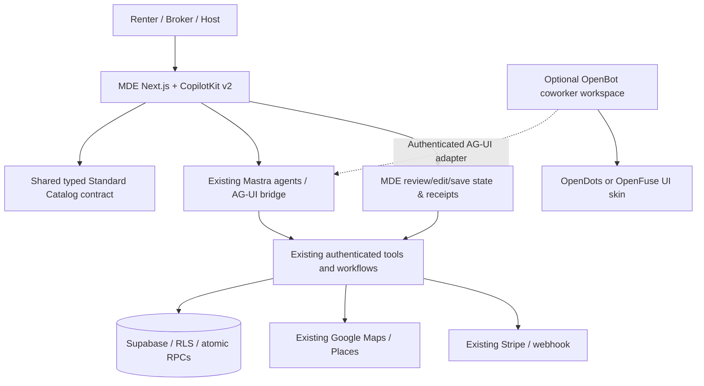

# MDE AI — Advanced AI and Future Systems

**Purpose:** Decide which advanced capabilities to adopt, how they improve actual MDE user journeys, and how to reuse **CopilotKit, OpenBot, OpenFuse and OpenDots** without another agent/search/database platform.

**Current phase:** **Phase A, prelaunch development.** It is valid to design, prototype, integrate and test advanced features **now** using the real MDE app and backend. No MVP completion, launch signoff, landlord ownership evidence, photo-rights paperwork, business approval, publication gate or rental eligibility is required to develop these features. Public-launch certification is a separate owner-initiated Phase B decision as defined in [AGENTS.md](AGENTS.md) and [mvp.md](mvp.md). Keep technical authentication, tenant isolation/RLS, audited privileged actions, accurate facts, safe payment testing and idempotency throughout.

**Ownership:** [prd.md](prd.md) defines user outcomes; [roadmap.md](roadmap.md) defines NOW/NEXT/LATER; [mvp.md](mvp.md) defines **future launch acceptance**, not a development freeze; [spec.md](spec.md) and [plan.md](plan.md) define the engineering workflow; [DESIGN.MD](DESIGN.MD) controls visual direction; Linear owns exact task titles/status. This file proposes **advanced options**, not an independent backlog, live checklist or new agent architecture. Earlier 28 May 2026 plan is preserved [as historical source](docs/_archive/root-advanced-2026-05-28.md).

## 1. Current baseline — verified against repository and upstream

- MDE uses **Next.js / React + CopilotKit v2 + AG-UI + Mastra + Supabase**, with Gemini for current product agents, real Google Maps/Places, and Stripe for ticketing. On the inspected 22 Nov 2026 main snapshot, `package.json` pins `@copilotkit/react-core` and `@copilotkit/runtime` to **1.88.0**; always recheck the target SHA before coding.
- Existing MDE browser-facing contract: `src/components/copilot/a2ui/mde-ui-catalog.tsx` extends official `standardUI`; the current app uses separate existing **Concierge** and **Host** CopilotKit providers, with a shared catalog contract rather than a shared private conversation. Some official controls/media remain deliberately omitted until real handlers exist.
- **OpenBot**, **OpenFuse** and **OpenDots** are CopilotKit-related upstream applications, **not currently verified as installed MDE product runtimes**. Do not claim their agent computers, memory, tasks, Slack or browser tools already work inside MDE merely because their repositories have demonstrations.
- The 2026 legacy rule *"no CopilotKit v2 migration until Mastra ships a bridge"* is **obsolete**: MDE already operates on CopilotKit v2; review actual installed APIs and existing Mastra transport. Older `plan/prd/*`, `tasks/MVP-REQUIRED.md`, `docs/advanced.md` and rigid W11/W19 schedules in the archived file are not active owners.

## 2. How the four products fit together

| System | Useful capability | Best MDE role | Adoption |
| --- | --- | --- | --- |
| **CopilotKit v2 + Standard Catalog** | Generative UI, reusable structured cards/forms/tables, typed UI actions and human-visible agent state | **Primary MDE product UI layer** for approved Rentals, Events, Places and operator journeys | **Use existing implementation now**; first complete [SAN-1675](https://linear.app/amo100/issue/SAN-1675) component contract and real page bindings |
| **OpenBot** ([official repo](https://github.com/CopilotKit/OpenBot)) | Optional workspace for agents, browser/files/computer work, routines, external AG-UI agents, activity/audit views | An **optional managed coworker experience** for brokers/operators, *not* a second MDE concierge or booking backend | Prototype via authenticated AG-UI adapter only if a use case exceeds existing Mastra workflows |
| **OpenFuse** ([official repo](https://github.com/CopilotKit/openfuse)) | Alpha personal-agent reference: visible browser/task plans, stop/continue, takeover, files and rich result cards across web/mobile | **UX/reference patterns** for long-running tasks, media/results and delegated research; can also be tried as the OpenBot OpenFuse skin | Reuse a small pattern or optional UI skin; no separate personal-agent database just to gain cards |
| **OpenDots** ([official repo](https://github.com/CopilotKit/OpenDots)) | Alpha persistent coworker template: role-specific Dots, editable Spaces/pages, review and save, connected apps | **Review → edit → save and reusable workspaces** for listing/event/partner preparation; optional OpenBot OpenDots skin | Complete existing [SAN-1555](https://linear.app/amo100/issue/SAN-1555) workflow; do not clone OpenDots data stores or backend |

**Important upstream update:** OpenBot now offers **OpenDots and OpenFuse as selectable UI skins** as part of its ecosystem, along with OpenDuet. To evaluate those experiences together, test **one OpenBot installation with skin selection**, not three separately deployed agent platforms. The community OpenDots/OpenFuse repos remain useful for studying UI/source implementation. Their readiness differs: OpenFuse and OpenDots explicitly describe themselves as alpha/template projects. Upstream repository readmes are capability references, not evidence of MDE integration.

**Cost / license note:** OpenBot's application template is MIT, but its CopilotKit Intelligence integration is **separately licensed**, including deployment/evaluation terms; OpenFuse Rich Threads and OpenDots conversations can require configured Intelligence. Evaluate actual run cost, infrastructure, model/tool billing, data handling and version compatibility before deciding to host OpenBot. Do not assume a free drop-in replacement for MDE's existing self-hosted CopilotKit runtime.

## 3. Architecture — reuse MDE instead of copying an AI agent stack

**Boundary rules:**

1. **One canonical MDE transaction owner.** An agent may prepare a listing change, request, event draft, reconciliation or follow-up, but only MDE's existing server action/Mastra tool/RPC commits the authorized operation. No parallel OpenBot booking, ticket or approval writer.
2. **MDE remains usable if OpenBot is offline.** A broker can view listings, manage viewings and save drafts; a renter can filter, inspect Details and request a viewing without an external coworker.
3. **Per-user identity must be real.** An optional AG-UI connection needs an authenticated user/agent mapping, server-side broker scope, explicit endpoint allowlist, least-privilege tools, audit trail, and readback. Never reuse one privileged OpenBot/Intelligence credential as all MDE users, or expose service role / secrets to a browser.
4. **Approval UI is a capability, not a Phase A business gate.** Support review/edit/ignore/accept patterns for consequential data edits, but **do not enforce landlord ownership/photo-rights/partner approval or booking/publishing paperwork prerequisites during development**. Required technical confirmations for destructive commands, external sends and financial operations remain.
5. **Separate history/stores.** Existing Mastra threads and Supabase own MDE conversations/records; external coworker histories require a measured integration and explicit data-retention plan. Avoid silently duplicating conversations, personal information, and model/tool costs.
6. **Official catalog first.** For MDE product UI, bind typed `Card`, `Table`, `Carousel`, `Form` and other installed components to actual app state and controlled actions. Register only supported components with real handlers; initial/empty/error pages work without waiting for an LLM turn.
7. **Truth/provenance:** source listing/place/event IDs and known coordinates/prices must resolve in the canonical service. The coworker can summarize a verified result, but cannot invent locations, payments, booking authority, ownership or a successful action.

## 4. Implementation strategy — the minimum incremental path

### Stage A — now: component-first MDE foundation

**Own existing issues; do not create duplicates:** [SAN-1675 · MDE AI — Map Official Standard Catalog Components to Existing Pages](https://linear.app/amo100/issue/SAN-1675), [SAN-1691 · EPIC · MDE Rentals — Playground GenUI: Create Listings, Discovery & Broker Dashboard](https://linear.app/amo100/issue/SAN-1691).

- Verify exact pinned SDK, source-backed component IDs, supported slots, `standardUI` omissions and agent-guide drift tests.
- Ship **one deterministic component-first working vertical slice**: card/map/Details → real typed action → API/database receipt. No new provider, search engine or agent backend.
- Preserve existing in-scope pages and handlers until real feature parity and 390px browser proof.

**Pass:** a user can complete the relevant MDE action with no AI turn; a generative response can additionally render the same source-backed facts without inventing or overwriting a newer human decision.

### Stage B — now/next: OpenDots-style reviewed actions and saved results

**Owner:** [SAN-1555 · MDE AI OpenDots — Map Editable AI Reviews and Saved Results to Existing Workflows](https://linear.app/amo100/issue/SAN-1555); optional cross-domain idea tracking [SAN-1550](https://linear.app/amo100/issue/SAN-1550).

- Use existing review proposal, version, draft and receipt contracts; let users edit suggested listing/event/partner fields, **Ignore** with no write, or **Save** exactly the edited values once.
- A longer research result may be a source-backed saved page/report *only* if a current MDE Saved/Trip/Host requirement benefits; otherwise keep it in the existing thread/workspace.
- Test stale suggestion versus newer user edit, duplicate replay, restart, unauthorized records, error recovery and user-visible readback.

**Pass:** real change once, matching receipt, no new approval subsystem or parallel OpenDots application.

### Stage C — optional: OpenBot AG-UI coworker pilot

**Owner if pursued:** [SAN-1328 · Put the Broker AI Coworker Inside the Existing Rentals Workspace](https://linear.app/amo100/issue/SAN-1328), and the cross-domain ideas epic [SAN-1550](https://linear.app/amo100/issue/SAN-1550).

**First use case:** broker asks “Review my pending viewings and prepare follow-up drafts.” Existing broker workspace shows each real scoped showing; optional coworker prepares the draft and displays real run status. It may not fabricate a send or create another appointment. Use a protected AG-UI endpoint/adapter and *read-only or mock external actions for first smoke*, then real authenticated MDE actions when explicitly supported.

Verify: one broker sees **only** their scoped records; another broker and guest cannot access them via endpoint, UI, replay or tool calls. Stop/retry/status reflect the actual external run. If the coworker is disabled, the original dashboard/viewing actions still succeed. Evaluate endpoint/session credentials, privacy boundary and separately licensed Intelligence before adopting production operations.

### Stage D — optional: OpenFuse-style delegated work UX

Borrow only proven helpful UI patterns: task plan → progress → grounded results → human takeover when needed → actual completion receipt. Example: an authorized operator asks for a neighborhood research brief grounded in Maps/Places and saved to a permitted MDE workspace. Do not start a second OpenFuse server/worker/storage merely for a plan panel. If an OpenBot skin already meets the visual goal, prefer its skin over a copy.

### Stage E — later: validated intelligence and new domains

Continue [roadmap.md](roadmap.md) NOW/NEXT/LATER: neighborhood comparisons and routing; trusted lead insights; host revenue/reconciliation; saved/trip continuity; optional multi-city scaling; optional guarded background monitoring. Use existing Mastra workflows, pgvector where benchmarked and canonical data. Introduce another agent or service only after a measurable deficiency in existing tools and a clear execution owner.

## 5. Actual acceptance checks (not an approval gate)

| Case | Decisive evidence |
| --- | --- |
| CopilotKit page without model | 390px/desktop renders grounded cards, empty/error and authorized primary actions |
| Catalog component action | Typed input resolves correct source ID and existing backend; no dead UI control |
| OpenDots-style edit/review | Ignore = 0 writes; Save = 1 accurate write; stale version rejected; readback proves result |
| OpenBot optional coworker | AG-UI status/run truth, Stop/Retry; authenticated scoped identity; fallback when unavailable |
| Secrets and isolation | Broker A/B and guest negative tests; no service-role or personal credentials in client/agent transcript |
| Long-running job | actual persisted run ID/status, bounded retry, cancellation, idempotency, audit and recoverable failure |
| External effects | no fabricated sends, payments, bookings, payouts or approval; privileged action authorized and traceable |
| Mobile and accessibility | 320/390/768, keyboard/screen-reader roles, focus/scroll and reduced motion |
| Implementation | exact commit SHA, focused tests, API/database receipts, matching CI/Playwright where applicable |

**Current proof status:** This document is a *plan*. Its existence does not prove OpenBot/OpenFuse/OpenDots deployed, connected or tested against MDE. The existing Linear issues and GitHub PRs retain progress and evidence. No special "MVP exit" or 30-day production soak is needed to **develop or test** an advanced feature now. Public-launch certification and potentially stricter business policies require the product owner's explicit Phase B decision.

## 6. Future capability shortlist — scoped by value, not artificial dates

| Area | Candidate | MVP/Advanced ownership |
| --- | --- | --- |
| Rentals | grounded neighborhood intelligence, editable rental requests, broker follow-up drafts, source-safe comparisons | Existing Rentals search, broker, CopilotKit and Mastra owners |
| Events | host revenue insights, check-in/ticket validation, refunds/reconciliation, optional sponsor matching | Existing Event/Ticketing and operator RPCs |
| Discovery/Trips | source-backed itinerary, saved context, researched place briefs and optional voice | Existing Saved/Trip/Places owners |
| AI workspace | optional OpenBot coworker run status, OpenDots-style saved results, OpenFuse-style task/takeover UI | Existing SAN-1550, SAN-1555 and SAN-1328 where scoped |
| Scale | evaluated personalized ranking/pgvector, multi-city configuration, new external channels | [roadmap.md](roadmap.md) only after measured need |

Use a source-verified Linear task before taking a candidate to implementation. **Do not treat a source example, optimistic roadmap date, upstream screenshot or unconfigured integration as working software.**

## 7. Official source links and maintenance

- [CopilotKit official Standard Catalog](https://docs.copilotkit.ai/generative-ui/components/standard-catalog) · [State/actions](https://docs.copilotkit.ai/generative-ui/components/state-and-actions) · [Surfaces](https://docs.copilotkit.ai/generative-ui/components/surfaces)
- [CopilotKit/OpenBot README](https://github.com/CopilotKit/OpenBot) · [OpenBot 1.0 integration and skins](https://www.copilotkit.ai/blog/openbot-whats-new) — AG-UI external agent bridge and OpenDots/OpenFuse/other skins. Check exact upstream revision before adapting its API.
- [CopilotKit/openfuse README](https://github.com/CopilotKit/openfuse) · [OpenBot integration boundary](https://github.com/CopilotKit/openfuse/blob/main/docs/OPENBOT-INTEGRATION.md) — reference implementation; its older version-specific details are **not** guaranteed compatible with a current OpenBot or MDE deployment.
- [CopilotKit/OpenDots README](https://github.com/CopilotKit/OpenDots) — reference template for persistent Dots, review/save and workspaces; also an OpenBot skin.
- MDE canonical [AGENTS.md](AGENTS.md) · [prd.md](prd.md) · [roadmap.md](roadmap.md) · [mvp.md](mvp.md) · [spec.md](spec.md) · [plan.md](plan.md); use current repository skills at `.claude/skills/{copilotkit,openbot,opendots,openmuse}/SKILL.md` if present.

**Historical source:** [28 May 2026 advanced roadmap](docs/_archive/root-advanced-2026-05-28.md) contains superseded OpenClaw/Hermes/Paperclip assumptions, stale documentation paths, rigid development weeks and the obsolete prohibition on CopilotKit v2 migration. Retain it as history, not execution instructions.
