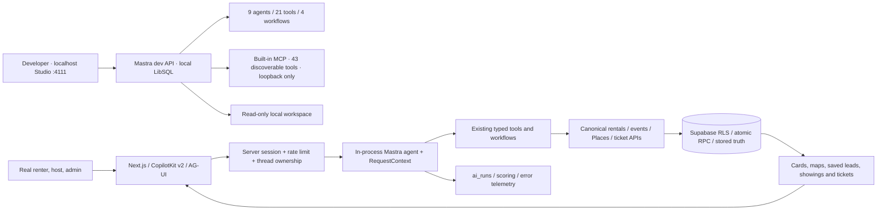

# MDE AI — Mastra Studio Live Audit, Defects, Scores & Fix Plan

**Verified:** 22 November 2026 · **Environment:** local Mastra Studio on `http://localhost:4111`, MDE's connected live Supabase checked *read-only* · **Git baseline:** clean `origin/main` at `0c3daf59afe84b0a8d8423cecb019b05ceee15a5` (Mastra Core 1.84.0).
**Related:** [Full platform audit](./02-MDE-Mastra-Platform-Audit-2026-11-22.md) · [Owner's full brief](./01-MDE%20AI%20%E2%80%94%20Complete%20Mastra%20Platform%20Audit-Improvements%20and%20Implementation.md). This live addendum corrects the older report's untested assumptions with actual Studio/browser/DB proof.
**Phase A:** Development-first. Never gate rentals, events, publishing, viewings or bookings on business ownership, photo permissions, publication status, moderation, approval, eligibility or launch certification. Keep authentication, operator authorization, RLS, real source facts, atomic transactions and idempotency.

## 1. Executive decision

**Keep the existing Mastra + CopilotKit v2 + Supabase platform.** All six Mastra Studio pages load after two small **local configuration/ignored-filesystem** corrections. Nine agents, 21 registered tools, four business workflows, 11 processors, one read-only workspace, and the built-in development MCP server are discoverable. The built-in MCP server answered a real JSON-RPC initialize call and listed **43** tool endpoints; a local Ping agent returned `PONG`, and local Rental/Event agents generated responses with tool calls.

**However:** page success ≠ grounded user-journey success. Three **verified code-path** problems in `src/mastra/tools/search-events.ts` affect event discovery and deserve the first product patch: backend outage incorrectly converted to no results; mixed USD/COP raw prices compared against a USD-only filter; and unconditional `published`+`is_active` filtering during development. One future draft/inactive event exists in the live DB and is filtered out. No source or live evidence supports installing a new agent system, extra vector DB, separate event search, global MCP integration, or dynamic business-workflow engine.

### Evidence and scores — what the percentages actually mean

| Measurable check | Outcome | Meaning / limitation |
|---|---:|---|
| Six Studio routes via Chromium, HTTP/browser console/API | **6/6 = 100% passed** | After fixes: Agents, Workflows, Tools, MCP Servers, Processors, Workspaces; not all underlying features tested |
| Core metadata APIs + package and MCP status endpoints | **9/9 HTTP 200** | Discovery contract; does not exercise each action |
| Real local Mastra agent generate requests | **3/3 HTTP 200** | Ping, rental, event; rental duplication UX still needs record-level analysis |
| MCP JSON-RPC initialize + tools/list | **2/2 HTTP 200** | 43 tools discoverable; no tool execution over MCP was attempted |
| Mastra Vitest, clean main | **1,203/1,203 executed tests passed; 46 skipped** | 100% of *executed* tests, not production correctness. 1,203/1,249 = 96.3% executed |
| `npm run check:mastra` | **PASS** | Local Core 1.84.0 and PG adapter 1.37.0, 36-table contract |
| ESLint, TypeScript | **PASS** | No new runtime code changes |
| Live DB Mastra security sample | **5/5 core tables verified** | RLS + FORCE RLS, no anon/auth SELECT privilege, service-role CRUD; does not cover every application policy |
| End-to-end viewing, venue approval, Stripe TEST paid ticket → QR | **Not tested in this pass** | No made-up pass percentage; scoped previous release QA is not full transaction certification |

**Engineering grades /100** below are *estimated audit judgments*, **not measured percent correct**. Rubric: runtime/discovery 30, technical safety 20, truthful product behavior 20, actual end-to-end proof 20, reuse/maintainability 10. Missing proof earns fewer points rather than an assumed pass.

| Component | Audit grade /100 | Why |
|---|---:|---|
| Agents | **84** | Nine load; Ping + Rentals + Events run. Cross-user privacy has previous release proof. Rental duplicate-address labels and full Concierge actions unproven |
| Tools | **66** | 21 discoverable, real tool calls, but event search has three concrete query/error defects and tool-by-tool authorizations not fully exercised |
| Workflows | **70** | Four registered; PG cold-start integration proof exists, yet venue live authorized suspend→resume-once + persisted action remains untested |
| MCP | **80** | Built-in JSON-RPC works, 43 tools; local server now loopback-only. No external MCPClient/curated MCPServer requirement or remote auth proof |
| Processors | **74** | 11 exposed with TokenLimiter, model-driven injection detector optional, bounded error tests; no paired p95/token/cost experiment |
| Workspaces | **88** | One deliberately read-only development workspace; missing optional directory fixed. No agent skill-instruction quality assessment |
| **Overall** | **77** | Rounded unweighted mean of the six grades. **Editorial engineering assessment, not 77% test success or launch readiness** |

## 2. Six Studio sections — live API and browser results

| Studio route | Actual API and discovery | Result / diagnosis |
|---|---|---|
| [Agents](http://localhost:4111/agents) | `GET /api/agents` → **9**: ping, router, rentals, Concierge, Events, evaluation, host-events, host-ops, partners | Browser & API pass. Direct Studio requests do *not* automatically reproduce production CopilotKit auth/context |
| [Workflows](http://localhost:4111/workflows) | `GET /api/workflows` → **6 API entries**: **four business workflows** plus `concierge-agent-input-processor` and `concierge-agent-output-processor` | Browser pass. Do not miscount processor workflows as extra business workflows |
| [Tools](http://localhost:4111/tools) | `GET /api/tools` → **21** registered tools | Browser pass. Listings, events, places, broker/host and viewing-proposal tools have distinct caller security requirements |
| [MCP Servers](http://localhost:4111/mcps) | `GET /api/mcp/builtin` reports `enabled:true`, `readOnly:false`, `auth:{type:"open",devOnly:true}`; no custom server registered | Browser pass. **Built-in Mastra MCP exists**, but no independent external-provider MCP integration; don't install or duplicate one just to fill Studio |
| [Processors](http://localhost:4111/processors) | `GET /api/processors` → **11**, including Token Limiter and ten intent/selection/error processors | Browser pass. Model-based injection detection is intentionally opt-in, not automatically missing |
| [Workspaces](http://localhost:4111/workspaces) | `GET /api/workspaces` → **one read-only** workspace; initial `GET /fs/list?path=.agents/skills` 404; after creating absent ignored local directory → **200** | Browser now passes without console errors. Workspaces are not a general shell/agent permission grant |

**Studio setup:** `http://localhost:4111` with API prefix `/api`. Mixing `127.0.0.1` in the address bar with a Studio API URL of `localhost` previously failed credentialed CORS. Keep the two hostnames consistent. Official setup: https://mastra.ai/docs/studio/overview.

### Real local agent smoke tests

| Agent | Prompt | HTTP | Duration | Result and caveat |
|---|---|---:|---:|---|
| Ping | "Please reply only with PONG" | 200 | 0.8s | Exact `PONG`; model and runtime actually executed |
| Rental | Furnished two-bedroom Laureles under COP 3M monthly | 200 | 7.2s | Returned two rows with same displayed street address and COP 2.4M monthly. Live DB has **seven 2BR Laureles rows with seven distinct IDs but four addresses**; identical address is not proof of duplicate row. Must include distinct canonical IDs/labels before classifying a duplicate |
| Events | Medellín live music Nov 28–29, 2026 | 200 | 8.4s | Agent correctly reported no matching event. Live DB aggregate: **zero events of any status** in that exact weekend. This specific empty result is **not** a defect |

**Security interpretation:** This Studio was started with `MASTRA_DEV_LIBSQL=1`; local conversations/workflow writes use isolated LibSQL. Search tools can still connect to the configured real Supabase service; they must not be used as evidence of production end-user authorization. The real application path remains Next.js `/api/copilotkit` → verified user/thread context → Mastra tools → existing domain RPC. This pass did not create a lead, event, payment or ticket. No production database mutations were performed.

## 3. Architecture and honest boundaries



**Important:** Mastra Studio's directly callable tool/agent endpoints are a **developer control surface**, not a replacement for the authenticated public CopilotKit runtime. The official Mastra Studio docs explicitly say that without `server.auth` the Studio and API are open. The built-in MCP development endpoint has Origin/Host protections, but an open Studio should still **stay loopback-only** or use authenticated transport. The current development server was restarted with `MASTRA_HOST=localhost`, and `ss -lntp` now confirms `127.0.0.1:4111` rather than `*:4111`.

## 4. Forensic findings — ordered by real product impact

| Severity | Source / verified root cause | Symptom and reproduction | Smallest canonical correction | Evidence classification |
|---|---|---|---|---|
| **P1** | `src/mastra/tools/search-events.ts:354–358,388–393` returns empty `source:'fallback'` without error on missing client/query failure | **Agent replies** can mistake a failed query for “no events found” because no explicit error reaches the agent. **Events result cards already identify empty fallback as a search error** (`src/components/copilot/search-tool-result-cards.tsx:723–724`); they are not indistinguishable from genuine zero matches | Propagate explicit safe `unavailable` from the existing tool to agents and consumers, preserving current card error UI. Test null client/query 401/503 versus successful zero rows separately | **Proven agent-path contract defect**, not a verified production outage; card UI already handles fallback |
| **P1** | `src/mastra/tools/search-events.ts:380–381,408` documents `maxPricePerTicket` as USD, but SQL compares it with the event's raw `ticket_price_min`, regardless of stored currency | “Under $30” can silently exclude COP events or compare quantities in different denominations; do not invent FX conversion | Use an explicit amount **and currency** contract, bound to `events.currency`; compare only like-for-like source values; alternatively return incomparable results with an honest budget note. Hydrated ticket tiers remain the price authority | **Proven schema/query mismatch**; live DB **32 USD, 19 COP** including lowercase `cop` |
| **P1** | `src/mastra/tools/search-events.ts:361–367` unconditionally filters `is_active=true` and `status='published'`; related event search paths in `src/lib/events/list-published-events.ts` and `get-public-event.ts` | A Phase A developer may create a draft/inactive event and not find it via discovery; this is a business publication gate, not a security boundary | Decide one **server-controlled Phase A event visibility predicate** in the existing domain/service/SQL owner, reuse in event search, Cards, Details and AI; avoid exposing another user's private data. Phase B must be explicit owner activation, not `NODE_ENV` | **Proven exclusion in fallback query**; live DB has **1 upcoming draft inactive** versus **2 upcoming published active**. Intelligent path must also be checked before declaring all query paths fixed |
| **P2** | Direct `rental-agent` response displayed twice the same address and price for a 2BR Laureles query | User can mistake same street label for duplicate listing or identical properties | Resolve each result by canonical listing ID and add a differentiating label (`also listed as #N` / unit / source) to its model context and UI; **do not** collapse distinct records by address | **Observed presentation ambiguity**, not a duplicate-ID DB defect: 7 distinct IDs / 4 addresses among matching 2BR Laureles rows |
| **P1 local security** | Dev server originally bound `*:4111` with `GET /api/auth/capabilities` returning `enabled:false` and built-in MCP `auth.type='open'` / `readOnly:false` | Developer control surface may be reachable from network peers if firewall permits; port reachability was not independently tested from another computer | **Fixed locally:** restart with `MASTRA_HOST=localhost` and keep Studio on `http://localhost:4111`. Require `server.auth` and explicit authorization if Studio ever deliberately becomes shared. Never expose unrestricted MCP tool execution as public app auth | **Confirmed unsafe listening configuration; corrected**, now `127.0.0.1:4111` |
| **P3 local UX** | Studio probes `.agents/skills` but `workspace/.agents/skills` directory did not exist | Workspaces page loaded but emitted API HTTP 404 and browser console error | **Fixed locally:** create missing ignored optional directory under the *read-only workspace's backing files*. Do not turn on agent write or sandbox tools | **Reproduced 404 → 200**; six pages now clean |
| **P2 developer diagnostics** | Mastra CLI 1.40 `local-pkg.getPackageInfo('@mastra/core')` resolves to an **unrelated ancestor** `/home/sk/node_modules/@mastra/core` at **1.82.0**, instead of project-installed **1.84.0** | CLI startup prints peer-mismatch; `/api/system/packages` and Studio footer display 1.82.0 while project lockfile/module package show 1.84.0 | Avoid `npm add @mastra/core@latest`. Verify installed path directly in the project and report vendor package-resolution issue; consider a focused pinned upstream CLI correction. Do not edit checked-in dependencies merely to silence false metadata | **Reproduced metadata-resolution defect**. This does **not** establish the actual compiled runtime uses 1.82.0 |
| **P2 recovery risk** | `src/lib/events/start-admin-review-workflow.ts:29,48–50` resumes a literal `suspend-for-admin-review` | Renamed/nested suspended step could become unresumable; no such failure presently reproduced | Inspect saved run with installed `createWorkflowStateReader(state).getSuspendedStep()?.path` before resuming; keep authorized operator/booking binding + exactly-once persisted decision | **Proven hardcoded step**, risk until future workflow shape or regression test reproduces |
| **P2 missing capability** | `src/mastra/workflows/event-venue-booking-workflow.ts:119–139` notification step always returns `notified:false` | A user cannot rely on an admin notification even if the workflow completes | Either surface “Not notified” or wire the **existing** domain notification/outbox service with idempotent delivery and delivery receipt; no extra workflow subsystem | **Confirmed stub**; owner unverified |
| **P2 concurrency risk** | `src/mastra/lib/agent-memory.ts:65–86` uses a process-local lock for thread working-memory updates | Two server instances could race preference set/clear; newest user decision may lose | Start with a **two independent process** failure/reproduction using disposable Postgres. If observed, adopt generation/compare-and-set on canonical memory store; preserve thread ownership | **Code-backed design limitation**, production failure not reproduced |
| **P3 measurement gap** | `GET /api/system/packages` reports `observabilityEnabled:false` and local LibSQL store lacks metric/trace-query capabilities | Studio Metrics/Traces cannot be used as authoritative p95/provider-cost evidence in this local setup | Reuse application's existing run logs and two registered faithfulness/grounding scorers; instrument actual Next.js requests under verified user context, never enable new provider export by default | **Verified local capability gap**, not broken production observability |

### Security/correctness invariants

- **Local MCP:** `POST /api/mcp` JSON-RPC `initialize` and `tools/list` both HTTP 200; listed **43 tools**. This is *discovery*, not authorization/functional success for those 43 operations. Official docs: https://mastra.ai/docs/server/mcp. Local default auth is open; DNS-rebinding Host/Origin defense is additional protection, not a replacement for localhost binding.
- **Live database:** `36` Mastra tables; `776` threads, `2,281` messages, `138` legacy snapshots; journal runs/entries `0` at inspection time. Journal and profile-role migrations recorded. Five sampled tables (`mastra_threads`, `mastra_messages`, `mastra_workflow_snapshot`, `mastra_workflow_runs`, `mastra_workflow_run_entries`) have RLS + FORCE RLS and deny direct `anon`/`authenticated` SELECT while server role holds CRUD. **Do not replay journal migration** from merged PR #917.
- **Studio vs end-user:** Studio requests to `/api/agents/.../generate` do not prove the server's public user session or actor privileges. The in-process CopilotKit route at `src/app/api/copilotkit/[[...path]]/route.ts:224–323` authorizes the thread, scopes `MASTRA_RESOURCE_ID_KEY` and checks rate limits. Keep testing wrong-user access, failed actions, idempotency and last-write-wins separately.
- **Source truth:** A generated row, model text or an HTTP 200 from a workflow is **never** a receipt for lead/showing, venue booking, paid ticket or webhook. Existing server routes/RPCs own writes, and retries must not duplicate persisted effects.
- **Workspaces:** The local filesystem is explicitly read-only (`src/mastra/workspaces.ts:24–32`) and not inherited by Vercel production (`:44–48`). Do **not** solve an absent optional skills directory by enabling code execution or write permissions.
- **Processors:** `TokenLimiter` and output/intent processors are registered. `PromptInjectionDetector` remains configurable. Evaluate latency/false positives before forcing model-driven filtering on all requests. Trust server auth and schema/RLS for consequential tools.
- **Phase A:** Source-backed development records may be discoverable and actionable even without business approvals or publication flags. Keep provenance and unknown availability truthful; deny unauthorized *outside* access.

## 5. Existing verified Linear ownership and PR status

Checked live on 22 November 2026. Keep exact task ownership; **do not create duplicate issues**.

| Priority | Verified Linear task | Current status | Evidence / recommended next action |
|---|---|---|---|
| P1 | [SAN-125 · EVT-007 — eventDiscoveryWorkflow (Mastra)](https://linear.app/amo100/issue/SAN-125) | Backlog | Registered event discovery workflow **not missing**; use the existing event owner to fix `search-events.ts` failure/status/currency predicates and prove same IDs across tool→workflow→UI |
| P1 | [SAN-1502 · MDE Rentals — Enable Full Development Journeys and Defer Real-World Approval Gates](https://linear.app/amo100/issue/SAN-1502) | In Progress | Reuse existing Phase A setting and apply the development/no-business-gate decision to event discovery via canonical owner without cross-tenant leaks |
| P1 | [SAN-755 · MDE QA — Prove AI Rental Search, Map, Details, and Viewing End-to-End](https://linear.app/amo100/issue/SAN-755) | In Progress | Rental direct Studio result contained address ambiguity; validate canonical IDs, cards, map, Details and one saved lead+showing |
| P1 | [SAN-305 · MDE Venues — Prevent Duplicate Venue Booking Requests](https://linear.app/amo100/issue/SAN-305) | Todo | Existing proposal tool never writes booking; verify confirm→one server transaction and two retries→one record |
| P2 | [SAN-1299 · EPIC · Make MDE AI Chats, Memory, and Workflows Reliable in Production](https://linear.app/amo100/issue/SAN-1299) | In Progress | Two-process working-memory race/clear test; do not add a second memory engine |
| P2 | [SAN-754 · MDE QA — Prove Host AI Event Draft, Review, and Publish End-to-End](https://linear.app/amo100/issue/SAN-754) | Backlog | Create/update/publish and stored result using existing UI/API; no Phase A business approvals required |
| P2 | [SAN-856 · See What Every AI Request Cost, How Long It Took, and Where It Failed](https://linear.app/amo100/issue/SAN-856) | Todo | p50/p95, TTFT, tool/LLM error, model token/cost from actual existing telemetry |
| P2 | [SAN-1395 · Check Live Chats for Made-Up Claims Using the Quality Checkers We Already Built](https://linear.app/amo100/issue/SAN-1395) | Backlog | Extend already registered faithfulness/grounding scorers to the versioned corpus |
| P2 | [SAN-1386 · EPIC · Mastra Upgrade — Upgrade MDE Without Losing Chats or Breaking Workflows](https://linear.app/amo100/issue/SAN-1386) | In Progress | Upgrade was merged; finish bounded end-to-end proof, no further unpinned upgrades |
| Completed | [SAN-1698 · MASTRA-UPG-002 — Upgrade MDE to Mastra 1.84](https://linear.app/amo100/issue/SAN-1698) | Done | [PR #909](https://github.com/amoai-tech/mdeai/pull/909) already merged. Local CLI metadata bug is not proof of an application downgrade |
| Completed | [SAN-881 · VEB-MVP-010 · OPS-PERSIST — Verify Mastra Postgres workflow suspend durability](https://linear.app/amo100/issue/SAN-881) | Done | Preserve existing CI cold-start integration; live authorized venue decision remains separate proof |

**Documentation PR:** [#925](https://github.com/amoai-tech/mdeai/pull/925) is open; this addendum belongs on its existing docs branch, not a new audit-only PR. **Do not merge without normal review and CI.**

## 6. Smallest ordered implementation plan — Core before Advanced

**Priority score /100** is an *estimated implementation order*, **not a success rate**. Weighting: user-visible impact 30, confirmed evidence 25, security/transaction risk 20, existing-code reuse 15, estimated effort 10. These are estimates for sequencing; verify new task ownership against the exact Linear issue before changing code.

| Priority /100 | Fix | Existing canonical owner / likely files | Success criterion |
|---:|---|---|---|
| **98** | Distinguish Events provider failure from genuine empty catalog | `src/mastra/tools/search-events.ts`; existing `rental-search-unavailable.ts` pattern; Events & Concierge user-visible fallback | Inject Supabase 401/503/null → honest error; empty database → valid empty; no false “no events” after provider outage |
| **96** | Correct event ticket budget currency | `search-events.ts` input + filter; existing event tier hydration; Events page filter schema | $25 USD does **not** silently compare to COP 80,000; COP 100,000 selects only COP-priced rows; no invented FX; price card equals canonical tier |
| **94** | Remove Phase A event publication/discovery blockers at canonical owner | `search-events.ts`, existing event search service/RPC and public event Details visibility; current server-controlled development phase | Existing draft/inactive **development** event can be searched, mapped and opened by authorized dev user with truthful status; unrelated private tenant record not exposed; Phase B publication rule not activated |
| **90** | Maintain loopback-only local Studio | Existing `dev:agent` / dev startup env, `MASTRA_HOST=localhost`; optionally a small scoped script change | `ss -lntp` shows 127.0.0.1:4111; all six Studio routes/browser/API pass; remote deployment never enables open dev MCP |
| **86** | Prove full rental→viewing action with canonical IDs | Existing Rental tool, CopilotKit renderer and `SAN-755` | User gets grounded distinct cards → Details → scheduled request → exactly one persisted lead+showing→correct broker; retry & wrong-user denial |
| **84** | Distinguish same-address rental candidates | `src/mastra/agents/rental-agent.ts` and existing cards/detail lookup/duplicate-title labels | Two distinct IDs with identical address display distinguishable descriptors; never falsely dedupe or falsely label ownership |
| **81** | Venue review resumability and once-only action | `src/lib/events/start-admin-review-workflow.ts`, existing venue workflow + atomic booking API | Persist → restart server → resume using stored suspended step once; second resume cannot duplicate booking/notification |
| **78** | Evaluate two-process working-memory ordering | `src/mastra/lib/agent-memory.ts` + existing PG test harness | Parallel set/clear same thread; latest preference wins with authorization. Change canonical store only on reproduced failure |
| **72** | Calibrated quality, latency and costs | Existing `ai_runs`, scorers, `SAN-856` and `SAN-1395` | Fixed corpus, p50/p95, TTFT, wrong-tool, unknown-fact, token and provider-cost distributions before/after |
| **25** | New global MCPServer, supervisor, ToolSearchProcessor, Knowledge alpha, duplicate database | **No owner; do not implement now** | Only reconsider on measurable unmet use case and verified compatible pinned exports |

**Recommended workflow:** reproduce one real failure → fix one existing tool/service/RPC → add focused tests → run Mastra tests, typecheck and lint → verify one full user journey + security/idempotency → only then open a focused implementation PR and update the existing Linear task. **Do not add a new agent, database, booking subsystem, vector index, or MCPServer.**

## 7. Test cases and acceptance criteria for a code-fix PR

| Test | Expected result | Where to assert |
|---|---|---|
| Supabase event query succeeds with zero rows | Explicit empty state, `source:'supabase'`, no invented results | `src/mastra/tools/__tests__/*search-events*` |
| Supabase missing, 401, 503 or network timeout | Typed unavailable/error state; AI says “search temporarily unavailable”, not “no events” | Existing tool + Events/Concierge agent error tests |
| USD 25 ticket budget with mixed USD/COP inventory | Apply USD predicate only to USD prices (or documented currency conversion if real FX source exists); no COP numeric comparison | Event tool SQL/unit test with both currencies |
| COP 100,000 ticket budget with COP rows and tier prices | Compare COP amounts to COP amounts; source currency preserved; no claim of ticket availability without sellable tiers | Event tool + `hydrateEventTicketOffers` and canonical event ticket tier tests |
| Phase A development draft/inactive event | Authorized developer sees it without a business publication gate and its `draft`/development status is truthful | Existing event discovery API + renderer + read-only SQL |
| Wrong user/organization tries to read a private draft | Denied by **technical** auth/RLS; not by a broad business-publishing rule | Authenticated API/browser negative test |
| Two same-address rental records | Distinct canonical IDs, distinct labels and correct Details links; no duplicate lead on retry | Rental-agent/Concierge card + Playwright + persisted DB |
| Two simultaneous booking confirmations | Exactly one authorized booking/lead/ticket and correct audit record; idempotency keys work | Existing domain RPC and webhook/booking integration tests |
| Suspended venue run recovered after process restart | Stored run resumes correct step with authorized actor and exactly one state transition | Disposable PG workflow test, authorized QA browser |
| Local Studio + MCP smoke after a developer restart | 6/6 browser routes; 9 agents, 21 tools, 4 business workflows, 11 processors, 1 workspace; MCP metadata + handshake; port only loopback | Playwright + harmless `curl` + `ss` |
| CopilotKit end-user tenancy | User A's thread never visible/executable to User B; Stop/stream respects cancellation | `/api/copilotkit` signed-in QA, 390px mobile + DB requery |

**Executed in this audit:** `npm run check:mastra` PASS; `npm run test:mastra` **1,203 pass / 46 skipped / 0 fail**; `npm run lint` PASS; `npm run typecheck` PASS; real local browser six-page check PASS; local Ping/Rental/Events agent generation HTTP 200; MCP initialize + tools/list 200; Supabase aggregate/schema checks read-only. This is **not** an `npm run floor` acceptance for future code changes because no tracked product code changed in this audit. The next implementation PR must run Floor on its exact final head.

### Read-only verification commands

```bash
# Run Studio safely from the actual pinned MDE checkout
MASTRA_HOST=localhost MASTRA_DEV_LIBSQL=1 npm run dev:agent

# Same origin for Studio and API (do not mix 127.0.0.1 with localhost)
curl -fsS http://localhost:4111/api/agents
curl -fsS http://localhost:4111/api/workflows
curl -fsS http://localhost:4111/api/tools
curl -fsS http://localhost:4111/api/processors
curl -fsS http://localhost:4111/api/mcp/builtin

npm run check:mastra
npm run test:mastra
npm run lint
npm run typecheck
```

Do not apply migrations merely because Studio has empty journal tables. Do not use an unscoped, auth-disabled Studio endpoint as a production end-user API. Never send a service-role secret to the browser. The local version UI's **1.82.0** is a *wrong CLI resolution receipt* when the installed project is **1.84.0**, not justification to run `npm add @latest`.

## 8. Official sources — adaptation decisions

| Official source | What it establishes | Decision for MDE |
|---|---|---|
| https://mastra.ai/docs/studio/overview | Studio local `localhost:4111` setup; agents, workflows, tools, MCP, processors, workspaces | **REFERENCE ONLY**; existing CLI/Studio is already correct |
| https://mastra.ai/docs/studio/auth | Without `server.auth`, Studio and API routes are open; one auth setting protects both | **ADAPT** only if Studio is shared; for local dev, bind loopback |
| https://mastra.ai/reference/configuration#serverhost | `server.host`/`MASTRA_HOST` and dev bind address | **ADAPT** into local launcher; verify `ss` and Chromium |
| https://mastra.ai/docs/server/mcp | Built-in `/api/mcp` per-caller tools, dev Origin/Host checks, auth requirements | **KEEP existing built-in**; no new MCPServer; test initialize and tools/list |
| https://mastra.ai/docs/agents/overview | Agent registration + tools and prompt selection | **REFERENCE ONLY**, pinned Mastra Core 1.84 |
| https://mastra.ai/docs/workflows/suspend-and-resume | Recover run and suspended step | **ADAPT** state-reader in existing venue helper only if regression proof |
| https://mastra.ai/docs/agents/processors | Input/output processors and guardrails | **MODEL** controlled false-positive and latency benchmark; no blind additions |
| https://mastra.ai/docs/sandbox/overview | Workspace filesystem vs local sandbox; local command execution is unsafe when unisolated | **KEEP read-only workspace**, never add local sandbox just to populate Studio |
| https://docs.copilotkit.ai/integrations/mastra/quickstart | CopilotKit v2 Mastra AG-UI bridge, `identifyUser`, thread-scoped `resourceId` | **REFERENCE ONLY**; MDE uses the existing in-process authenticated route rather than duplicating a separate server |
| https://supabase.com/docs/guides/api/securing-your-api | Data API, table grants, RLS vs app authentication | **KEEP RLS and private server credentials**; independent wrong-user proof |
| https://github.com/mastra-ai/mastra | Upstream source: `local-pkg`-based package version discovery and modern MCP tool registry | **REFERENCE ONLY**; do not copy upstream `main` over pinned package |

The Mastra documentation and GitHub `main` may describe newer APIs than installed `1.84.0`. Before implementing any change, verify the exact installed exports/types, package-lock and current source/CI. Firecrawl, Mastra Docs, Context7 and CopilotKit Docs were used for current independent references; the live repo, browser and Supabase evidence take precedence for current MDE behavior.

## 9. What changed now vs what remains

**Changed now, verified:**
1. Restarted the running local Mastra Studio with `MASTRA_HOST=localhost` (no tracked code changes). The server now binds `127.0.0.1:4111`; all six browser routes and metadata APIs pass.
2. Created the previously absent ignored local `workspace/.agents/skills` folder. Workspaces API probe changed from 404 to 200, no newly granted filesystem writes; the folder is intentionally not committed.
3. Exercised the local Ping/Rental/Events agents and the built-in JSON-RPC MCP read-only metadata path; verified read-only Supabase aggregates and permissions, installed package versions, existing tests and official references.
4. Added **this audit document** in the existing documentation review branch and synchronized it to the owner's local `docs/mastra/plan` directory. No production DB, listing, payment, model, booking or publication changes were made.

**Not changed yet:** the event discovery error contract, currency-aware budget, Phase A visibility logic, venue notification stub/resume step, and cross-process memory. They require focused code/testing PR(s) and independently verified end-to-end truth. They are **not** automatically fixed by a correct Studio UI.

**Next smallest action:** Take the existing event discovery owner (`SAN-125`), reproduce one P1 source/error case with a focused unit test, fix `src/mastra/tools/search-events.ts` and any shared canonical event visibility owner, then test the actual Events/Concierge API, page, source-backed cards and live development draft access while preserving private-data isolation. The docs-only PR should not be mislabeled as feature implementation.
