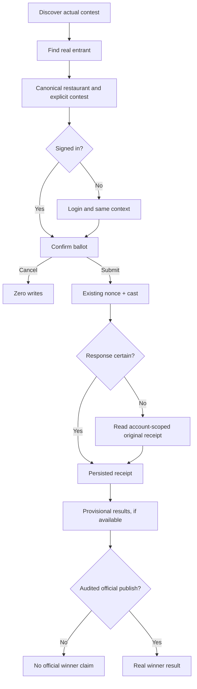

# Restaurant Contest UX — premium, responsive, source-backed

Owner: [SAN-1467 · MDE Restaurants Contest — Design Contest Wireframes and Mobile States](https://linear.app/amo100/issue/SAN-1467)  
Artifact: design specification, **NOT a shipped feature**. As of October 16, 2026.

## Rules and sources

- Use current `src/app/globals.css` and [canonical design system](../../../design-system.md), not outdated dark-first `DESIGN.MD`. MDE is **light-luxury** with slate backgrounds, teal interaction and restrained gold for AI/rating cues; all typography sans.
- Current app has `/restaurants`, `/restaurants/[id]`, search, maps and secure votes. The restaurant contest/leaderboard public pages are proposed work. Current live data: one **expired DRAFT DEV smoke** restaurant contest with one Carmen entrant, no restaurant category entries, and a separate pageant. **Never manufacture contests, photos, ranks, votes or winners.**
- One authenticated **account** ballot per contest, not one uniquely verified person per category. Missing contest identity must not silently choose an arbitrary ballot. Keep Phase A business eligibility/approval/ownership paperwork deferred while preserving auth, RLS, truthfulness, idempotency and audit.
- Reuse current `RestaurantCard`, `BrowseMapPanel`/MapContext, `RestaurantVotePanel`, Next.js pages and installed shadcn/Base UI components. No second AI agent, vote engine, map context, design system or tally SQL.

## Screens to build (real data only)

### A. Contest landing — SAN-1524

```text
DESKTOP
┌────────────────────────────────────────────────────────────────────────┐
│ MDE nav     Restaurants   Contests   My Votes   Chat                  │
│ Concursos gastronómicos de Medellín         [Explorar restaurantes]  │
│ Clear one-line intro and REAL contest/phase status                  │
│ [Activos] [Próximos] [Finalizados]                                   │
│ [sourced cover / neutral fallback][actual contest/date][Ver]        │
│ NO CURRENT CONTEST? “Concursos en preparación” + restaurant CTA       │
└────────────────────────────────────────────────────────────────────────┘

390px PHONE: stacked title/action → horizontally scrollable status filters →
single 4:3 source-photo or placeholder contest card → View details.
```

### B. Contest nominees, map and filters — SAN-1524/1468

```text
1440: [Contest title · method · rules]  [Filter: cuisine/neighborhood]
      [real restaurant card] [real restaurant card] | existing map/pins
      [Ver restaurante] → /restaurants/[uuid]?contest_id=[real UUID]
390:  [Contest title][List/Map] → one card/row, map in existing sheet
```

Use `vote.entities.restaurant_id` joined to `public.restaurants` and actual contest scope. If coordinates absent, omit pin; map outage never blocks cards. No pageant entrants in restaurant list.

### C. Canonical restaurant details → vote — SAN-1469 (existing)

```text
[Actual restaurant photo/fallback][Name · Area · Cuisine]
[Contest name/status] [Ver mapa if data] [Votar if actual entry]
Guest → login → return to original restaurant AND contest
Signed in → “¿Confirmas tu voto?” [Cancelar] [Confirmar voto]
```

Never silently cast from card/AI; cancel does zero writes. Existing nonce/cast/receipt path remains authoritative.

### D. Persisted receipt / vote history — SAN-1469/1525

```text
“Tu voto quedó guardado” only after confirmed DB COMMIT or receipt recovery
[Actual restaurant] [Exact contest] [Saved timestamp/reference]
[Mis votos] [Volver al concurso]
After lost network response: “Comprobando si se guardó…” → recover,
not “nothing saved” or an automatic duplicate ballot.
```

Authenticated user can read only own receipt. No unsupported change-vote action.

### E. Provisional leaderboard versus audited winner — SAN-1470

```text
[Contest selector] [PROVISIONAL/DEV label] [As-of time] [How counted]
[Real restaurant image/name/cuisine] [Accepted FREE audience count if visible]
[Ver restaurante]   Equal ranks only if canonical SQL confirms a tie.
No results/hidden? Honest empty/message, NOT mock rankings/podium.
Official winner ONLY after SAN-1474 audited publication.
```

Current smoke restaurant has legacy rank=1 with 0 audience votes — do not present as a winner. SAN-1497 owns accepted-vote SQL and test-ballot exclusion.

## Responsive and interaction contract

- Layout: 390px one column and full-width detail/map sheet; 768px list/map switch; 1024px readable grid; 1440px cards + optional map. Maintain one consistent primary CTA per card and readable 16px body; display 30–36px phone title, 44–52px desktop title.
- Main buttons target ~44×44px. WCAG 2.2 AA minimum is **24px or adequate spacing**, not 44px. Visible focus, keyboard Tab/Enter/Escape, reduced motion, readable light/dark contrast and status expressed without color alone.
- Stable 4:3 image dimensions, correctly sourced venue media, ordinary neutral fallback if missing. Never disguise unrelated generic photos as a restaurant's signature dish.
- Every screen: loading skeleton, true empty state, API failure/retry, no photo, no coordinates, unauthorized state where applicable; returning from detail restores selected card/filter/scroll.
- Do not present unsupported restaurant prices, hours, user-verified identities, award methods or available reservations as facts.

## Mermaid — user journey



## Reuse owners and acceptance

- [SAN-1524](https://linear.app/amo100/issue/SAN-1524): landing, contest detail, category/entrant navigation and source-backed empty state.
- [SAN-1468](https://linear.app/amo100/issue/SAN-1468): reuse canonical restaurant card/MapContext, no fake pin or new map.
- [SAN-1469](https://linear.app/amo100/issue/SAN-1469), [SAN-1525](https://linear.app/amo100/issue/SAN-1525): auth/confirmation/one persisted receipt/second-device recovery.
- [SAN-1497](https://linear.app/amo100/issue/SAN-1497), [SAN-1470](https://linear.app/amo100/issue/SAN-1470), [SAN-1474](https://linear.app/amo100/issue/SAN-1474): accurate accepted-free SQL, provisional screen, published audited winner respectively.

Done for SAN-1467 when: five responsive wireframes, real-data copy/state contract, keyboard/390/768/1024/1440 review screenshots and source-verified handoff are linked. This document alone **does not certify** working UI.

## Official references incorporated

- Responsive layout [web.dev design](https://web.dev/learn/design/) — **MODEL** fluid layouts in current Tailwind, verify 4 viewports.
- Image sizing [Next.js Image](https://nextjs.org/docs/app/api-reference/components/image) — **ADAPT** existing image/placeholder, verify zero layout shift.
- Accessible touch target [WCAG 2.2](https://www.w3.org/WAI/WCAG22/Understanding/target-size-minimum) — **REFERENCE/ADAPT** existing buttons, verify keyboard and target size.
- Dialog behavior [WAI APG](https://www.w3.org/WAI/ARIA/apg/patterns/dialog-modal/) — **REFERENCE ONLY** for current dialog, verify focus return/escape.
- Browser viewport [Playwright projects](https://playwright.dev/docs/test-projects) — **MODEL** test project setup in current `playwright.config.ts`.
