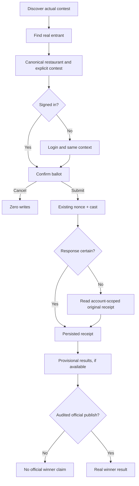

# Restaurant Contest UX — premium, responsive, source-backed

Owner: [SAN-1467 · MDE Restaurants Contest — Design Contest Wireframes and Mobile States](https://linear.app/amo100/issue/SAN-1467)
Artifact: design specification, **NOT a shipped feature**. As of October 16, 2026.

## Rules and sources

- Use current `src/app/globals.css` and [canonical design system](../../../design-system.md), not outdated dark-first `DESIGN.MD`. MDE is **light-luxury** with slate backgrounds, teal interaction and restrained gold for AI/rating cues; all typography sans.
- Current app has `/restaurants`, `/restaurants/[id]`, search, maps and secure votes. The restaurant contest/leaderboard public pages are proposed work. Current live data: one **expired DRAFT DEV smoke** restaurant contest with one Carmen entrant, no restaurant category entries, and a separate pageant. **Never manufacture contests, photos, ranks, votes or winners.**
- One authenticated **account** ballot per contest, not one uniquely verified person per category. Missing contest identity must not silently choose an arbitrary ballot. Keep Phase A business eligibility/approval/ownership paperwork deferred while preserving auth, RLS, truthfulness, idempotency and audit.
- Reuse current `RestaurantCard`, `BrowseMapPanel`/MapContext, `RestaurantVotePanel`, Next.js pages and installed shadcn/Base UI components. No second AI agent, vote engine, map context, design system or tally SQL.

## Screens to build (real data only)

### A. Contest landing — SAN-1524

```text
DESKTOP
┌────────────────────────────────────────────────────────────────────────┐
│ MDE nav     Restaurants   Contests   My Votes   Chat                  │
│ Concursos gastronómicos de Medellín         [Explorar restaurantes]  │
│ Clear one-line intro and REAL contest/phase status                  │
│ [Activos] [Próximos] [Finalizados]                                   │
│ [sourced cover / neutral fallback][actual contest/date][Ver]        │
│ NO CURRENT CONTEST? “Concursos en preparación” + restaurant CTA       │
└────────────────────────────────────────────────────────────────────────┘

390px PHONE: stacked title/action → horizontally scrollable status filters →
single 4:3 source-photo or placeholder contest card → View details.
```

### B. Contest nominees, map and filters — SAN-1524/1468

```text
1440: [Contest title · method · rules]  [Filter: cuisine/neighborhood]
      [real restaurant card] [real restaurant card] | existing map/pins
      [Ver restaurante] → /restaurants/[uuid]?contest_id=[real UUID]
390:  [Contest title][List/Map] → one card/row, map in existing sheet
```

Use `vote.entities.restaurant_id` joined to `public.restaurants` and actual contest scope. If coordinates absent, omit pin; map outage never blocks cards. No pageant entrants in restaurant list.

### C. Canonical restaurant details → vote — SAN-1469 (existing)

```text
[Actual restaurant photo/fallback][Name · Area · Cuisine]
[Contest name/status] [Ver mapa if data] [Votar if actual entry]
Guest → login → return to original restaurant AND contest
Signed in → “¿Confirmas tu voto?” [Cancelar] [Confirmar voto]
```

Never silently cast from card/AI; cancel does zero writes. Existing nonce/cast/receipt path remains authoritative.

### D. Persisted receipt / vote history — SAN-1469/1525

```text
“Tu voto quedó guardado” only after confirmed DB COMMIT or receipt recovery
[Actual restaurant] [Exact contest] [Saved timestamp/reference]
[Mis votos] [Volver al concurso]
After lost network response: “Comprobando si se guardó…” → recover,
not “nothing saved” or an automatic duplicate ballot.
```

Authenticated user can read only own receipt. No unsupported change-vote action.

### E. Provisional leaderboard versus audited winner — SAN-1470

```text
[Contest selector] [PROVISIONAL/DEV label] [As-of time] [How counted]
[Real restaurant image/name/cuisine] [Accepted FREE audience count if visible]
[Ver restaurante]   Equal ranks only if canonical SQL confirms a tie.
No results/hidden? Honest empty/message, NOT mock rankings/podium.
Official winner ONLY after SAN-1474 audited publication.
```

Current smoke restaurant has legacy rank=1 with 0 audience votes — do not present as a winner. SAN-1497 owns accepted-vote SQL and test-ballot exclusion.

## Responsive and interaction contract

- Layout: 390px one column and full-width detail/map sheet; 768px list/map switch; 1024px readable grid; 1440px cards + optional map. Maintain one consistent primary CTA per card and readable 16px body; display 30–36px phone title, 44–52px desktop title.
- Main buttons target ~44×44px. WCAG 2.2 AA minimum is **24px or adequate spacing**, not 44px. Visible focus, keyboard Tab/Enter/Escape, reduced motion, readable light/dark contrast and status expressed without color alone.
- Stable 4:3 image dimensions, correctly sourced venue media, ordinary neutral fallback if missing. Never disguise unrelated generic photos as a restaurant's signature dish.
- Every screen: loading skeleton, true empty state, API failure/retry, no photo, no coordinates, unauthorized state where applicable; returning from detail restores selected card/filter/scroll.
- Do not present unsupported restaurant prices, hours, user-verified identities, award methods or available reservations as facts.

## Mermaid — user journey



## Reuse owners and acceptance

- [SAN-1524](https://linear.app/amo100/issue/SAN-1524): landing, contest detail, category/entrant navigation and source-backed empty state.
- [SAN-1468](https://linear.app/amo100/issue/SAN-1468): reuse canonical restaurant card/MapContext, no fake pin or new map.
- [SAN-1469](https://linear.app/amo100/issue/SAN-1469), [SAN-1525](https://linear.app/amo100/issue/SAN-1525): auth/confirmation/one persisted receipt/second-device recovery.
- [SAN-1497](https://linear.app/amo100/issue/SAN-1497), [SAN-1470](https://linear.app/amo100/issue/SAN-1470), [SAN-1474](https://linear.app/amo100/issue/SAN-1474): accurate accepted-free SQL, provisional screen, published audited winner respectively.

Done for SAN-1467 when: five responsive wireframes, real-data copy/state contract, keyboard/390/768/1024/1440 review screenshots and source-verified handoff are linked. This document alone **does not certify** working UI.

## Official references incorporated

- Responsive layout [web.dev design](https://web.dev/learn/design/) — **MODEL** fluid layouts in current Tailwind, verify 4 viewports.
- Image sizing [Next.js Image](https://nextjs.org/docs/app/api-reference/components/image) — **ADAPT** existing image/placeholder, verify zero layout shift.
- Accessible touch target [WCAG 2.2](https://www.w3.org/WAI/WCAG22/Understanding/target-size-minimum) — **REFERENCE/ADAPT** existing buttons, verify keyboard and target size.
- Dialog behavior [WAI APG](https://www.w3.org/WAI/ARIA/apg/patterns/dialog-modal/) — **REFERENCE ONLY** for current dialog, verify focus return/escape.
- Browser viewport [Playwright projects](https://playwright.dev/docs/test-projects) — **MODEL** test project setup in current `playwright.config.ts`.

## Design review update — October 18, 2026 (PR #377)

**Design-only scope:** This PR documents visual and interaction intent. No /contests route, database migration, vote write or live screen is added. Existing /restaurants, /restaurants/[id], RestaurantBrowseView, RestaurantCard, BrowseMapPanel/Sheet and RestaurantVotePanel are the reuse points. No separate contest catalog or vote engine.

### Visual review package — concept images, not application screenshots

A self-contained [premium responsive concept](./contest-ux-preview.html) illustrates all five screen types: discovery, contestants/list-map, restaurant/confirmation, receipt and provisional results. It deliberately uses geometric image placeholders, text placeholders, empty results and a disabled-looking presentation of vote actions. **It is not connected to Supabase, does not prove live routing or voting, and must never be used as production UI evidence.**

| Viewport | Concept screenshot | Browser outcome |
| --- | --- | --- |
| 390px phone | [View 390](./contest-ux-390.png) | No horizontal overflow |
| 768px tablet | [View 768](./contest-ux-768.png) | No horizontal overflow |
| 1024px laptop | [View 1024](./contest-ux-1024.png) | No horizontal overflow |
| 1440px desktop | [View 1440](./contest-ux-1440.png) | No horizontal overflow |

**Reproducible visual check:** Open the static HTML in Chromium/Playwright with those viewports, capture `fullPage: true`, and assert `document.documentElement.scrollWidth <= window.innerWidth`. This is **concept layout verification only**; pixel fidelity, keyboard interaction, real data, loading/retry, authorization and running app screenshots remain unverified until the owning UI PRs ship.

### Premium editorial direction — reuse, not a rebrand

- **One expressive moment:** generous city-specific headline and a quiet illustrative/photo area above a calm editorial contest card; no fictitious restaurant photographs. Actual venue images come from existing catalog media. If none is available, use the existing placeholder.
- **Hierarchy:** brand/nav → title and short meaning → current contest status → primary explore CTA → verified contests → source-backed entries → vote or real results. Do not crowd the hero with rankings, filter controls and unrelated AI chat actions.
- **Typography:** use the *current* system-sans/heading token in `src/app/globals.css`, which also maps `font-serif` to sans. Do not adopt the stale serif aspiration in `docs/05-design/design-system.md`. Suggested H1: `clamp(2.125rem, 4vw, 3.25rem)`, line-height ~1.08–1.16, tight but readable tracking; normal body 1rem / 1.5; metadata 0.8125–0.875rem. Verify actual text wrapping with Spanish copy, browser zoom and translated/long titles.
- **Color:** white/near-white background, existing slate text, teal for navigation, buttons and focus, gold sparingly for genuine rating/AI cues only. No generic luxury black-and-gold theme, counterfeit medals, gold vote counts, third accent color or unjustified gradients. Tokens remain owned by `globals.css`.
- **Content density:** 64–72rem reading width, clear max text measure (~55–70 characters), 20–32px major section spacing on mobile and 40–72px on desktop. One primary action per stage. Text describes actual voting constraints: one ballot **per account per contest**.
- **Motion:** allow intentional feedback for a selected card and opening an existing dialog/sheet; no entrance animation on every tile. Honor `prefers-reduced-motion`. Status must be recognizable without relying on color.
- **Images:** known catalog media or neutral placeholder with `aspect-[4/3]`, responsive `sizes` when using `next/image`, `object-cover` with a useful focal point; no CLS and no unauthorized image claims.

### Responsive implementation matrix (behavior, not screenshot inference)

| Viewport | Hierarchy/layout | Card/map action | Navigation / detail |
| --- | --- | --- | --- |
| 390 | 16px side gutters; stacked 34–36px H1; 1-column 4:3 contest and venue cards | List first; existing map sheet via clearly labelled Map control | One 44px+ primary action, sign-in/confirmation stays in the real vote panel |
| 768 | 24px gutters; H1 ~40px; 1–2 cards depending on actual content width | List/Map switch using existing BrowseMapSheet or layout state | No simultaneous cramped list+map; sticky bars cannot hide content or focus |
| 1024 | 28–32px gutters; H1 ~44px; grid with flexible cards | Side-by-side map only if each pane has usable minimum width; otherwise stack/toggle | Filter controls should wrap, not cause page overflow |
| 1440 | Centered max-width 1240px; H1 up to ~52px; spacious 2-card grid and map | Existing synchronized cards/pins split layout; map no wider than useful | Retain visible primary CTA, restore list filters/scroll from details |

Use breakpoint changes only when content requires them; consider CSS container queries for reused cards inside narrower map/chat panels instead of relying solely on viewport width. Target ~44×44px for touch comfort; WCAG 2.2 SC 2.5.8 AA uses **24×24 CSS px or sufficient spacing**, and automated size checks do not replace keyboard and focus tests.

### Data + state + ownership: required corrections to related tasks

| Existing task / exact code owner | Confirmed or potential failure | Minimum correction and proof |
| --- | --- | --- |
| [SAN-1524 · MDE Restaurants Contest — Build Contest Landing, Categories and Rules](https://linear.app/amo100/issue/SAN-1524) · **NEW** `src/app/contests/page.tsx`, `src/app/contests/[slug]/page.tsx` | Public routes are absent on updated main. Cannot infer category lists or contest state from an illustrative design. | Build *one* source-backed landing + contest entrant slice. Require an actual contest id/slug. If no current contest exists show “Concursos en preparación” and restaurant browsing link. Empty/expired/draft/missing-contest cases get distinct honest copy; no development business approval gate. |
| [SAN-1468 · MDE Restaurants Contest — Improve Real Restaurant Directory and Map](https://linear.app/amo100/issue/SAN-1468) · `src/components/restaurants/restaurant-browse-view.tsx` | Current `/restaurants` cards are general catalog search results (`limit: 12`), *not* contestants; using the same list unfiltered would imply participation. | Filter actual linked `vote.entities.restaurant_id` + exact contest. Reuse RestaurantCard, BrowseMapPanel/Sheet and MapContext; omit pins with unknown coordinates; pagination/real count before claiming all entrants. Preserve selection, applied filters and scroll on Details → Back. |
| [SAN-1469 · MDE Restaurants Contest — Build Restaurant Detail and Secure Vote Screen](https://linear.app/amo100/issue/SAN-1469) **Done baseline**, plus SAN-1524 integration · `src/app/restaurants/[id]/page.tsx` and `src/lib/restaurants/fetch-restaurant-by-id.ts` | **Real integration gap:** proposed entrant URL contains `?contest_id=`, but detail route currently reads only `params.id`; `fetchRestaurantVoteTarget(restaurant.id)` has no contest parameter. Future simultaneous contests could show a different ballot than the chosen contest. Login redirect also uses `usePathname()` (omits query string). | In the owning contest integration task, validate the exact contest/restaurant pair server-side using the **existing** RPC contract or its canonical extension, never pick an arbitrary contest. Preserve a validated contest id in sign-in return. Prove two contests + one restaurant resolves the selected contest; invalid id yields no voting target. Keep the existing nonce/cast and one-account-one-ballot security. |
| [SAN-1525 · MDE Restaurants Contest — Add My Votes and Cross-Device Vote History](https://linear.app/amo100/issue/SAN-1525) · `/me/votes` (proposed) and existing `restaurant-vote-panel.tsx` | A transient timeout must not show “you did not vote”; returning users need a reliable account-scoped receipt. | Reuse `/api/restaurants/my-vote`, persisted receipt and recovery from PR #375 as applicable. Unknown/error → retry/check, not recast. Test reload and second device; count remains one. |
| [SAN-1497 · MDE Restaurants Contest — Count Only Valid Free Votes in Rankings](https://linear.app/amo100/issue/SAN-1497) + [SAN-1470 · MDE Restaurants Contest — Build Live Leaderboard and Winner Display](https://linear.app/amo100/issue/SAN-1470) | A legacy rank=1 or development test votes can impersonate real standings. No public leaderboard route yet. | Reuse canonical accepted-audience tally, exclude test ballots from public-style totals, define tie/zero/hidden states and sourced `as_of`. Leaderboard shows provisional values; don't create client-side aggregate SQL or a second vote counter. |
| [SAN-1474 · MDE Restaurants Contest — Audit Results and Publish the Real Winner](https://linear.app/amo100/issue/SAN-1474) | Provisional leader may be mistaken for an official winner. | Official winner treatment **only** when a real audited publication record exists; don't require this public-launch process to exercise development voting. |
| [SAN-1531 · MDE Restaurants — Build a Three-Panel Discovery Workspace With AI Chat and In-Panel Details](https://linear.app/amo100/issue/SAN-1531) | A separate contest map or side panel duplicates workspace state. | Adapt existing shared cards/detail/map to the workspace when task is implemented, not another map engine or vote UI. Mobile detail uses existing sheet semantics. |

**No schema change in #377:** This is a UI design contract. Read-only DB counts/identity should be checked by the implementing tasks against live Supabase before claiming a real number of current nominees or votes. The October 16 example of one draft development contest is a historical snapshot, not fresh October 18 production proof.

### Completion and proof — keep design proof separate from product proof

- [x] Five core states and one coherent user journey documented.
- [x] Implementation owner and existing reusable components identified.
- [x] Static design preview and four width-specific concept captures checked for horizontal overflow.
- [x] No fictitious venue photo, public winner, count, map coordinate, accepted ballot or payment displayed.
- [ ] **Live browser captures** of the current `/restaurants` and `/restaurants/[id]` at 390/768/1024/1440 (no running app on local 3001/3081 during this review).
- [ ] Manual keyboard, 200% zoom, contrast and screen-reader review of **implemented** UI; visual preview alone cannot prove these.
- [ ] Real contest landing/entrants and leaderboard routes implemented in their owning tasks; no corresponding live screenshots exist yet.
- [ ] Design review approval, CI completion, and task status handoff.

**Fastest handoff:** review/merge #377 as the design contract, then implement SAN-1524 as a vertical slice, SAN-1468 contest-aware selection, SAN-1469 exact-contest detail integration, SAN-1525 recovery, SAN-1497/SAN-1470 truthful leaderboard, and SAN-1474 official publication later. Existing voting, cards, map, design tokens, and database counting stay canonical. Finish with authenticated Playwright journey and actual database receipt evidence.

### External sources applied

- [Responsive design — web.dev](https://web.dev/learn/design/) · MODEL content-driven grid/list switch and viewport testing in the concept preview; verify screenshots.
- [CSS container queries — MDN](https://developer.mozilla.org/en-US/docs/Web/CSS/Guides/Containment/Container_size_and_style_queries) · REFERENCE ONLY until reused narrow-pane cards need container-based breakpoints.
- [Next.js Image](https://nextjs.org/docs/app/api-reference/components/image) · ADAPT to owning restaurant image components during actual implementation (`fill`, `sizes`, reserved aspect ratio).
- [WCAG 2.2 target size](https://www.w3.org/WAI/WCAG22/Understanding/target-size-minimum) · MODEL ~44px comfort targets with 24px AA baseline and clear spacing.
- [Playwright screenshots](https://playwright.dev/docs/screenshots) · ADAPT `page.screenshot({ fullPage: true })` to reproduce review captures from the static concept and, later, real application routes.
