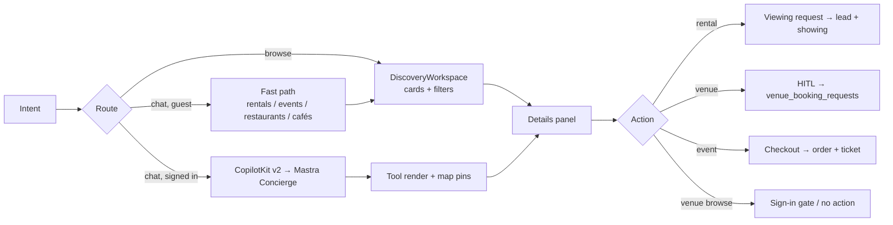
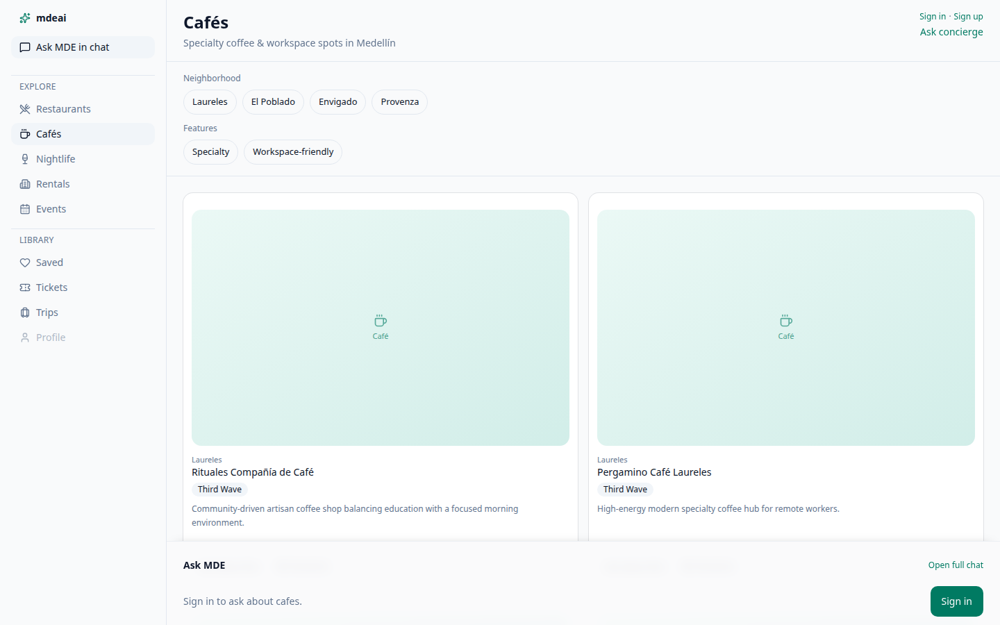
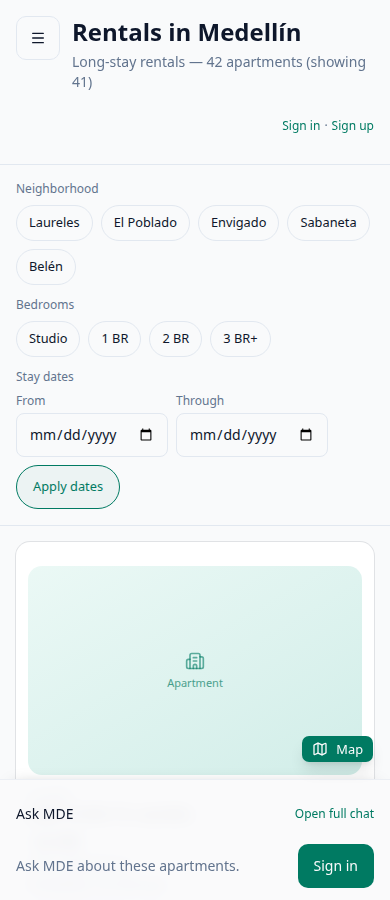
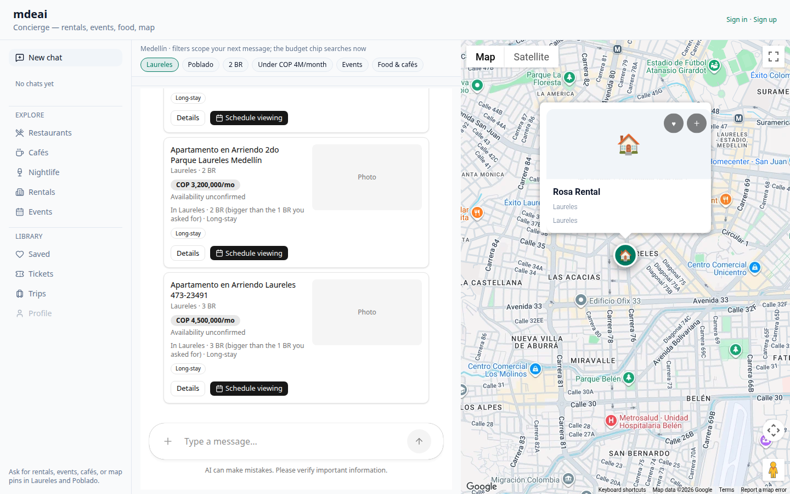
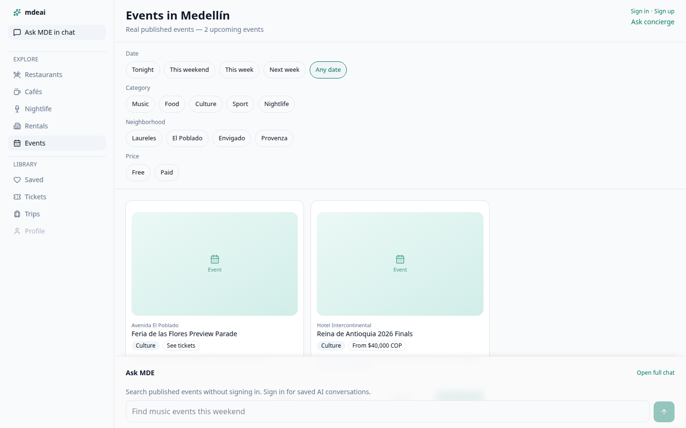
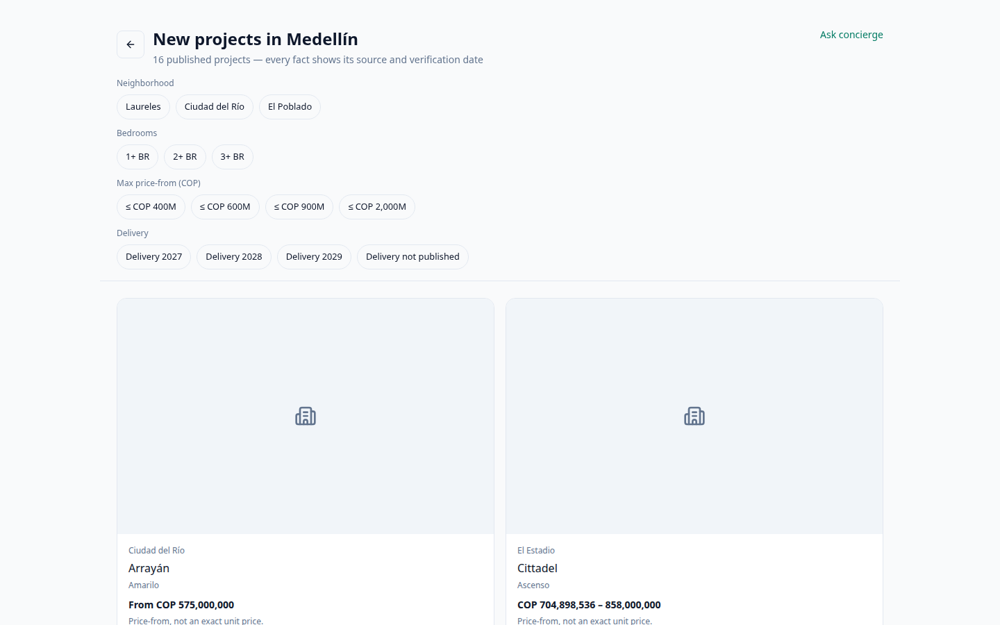

# MDE AI — UI/UX, Architecture and Workflow Audit

**Audited:** 2026-10-28 · **Deployed:** `www.mdeai.co` `/api/version` → `e779b78fc1d610d7596582fbe0de5308371c8590` · **GitHub `main`:** same SHA at audit time (`2e5ca782dd` after #608 merged) · **Phase:** A, prelaunch development.

**Method.** 50 live page loads (10 routes × 320/390/768/1024/1440), two guest concierge runs with network capture, read-only Supabase queries, Linear GraphQL for the [UIUX view](https://linear.app/amo100/view/uiux-mde-8ee8b3de6460), and source reading of the owning files. No production record was created, changed or deleted. Nothing here is inferred from a Linear label.

**Companion files.** Tracker: [01-progress.md](01-progress.md). Plan: [03-implementation-plan.md](03-implementation-plan.md). Discovery execution detail: [san-1390-discovery-implementation.md](san-1390-discovery-implementation.md).

---

## 1 · Executive findings

MDE is a **working discovery product with an unfinished venue surface and a merge queue nobody can clear**. Ten public routes render at every width with no overflow and no broken images; rentals answer with real grounded cards, a real map and a real summary; the rental viewing path has persisted real leads and showings. What does not work is what has not been merged, what was never built, and what the data cannot support.

### Top 10 proven problems

| # | Problem | Evidence | Owner | Smallest correct fix |
| --- | --- | --- | --- | --- |
| 1 | **Café and nightlife discovery is not a discovery surface.** No map, no Details, no action, two oversized cards at 1440, zero photos, and Ask MDE is a sign-in gate. | [`cafes-1440`](screenshots/2026-10-28-audit/_cafes-1440.png): 2 cards, ~320px placeholder each, no map column; audit row `map=absent` at all five widths | SAN-1146, SAN-1531 | Land #604 (real nullable coordinates), then render the existing `BrowseMapPanel` + a pin converter in `cafe-browse-view.tsx` / `nightlife-browse-view.tsx` |
| 2 | **Venues without coordinates are pinned at the city centre by the AI path.** | `src/mastra/tools/search-venue-anchors.ts:344-345` — `num(row.latitude) ?? 6.2442`, `num(row.longitude) ?? -75.5812` | SAN-1146 | #604 removes the fallback; unmerged |
| 3 | **The same apartment is shown twice in one answer.** Two active rows, identical title/neighbourhood/bedrooms/rent, no photos or coordinates, one badged "Best match". | Live answer + `apartments` rows `5247d1e6…` and `d9e96fb4…`; `/rentals` labels the copy, chat did not | SAN-1235 | **Fixed in PR #609** (one shared label rule). The duplicate rows remain a data decision |
| 4 | **Four proven PRs cannot merge.** #599, #604, #597 and #598 are green or code-complete but `REVIEW_REQUIRED`; #604's `review / review` job fails in infrastructure after the model call, not on a finding. | `gh pr checks`; run 40655120865 | process | Record the sole-collaborator exception for the green ones; re-run #604's review job |
| 5 | **The event journey cannot be exercised at all.** 49 published events, 0 in the next 14 days, 2 future (2026-12-06, 2027-02-24). | Supabase `events`; live "salsa events this weekend" → honest empty state | SAN-1600 / inventory | Seed development events across the next 60 days, labelled as development records |
| 6 | **Guest chat silently answers with a fast path where it can, and offers sign-in only where it cannot.** A guest who types a free-form question gets cards but no AI answer and no explanation; a non-fast-path question gets the sign-in offer. | Live: `POST /api/copilotkit` → 401; `use-concierge-send-handlers.ts:71-77` shows `showSignInPrompt` only on the agent path | SAN-1145, SAN-1150-adjacent | Show the existing `SIGN_IN_REQUIRED_MESSAGE` next to fast-path results for guests |
| 7 | **Rental cards without photos are dominated by a large grey "Photo" box.** | [`journey-02-rental-turn1`](screenshots/2026-10-28-audit/journey-02-rental-turn1.png): three cards, each with a ~200px empty media block | SAN-1140 (#599) | In the compact card, replace the empty media block with the existing neutral fallback at thumbnail size |
| 8 | **Small touch targets on public pages.** 23–45 interactive targets under 24×24 CSS px depending on route/width (home 23 at 320, `/rentals` 45 at 1024). | Audit DOM measurement, 50 loads | SAN-1348, SAN-524 | Fix the measured offenders; 24×24 is the WCAG 2.2 floor, 44×44 the product goal |
| 9 | **The site emits a 401 to `/api/copilotkit` on every public page for every guest.** | Console error on all 10 routes, 5 widths each; response body `{"error":"unauthorized"}` | SAN-1592/SAN-1301 | Skip runtime connect when no session, or return a typed non-error payload |
| 10 | **`/rentals` contradicts itself above the fold on mobile**: "42 apartments (showing 41)" with no explanation, and the first viewport is filters only. | [`rentals-390`](screenshots/2026-10-28-audit/_rentals-390.png) | SAN-1421 | Say which apartment is excluded and why, or stop excluding it |

### What is genuinely good (do not rebuild)

- **DiscoveryWorkspace** gives rentals, restaurants, cafés, nightlife and events one layout contract (`data-testid="workspace-*"`), and it survives all five widths.
- **Truthful map semantics** already ship: `BrowseMapPanel` renders `browse-map-unavailable` instead of fake pins, and the rental answer says *"Map locations aren't available for these yet"* when the three returned listings have no coordinates. That is exactly DESIGN.MD §6.
- **Settlement of the rental lead** is real: 8 of 8 recent leads have exactly one showing, `scheduled`, with the newest on 2026-10-18.
- **Two consequential AI actions have human confirmation**: venue booking requests and host event publish (`useHumanInTheLoop` in `concierge-copilot-bridge.tsx` and `host-event-copilot-bridge.tsx`).
- **Honest empty states** on events, and an honest "Not independently verified" badge on self-attested rentals.

---

## 2 · Route inventory (from `src/app/`)

68 `page.tsx`, 39 `route.ts`, 14 `layout.tsx`, 1 proxy (`src/proxy.ts`), 5 `'use server'` files with 9 actions. Route groups are `(browse)`, `(broker)` ×2, `(workspace)` — there is **no** `(marketing)` or `(app)` group.

| Surface | Route | Source | Verified 2026-10-28 |
| --- | --- | --- | --- |
| Home | `/` | `src/app/page.tsx` → `components/home/*` | 200 at 320–1440, no overflow |
| Concierge | `/chat` | `src/app/chat/page.tsx` → `ChatPageClient` | 200; guest runtime 401 by design; fast path answers |
| Rentals browse | `/rentals` | `src/app/rentals/(browse)/page.tsx` → `RentalBrowseView` | 200; cards + map panel + inline Ask |
| Rental detail | `/rentals/[id]` | `src/app/rentals/[id]/page.tsx` → `RentalDetailView` | 200 (in-app navigation) |
| Restaurants | `/restaurants` | `src/app/restaurants/page.tsx` → `RestaurantBrowseView` | 200; cards + map + Details |
| Restaurant detail | `/restaurants/[id]` | `src/app/restaurants/[id]/page.tsx` | 200 + contest vote panel |
| Cafés | `/cafes` | `src/app/cafes/page.tsx` → `CafeBrowseView` | 200; **no map**, no Details, no action |
| Nightlife | `/nightlife` | `src/app/nightlife/page.tsx` → `NightlifeBrowseView` | 200; **no map**, no Details, no action |
| Events | `/events` | `src/app/events/page.tsx` → `EventBrowseView` | 200; inline Ask; **no map column** |
| Event detail | `/events/[slug]` | `src/app/events/[slug]/page.tsx` → `EventDetailView` | 200 |
| Contests | `/contests`, `/contests/[id]` | `src/app/contests/*` | 200 |
| New projects | `/new-projects`, `/new-projects/[slug]` | `src/app/new-projects/*` | 200; 16 projects, 41 unit types |
| Saved | `/saved` | `src/app/saved/page.tsx` | 200 (guest prompt) |
| Trips | `/trips`, `/trips/[id]` | `src/app/trips/*` | 200 |
| Tickets | `/me/tickets`, `/me/tickets/[id]` | `src/app/me/tickets/*` | 200; guest `?token=` flow deliberately anonymous |
| Account launcher | `/app` | `src/app/app/page.tsx` | redirects guests to `/login?next=/app` |
| Personal | `/app/me`, `/app/me/{saved,tickets,tickets/[id]}` | `src/app/app/me/*` | auth-gated |
| Host events | `/host/events`, `/host/event/new`, `/host/dashboard`, `/host/analytics` | `src/app/host/*` | auth-gated |
| Host events (canonical) | `/app/events`, `/app/events/{new,[id],attendees,check-in,tickets,overview,analytics}` | `src/app/app/events/*` | auth-gated |
| Broker rentals | `/host/rentals*`, `/app/rentals*` | `src/app/host/rentals/*`, `src/app/app/rentals/*` | auth-gated; `/host/rentals/dashboard` is an unconditional redirect to `/host/rentals?mode=overview` |
| Partner | `/partners`, `/partners/{cafes,nightlife,restaurants,signup,profile}`, `/app/partners/profile` | `src/app/partners/*` | 200 |
| Admin | `/admin/{contests,contests/[id],event-bookings,rentals}`, `/app/contests*`, `/app/admin/events` | `src/app/admin/*`, `src/app/app/*` | behind `getAdminGate()` → `is_admin()` |
| Auth | `/login`, `/signup`, `/auth/callback`, `/auth/signout` | `src/app/auth/*` | 200 |
| Placeholders | `/sponsors`, `/business/ai`, `/partners/rentals` | `PartnerLandingPlaceholder` | 200, "coming soon", `robots: noindex` |

**Protection model.** No `middleware.ts`; `src/proxy.ts` → `updateSession`. Protected prefixes `/host/events`, `/host/event`, `/trips`, `/saved`, `/app` plus exact `/me/tickets`; unauthenticated → `302 /login?next=…`. `/admin/*`, `/host/dashboard`, `/host/analytics`, `/host/rentals/*`, `/partners/profile` and **all** `/api/*` are not proxy-protected and rely on page/layout gates and per-handler auth. `api/copilotkit` is excluded from the matcher on purpose.

**Duplication to be aware of (not a defect by itself).** `/admin/*` ↔ `/app/contests*`; `/host/events` ↔ `/app/events`; `/host/dashboard` ↔ `/app/events/overview`; `/host/analytics` ↔ `/app/events/analytics`; `/partners/profile` ↔ `/app/partners/profile`; `/saved` ↔ `/app/me/saved`; `/me/tickets*` ↔ `/app/me/tickets*`; `/host/rentals*` ↔ `/app/rentals*`. Same component body, different shell. Any fix must land in the shared component, never in one route.

---

## 3 · Visual UI/UX findings

Screenshots are in [`docs/UIUX/screenshots/2026-10-28-audit/`](screenshots/2026-10-28-audit/). All are real Chrome loads of production at the stated width.

### 3.1 Café discovery, 1440 — the clearest failure of the design principles

- Two cards across a 1440 viewport, each with a ~320px mint placeholder, no photo, no price, no open state and **no action at all** — not even Details or Directions.
- No map column, although the restaurant page one URL away has one.
- The Ask MDE bar is a sign-in gate, so a guest's only route into AI is signing up.
- DESIGN.MD §11 promises "Cards, Map, Details and Ask MDE on one page"; only Ask MDE (gated) is present.

**Minimal correction.** Reuse `DiscoveryWorkspace` with `rightPanel={<BrowseMapPanel/>}` and the restaurant page's card/Details contract. Drop the placeholder to a 4:3 thumbnail, add one primary action (Details) and keep the sign-in gate but explain it with the existing `SIGN_IN_REQUIRED_MESSAGE`.

### 3.2 Rentals at 390 — filters own the first viewport, the map button covers a card

- Header, neighborhood chips, bedroom chips, two date fields and "Apply dates" consume the entire first screen; the first card starts below the fold.
- The floating **Map** control sits on top of the first card's media area.
- "42 apartments (showing 41)" is unexplained.
- Ask MDE is a sign-in gate, correctly worded ("Sign in to ask about these apartments.").

**Minimal correction.** Collapse filters into one "Filters" disclosure at `<640px` (2 chips + a count badge), keep the applied state visible, and move the map affordance into the header row instead of floating over results.

### 3.3 Chat, 1440 — honest and dense, with two card defects

- The answer above the cards is truthful and specific: *"Found 3 rentals — see cards below. Map locations aren't available for these yet. Applied budget: COP 3,000,000 per month."* This is the best copy in the product.
- **Duplicate listing**: the first two cards are the same flat, one badged "Best match" (fixed in #609).
- **Duplicate benefit label**: each card prints "Long-stay" twice — once as a benefit badge, once inside the match reason ("In Laureles · 2 BR, as you asked · Long-stay").
- **Empty media block**: a ~200px grey "Photo" rectangle dominates each photo-less card.
- The sticky filter/chip row overlaps content as the transcript scrolls; the first card is clipped under it.

**Minimal correction.** De-duplicate the benefit from the match reason at the `rentalBenefitBadges`/`buildMatchReason` seam, render the neutral photo fallback at thumbnail size, and add scroll padding to the transcript so the sticky row never clips a card.

### 3.4 Events, 1440 — the layout is fine; the inventory is empty

The page renders filters, an inline composer and a truthful empty state. With 0 events in the next 14 days the journey cannot be judged further. No map column exists on `/events`; SAN-1250 shipped date/price truthfulness instead.

### 3.5 New projects, 1440

Real project cards, real prices, no AI dependency, no login. This is the most complete browse surface in the app and the right template for café/nightlife.

### 3.6 Measured responsive/accessibility results

| Check | 320 | 390 | 768 | 1024 | 1440 | Verdict |
| --- | --- | --- | --- | --- | --- | --- |
| HTTP 200 on 10 public routes | 10/10 | 10/10 | 10/10 | 10/10 | 10/10 | pass |
| Horizontal overflow (px) | 0 | 0 | 0 | 0 | 0 | pass |
| Broken images | 0 | 0 | 0 | 0 | 0 | pass |
| Composer present | /chat only | /chat | /chat, /events | /chat, /events | /chat, /events | partial: browse pages gate Ask behind sign-in |
| Map column | rentals, restaurants | rentals, restaurants | + | + | + | **fail** for cafés, nightlife, events |
| Targets < 24×24 px | 23–29 | 29–38 | 24–38 | 45 | 35 | **fail** WCAG 2.2 §2.5.8 |
| Console 401 (guest runtime) | every route | every route | every route | every route | every route | noise, not user-visible |

Keyboard, focus-visible, 200%/400% zoom and screen-reader announcement were **not** exercised in this audit; those remain SAN-1348's scope and are marked unknown rather than passed.

---

## 4 · User journey matrix

Each row is a real attempt on production, not a code reading.

| Journey | Result | Reproducible example | Evidence |
| --- | --- | --- | --- |
| **4.1 Discovery** — search → real cards → matching map → Details → Ask MDE | 🟡 **PASS with gap** | Guest, 1440: type "2 bedroom apartment in Laureles under 3 million pesos per month" → 3 real cards, honest summary, budget applied, Details panel opens with real headings ("Bright 2BR in Laureles — WiFi, Balcony…", "Calle 10 #42-15, Laureles") | [`journey-02`](screenshots/2026-10-28-audit/journey-02-rental-turn1.png), [`journey-04`](screenshots/2026-10-28-audit/journey-04-rental-details.png). Map is empty **truthfully** — the 3 returned flats have no coordinates. Free-form AI is unavailable to guests (401 by design) |
| **4.2 Rentals** — find → Details → schedule viewing → one saved lead/showing → broker visibility → renter status | 🟡 **PARTIAL (historical proof, not re-run)** | Modal + `POST /api/leads/schedule-viewing` exist; `leads` 19 / `showings` 8 with exactly one `scheduled` showing per lead, newest 2026-10-18. The 2026-10-28 guest run stopped at Details because scheduling requires a signed-in QA account | Supabase counts; no new write made |
| **4.3 Events** — discover → Details → tier/quantity → Stripe TEST → webhook → ticket/QR | 🔴 **FAIL (environment)** | "salsa events this weekend in Medellín" → "No events matched — try another category, neighborhood, or date." 0 published events in the next 14 days | Supabase `events`; empty state is correct, inventory is not |
| **4.4 Restaurants** — discover → Details → map → reservation/vote → saved receipt | 🟡 **PARTIAL** | `/restaurants` cards + map + Details live; vote RPCs (`cast_restaurant_vote`, `vote_consume_nonce`, `vote_receipt`) and `vote_consumed_nonces` (132 rows) exist; one `venue_booking_requests` row exists. Cross-device "My Votes" (SAN-1525) unverified | Supabase + route map |
| **4.5 Dashboards** — sign in → workspace → create/edit/search → save → refresh → persisted | ❓ **NOT VERIFIED** | Signed-in QA credentials were not available in this session; `/app`, `/host/*`, `/app/events*`, `/app/rentals*` all redirect guests as designed | Route guards read; no authenticated run |
| **4.6 AI dashboard assistant** — ask → grounded suggestion → review/edit → confirm → saved result + receipt | 🟡 **PARTIAL** | Consequential actions exist with HITL: `venueBooking` (venue request row) and `preview_and_publish` (host event). No dashboard "assistant" can edit rental/listing data; Host Ops tools are read-only | `src/mastra/index.ts`, `src/components/chat/concierge-copilot-bridge.tsx`, `src/components/host/host-event-copilot-bridge.tsx` |

**Guest-vs-signed-in truth.** `POST /api/copilotkit` returns `401 {"error":"unauthorized"}` for guests; `use-concierge-send-handlers.ts` intercepts a no-account send and shows `SIGN_IN_REQUIRED_MESSAGE`, but only when the message reaches the agent path. Fast-path queries (rentals, events, restaurants, cafés) are answered anonymously and therefore never show that notice — they show results and a sign-in-gated Ask row instead.

---

## 5 · AI agent and dashboard-action capability matrix

| Agent / workflow | File | Tools | Reachable from | Can it change data? | Confirmation | Verified live? |
| --- | --- | --- | --- | --- | --- | --- |
| `conciergeAgent` | `src/mastra/agents/concierge.ts` | searchRentals, searchEvents, searchRestaurants, searchVenueAnchors, searchGroundedPlaces, searchAttractions, searchNewProjects, compareNewProjects, requestVenueBooking, classifyIntent, extractIntentSlots | `/chat`, five discovery pages | venue booking request only | HITL `venueBooking` | Guest path 401 (by design); signed-in unverified |
| `rentalAgent` | `agents/rental-agent.ts` | searchRentals | `/chat` rental intents | no | n/a | Fast path / tool output observed |
| `eventAgent` | `agents/event-agent.ts` | searchEvents, searchWebGroundedEvents | `/chat`, `/events` | no | n/a | Not exercised (no future events) |
| `hostEventAgent` | `agents/host-event.ts` | set_event_draft, preview_and_publish (frontend tools) | `/host/event/new`, `/app/events/new` | creates/publishes events | HITL publish panel | Not exercised (auth) |
| `hostOpsAgent` | `agents/host-ops.ts` | hostops-read-tools, hostops-insight-tool | host dashboards | **read-only** | n/a | Not exercised (auth) |
| `partnerAgent` | `agents/partner-agent.ts` | partner-profile-tool | partner surfaces | profile field suggestions | user edits before save | Not exercised (auth) |
| `routerAgent`, `pingAgent`, `evaluationAgent` | `agents/*` | — | internal | no | n/a | n/a |
| Workflows | `rental-search`, `event-discovery`, `event-venue-booking`, `sales-insight` | — | via agents | booking workflow writes after approval | HITL | Not exercised |

**Not implemented, despite task names:** OpenBot / broker "coworker" (0 references to `openbot` or `coworker` in `src/`), `compareVenues`, chat image upload, follow-up suggestion buttons, rental offers/requests, rent receipts. These are backlog, not broken features.

**Grounding reality.** Retrieval is Supabase-backed tool calls plus pgvector embeddings (`listing_embeddings` 44, `restaurant_embeddings` 44, `event_embeddings` 49, `embedding_jobs` 610). `ai_runs` holds 2,240 rows and `mastra_threads` 138, so the runtime is genuinely exercised in production, not a demo.

---

## 6 · Frontend → backend → Supabase integration review

| Journey step | Frontend | Server | Persisted | Verdict |
| --- | --- | --- | --- | --- |
| Rental search | `search-tool-render` / fast path | `searchRentals` tool → Supabase | `search_logs` 4,374 | working |
| Rental details | `RentalDetailView` | `getRentalDetail()` | `apartments` + `rental_listing_images` 500 | working |
| Viewing request | modal → `POST /api/leads/schedule-viewing` | lead + showing (atomic) | 19 leads / 8 showings | working historically, not re-run |
| Restaurant browse | `RestaurantBrowseView` | `searchRestaurants` | `restaurants` 44 (42 active) | working |
| Restaurant vote | `RestaurantVotePanel` | `cast_restaurant_vote` RPC | `vote_consumed_nonces` 132 | working backend, cross-device UI unproven |
| Venue booking (AI) | HITL panel | `requestVenueBooking` tool | `venue_booking_requests` 1 | working mechanism, single record |
| Event browse | `EventBrowseView` | `fetchPublicEventsCatalog` | `events` 49 published | working, **no future inventory** |
| Event checkout | tier picker → `/api/tickets/checkout` | Stripe + ticket RPCs | `event_orders` 39, `event_tickets` 4, `payments` 3, `event_attendees` 43 | not exercised in TEST mode here |
| New projects | `ProjectBrowseView` | `listNewProjects` | 16 projects / 41 unit types | working |
| Partner signup | wizard + server action | `submitBrokerOnboarding`, `/api/partners/*` | `partners` 16, `partner_members` 10 | partially verified (routes live) |

**RLS:** every `public` table has RLS enabled; no table is unprotected. Three tables have RLS on with **zero** policies (`app_runtime_config`, `rental_runtime_settings`, `vote_consumed_nonces`) — service-role-only by design, which is acceptable but must never be granted to `anon`/`authenticated`.

---

## 7 · Defects, risks and unknowns (kept separate)

### Defects (reproduced)

1. Duplicate apartment served twice in one answer — **fixed, PR #609**.
2. Venue without coordinates pinned at Medellín city centre by the AI path (`search-venue-anchors.ts:344`) — fix in #604, unmerged.
3. Café/nightlife pages lack map, Details and actions.
4. Duplicate "Long-stay" label inside one rental card.
5. Unexplained "42 apartments (showing 41)".
6. Map FAB overlaps the first card's media at 390px on `/rentals`.
7. 23–45 sub-24px targets on public routes.
8. Guest 401 to `/api/copilotkit` on every public page load.
9. First card clipped under the chat filter/chip row.
10. #604's review job fails after the model call (infrastructure, not a finding).

### Risks (would become defects if unmanaged)

- **One production Supabase project.** Any test with the service-role key writes real rows. Every new E2E must clean up and re-query.
- **Heuristic duplicate detection.** Two genuinely distinct units with identical facts would be labelled "Also listed as #…". Accepted for now; a data-level canonical id would be better.
- **`/admin/*` is not proxy-protected.** It depends on `getAdminGate()` per page; a new admin page that forgets the gate would be public.
- **Event inventory is development data.** Before Phase B, these rows need freshness/ownership review, or launch will inherit stale dates.
- **Map 13/42 rental rows and 1/42 restaurant rows lack coordinates.** Truthful no-pin behaviour, but it silently reduces the map to 69% of rental supply.

### Unknowns (evidence needed, not failures)

- Signed-in dashboard journeys (4.5) and the full AI dashboard action loop (4.6).
- Stripe TEST checkout → webhook → ticket/QR on a phone viewport.
- Screen-reader announcement quality, 200%/400% zoom, focus order.
- Real mobile keyboard behaviour on a physical device.
- Latency/cost of the concierge (not measured; `ai_runs` exists but per-turn timing was out of scope).

---

## 8 · Files and components that own each fix

| Problem | Files | Minimal change | Proof |
| --- | --- | --- | --- |
| Café/nightlife discovery | `src/components/cafes/cafe-browse-view.tsx`, `src/components/nightlife/nightlife-browse-view.tsx`, `src/lib/browse/browse-pin-converters.ts`, `src/lib/cafe-browse.ts`, `src/lib/nightlife-browse.ts` | converter + `useBrowseMapSync` + `BrowseMapPanel` + Details, copying `restaurant-browse-view.tsx` | 390/1440 screenshot with matching ids |
| Fabricated venue pin | `src/mastra/tools/search-venue-anchors.ts` | #604: nullable coordinates, no constant fallback | unit: null in → null out |
| Duplicate listing label | `src/lib/rentals/duplicate-listings.ts`, `src/components/copilot/search-tool-result-cards.tsx`, `src/components/copilot/rental-card.tsx` | **done in #609** | 8 tests + render test |
| Duplicate benefit label | `src/lib/rental-display.ts` (`rentalBenefitBadges`, `buildMatchReason`) | drop a benefit already present in the match reason | render test on one card |
| Empty photo block | `src/components/copilot/rental-card.tsx`, `src/components/browse/venue-card-shell.tsx` | neutral fallback at thumbnail size | screenshot + card test |
| Mobile filters/FAB | `src/components/rentals/rental-browse-view.tsx`, `src/components/browse/BrowseMapSheet.tsx` | disclosure filters, header map button | 390 screenshot |
| Small targets | `src/components/chat/chat-nav-rail.tsx`, browse filter chips, `src/components/home/*` | min 24×24 (target 44) | DOM measurement |
| Guest 401 noise | `src/components/providers/mde-copilotkit-provider.tsx` (or equivalent), `src/app/api/copilotkit/[[...path]]/route.ts` | skip connect without a session | console clean on 5 routes |

---

## 9 · Weighted quality scores

Rubric fixed before scoring; each dimension is judged only on the evidence in this file. "Not scored" is used where the audit produced no evidence.

| Dimension | Weight | Score | Basis |
| --- | --- | --- | --- |
| Visual hierarchy and typography | 15 | 11 | Home, rentals, restaurants and new-projects read cleanly; café/nightlife oversized placeholders and duplicate labels cost points |
| Design-system consistency | 10 | 7 | One token set, one card shell; café/nightlife and chat diverge from the browse contract |
| Card and content quality | 10 | 6 | Real data and truthful prices; three of ten surfaces still ship large empty media blocks |
| Map ↔ card ↔ Details integration | 15 | 9 | Rentals and restaurants work; cafés/nightlife have no map; events have none |
| AI chat UX (context, streaming, actions, HITL) | 20 | 13 | Grounded answers, honest summaries, two HITL actions; guest path, Stop/Retry and failure states unproven |
| Responsive and mobile | 10 | 6 | No overflow anywhere; filters dominate the 390 first viewport and the map FAB overlaps content |
| Accessibility (WCAG 2.2) | 10 | 5 | Semantics and focus styling exist; measured target failures; no AT/zoom pass |
| State truthfulness (loading/empty/error/success) | 10 | 8 | The strongest area: honest empty, honest no-pin, no fake success found |
| **Total** | **100** | **65** | |

**Separately:**

| Score | Value | Why |
| --- | --- | --- |
| Production readiness — discovery | PASS | Rentals/restaurants/new-projects complete a real guest journey |
| Production readiness — events | FAIL (inventory) | No future events; checkout unproven |
| Production readiness — venues (café/nightlife) | FAIL | Not a discovery surface yet |
| Production readiness — dashboards | UNKNOWN | No authenticated run |
| Production readiness — payments | UNKNOWN | No TEST-mode purchase exercised |
| Task completion (view) | 47.2% on the only established denominator (SAN-1390, 17/36) | Not comparable to the quality score |

---

## 10 · Evidence sources

| Source | What it proved |
| --- | --- |
| `GET /api/version` (production) | Deployed SHA `e779b78fc1…` = GitHub `main` at audit time |
| 50 live Chrome loads, 10 routes × 5 widths | Status, overflow, images, map presence, composer, target sizes |
| Guest concierge runs with network capture | Cards, summary copy, Details panel, `/api/copilotkit` 401 |
| Supabase read-only queries | Inventory, coordinate coverage, leads/showings, orders/tickets, RLS and RPC inventory |
| Linear GraphQL (`UIUX_MDE` view) | 184 tasks, exact titles, states, priorities, parents |
| `gh pr view/checks`, workflow logs | #599/#604/#597/#598/#605 state; #604 review failure is post-model infrastructure |
| Source reading | Agents, tools, HITL, send handlers, duplicate helper, coordinate fallback |

**Not used as evidence:** Linear status alone, CI success alone, HTTP 200 alone, and any earlier document that reported percentages without a denominator.
