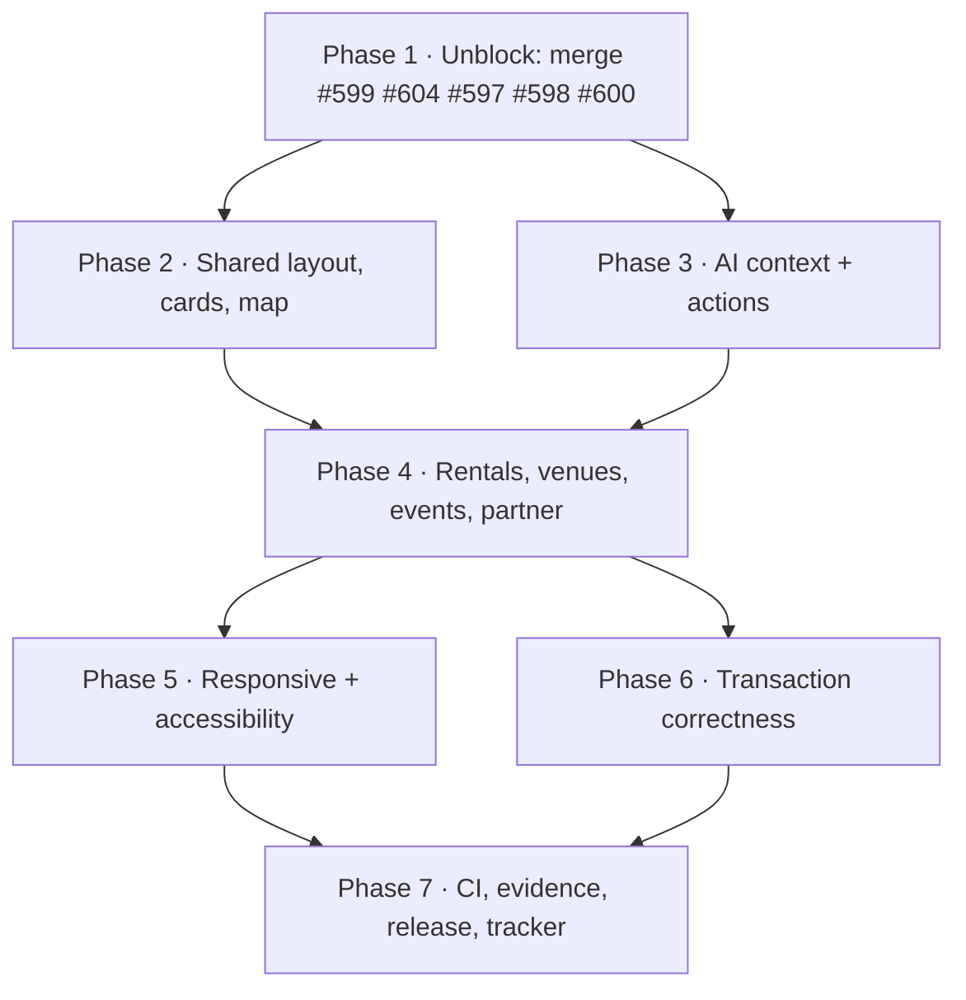

# MDE AI — UI/UX Implementation Plan

**Written:** 2026-10-28 against production `e779b78fc1…` (= `main` at audit time; `main` is now `2e5ca782dd` after #608).
**Ordered by dependency and user value, not by Linear number.**
**Companions:** [01-progress.md](01-progress.md) (verified status per task) · [02-audit.md](02-audit.md) (evidence and defects) · [san-1390-discovery-implementation.md](san-1390-discovery-implementation.md) (technical detail for the discovery epic).

**Rules for every step.** Reuse the existing Next.js app, Supabase data, CopilotKit v2 + Mastra concierge, `DiscoveryWorkspace`, `BrowseMapPanel`, `VenueCardShell` and the existing action paths. No second map, search engine, card framework, agent, table or workflow. Phase A: no approval, ownership, eligibility, publishing or booking-permission gate; keep auth, RLS, server authorization, audit trails, idempotency and truthful data.

**Critical path in one line:** clear the five open proven PRs → finish the café/nightlife surface → prove the signed-in AI and dashboard loop → re-prove the rental and event transactions → close responsive/a11y defects → lock evidence to an exact SHA.

---

## Phase 1 — Unblock the proven work (do first; nothing here is new code except 1.4)

| # | Owner (exact Linear task) | Outcome | Evidence it is needed | Affected files | Minimal fix | Prerequisite | Acceptance test | PR |
| --- | --- | --- | --- | --- | --- | --- | --- | --- |
| 1.1 ✅ merged+deployed | [SAN-1140 · MDE Discovery — Compact, Consistent Cards Across Five Pages](https://linear.app/amo100/issue/SAN-1140) *(outside this view's label; owns #599)* | Compact five-page feed on `main` | 19/19 checks green at `ba8aaabdda`; nightly-price regression covered | `src/components/rentals/rental-browse-card.tsx`, five `*-browse-view.tsx`, `venue-browse-card.tsx` | Merge as-is | Approval | `/rentals`, `/restaurants`, `/events`, `/cafes`, `/nightlife` at 390/1440 show compact rows with truthful prices | #599 |
| 1.2 ⏳ open | [SAN-1146 · Cafés and Nightlife — Match Venue Cards to Real Map Pins](https://linear.app/amo100/issue/SAN-1146) | No invented venue pin anywhere | `search-venue-anchors.ts:344` falls back to `6.2442,-75.5812`; 1 of 42 active restaurants and all venue-anchor rows can hit it | `src/mastra/tools/search-venue-anchors.ts`, `src/lib/{cafe,nightlife}-browse.ts`, `browse-pin-converters.ts` | Merge #604 unchanged; its `review / review` failure is post-model infrastructure (run 40655120865), so re-run that job | Approval + re-run | unit: null coordinate in → no pin out; live: no marker at the city centre for a coordinate-less venue | #604 |
| 1.3 ✅ merged+deployed | [SAN-1600 · MDE Events — Make Event Details Trustworthy, Premium, and Easy to Act On](https://linear.app/amo100/issue/SAN-1600) | The ticket the visitor chose is the ticket they pay for | 17/17 green at `b2971f00`; #601's merge commit equals #597's head, so the visual pass is already inside #597 | `event-ticket-tiers.tsx`, `event-detail-*.tsx`, `src/components/chat/*` | Merge #597 only (never mix Stripe changes) | Approval | VIP × 3 in chat → checkout payload carries the VIP tier id and quantity 3 | #597 |
| 1.4 ⏳ open (draft) | [SAN-737 · Make Ask MDE Understand the Current Page and Selected Place](https://linear.app/amo100/issue/SAN-737) | Selected item A→B→Clear answers the current record | #598 is 16/16 green but a **draft**; #583 merged the mechanism | `discovery-agent-context.ts`, `concierge.ts`, `fetch-public-events-catalog.ts` | Mark ready, then prove A→B→Clear signed-in on `/events` | QA credentials | Select A, select B, clear; each answer names only the current record | #598 |
| 1.5 ✅ merged+deployed | [SAN-1235 · Show Renters Which Listings Are Fresh, Trustworthy, and Not Duplicates](https://linear.app/amo100/issue/SAN-1235) | One apartment is never shown twice unlabelled | Production answer shows the same flat twice; two active rows (`5247d1e6…`, `d9e96fb4…`) | `src/lib/rentals/duplicate-listings.ts`, `src/components/copilot/search-tool-result-cards.tsx`, `src/components/copilot/rental-card.tsx` | **Already implemented** — shared label rule, 8 tests | — | Chat shows "Also listed as #1" on the later copy; unique listing shows nothing | #609 |
| 1.6 ✅ merged+deployed | [SAN-1429 · Make agent search results change the map only when they are the newest finished result](https://linear.app/amo100/issue/SAN-1429) | A stale result never wipes the map | #600 open, 17/17 green | newest-wins guard + recovery spec | Merge #600 | Approval | Replay an older malformed result; pins for the newest search remain | #600 |

**Parallel:** 1.1, 1.2, 1.3, 1.4, 1.6 are independent PRs and can each be merged the moment approval exists. Only approval blocks them; no code conflict remains between them.

---

## Phase 2 — Finish the shared surface (after #599; #604 already merged by then)

| # | Owner | Outcome | Evidence | Files | Minimal fix | Prerequisite | Acceptance test | PR |
| --- | --- | --- | --- | --- | --- | --- | --- | --- |
| 2.1 | [SAN-1146](https://linear.app/amo100/issue/SAN-1146) | Café/nightlife see a real map with real pins | `/cafes` and `/nightlife` render **no** map at any of five widths; no café/nightlife converter exists | `src/components/cafes/cafe-browse-view.tsx`, `src/components/nightlife/nightlife-browse-view.tsx`, `src/lib/browse/browse-pin-converters.ts` | Add `cafeToMapPin`/`nightlifeToMapPin` returning `null` unless both coordinates are real; copy `restaurant-browse-view.tsx`'s `useBrowseMapSync` + `rightPanel` | 1.1 and 1.2 merged | One venue without coordinates: card yes, pin no, no marker at 6.2442/-75.5812; a venue with coordinates selects the same id from card, pin and Details | new PR |
| 2.2 | [SAN-1531 · Restaurants — Cards, Map, Details and Ask MDE on One Page](https://linear.app/amo100/issue/SAN-1531) | Card, pin and Details share one identity | `/restaurants` already has all three; identity is unproven | `restaurant-browse-view.tsx`, `restaurant-details-panel.tsx` | Tests only unless a mismatch reproduces | 1.1 | Same UUID in card `data-pin-id`, marker and Details heading at 390/1440 | test-only PR |
| 2.3 | [SAN-972 · Events — Polish the Responsive Cards, Filters and Map Layout](https://linear.app/amo100/issue/SAN-972) | Events layout matches the other four pages | `/events` has no map column and the filter block is desktop-shaped at 390 | `src/components/events/event-browse-view.tsx` | Reuse the `DiscoveryWorkspace` disclosure pattern from 5.2; add no map unless pins are truthful | 1.1 | 320/390/768/1440 screenshots; keyboard focus visible; no card clipped by the sticky row | new PR |
| 2.4 | [SAN-1140](https://linear.app/amo100/issue/SAN-1140) (card owner) | A card never prints the same benefit twice or a giant empty photo | Live: "Long-stay" twice per card; ~200px grey "Photo" block | `src/lib/rental-display.ts` (`rentalBenefitBadges`, `buildMatchReason`), `rental-card.tsx`, `venue-card-shell.tsx` | Drop a benefit already present in the match reason; render the neutral fallback at thumbnail size | 1.1 | Render test per card; screenshot of a three-card answer | new PR |
| 2.5 | [SAN-1145 · Add the Same Ask MDE Chat to Restaurants, Cafés and Nightlife](https://linear.app/amo100/issue/SAN-1145) | Every page states the same Ask contract | Ask is a sign-in gate on browse pages, a composer on `/events`, a full chat on `/chat` | `DiscoveryWorkspace.tsx` (`workspace-ask-composer`), `concierge-sign-in-message.ts` | One shared gate sentence + one CTA, no new component | — | Guest sees the same wording on five pages; signed-in sees the composer | new PR |
| 2.6 | [SAN-1122 · Give Restaurants, Cafés, and Nightlife One Consistent Discovery Experience](https://linear.app/amo100/issue/SAN-1122) | Close the cross-category gap or name what remains | Overlaps 2.1–2.5 almost entirely | — | Compare once after 2.1–2.5 and close with evidence | 2.1–2.5 | Side-by-side at 390/768/1440 | — |

**Parallel:** 2.1 (café/nightlife), 2.2 (restaurant test), 2.4 (card polish) and 2.5 (Ask copy) touch different files. 2.3 depends on 1.1 but not on 2.1.

---

## Phase 3 — AI context and authorized actions

| # | Owner | Outcome | Evidence | Files | Minimal fix | Prerequisite | Acceptance test | PR |
| --- | --- | --- | --- | --- | --- | --- | --- | --- |
| 3.1 | [SAN-737](https://linear.app/amo100/issue/SAN-737) | A→B→Clear proven on all five routes | Mechanism merged in #583; only the signed-in proof is missing | `src/components/chat/*`, `discovery-agent-context.ts` | Tests only | 1.4 | A→B→Clear at 1440 and 390; refresh keeps context; forged id refused | test-only PR |
| 3.2 | [SAN-1145](https://linear.app/amo100/issue/SAN-1145) | A guest is never left without an explanation | Live: guest rental question → cards, no AI answer, no sign-in notice (`use-concierge-send-handlers.ts:71-77` only fires on the agent path) | `src/lib/hooks/use-concierge-send-handlers.ts`, `src/hooks/use-*-fast-path.ts`, `concierge-transcript-tail.tsx` | After a fast-path answer, if `!signedIn`, render the existing `SIGN_IN_REQUIRED_MESSAGE` line (no new modal) | 1.1 (card layout stable) | Guest types a rental question: cards **and** the sign-in sentence; signed-in user sees no sentence | new PR |
| 3.3 | [SAN-1145](https://linear.app/amo100/issue/SAN-1145) | Stop/Retry and provider failures recover | Stop/Retry exist (`concierge-stop`, `concierge-error-notice`); states unproven | `concierge-run-feedback.tsx`, `concierge-error-store.ts` | Fix only what the failure matrix reproduces | — | 401/403/429/5xx, interrupted stream, Stop then Retry, IME composition | new PR (only if a defect reproduces) |
| 3.4 | [SAN-729 · MDE Host AI — Answer Sales Questions With Actual Numbers](https://linear.app/amo100/issue/SAN-729) | Host AI answers equal the dashboard | Agent + read tools exist; parity unproven; currently In Review | `src/mastra/agents/host-ops.ts`, `src/mastra/tools/hostops-read-tools.ts`, `load-host-dashboard.ts` | Prove parity; no new tool | Signed-in host | One dashboard figure = the agent's answer for the same period | test-only |
| 3.5 | [SAN-1133 · Require Human Approval Before AI Makes Sensitive Rental Changes](https://linear.app/amo100/issue/SAN-1133) | Every consequential AI write is confirmed | HITL exists for venue booking and event publish only | `src/components/chat/concierge-copilot-bridge.tsx`, `host-event-copilot-bridge.tsx` | Extend the existing `useHumanInTheLoop` pattern when a rental write is added; do not invent a new approval service | A real rental write to guard | Proposed change → edit → confirm → one persisted row + receipt | with that write |
| 3.6 | [SAN-1298 · EPIC · CopilotKit Upgrade — One Safe AI Pattern Across Every MDE Screen](https://linear.app/amo100/issue/SAN-1298) | Close the upgrade epic | Four child tasks Done; v2-only import test ships | — | Audit remaining screen coverage, then close | 3.1–3.3 | No v1 import; every AI screen renders on v2 | close-out |

**Parallel:** 3.1 and 3.2 are independent. 3.3 depends on 3.2's copy. 3.4 needs host credentials and can run alongside the rest of Phase 3.

---

## Phase 4 — Complete the product workflows

| # | Owner | Outcome | Evidence | Files | Minimal fix | Prerequisite | Acceptance test | PR |
| --- | --- | --- | --- | --- | --- | --- | --- | --- |
| 4.1 | [SAN-262 · Request a Rental Viewing — Choose Time, Review, Then Submit](https://linear.app/amo100/issue/SAN-262) | One persisted lead + showing per request, with a truthful confirmation | 19 leads / 8 showings, exactly one `scheduled` per lead, newest 2026-10-18; not re-run on 2026-10-28 | `src/components/rentals/*viewing*`, `src/app/api/leads/schedule-viewing/route.ts` | Prove; fix only a reproduced defect | Signed-in renter + QA | Submit twice → exactly one lead and one showing; refresh shows "Viewing requested" only after the write | test-only PR |
| 4.2 | [SAN-1056 · Track Every Rental Lead Through One Clear Journey From Inquiry to Leased](https://linear.app/amo100/issue/SAN-1056) | Renter and broker see the same lead state | Pipeline fields exist (`pipeline_stage`, `next_followup_at`) | `leads` model + broker inbox | Show the existing stages; do not add a second status | 4.1 | Renter status and broker inbox agree after a transition | new PR |
| 4.3 | [SAN-1235](https://linear.app/amo100/issue/SAN-1235) | The duplicate flat is resolved, not just labelled | Two active rows for one address | `apartments` rows + import guard | Deactivate the older row (audited) or add an import uniqueness guard; one decision, recorded | 1.5 merged | `/rentals` total and card count agree; one card for that address | small PR or admin action |
| 4.4 | [SAN-1525 · MDE Restaurants Contest — Add My Votes and Cross-Device Vote History](https://linear.app/amo100/issue/SAN-1525) | A voter sees their own votes on any device | Vote receipts + nonces exist (132); "My Votes" absent | `src/app/api/restaurants/my-vote/route.ts`, contest UI | Use the existing receipt RPC; no new vote table | — | Vote on device A, open device B signed in, same vote shown | new PR |
| 4.5 | [SAN-526 · Make Mobile Ticket Checkout and QR Tickets Work Reliably](https://linear.app/amo100/issue/SAN-526) | A phone purchase ends in a usable ticket | 39 orders / 4 tickets / 3 payments; no TEST purchase exercised here | `/api/tickets/checkout`, `/api/tickets/validate`, wallet route | Prove on a phone viewport, then fix only what fails | Stripe TEST + QA | TEST purchase → webhook → ticket → QR opens once, scan validates once | test + fix PR |
| 4.6 | [SAN-1600](https://linear.app/amo100/issue/SAN-1600) | Events are discoverable in the near term | 0 published events in the next 14 days | development event data | Seed labelled development events across the next 60 days | 1.3 merged | "salsa events this weekend" returns ≥1 real card | data + evidence |
| 4.7 | [SAN-1419 · EPIC — Take a New Partner From Signup to Their First Live Listing](https://linear.app/amo100/issue/SAN-1419) | A new partner reaches one live listing | Signup wizard, AI suggestions and website autofill shipped; first-listing leg unproven | `partners/signup/*`, `submitBrokerOnboarding`, publish route | Prove; fix the first blocked step only | 4.1 (signed-in path) | Signup → profile → listing draft → publish → public page | test + fix |
| 4.8 | [SAN-1545 · MDE Partners — Edit Café, Nightlife & Venue Photos on Mobile](https://linear.app/amo100/issue/SAN-1545) | Venue photos editable on a phone | `/cafes` and `/nightlife` currently ship **0** photos | partner profile edit + Cloudinary path | Reuse the existing upload; mobile layout only | 4.7 | 390px: replace a café photo, reload, photo persists | new PR |
| 4.9 | [SAN-1506 · Tell Renters Plainly Why a Listing Was Left Out](https://linear.app/amo100/issue/SAN-1506) | The rental count explains itself | "42 apartments (showing 41)" is unexplained; 13/42 rentals have no coordinates | `rental-browse-view.tsx`, `search-rentals.ts` | One sentence naming the exclusion reason | 4.3 | Header explains any gap between total and shown | new PR |

**Parallel:** 4.1/4.2 (rentals), 4.4 (votes), 4.5 (payments) and 4.7/4.8 (partner) are independent. 4.6 is data-only and can start immediately. 4.3 needs a product decision, not engineering time.

---

## Phase 5 — Responsive, mobile and accessibility

| # | Owner | Outcome | Evidence | Files | Minimal fix | Prerequisite | Acceptance test | PR |
| --- | --- | --- | --- | --- | --- | --- | --- | --- |
| 5.1 | [SAN-1348 · MDE Accessibility — Test What Screen Readers Announce](https://linear.app/amo100/issue/SAN-1348) | No sub-24px interactive target on a public route | Measured: 13–45 per route/width, `/rentals` worst (29 at 320, 45 at 1024) | nav rail, filter chips, `src/components/home/*` | Raise the measured offenders to ≥24×24 (44 for primary) | — | DOM measurement reports 0; WCAG 2.2 §2.5.8 check passes | new PR |
| 5.2 | [SAN-1421 · Rentals — Inline Ask MDE Chat, Filters and Map (Delivered)](https://linear.app/amo100/issue/SAN-1421) | Results visible in the first phone viewport | `/rentals` 390: filters fill the screen; map FAB overlaps the first card | `rental-browse-view.tsx`, `BrowseMapSheet.tsx` | Disclosure filters under 640px; move the map control to the header row | 1.1 | 390: first card visible without scrolling; no control overlaps a card | new PR |
| 5.3 | [SAN-524 · MAP-011-M — Mobile map interaction system](https://linear.app/amo100/issue/SAN-524) | Map sheet usable by touch and keyboard | Sheet exists (`browse-map-fab`, `browse-map-close`); focus/escape unproven here | `BrowseMapSheet.tsx`, `map-mobile-sheet.tsx` | Verify; fix only reproduced traps | 5.2 | Open sheet, tab through, Escape closes, focus returns to the FAB | test-only |
| 5.4 | [SAN-1348](https://linear.app/amo100/issue/SAN-1348) | Zoom and focus verified | Never exercised in this audit | app-wide | Manual pass at 200%/400% and keyboard-only on five routes | 5.1 | No clipped content at 400%; visible focus everywhere | evidence |
| 5.5 | [SAN-1558 · EPIC · MDE Mobile — Verified Progress Tracker and End-to-End Journeys](https://linear.app/amo100/issue/SAN-1558) | One recorded mobile journey per area | Epic open, no journey evidence | docs + specs | Record five journeys at 390 | 5.1–5.4 | Five videos/traces linked from SAN-1534 | evidence |

---

## Phase 6 — Transaction and data correctness

| # | Owner | Outcome | Evidence | Files | Constraint | Acceptance test | PR |
| --- | --- | --- | --- | --- | --- | --- | --- |
| 6.1 | [SAN-477 · REAL-010 — Saved + trips integration](https://linear.app/amo100/issue/SAN-477) | Save → trip → reload persists | `saved_places`, `collections`, `trips` exist | reuse existing tables | Saved state must survive refresh and appear on both `/saved` and `/app/me/saved` | new PR |
| 6.2 | [SAN-526](https://linear.app/amo100/issue/SAN-526) | No duplicate charge or ticket on retry | `payments` 3, `idempotency_keys` 80 | Stripe + ticket RPCs | Retry the same checkout twice → one order, one ticket | test |
| 6.3 | [SAN-1059 · Make Rental Search and Viewing Fail Safely and Recover Cleanly](https://linear.app/amo100/issue/SAN-1059) | Failure cannot fake success | error notices exist | existing error paths | Force a 500 on the viewing write → form intact, no success state | test |
| 6.4 | — (no view task owns this; cross-cutting) | RLS gap cannot be introduced by a new page | 0 RLS-less tables; 3 tables with RLS and 0 policies | migrations | Every new table gets RLS + policy in the same PR; `/admin/*` keeps `getAdminGate()` | `npx supabase test db` |

---

## Phase 7 — Prove, deploy and keep the tracker honest

| # | Owner | Outcome | Acceptance test |
| --- | --- | --- | --- |
| 7.1 | [SAN-1534](https://linear.app/amo100/issue/SAN-1534) | This audit's evidence is attached to the register | `02-audit.md` + the 12 screenshots linked from SAN-1534 with the exact SHA |
| 7.2 | [SAN-1534](https://linear.app/amo100/issue/SAN-1534) | One exact-SHA matrix per route | Five routes × {390, 1440} × {cards, map, Details, Ask} with pass/fail and a screenshot name |
| 7.3 | [SAN-1390](https://linear.app/amo100/issue/SAN-1390) | The 36-checkpoint count moves only on new proof | Each change cites task + PR + SHA + browser/DB evidence; 47.2% is never restated without a delta |
| 7.4 | repo | Required gates on the exact head | `npm run floor`, `mastra-schema-init`, `review / verify-review-result` green on the pushed SHA |
| 7.5 | repo | Deployed SHA equals the merge SHA | `/api/version` readback after promotion, then one guest journey replayed |
| 7.6 | [SAN-1534](https://linear.app/amo100/issue/SAN-1534) | Tracker does not rot | Refresh `01-progress.md` after every phase; delete a row's ✅ when its evidence expires |

---

## What not to do

- Do not rebuild discovery, cards, maps or the concierge. They exist and render.
- Do not add an agent, approval service, map provider, search engine, schema or dashboard for any row above.
- Do not fix a café/nightlife card in two places: `cafe-browse-view.tsx` and `nightlife-browse-view.tsx` must call one converter.
- Do not treat CI green, HTTP 200 or a Linear "Done" as user proof. The three failure modes this audit found were all invisible to those signals.
- Do not merge `#597` with Stripe changes, or `#598` with UI changes.
- Do not delete the duplicate apartment row without recording the decision and its audit trail.

## First five actions (updated 2026-10-28 after promotion)

1. **Stop merging one-at-a-time without waiting for promotion.** Four merges in ten minutes made three certification runs go stale; production lagged ~17 minutes. Either serialize (merge → wait for `/api/version`) or let certification re-target the newest candidate.
2. **Land #604** — it is now "Cafés & Nightlife: Show Real Map Pins and Keep Cards in Sync", the remaining half of finding #1. No café photos exist yet; that is separate.
3. **Resolve the two duplicate apartment rows** (SAN-1235): deactivate the older row with an audit trail, or add an import uniqueness guard.
4. **Take #598 out of draft** and run the signed-in A→B→Clear proof (SAN-737).
5. **Seed future development events** (4.6) — two upcoming events is not enough to judge the event journey.
