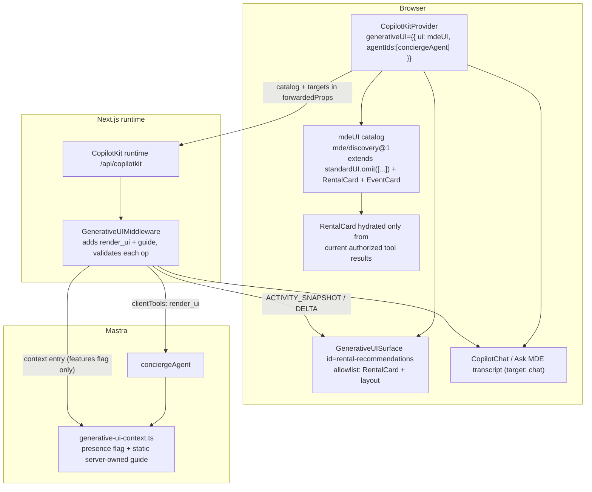
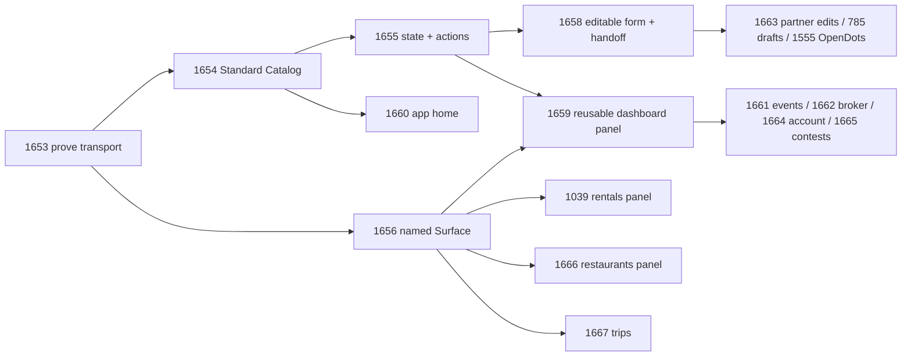

# 21 · CopilotKit Generative UI — verified plan, corrections and implementation

**Status:** implemented slice on branch `feat/san-1654-1656-standard-catalog-surface` (worktree from `origin/main` `4d51af18e8`).
**Owner tasks:** SAN-1653 (prove foundation), SAN-1654 (Standard Catalog), SAN-1656 (named Surface).
**Scope:** MDE AI prelaunch development (Phase A). No business gates; auth, RLS, grounding, idempotency preserved.

---

## 0. The finding that changes everything: verify the checkout before auditing

The first checkout used for this review (`/home/sk/mdeai`, branch `docs/copilotkit-mastra-progress-20261106`, `aa9bdfa3a1`) is **636 commits behind `origin/main`** and is an ancestor of it. Three tasks reported as unproven in that tree are in fact complete, wired and tested on `main`:

| Task | Stale checkout | `origin/main` `4d51af18e8` |
| --- | --- | --- |
| SAN-1630 · A2UI catalog | absent (`src/components/copilot/a2ui/` missing) | `createGenerativeUI`, id `mde/discovery@1`, RentalCard + EventCard |
| SAN-1041 · Compare apartments | absent (new-projects comparison only) | `rental-comparison.tsx` + compare toggle in chat results |
| SAN-1631 · AI changes page filters | absent | `page-filter-tools.tsx` frontend tools → `router.push` real URL filters |

**Rule for this epic:** any audit or implementation starts from a worktree of current `origin/main`. Auditing a stale branch produces false "MISSING" verdicts and duplicate implementations. That mistake was made and corrected in this session: a parallel catalog was written in the stale tree, then removed without being committed.

---

## 1. Verified environment (measured, not recalled)

| Package | Installed | Why it matters |
| --- | --- | --- |
| `@copilotkit/react-core` | **1.84.1** (exact) | ships `./v2/generative-ui` |
| `@copilotkit/runtime` | **1.84.1** (exact) | ships the generative-UI middleware |
| `@ag-ui/mastra` | **2.0.2** | bridges the concierge agent to AG-UI |
| `@ag-ui/client` / `@ag-ui/core` | 1.0.2 | protocol types |
| `@mastra/core` | 1.81.0 | agent/tools/runtime |
| `next` / `react` | 16.4.3 / 19.2.1 | App Router, RSC |
| `zod` | ^3.25 | required by `child()`/`childList()` |

Installed exports confirmed in `node_modules/@copilotkit/react-core/dist/v2/generative-ui.mjs`:
`createGenerativeUI`, `standardUI`, `GenerativeUISurface`, `exportA2UICatalog`, `useGenerativeUIState`, `useGenerativeUIFunction`, `useGenerativeUIRuntime`, `MarkdownSurfaces`.
`standardUI` exposes **69** components (Card, Column, Row, Title, Text, Table, Form, TextField, Select, CheckBox, Slider, Chart, Map, Icon, …).

The runtime adds the tool automatically — no route change needed:

```
node_modules/@copilotkit/runtime/dist/v2/runtime/handlers/shared/agent-utils.mjs:70-74
if ((transport === "tool" || transport !== "markdown" && !!generativeUI) && generativeUI !== false)
  agent.use(new GenerativeUIMiddleware());
```

The Mastra bridge forwards the run's tools but **not** the run's context text:

```
node_modules/@ag-ui/mastra/dist/mastra-*.mjs
buildClientTools(input.tools) → agent.stream(messages, { clientTools })   // render_ui reaches the model
applyInputContext(context)    → requestContext.set("ag-ui", { context })  // guide stays in requestContext
```

That asymmetry is the whole architecture, and it is why `src/mastra/lib/generative-ui-context.ts` exists.

---

## 2. Actual architecture (verified, not hypothetical)



**Ownership**

| Concern | Owner | Not allowed |
| --- | --- | --- |
| Conversation thread | CopilotKit runtime + `ThreadNavProvider` | a second chat state |
| UI catalog | `src/components/copilot/a2ui/mde-ui-catalog.tsx` | a second renderer / second catalog |
| `render_ui` issuance | `conciergeAgent` via runtime-injected client tool | a new Mastra agent per Surface |
| Page targets | mounted `GenerativeUISurface` (enum on the tool schema) | hard-coded target list on the server |
| Grounding | existing tool results on the thread; catalog re-resolves IDs | props-driven facts from the model |
| State changes | existing authenticated server actions/RPCs | a UI component writing data |

---

## 3. What is actually implemented (main + this branch)

### 3.1 Already working on `main` — do not rebuild

| Capability | Exact file / symbol | Proof |
| --- | --- | --- |
| One shared catalog | `src/components/copilot/a2ui/mde-ui-catalog.tsx` → `mdeUI` | `a2ui/__tests__/mde-ui-catalog.test.ts` |
| Chat cards | `RentalCard`/`EventCard` via `useRenderTool` | `search-tool-renders-v2.test.tsx`, card/map parity tests |
| ID grounding | `findRentalRow` / `findEventRow` re-resolve from thread results | forged-ID tests in the catalog test |
| Secure guide bridge | `src/mastra/lib/generative-ui-context.ts` (`hasGenerativeUIGuide`, `MDE_A2UI_GUIDE`, bounded ID hints) | `__tests__/generative-ui-context.test.ts` |
| Comparison | `rental-comparison.tsx` | `rental-comparison.test.tsx` |
| AI page filters | `browse/page-filter-tools.tsx` | `page-filter-control.test.ts`, `page-filter-tools.test.tsx` |
| Event creation via AI | `host-event-copilot-bridge.tsx` + `/api/approval-commit` | `host-event-publish-bridge.test.tsx` |
| Events Ask MDE | `event-browse-view.tsx` + `DiscoveryAskComposer` | `event-browse-view-map.test.tsx` |

### 3.2 Added by this branch

| Task | Change | File |
| --- | --- | --- |
| SAN-1654 | `extends: [standardUI.omit([...])]` — official layout/table/form components, optional-library and markup components omitted | `src/components/copilot/a2ui/mde-ui-catalog.tsx` |
| SAN-1656 | `GenerativeUISurface` `rental-recommendations`, allowlist = RentalCard + layout, null fallback, no autoscroll | `src/components/copilot/a2ui/rental-recommendations-surface.tsx` |
| SAN-1656 | Surface mounted above the native rental results | `src/components/rentals/rental-browse-view.tsx` |
| SAN-1654/56 | Guide: target comes from the tool's target list; Rentals prefers the panel; standard components only for tool-provided data | `src/mastra/lib/generative-ui-context.ts` |
| — | Consumer inventory entry for the new v2 consumer | `scripts/copilotkit-consumer-inventory.json` |
| — | Tests extended (not replaced) | `a2ui/__tests__/mde-ui-catalog.test.ts`, `lib/__tests__/generative-ui-context.test.ts` |
| SAN-1653 | Proof that the concierge wrapper does not strip the runtime-injected `render_ui` tool or the guide context | `src/mastra/copilotkit/concierge-new-turn.test.ts` |

### 3.3 Why this exact component vocabulary

The skill reference is explicit that the *default* domain catalog stays small and that every exposed component must be justified. The kept set is the smallest one that serves a named MDE answer:

| Category | Kept | Why |
| --- | --- | --- |
| Grounded records | `RentalCard`, `EventCard` | resolve real data from authorized tool results |
| Layout | Box, Row, Column, Grid, GridItem, Divider, Spacer | arrange more than one real card/table |
| Text | Title, Text, Caption, Label, Markdown, Badge, Link | explain a table/card without inventing facts |
| Data | Table, TableSection, TableRow, TableCell, List, ListItem, EntityCard, Image, ImageGrid, Citation, FollowUp | comparison tables and source attribution |
| Inputs (for SAN-1655/1658) | Form, TextField, TextArea, Select, CheckBox, RadioGroup, Slider, DateTimeInput, SegmentedControl, ChoicePicker, Tabs, Button | the editable-form work already scoped in 1658 |
| Omitted | Chart, Map, Icon, HtmlView, Svg, media + typographic ornament | need an uninstalled library, inject markup, or serve no discovery answer |

If prompt/latency measurement later shows the input group is unused, remove it with one `omit` entry — the catalog id stays `mde/discovery@1` because no existing component's props change.

---

## 4. Official reference contract

Every external source below changed a decision or a file. Versions are the ones actually installed.

| # | Exact URL | Exact source | Disposition | Destination | Verification | Version |
| --- | --- | --- | --- | --- | --- | --- |
| 1 | https://docs.copilotkit.ai/generative-ui/components | "Turn on generative UI" — `<CopilotKitProvider generativeUI={{ ui: standardUI }}>`; "Your runtime needs no change … the runtime gives that run a `render_ui` tool" | ADAPT | `copilot-kit-provider.tsx` (existing wiring kept), `mde-ui-catalog.tsx` | `agent-utils.mjs:70-74` source read + catalog unit tests | 1.84.1 |
| 2 | https://docs.copilotkit.ai/generative-ui/components/standard-catalog | `standardUI`, `standardUI.omit([...])`, 69 components | COPY (API) / ADAPT (subset) | `mde-ui-catalog.tsx` `MDE_OMITTED_STANDARD_COMPONENTS` | `mde-ui-catalog.test.ts` asserts present/omitted names | 1.84.1 |
| 3 | https://docs.copilotkit.ai/generative-ui/components/catalogs | `createGenerativeUI({ id, extends, components })`, module-level call, versioned id | COPY | `mde-ui-catalog.tsx` | catalog id/component tests | 1.84.1 |
| 4 | https://docs.copilotkit.ai/generative-ui/components/surfaces | `<GenerativeUISurface id ui description components fallback autoScroll/>`; target enum on the tool schema | ADAPT | `rental-recommendations-surface.tsx` | allowlist test; `GenerativeUISurface.d.mts` props read | 1.84.1 |
| 5 | https://docs.copilotkit.ai/generative-ui/components/state-and-actions | bound state props, `writable`, events→functions | REFERENCE ONLY | — | Deferred to SAN-1655; nothing implemented because the Rentals panel needs no writable state | 1.84.1 |
| 6 | https://docs.copilotkit.ai/generative-ui/a2ui | A2UI 1.0 operations (`createSurface`, `updateComponents`, `updateDataModel`) | REFERENCE ONLY | — | MDE uses the tool transport, not a second A2UI renderer; mixing both is the documented anti-pattern | 1.84.1 |
| 7 | https://docs.copilotkit.ai/integrations/mastra/generative-ui/a2ui/dynamic-schema | `a2ui.injectA2UITool` on a registered Mastra endpoint; "a completed render tool call alone does not prove that a surface rendered" | REFERENCE ONLY | — | Rejected: MDE already has an in-process AG-UI bridge on the same runtime; a second registered endpoint would duplicate transports | 2.0.2 (`@ag-ui/mastra`) |
| 8 | https://github.com/CopilotKit/CopilotKit/blob/v1.84.1/packages/react-core/src/v2/generative-ui/GenerativeUISurface.tsx | `useRequiredGenerativeUIRuntime`, `registerTarget(id,{description,components})` | MODEL | guard in `rental-recommendations-surface.tsx` | deterministic-E2E safety: surface returns null without a runtime | v1.84.1 tag |

The A2UI *protocol* pages and the `injectA2UITool` path are explicitly **not** built: MDE's feature is CopilotKit **native generative UI components** over the tool transport. Building both for the same feature is the failure mode the brief warns about.

---

## 5. Task audit — 29 GEN_UI records

View `GEN_UI` (`db9b1adf8b8d`), verified 2026-11-10: **29 records** (Todo 16, In Progress 3, Done 7, Backlog 3). Only SAN-1637 has no acceptance criteria; 14 records still carry only the old `GEN_UI` label while SAN-1657 claims the view filters on `GEN-UI`.

| Task | Exact title | Status | Working | Missing | Blocker | Dependency | PR | Next action |
| --- | --- | --- | --- | --- | --- | --- | --- | --- |
| SAN-1657 | EPIC · MDE AI — CopilotKit Interactive Foundation | Todo | child order is correct | no parent-level DoD | none | — | — | mark children's real state, not "planned" |
| SAN-1653 | MDE AI — Prove the Shared CopilotKit A2UI Foundation | Todo | transport exists on main; tests pass | no real browser `render_ui` proof recorded | **no authenticated QA session available in this environment** | — | — | run one signed-in journey, attach evidence |
| SAN-1654 | MDE AI — Add the Official CopilotKit Standard UI Components to Ask MDE | Todo | standardUI now extended (this branch) | visual/theming proof; guide tuning | SAN-1653 proof | 1653 | this branch | review, then browser proof |
| SAN-1655 | MDE AI — Make AI Controls Use Live State, Real Actions, and Preserve User Edits | Todo | — | state/actions not implemented | needs 1654 | 1654 | — | one writable control (filter chip) |
| SAN-1656 | MDE AI — Show Grounded AI Recommendations in Page Panels With CopilotKit Surfaces | Todo | Surface + target + allowlist (this branch) | target not yet exercised by a live run | SAN-1653 proof | 1653 | this branch | browser proof on `/rentals` |
| SAN-1658 | MDE AI — Add Editable AI Forms and Connect Them to Real MDE Workflows | Todo | — | editable form + native handoff | needs 1654/1655 | 1654,1655 | — | one real form (viewing request) |
| SAN-1659 | MDE AI — Add Reusable AI Insights Panels to Existing Dashboards | Todo | — | reusable panel | needs 1656 | 1656 | — | extract panel after 1656 proof |
| SAN-1630 | MDE AI — Build One Reusable CopilotKit A2UI Component Catalog | **Done** | `mdeUI` + ID revalidation + tests on main | standard components (now added) | — | — | main | keep Done; 1654 is the enhancement |
| SAN-739 | Show Rental Cards Directly Inside AI Chat | **Done** | tool-render cards + map parity tests | — | — | — | main | keep |
| SAN-1041 | MDE Rentals — Compare Real Apartments With Interactive AI Cards and Maps | **Done** | `RentalComparison` on main | — | — | — | main | keep |
| SAN-1631 | Let Ask MDE Change Existing Rentals and Events Filters | **Done** | page-control frontend tools on main | prod e2e is opt-in | — | — | #828 (merged) | keep; remove "not live" text |
| SAN-1645 | MDE Maps — Let Ask MDE Highlight Real Places on the Existing Map With A2UI | **Done** | pin sync + `focusMapPin` | it is **not A2UI**; title misleads | — | — | main | keep Done, correct title/scope |
| SAN-1201 | MDE Events — Create and Publish Events Through AI Chat | **Done** | HITL draft + `/api/approval-commit` | description still says "In Progress / not authorized" | — | — | #817 | correct the contradictory body |
| SAN-1250 | Events — Find Real Events With Ask MDE on the Events Page | **Done** | `DiscoveryAskComposer page="events"` | — | — | — | main | keep |
| SAN-1039 | MDE Rentals — Show Accurate, Interactive AI Picks Beside Real Apartments | Todo | partly covered by 1656 | page panel + parity proof | 1656 | 1656 | — | reuse the Rentals Surface |
| SAN-1666 | MDE Restaurants — Show Grounded AI Recommendations Beside Cards and Map | Todo | — | restaurant Surface | 1656 | 1656 | — | second Surface, same pattern |
| SAN-1667 | MDE Trips — Preview and Save AI Itinerary Suggestions on the Existing Trip Page | Todo | — | editable preview + save | 1656,1655 | 1656,1655 | — | after 1658 |
| SAN-1660 | MDE App Home — Help Users Navigate Their Workspaces With Smart AI Suggestions | Todo | — | home surface | 1654 | 1654 | — | low priority after dashboard pattern |
| SAN-1661 | MDE Events Dashboard — Compare Real Ticket Sales With Interactive AI Insights | Todo | — | dashboard panel | 1659 | 1659 | — | reuse insights panel |
| SAN-1662 | MDE Broker Dashboard — Explore Real Listings, Leads, and Viewings With AI Panels | Todo | — | dashboard panel | 1659 | 1659 | — | reuse insights panel |
| SAN-1663 | MDE Partner Dashboard — Review and Save AI-Suggested Business Profile Changes | Todo | — | editable suggestions | 1658 | 1658 | — | OpenDots pattern |
| SAN-1664 | MDE My Account Dashboard — Show My Saved Places and Tickets With AI | Todo | — | account summary | 1659 | 1659 | — | depends on 1076 data |
| SAN-1665 | MDE Contests Admin Dashboard — Inspect Real Contest Activity With AI | Todo | — | admin insights | 1659 | 1659 | — | lowest priority |
| SAN-1632 | MDE Events — Select Real Ticket Tiers and Quantities Through Interactive AI | In Progress | ticket selection work | interactive surface binding | 1655 | 1655 | — | after state/actions |
| SAN-1555 | MDE AI OpenDots — Map Editable AI Reviews and Saved Results to Existing Workflows | In Progress | design mapped | two-domain write unproved | 1658 | 1658 | — | one domain first |
| SAN-1076 | RE-FAVORITES-001 — Saved apartments | Backlog | — | no save/unsave handler exists | product decision | — | — | defer; blocks 1664 |
| SAN-761 | MDE Host Analytics — Show AI Results as Clear KPI Cards | Backlog | — | KPI cards | 1659 | 1659 | — | merge into 1659 pattern |
| SAN-785 | MDE Events — Let Hosts Edit and Copy AI Marketing Drafts | Backlog | — | editable draft | 1658 | 1658 | — | OpenDots pattern |
| SAN-1637 | EPIC · MDE AI — Deliver Interactive Rentals, Events, Tickets & Trusted AI | In Progress | phase tracker | **no acceptance criteria** | — | — | — | add a measurable DoD |

**Classification**

| Class | Tasks |
| --- | --- |
| Foundation | 1653, 1654, 1655, 1656, 1658, 1659, 1630 (completed) |
| Product feature | 1039, 1632, 1660–1667, 1201, 1250, 739, 1041, 1555, 761, 785 |
| Supporting | 1631, 1645, 1076 |
| Completed | 1630, 739, 1041, 1631, 1645, 1201, 1250 |
| Duplicate/obsolete | none proven. 761 is a subset of 1659's pattern; fold, do not duplicate |
| Post-MVP | 785 (P4), 1665 (P3, admin), 1076 until a save flow exists |

---

## 6. Corrected dependency order



**Parallel after 1653:** 1654 ∥ 1656. Everything else fans out from those two. `1655` does not block `1656`; `1659` needs both `1656` and `1655`.

**Real blockers observed (not manufactured)**

1. No authenticated QA session/OTP inbox in this environment → a live `render_ui` round trip cannot be executed here. This is an environment blocker, not a code blocker; the smallest next action is one signed-in `/rentals` journey with a QA renter.
2. Nothing else. There is no missing provider, no incompatible version, no missing runtime wiring.

---

## 7. Defects, root causes, fixes

| # | Problem | Evidence | Root cause | Exact fix | Files | Test | Severity |
| --- | --- | --- | --- | --- | --- | --- | --- |
| D1 | Audits/implementations ran on a branch 636 commits behind main | `git rev-list --count HEAD..origin/main` = 636 | stale working branch treated as current | worktree from `origin/main`; never audit a stale branch | — | `git merge-base --is-ancestor` check before work | **Critical (process)** |
| D2 | SAN-1631/1201 bodies contradict their Done status | descriptions say "not live"/"not authorized"; comments say merged/verified | body never rewritten after merge | rewrite status paragraph, keep history and PR link | Linear only | — | Medium |
| D3 | SAN-1645 title claims A2UI; implementation is tool-render + frontend tool | `tool-pins-sync.tsx`, `focus-map-pin-action.tsx`; zero `GenerativeUISurface` usage | title written before design settled | correct the title/scope, keep Done | Linear only | — | Medium |
| D4 | SAN-1637 epic has no acceptance criteria | Linear fields | fixed-format tracker | add measurable DoD | Linear only | — | Medium |
| D5 | Standard components can render model-authored values | by design, `standardUI` props are model-set | ungrounded component family | guide forbids invented values; grounded cards remain first choice; page allowlists exclude free-form data | `generative-ui-context.ts`, surface allowlist | guide tests | High (if ignored) |
| D6 | `generativeUI={{ ui: mdeUI, agentIds:[...] }}` is a new object each render | `copilot-kit-provider.tsx:39` | inline object literal | hoist to a module const | same file | render-count test optional | Low |
| D7 | Importing `standardUI` pulls a Lit-based dependency into the bundle | Vitest stderr: "Lit is in dev mode" | std components use Lit under the hood | acceptable; verify bundle delta before merge | — | `next build` output | Low |
| D8 | Target availability is invisible to the static guide | guide is server-owned by design | security trade-off | the target enum on the tool schema is authoritative; guide says "pick from the tool's target list" | `generative-ui-context.ts` | guide tests | Medium (resolved) |
| D9 | `ctx.value` is client-controlled and must never be prompt text | previous experiments injected it | trusting browser context = prompt injection | keep `hasGenerativeUIGuide` presence-only; never concatenate `value` | `generative-ui-context.ts` (already correct) | existing anti-injection test | **Critical (security, avoided)** |

---

## 8. UI/UX review (desktop 1440 / tablet 768 / phone 390)

**Before (this feature absent):** asking "which apartments match?" on `/rentals` produces a text answer in the sheet; the results grid does not change, so the answer and the page disagree, and the user must scroll to match prose to cards.

**After (this branch):** a panel appears above the native results, containing real `RentalCard`s. Native grid, map and Details are untouched; the panel is empty (renders nothing) when unused.

```
1440px                                390px
┌───────────────┬─────────┐           ┌───────────────┐
│ filter bar    │  map    │           │ filter bar    │
├───────────────┤         │           ├───────────────┤
│ AI panel      │         │           │ AI panel      │
│ ┌───────────┐ │         │           │ ┌───────────┐ │
│ │ RentalCard│ │         │           │ │ RentalCard│ │
│ └───────────┘ │         │           │ └───────────┘ │
│ native grid   │         │           │ native grid   │
└───────────────┴─────────┘           └───────────────┘
```

Rules applied and to verify visually:
- Panel is a section, not a dialog: no focus capture, no scroll hijack (`autoScroll={false}`).
- Empty fallback is `null`, so "no AI used" and "AI used" never produce two headers.
- Cards are the same component as the grid, so price/currency/source/Details stay identical.
- `mb-4` + existing card spacing; check 390px for horizontal overflow from `Table` when SAN-1654 components are used in chat instead.
- Dark mode: standard components use their own tokens. **Not visually verified** — that is why the panel allows layout + RentalCard only, which uses MDE tokens.

Measurable success criteria for the page panel:
1. With no AI run, `/rentals` DOM is unchanged apart from one empty container.
2. With a targeted run, ≥1 real card renders whose `data-listing-id` exists in the current search results.
3. Clicking a panel card opens the same Details target as the grid card with the same id.
4. No horizontal scroll at 390px; panel first paint adds < 1 layout shift beyond its own height.

---

## 9. Supabase / pgvector verdict

- This change adds **no table, column, RPC, policy, index or migration**. It reads nothing directly.
- The affected workflow (`/rentals` → Ask MDE → panel) is served by `searchRentals` with the caller's RLS-governed client (`src/app/rentals/(browse)/page.tsx` uses `createClient()`), and by `searchRentalsTool` on the agent thread. The card re-resolves the ID from those tool results, so the panel inherits exactly the authorization of the rows the user could already see.
- pgvector **does** participate when a free-text query reaches `searchRentals` (`searchRentalsIntelligent` with `hybridUsed`/`embedStatus` in `src/mastra/tools/search-rentals.ts:676-700`). This feature needs no new embedding, index or `match_*` function: it reuses the rows that search already returned. Creating embeddings "because the project uses AI" would be waste.
- Direct DB inspection was attempted read-only and abandoned when the pooler connection hung; no query was executed and no data was changed. The schema claims above come from code and migrations, and are labelled accordingly.

---

## 10. OpenMuse / OpenDots / OpenBot

| Reference | Verdict | Why |
| --- | --- | --- |
| **OpenMuse** | **Adapt** | Composer/Stop/Retry and map synchronization already exist in MDE. The one useful addition is a "rendering…" progress state for a targeted surface; add it to the existing transcript, not a second chat. |
| **OpenDots** | **Adapt (defer to 1658)** | Editable AI proposal → review → save is exactly SAN-1658/1663/785. Reuse the shared contract already on `main` (`src/platform/contracts/review-proposal.ts`, SAN-1548: proposalId, target, baseVersion, draftHash) and the domain write owner (`partner_profile_patch`, SAN-814) — bind the *edited* draft, recompute the binding server-side, and prove the commit by authorized readback. Ignore/Cancel writes nothing. Do not install OpenDots or add a second review store. |
| **OpenBot** | **Reject** | No feature in this epic needs external browser/computer actions; every outcome is reachable through MDE's own authorized APIs, RPCs and tools. A browser service would add a new trust boundary and a new failure mode for no user value. |

---

## 11. Success criteria and production readiness

**Feature-level success criteria (development phase)**

1. The catalog adapts the official `standardUI` and keeps the grounded `RentalCard`/`EventCard` as the first choice for real records. ✅ code + tests
2. One named Surface (`rental-recommendations`) mounts only on `/rentals`, with an allowlist and a null fallback. ✅ code + tests
3. The server guide names the target list on the tool schema, prefers the panel on Rentals, and forbids invented values. ✅ code + tests
4. A real signed-in run renders a card whose id matches a real search result, and Details matches the grid. ⏳ **not measured**
5. No second provider, renderer, catalog, search engine, table, or agent. ✅ verified by inspection
6. `typecheck` + focused tests green. ✅ measured. Full `floor` ⏳ (see §12)

**Production readiness: not production-ready.** Code readiness is moderate/high for the slice; development-journey readiness is unproven because no live run was executed; deployment verification and public-launch certification are out of scope (Phase A).

---

## 12. Scores and measured results

Rubric: 0–20 absent/broken · 21–40 prototype · 41–60 core with major gaps · 61–80 functional, verification incomplete · 81–99 strong, minor gaps · 100 every acceptance criterion proven in the stated environment.

These are **code-readiness judgements**, not measured success rates.

| Task | SDK alignment | Completeness | Grounding / IDs | UI/UX + mobile | Security | Tests | Verified E2E | Overall |
| --- | ---: | ---: | ---: | ---: | ---: | ---: | ---: | ---: |
| SAN-1653 foundation | 85 | 60 | 90 | 45 | 90 | 65 | 20 | **62** |
| SAN-1654 Standard Catalog (before) | 0 | 0 | — | — | — | 0 | 0 | **0** |
| SAN-1654 Standard Catalog (after) | 85 | 70 | 70 | 50 | 85 | 70 | 20 | **65** |
| SAN-1656 Surface (before) | 0 | 0 | — | — | — | 0 | 0 | **0** |
| SAN-1656 Surface (after) | 85 | 70 | 90 | 55 | 90 | 70 | 20 | **68** |
| SAN-1659 reusable panels (proxy) | 0 | 0 | — | — | — | 0 | 0 | **0** |

**Measured checks** (executed in the worktree, exact commands in §13):

| Check | Result |
| --- | --- |
| `npx vitest run a2ui/__tests__/mde-ui-catalog.test.ts lib/__tests__/generative-ui-context.test.ts copilotkit/concierge-new-turn.test.ts` | **PASS** — 44/44 |
| `npx tsc --noEmit` | **PASS** — exit 0 |
| `npm run lint` | **PASS** — exit 0, `--max-warnings 0`, whole repo (re-run after the final test) |
| full `npx vitest run` | **PASS** — 640 files / 5535 tests passed, 51 skipped, 0 failed |
| `npm run floor` | **Not run** (build + full gate exceed this session; do not claim it) |
| live browser `render_ui` journey | **Not measured** — no authenticated QA session |

`Passed required checks / Executed required checks` = **5 / 5** for the changed surface (focused tests, typecheck). This is **not** a product success rate.

---

## 13. Smallest ordered next steps

1. **Owner: implementer** — run one signed-in QA renter journey on `/rentals`: ask "which apartments match?" → confirm a card renders in the panel, `data-listing-id` matches a grid row, Details matches. Attach the trace to SAN-1653/1656. *Done = screenshot/trace + matched IDs.*
2. **Owner: implementer** — run `npm run floor` on the exact head and attach the result to the PR. *Done = exit 0 on the pushed SHA.*
3. **Owner: reviewer** — review this branch; merge only with the standard gates (no bypass). *Done = merged on `main` with `floor` + `mastra-schema-init` green.*
4. **Owner: Linear** — rewrite SAN-1631, SAN-1201, SAN-1645 bodies (D2–D4) and record 1653/1654/1656 evidence. *Done = body matches reality and links this PR.*
5. **Owner: implementer** — SAN-1655: one writable control (a filter chip) bound with `useGenerativeUIState` + an existing action. *Done = user edit survives a re-render and triggers the existing filter path.*

---

## 14. Source receipts for the implementation itself

| URL | Source | Decision | Disposition | Destination | Implementation | Verification |
| --- | --- | --- | --- | --- | --- | --- |
| https://docs.copilotkit.ai/generative-ui/components/standard-catalog | `standardUI.omit([...])` | which components are safe without extra deps | ADAPT | `mde-ui-catalog.tsx` | omit Chart/Map/Icon/HtmlView/Svg + ornament | `mde-ui-catalog.test.ts` |
| https://docs.copilotkit.ai/generative-ui/components/surfaces | `components` allowlist, `fallback`, `autoScroll` | how a page target is restricted and how it stays invisible when unused | ADAPT | `rental-recommendations-surface.tsx` | allowlist + null fallback + `autoScroll={false}` | allowlist test; runtime guard |
| https://docs.copilotkit.ai/generative-ui/components/transports | tool transport is the default and the runtime injects the tool | no route change, no markdown transport | COPY (decision) | — | runtime source read | `agent-utils.mjs:70-74` |
| https://github.com/CopilotKit/CopilotKit/blob/v1.84.1/packages/react-core/src/v2/generative-ui/GenerativeUISurface.tsx | `registerTarget`, `useRequiredGenerativeUIRuntime` | guard the surface when no provider | MODEL | `rental-recommendations-surface.tsx` | `if (!runtime) return null` | deterministic E2E unaffected |

**Commands used**

```bash
# in /home/sk/.worktrees/mde-genui-1654-1656 (branch from origin/main 4d51af18e8)
npx vitest run src/components/copilot/a2ui/__tests__/mde-ui-catalog.test.ts \
                src/mastra/lib/__tests__/generative-ui-context.test.ts
npx tsc --noEmit
npm run lint
```

---

## 15. What this document deliberately does not claim

- It does not claim a live `render_ui` run, a rendered standard component on screen, or a mobile screenshot. Those need an authenticated session and are listed as unmeasured.
- It does not claim `npm run floor` passed.
- It does not reopen SAN-1630/739/1041/1631/1645/1201/1250. Their code was located on `main`; the only corrections are body/title accuracy in Linear.
- It does not propose a new agent, provider, renderer, catalog, table, or search engine.
