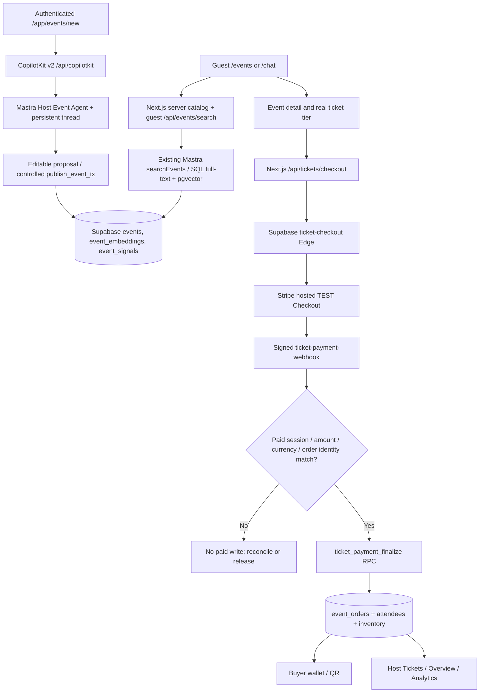

# MDE Events — Architecture, AI, UI/UX and Production Audit

**Audit date:** 2026-10-27 (America/Bogota)  
**Scope:** MDE Events public discovery, event details, host signup/workspace/wizard, AI, Stripe tickets, wallet, admin, search and responsive UX.  
**Repository:** https://github.com/amoai-tech/mdeai · **local checkout:** `/home/sk/mdeai`  
**Live app:** https://www.mdeai.co · **Supabase:** `zkwcbyxiwklihegjhuql`  
**Linear:** [SAN-757 — AI-Native Events OS progress](https://linear.app/amo100/issue/SAN-757) · [SAN-1599 — EPIC · MDE Events — Reliable Stripe Checkout and Paid Ticket Orders](https://linear.app/amo100/issue/SAN-1599)  
**Evidence:** [browser JSON](evidence/browser-smoke-2026-10-27.json), [390px events](evidence/events-390.png), [1440px events](evidence/events-1440.png), [390px false-payment](evidence/fake-payment-390.png), [390px event detail](evidence/reina-390.png), [390px chat](evidence/chat-390.png). These are captured from **live production** using installed Google Chrome/Playwright on the authorized Ubuntu device.

> **Verdict: working browse and authenticated route protection; ticket purchase still NOT independently proven end to end.** This is a **development functionality report**, not public-launch certification. We preserve Phase A's unrestricted business workflows; authentication, Stripe verification, RLS, ledger consistency and truthful outcomes remain mandatory.

## 1. Executive decision

- **Working / observed today:** Public `/events`, Reina/Feria detail pages and guest `/chat` load at 390px and 1440px; desktop/tablet browsing does not overflow; protected Host and wallet URLs redirect guests to `/login?next=...` rather than masquerading as missing pages; Supabase ticket RPC execution is restricted to `service_role`; payment Edge Functions are active; indexed event vectors exist; two focused event-search test files passed **9/9**.
- **Proven broken today:** (P0) production event detail falsely announces payment based solely on `?checkout=success`; (P1) mobile Host signup viewport overflows **470px content in 390px viewport**; (P1) no-tier Feria detail misleadingly displays **“Sold out”** alongside “Ticket tiers coming soon.”
- **Not proven:** A newly completed Stripe TEST payment and signed webhook producing **one exact, correctly valued paid order + owned wallet/QR**; full signed-in Host signup/publish/draft recovery; organizer analytics accuracy; Admin actions; agent response correctness under parallel queries and source freshness; full WCAG/Lighthouse or Core Web Vitals. These are **unknown acceptance gaps, not inferred failures**.
- **Most efficient next action:** land and release existing [PR #567](https://github.com/amoai-tech/mdeai/pull/567) after current-head checks/review, then run [SAN-974](https://linear.app/amo100/issue/SAN-974)'s real Stripe test-mode purchase and [SAN-1263](https://linear.app/amo100/issue/SAN-1263)'s one authoritative browser-to-DB workflow. Fix mobile navigation and zero-tier copy as minimal follow-ups in the existing owners; no new engines.

## 2. Evidence / reproducibility

### Code and release boundary
- Local checkout branch **`feat/san-983-982-984-515-event-ops`** was at `5d728324f0` (2026-10-26). `origin/main` advanced during this audit: first observed `bb5d9b5c8d`, then **`76cb767123`** (merged PR #552). An **isolated clean worktree** based on `76cb767123` owns the two UI corrections. **Never treat either local branch as current production/main**.
- The working tree already has unrelated modifications to `scripts/check-docs.mjs` and its test, plus untracked projects/docs. This audit **did not reset, merge, commit, push or deploy that unrelated work**.
- GitHub verified [PR #567](https://github.com/amoai-tech/mdeai/pull/567) **open, not merged** (fake payment banner + persisted Edge function config); [PR #569](https://github.com/amoai-tech/mdeai/pull/569) **open** (release status published too early); [PR #552](https://github.com/amoai-tech/mdeai/pull/552) **merged** (Host Tickets/Attendees/Admin/check-in routes). The exact production deployment SHA was **not independently resolved in this audit**. A merged PR or deployed Edge function does not certify a working paid checkout.
- Repository versions read from package.json: Next.js **16.4.3**; `@copilotkit/react-core` / `@copilotkit/runtime` **1.75.0**; `@mastra/core` **1.74.0**; `@mastra/memory` **1.35.0**; `@ag-ui/mastra` **1.1.6**.

### Live Chrome read-only smoke, October 27
Executed real browser navigation at **390, 768 and 1440px**. **21/21 navigation attempts completed with page content or the expected login redirect**. This measures **navigation**, not complete authenticated journeys, transactions, accessibility or checkout success.

| URL / check | Evidence / result |
|---|---|
| `/events` | HTTP 200; 2 upcoming events rendered at all three widths, no document horizontal overflow (390/768/1440). |
| `/events/reina-de-antioquia-2026-finals` | HTTP 200; COP 40,000 displayed; no document overflow at all three widths. Two `h1` instances in rendered text merit semantic/visibility check (mobile/desktop variants). |
| `/events/a1b2c3d4-0001-0001-0001-000000000003` | HTTP 200; no ticket tiers, but misleading “Sold out” summary. Proven copy/state contradiction. |
| `/events/reina-de-antioquia-2026-finals?checkout=success` | HTTP 200; **“Payment received — check your email for tickets”** with **no checkout performed**. **High-severity truthfulness failure**. |
| `/chat` | HTTP 200 guest start, explanatory prompt/chips visible; **no conversation response or actual search action tested in this run**. |
| `/partners/signup?type=host` | HTTP 200 guest auth gate; **390px viewport scrollWidth=470px**. Offender measured: `src/components/partners/partner-signup-nav.tsx` right action group / “Explore Medellín” button extends to right=470. |
| `/app/events/overview`, `/app/events/new`, `/app/me/tickets` | Redirect to `/login?next=...` as designed when anonymous; page HTTP 200 is the redirected login, **not proof signed-in dashboard/wallet works**. |

**Focused test run:** `npx vitest run src/app/api/events/search/route.test.ts src/lib/events/__tests__/list-published-events.test.ts --reporter=dot` → **2 files / 9 tests passed**. Vite emitted a known native-config-loader migration warning, not a failed test. **Not run in this audit:** full `npm run floor`, authenticated Host E2E, signed webhooks, Stripe provider payments, complete mobile accessibility tooling.

### Supabase production read-only checks
- `event_orders` **39**; `status='paid'` **12**; `subtotal_cents=0` **37**, including **all 12 marked paid**. This is a **historical ledger consistency concern**; it is **not evidence that 12 Stripe payments actually settled**, nor proof the new writer is broken. Do not bulk rewrite old orders without provenance.
- `events` **49**, `event_embeddings` **49**, `event_grounding` **0**, `event_tickets` **4**. Embeddings cover the current event-row count; `event_grounding` currently provides no event-source evidence. Validate actual per-result upstream attribution and the `event_signals` path before claiming “ungrounded search.”
- pgvector **0.8.0** and PostGIS **3.3.7** installed; event embedding **HNSW cosine index** and events full-text **GIN** index exist. No evidence yet of recall/precision benchmarks, query plans or stale-vector detection.
- `ticket_checkout_create_pending` / `ticket_payment_finalize`: `anon EXECUTE=false`, `authenticated EXECUTE=false`, `service_role EXECUTE=true`. Keep normal guest checkout routed through authorized server/Edge code; never reintroduce a business approval gate.
- `ticket-checkout` and `ticket-payment-webhook` are **ACTIVE v47**; both currently have `verify_jwt=false` so handler-level checkout authorization / cryptographic Stripe signature verification are essential.
- Supabase security advisor flagged `public.spatial_ref_sys` RLS disabled, extensions in public, and public-callable SECURITY DEFINER functions (including `compute_ticket_total`). These are **advisor findings requiring function-by-function privilege/behavior assessment**, **not proven ticket exploits**. Do not relocate extensions or change broad grants without checking dependencies. [Supabase database linter](https://supabase.com/docs/guides/database/database-linter).

## 3. Priority defects — root cause → minimal patch → proof

| Severity / existing owner | Reproduction / root cause | Exact smallest fix | Acceptance / tests |
|---|---|---|---|
| **🟥 P0** [SAN-1597 — MDE Events — Stop Unpaid Reservations and Wrong-Amount Fulfillment](https://linear.app/amo100/issue/SAN-1597) | Live `?checkout=success` emits false “Payment received” from `src/components/events/event-checkout-notice.tsx`, even while hook state remains pending. | **Reuse existing [PR #567](https://github.com/amoai-tech/mdeai/pull/567)**: pending notice until authorized wallet API says `paid`; remove unproved email promise; retain canonical `supabase/config.toml` function settings. **Do not create duplicate PR/fix.** | Anonymous fake URL at 390/1440 never claims paid; genuinely paid response shows confirmed exactly once; failed/fetch error stays neutral. Review→merge→ordinary deploy→retest. |
| **🟡 P1** Events detail truth / [SAN-1560 — MDE Events — Show Accurate Ticket Prices and Actions in the Public Catalog](https://linear.app/amo100/issue/SAN-1560) | `src/components/events/event-detail-view.tsx` renders fallback `"Sold out"` whenever `fromTier=null`, conflating **zero tiers** and **all tiers sold**. `EventTicketTiers` itself correctly says tiers coming soon when empty. | Render **“Price TBD”/“Ticket tiers not published”** when `event.tickets.length===0`; reserve **“Sold out”** for nonempty tiers all exhausted. Keep no Buy button. Test 0 tiers / priced available / priced sold-out at mobile+desktop. | Same semantics across Ask MDE, browse and event detail; no invented price or availability. |
| **🟡 P1** Host signup responsive / existing onboarding owner ([SAN-1207](https://linear.app/amo100/issue/SAN-1207)) | 390px guest `/partners/signup?type=host` document extends to 470px. DOM identifies `src/components/partners/partner-signup-nav.tsx` header right actions; both “Sign in” and long “Explore Medellín” display beside logo + picker back link. | Reuse navbar responsive utilities: collapse nonessential Explore CTA on narrow screens and/or make back action compact/icon+accessible name. Preserve reachable login and keyboard access. No new responsive shell. | `scrollWidth<=clientWidth` at 320/390/768/1440; tap target ≥24 CSS pixels or sufficient spacing; no clipped login button. |
| **🟡 P1** [SAN-582 — Standardize currency formatting across all event price surfaces](https://linear.app/amo100/issue/SAN-582) / [SAN-974](https://linear.app/amo100/issue/SAN-974) | Historical paid orders have zero subtotal; a tier price UI is not a settled amount proof. | Trace `src/lib/events/format-money.ts` → `event_tickets.price_cents` → `ticket_checkout_create_pending` → Stripe Checkout `amount_total` → webhook → `event_orders`; verify only **new** test orders and migration parity, never infer/overwrite old paid settlements. | Test COP 40,000 tier produces exact documented minor-unit Stripe/DB amount, tax/fee arithmetic and **one paid saved order** after signed webhook. |
| **🟡 P1** [SAN-1242 — EVOS-01 — Stripe webhook test harness](https://linear.app/amo100/issue/SAN-1242) / [SAN-116](https://linear.app/amo100/issue/SAN-116) | Edge presence and helper tests do not establish whole-handler signature/replay/mismatched-order behavior. | Extend **existing** `supabase/functions/ticket-payment-webhook/index.ts` and its shared verification helpers/tests; test wrong signature, unpaid session, currency/amount mismatch, replay, sponsor-intent crossover, cancel/expiry. | Verified wrong/replayed events cannot create extra order/attendee/inventory hold; correct signed test payment finalizes once. |
| **🟡 P1** [SAN-1561 — MDE Events — Keep Test Events Out of Public Search](https://linear.app/amo100/issue/SAN-1561) / [SAN-124 — Keep Fresh Event Recommendations Grounded in Trusted Google Sources](https://linear.app/amo100/issue/SAN-124) | “Feria de las Flores Preview Parade” is guest-visible; `event_grounding` has zero rows and historical project evidence suggests uncertain event-specific provenance. **Not proof event is fictitious.** | Trace `src/mastra/tools/search-events.ts`, `src/lib/events/public-event-fixtures.ts`, source fields and official organizer links. Mark QA/provenance truthfully; do not silently invent confirmation or automatically block development event visibility. | Every claim explicitly distinguishes source-specific evidence, unknown price, and Maps *place* link (not proof of an event). |

## 4. Progress tracker — verified issue ownership, measured where available

The **payment epic's pre-existing gate tracker** defines four acceptance gates for each of seven children: **11/28 = 39% documented evidence coverage as of Oct 26**, not a live payment success rate; the browser/payment criteria below remain unproven on Oct 27. Percentages are used only for that pre-defined denominator. Other task percentages are **Not measured** until their acceptance tests are counted.

| Existing Linear task | Status | Gate completion | Confirmed / missing | Next |
|---|---|---:|---|---|
| [SAN-1266 — RLS-EVENTS-AUDIT — Supabase RLS audit: event_orders + event_tickets + event_attendees](https://linear.app/amo100/issue/SAN-1266) | 🟢 Done | 4/4 = **100%** | Live ACL verified | Preserve tests |
| [SAN-1597 — MDE Events — Stop Unpaid Reservations and Wrong-Amount Fulfillment](https://linear.app/amo100/issue/SAN-1597) | 🟡 In Progress | 3/4 = **75%** | ACL/Edge deployed; #567 open; no new settled-order proof | Merge/release #567 and prove paid transition |
| [SAN-582 — Standardize currency formatting across all event price surfaces](https://linear.app/amo100/issue/SAN-582) | 🔵 Todo | 1/4 = **25%** | Existing tier formatter; paid breakdown unverified | One new Stripe/DB reconcile test |
| [SAN-1242 — EVOS-01 — Stripe webhook test harness](https://linear.app/amo100/issue/SAN-1242) | 🔵 Todo | 1/4 = **25%** | Existing helper tests, not handler-level signed E2E | Shared negative harness |
| [SAN-116 — MDE Events — Keep Ticket Payments Separate From Sponsor Payments](https://linear.app/amo100/issue/SAN-116) | 🟡 In Review | 1/4 = **25%** | Separate functions present; negative crossover proof absent | Reuse SAN-1242 |
| [SAN-974 — MDE Events — Prove a Stripe Test Payment Saves One Correct Paid Ticket Order](https://linear.app/amo100/issue/SAN-974) | 🟡 In Review | 1/4 = **25%** | Checkout path exists; signed real test payment not demonstrated here | Test-only payment + live DB readback |
| [SAN-1263 — MDE Events — E2E Test Host Publish Through Stripe to a Paid Ticket Order](https://linear.app/amo100/issue/SAN-1263) | 🔵 Todo | 0/4 = **0%** | Existing browser suites have mocked commerce paths | Single real Playwright/DB suite |
| [SAN-1201 — MDE Events — Create and Publish Events Through AI Chat](https://linear.app/amo100/issue/SAN-1201) | 🟢 Linear Done | **Not measured** | Host wizard and atomic publish paths exist; authenticated journey not run today | Preserve; test restore/readback |
| [SAN-1244 — MDE Events — Recover Host AI Drafts After Errors or Lost Connections](https://linear.app/amo100/issue/SAN-1244) | 🟡 In Progress | **Not measured** | Editable wizard recovery unproven in this run | Persist draft, reload/rewind and compare receipt |
| [SAN-1250 — Events — Find Real Events With Ask MDE on the Events Page](https://linear.app/amo100/issue/SAN-1250) | 🟢 Linear Done | **Not measured** | Prior price bug fix #563 reported; guest chat shell loads | Run grounded query/card assertion on exact deployment |
| [SAN-983 — MDE Events — Show Hosts Real Ticket Sales, Orders, and Inventory in /app](https://linear.app/amo100/issue/SAN-983) | 🟢 Linear Done | **Not measured** | #552 merged; source route exists | Signed-in orders/KPI cross-check |
| [SAN-729 — MDE Host AI — Answer Sales Questions With Actual Numbers](https://linear.app/amo100/issue/SAN-729) | 🟡 In Review | **Not measured** | Grounded analytics intent; readback not checked today | DB vs AI answer sample |
| [SAN-675 — MDE Events — Prove a New Host Can Onboard, Publish + Sell the First Ticket](https://linear.app/amo100/issue/SAN-675) | 🔵 Todo | **Not measured** | Guest signup/login works; paid end-to-end not proven | After SAN-1599's payment path |
| [SAN-984 — Host check-in scanner — design screen build (/host/check-in · NEW, no-AI)](https://linear.app/amo100/issue/SAN-984) | 🔵 Backlog | **Not measured** | #552 already merged code for `/app/events/check-in`; Linear status/acceptance need reconciliation | Independently run staff-scoped scan/replay when prioritized; not a payment gate |

## 5. System architecture and ownership



**Canonical owners, not new architectures:** UI pages in `src/app/events` and `src/app/app/events`; `src/components/host` event wizard/shell; `src/components/events` tiers/details; `src/app/api/tickets/checkout/route.ts`; `supabase/functions/ticket-checkout/index.ts` and `ticket-payment-webhook/index.ts`; `src/mastra/agents/host-event.ts`; `src/mastra/tools/search-events.ts`; shared SQL/RPCs and persisted Supabase data.

**AI setup:** CopilotKit v2 supports scoped provider/thread/agent binding; Mastra `hostEventAgent` uses `createHostEventThreadMemory(EventDraftStateSchema)` and `ACTIVE_TEXT_MODEL`. Source declares Gemini Flash as default; `MDE_AI_PROVIDER=nvidia` is opt-in for selected agents. **Runtime model selection, token costs and latency were not measured during this audit.** LLM output may propose/edit events and offer suggestions; it must never be the payment authority or fabricate successful saves.

**pgvector decision:** **REUSE** `event_embeddings` (49 rows/49 events), existing HNSW and full-text indexes. Benchmark `hybrid_search_events`/`event_signals` path, date/COP filters and source freshness before adding indexes or a second retrieval service. Source evidence needs investigation because `event_grounding` is empty; never equate a Google Maps place URL with an official dated event notice.

**Upstream comparison:**
- **OpenMuse — ADAPT:** progress from real AG-UI events, responsive composer and Stop/Retry behavior into existing MDE `/chat`. No separate mobile/server/task engine.
- **OpenDots — ADAPT:** user-editable AI drafts, Accept/Edit/Ignore and confirmed receipts into `src/components/host` / existing `publish_event_tx`; no second event store or business approval gate.
- **OpenBot — DEFER:** optional external-browser coworker; no demonstrated native Events gap warrants installing a second automation/computer/runtime. Review only if an API-first integration cannot perform a concrete authorized action safely.

## 6. Premium UI/UX review and targeted wireframes

**Evidence basis:** actual Chrome rendering/screenshots and DOM overflow metrics, not a completed design-system or Lighthouse audit.

| Screen | Existing strengths / verified issue | Minimal premium improvement (owner) |
|---|---|---|
| `/events` | Clean heading, date/category/neighborhood/price chips, two event cards, 390/768/1440 no document overflow. | Keep restrained typography and card rhythm; prominent inline “Ask MDE” entry point alongside filters, with results rendered into existing card grid. Avoid a second search/composer engine (`src/components/events/event-browse-view.tsx`, [SAN-1250](https://linear.app/amo100/issue/SAN-1250)). |
| Event detail | Real tier pricing, Buy action on priced event, readable content mobile. **Feria “Sold out” false fallback**, two headings represented by hidden responsive variants. | Distinct “Price TBD / tiers coming soon” vs genuinely sold out; confirm only one visible/accessible page `h1` at a given viewport; strengthen hierarchy of date/venue/price. (`event-detail-view.tsx`) |
| Host signup | Relevant program and login CTA visible, but **80px mobile overflow**. | Collapse redundant nav action at narrow width; keep “Sign in” and back/picker available; test 320/390px (`partner-signup-nav.tsx`). |
| `/app/events/overview` | Server-side redirect correctly protects private dashboard. | Signed-in evidence needed before claiming premium KPI accuracy; use one dominant “Next action”, three real KPI cards and a grounded assistant side-panel. Reuse `HostDashboardOsShell` and `load-host-dashboard.ts`; no fake values. |
| `/app/events/new` | Protected canonical route reuses `HostEventShell`. | Wizard steps: Details → Time/Place → Tickets → Editable AI suggestion → Save receipt; persistence after refresh is [SAN-1244](https://linear.app/amo100/issue/SAN-1244), not new localStorage-only state. |
| `/app/me/tickets` | Protected wallet redirect works anonymously. | Paid/processing/cancelled labels from DB, obvious QR and recovery action, no false paid banner; tests with real buyer account required. |

**Low-fidelity wireframes (design proposals, NOT screenshots):**

```text
DISCOVER /events                   HOST /app/events/overview
[Medellín Events] [Ask MDE ▸]      [Host Events]           [Create Event]
[Dates] [Areas] [Price]            [Sales COP] [Paid orders] [Capacity]
[Featured event card | Date]       [Your events table + filters]
[Event card] [Event card]          [Next action + Ask Host AI (real metrics)]

EVENT DETAIL                      CREATE /app/events/new
[Photo / Title / Location]         [Step 1 Details] [Step 2 Venue/date]
[From COP 40,000 | Qty]            [Step 3 Tickets] [Step 4 Review]
[Buy with Stripe]                  [AI suggestions: Accept/Edit/Ignore]
[Confirmed? ONLY via wallet]       [Publish] → [Saved event ID + receipt]

MY TICKETS
[Upcoming] [Past]
[Event card | Paid / Processing] → [View saved QR / Receipt]
```

**Accessibility requirements:** ≥24×24 CSS px targets or applicable spacing exceptions (WCAG 2.2 2.5.8), visible keyboard focus, descriptive controls/landmarks, 200% zoom and 320px reflow, contrast/readable text, reduced motion, reachable sticky checkout CTA. These are **recommended test checks**, not already certified.

## 7. Evidence-backed score /100 (NOT “percent correct”)

The score below measures **coverage of 45 predefined audit checkpoints supported by evidence from this pass**, deliberately counting untested acceptance as not proven. It **does not estimate the quality of untested implementation** or purchase success rate.

| Weighted category | Measured evidence gates | Contribution |
|---|---:|---:|
| Real user journeys / feature behavior (25 points) | **4/10**: browse, two event details, guest chat startup, expected guest→login routing; other end-to-end user journeys untested | **10/25** |
| Backend / Supabase / Stripe / security (25) | **4/10**: canonical tables, active Edge functions, RPC ACL and vector/FTS indexes; actual settled payment, full payment negatives and admin RLS journeys untested | **10/25** |
| CopilotKit / Mastra / agents (20) | **3/10**: version/config routing, registered Host agent, defined thread memory; grounded answer/action/restore performance untested | **6/20** |
| Visual/responsive / accessibility (20) | **5/10**: public browse at multiple widths, detail at multiple widths, guest chat mobile, protected-login mobile, screenshots; mobile signup overflow and no-tier messaging failed; a11y untested | **10/20** |
| QA / release / recovery (10) | **2/5**: recorded 21 route navigations and 9 focused tests, live SQL evidence; full floor/paid E2E/release provenance/retry recovery unverified | **4/10** |
| **Overall verified evidence coverage** | **18/45 checkpoints** (category-weighted) | **40/100** |

**Observed browser navigation completion:** **21/21 = 100% for route load/expected redirect only**. **Actual paid checkout success rate:** **Not measured (0 complete payment journeys executed)**. **Agent task completion rate:** Not measured. **Production functionality readiness:** public browse works for tested pages; payments incomplete/unproven. **Public-launch readiness:** separate Phase B evaluation, not requested or activated.

## 8. Implementation order, tests and release steps

1. **P0 — SAN-1597 + #567:** independent PR review + exact-head CI; merge via normal release workflow (do not manually promote against [PR #569](https://github.com/amoai-tech/mdeai/pull/569)'s release-controller concern); production fake-URL/pending/confirmed retest at 390 and 1440. Fix exists in PR; **do not duplicate**.
2. **P0 — SAN-582 → SAN-974 → SAN-1242 → SAN-1263:** verify COP minor-unit total and actual test-mode session; signed webhook finalizes **one** order; test invalid signature, wrong amount, sponsor mismatch, cancelled/expired, concurrent retry, webhook redelivery, private wallet and cleanup. Use ``npm run smoke:ticket-paid-proof`` where documented, plus Playwright/DB readback. Record only redacted payment IDs.
3. **P1 — mobile signup:** targeted `partner-signup-nav.tsx` responsive class change and Playwright 320/390/768/1440 assertions. Preserve authenticated signup and the existing wizard state; coordinate with [SAN-1207](https://linear.app/amo100/issue/SAN-1207).
4. **P1 — no-tier event:** targeted `event-detail-view.tsx` state split (zero tier: Price TBD, nonempty sold out: Sold out); add focused React test and event screenshot; align `EventTicketTiers` and chat pricing. Existing [SAN-1560](https://linear.app/amo100/issue/SAN-1560) owns price correctness; link a follow-up without reimplementing completed work.
5. **P1 — SAN-1244 + SAN-729 / SAN-983:** signed-in 390px Host AI wizard draft refresh/edit/recovery; compare actual organizer KPI SQL to rendered dashboard and agent reply; test cross-host 403 and retry/no duplicate publish.
6. **P2 — SAN-124 / SAN-1561:** verify event-specific official sources; reconcile empty grounding rows and published cards with truthful labels; only then tune vector/FTS ranking.
7. **P2 — visual/accessibility:** use existing Tailwind/shadcn tokens and `uiux` / `frontend-design` / `wireframe` skills for small changes, compare screenshots and keyboard/touch metrics. Do not rebuild page shells.
8. **P3 — advanced:** QR admission/scanner ([SAN-984](https://linear.app/amo100/issue/SAN-984)), ticket email/SMS ([SAN-1262](https://linear.app/amo100/issue/SAN-1262)), Stripe Connect ([SAN-1264](https://linear.app/amo100/issue/SAN-1264)) only per existing scope; not prelaunch development blocks.

**For each implementation PR:** inspect current `origin/main` and active PR owner → isolated clean worktree/branch → minimum source change → focused Vitest/pgTAP/Deno → lint/typecheck → `npm run floor` when applicable → Playwright signed-in/guest at 390/768/1440 → DB readback + retry/unauthorized → review → merge → **canonical release workflow** → domain/commit verification → screenshot evidence → update exact existing Linear task. Avoid touching today's dirty feature branch or promoting unmerged candidates.

## 9. References and confidence boundaries

**Inspected project skills:** `architect`, `events`, `progress`, `copilotkit`, `mastra`, `stripe`, `uiux`, `openmuse`, `opendots`, `openbot`, `e2e` and related AGENTS guidance. They informed architecture, truthfulness, AI ownership, flow checks and reporting; no claim is made that every optional skill or production certification procedure was run.

**Official/upstream (read/compared for specific concepts):**
- [CopilotKit v2 chat agent/thread configuration](https://docs.copilotkit.ai/reference/v2/hooks/useCopilotChatConfiguration) — maintain one provider/agent scope.
- [Mastra memory](https://mastra.ai/docs/memory/overview) — durable thread/memory, not evidence of persisted event draft by itself.
- [Supabase pgvector HNSW](https://supabase.com/docs/guides/ai/vector-indexes/hnsw-indexes) — keep existing cosine HNSW, benchmark recall before further indexes.
- [Supabase securing Edge Functions](https://supabase.com/docs/guides/functions/auth) — webhook signature/handler security when platform JWT verification is disabled.
- [Stripe Checkout fulfillment](https://docs.stripe.com/checkout/fulfillment) and [webhooks](https://docs.stripe.com/webhooks) — server-authenticated paid status and idempotent fulfillment.
- [OpenMuse](https://github.com/CopilotKit/openmuse), [OpenDots](https://github.com/CopilotKit/OpenDots), [OpenBot](https://github.com/CopilotKit/OpenBot) — patterns to adapt, not new MDE subsystems.
- [WCAG 2.2 target size](https://www.w3.org/WAI/WCAG22/Understanding/target-size-minimum) and [focus appearance](https://www.w3.org/WAI/WCAG22/Understanding/focus-appearance) — responsive and keyboard benchmarks.

**Work performed:** audited GitHub/Linear/Next.js source/live Supabase (read-only), ran production Chrome screenshot/navigation smoke and focused Vitest 9/9, and wrote this report. Then applied **two small UI source fixes in a separate clean worktree** with RED→GREEN regression tests and local-browser verification. **No Stripe charge, database mutation, signed-in Host workflow, PR merge or production deployment was executed in this audit**. Do not confuse local previews or recorded login screenshots with authenticated production verification.

**Next decision:** merge and deploy #567 through reviewed process, then prove one actual **test-mode** paid order with Stripe signature, exact amount, attendee and wallet readback. That is the largest remaining gap between browsing working and a working event-ticket product.


## 10. Focused implementation proof (isolated branch; NOT production)

**Isolated worktree:** `/home/sk/mdeai/.worktrees/fix-events-audit-ui-20261027`, branch `fix/events-audit-ui-truth-20261027` based on observed `origin/main` `76cb767123`. Original dirty feature branch and its work were preserved.

| Correction | Changed files | RED → GREEN proof | Local Chrome readback |
|---|---|---|---|
| **No tiers ≠ sold out** | `src/components/events/event-detail-view.tsx`; new `src/components/events/__tests__/event-detail-view.test.tsx` | Original test failed looking for “Price TBD” and forbidding “Sold out”; after fix passes with 0-tier, priced and truly sold-out variants | Local `/events/a1b2c3d4-0001-0001-0001-000000000003` at **320/390/768/1440px**, displays **Price TBD**, no “Sold out” and no horizontal overflow |
| **Mobile Host signup header does not overflow** | `src/components/partners/partner-signup-nav.tsx`; expanded `src/components/partners/__tests__/partner-signup-nav.test.tsx` | Original test failed without `sm:inline-flex` responsive secondary action; after fix passes | Local `/partners/signup?type=host` at **320/390/768/1440px**, all documentWidths equal viewport widths |

**Focused regression result:** 3 test files / **8 passed** (new/updated component tests plus existing event search route tests). Focused ESLint passed. **Eight local Chrome route/viewpoint checks passed**, screenshots and JSON saved below. This is a **locally verified source fix awaiting independent PR, CI and production validation**, not a successful deployed change.

**After (local worktree)** [browser JSON](evidence/after-ui-fixes-2026-10-27.json) · [signup 320px](evidence/after-signup-320.png) · [signup 390px](evidence/after-signup-390.png) · [no-tier 320px](evidence/after-no-tiers-320.png) · [no-tier 390px](evidence/after-no-tiers-390.png) · [signup 1440px](evidence/after-signup-1440.png).

**Additional observation:** In the **local development server only**, a guest event-detail load logged `/api/copilotkit` HTTP 401 and “Agent conciergeAgent not found” warnings after the page rendered. This is **not established as a production defect**; inspect `src/components/chat/concierge-coagent-context.tsx` and agentless route ownership only if independently reproduced, and do not weaken the authenticated CopilotKit endpoint.

**Full repository gate on isolated worktree:** `npm run floor` completed with **3,774 Vitest tests passed / 35 skipped** (486 test files passed / 10 skipped), Next.js optimized build, lint, TypeScript, security/release and Mastra contract checks. Non-blocking warnings noted: Vite native-config-loader migration, protobuf dynamic dependency, and local-dev LibSQL. This is *branch-local* proof; exact-head CI and production replay remain mandatory.
