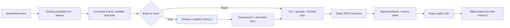

# MDE Events — Evidence-Based Audit, Progress Tracker & Roadmap

**Audit:** 2026-11-07 (America/Bogota) · **Stage:** Phase A / PRELAUNCH DEVELOPMENT · **Owner:** [SAN-757 · AI-Native Events OS progress](https://linear.app/amo100/issue/SAN-757/ai-native-events-os-progress).
**Companion epic:** [SAN-1637 · EPIC · MDE AI — Deliver Interactive Rentals, Events, Tickets & Trusted AI](https://linear.app/amo100/issue/SAN-1637/epic-mde-ai-deliver-interactive-rentals-events-tickets-and-trusted-ai) — preserve its owner-locked five tables; **do not edit that epic's format**.
**Sources:** [GitHub main](https://github.com/amoai-tech/mdeai), [Events Linear view](https://linear.app/amo100/view/events-mdev2-44fb48e91df8), [Production events](https://www.mdeai.co/events), [Supabase project](https://supabase.com/dashboard/project/zkwcbyxiwklihegjhuql).
**Scope of this change:** Read-only audit + roadmap document. No production data mutations, no deployments or merges. **No business approvals, ownership/photo/publishing gates in Phase A**; retain security, scoped writes, truthful data, payment integrity, idempotency and audits.

## Executive decision

**Verdict: DEVELOPMENT FUNCTIONALITY PARTIALLY VERIFIED; PUBLIC-LAUNCH CERTIFICATION NOT YET INITIATED.** The solution is to finish the existing Host AI→event publish→Stripe TEST Checkout→paid order→wallet QR→staff check-in, not rebuild the event engine or add parallel agents.

- **Working / built:** Public event cards/filters/map/Ask, event details, shared host workspace, hostEventAgent, hostOpsAgent, existing event review/publish RPC, hosted Checkout and signed webhook, wallet QR, authorized scanner and event API.
- **Proven gaps / recorded failures:** Host AI field-filling at 1440px and one attempted AI create/publish flow failed (SAN-1201/SAN-1263); some hybrid search can label missing tier as free or trim matches early (SAN-387); full cross-route draft recovery and an exact-event official citation remain unproven.
- **Important progress correction:** Prior 2026-10-26/27 audit said payment not proven; newer SAN-974 reports genuine authenticated Stripe TEST purchase, paid order, wallet QR at desktop/390px and refund testing. This does **not** prove host-created event→buyer paid→door all in one run.
- **Do not block Phase A work** with real-world host approvals, photo-rights paperwork or business certification. Use test money in Stripe TEST mode; only users' actual decision should trigger checkout. Super Admin changes require authenticated, audited server actions.

## Verified inventory and provider state (read-only SQL, 2026-11-07)

| Evidence | Live result | Meaning / caveat |
|---|---:|---|
| Events | **51** | 49 active, **4 future-dated in total, 2 both future and active**; inventory depth is limited |
| Ticket tiers | **6** | All 6 active; 5 have a positive price; do not infer a free tier where none exists |
| Orders | **48** | 12 paid, 33 cancelled, 3 refunded; status history is mixed |
| Historical paid rows | **12** | All 12 paid orders have nonzero total but **zero subtotal** and no buyer_user_id; most recent marked-paid 2026-06-09. Do not present these as new buyer-bound payment proof |
| Refunded orders | **3** | Recent Stripe TEST journey evidence lives in SAN-974, includes buyer-bound orders; prove exact Stripe readback before claiming a final payment receipt |
| Attendees / check-ins | **52 / 6** | 14 active attendees, 2 QR-used; audit results include 2 consumed and 1 already-used (not necessarily same new-host E2E) |
| Event embeddings / signals | **51 / 49** | pgvector inventory present; retrieval recall, current hashes and event-date validity not certified |
| Event grounding records | **0** | Persistent exact-event source evidence absent in this table; existing web-grounding tool still exists |
| Waitlist / event follows | **0 / 1** | Schema exists; adoption/integration not proven |
| Edge Functions | **ticket-checkout v56, ticket-payment-webhook v54, ticket-validate v45, event-staff-link-generator v44** | ACTIVE means deployed, not that each user journey passed |
| Privileged RPC grants | **Pending/finalize/cancel/consume: service_role only** | Verified direct anon/auth EXECUTE denied for these named RPCs |
| Security advisory | **compute_ticket_total** callable by anon as SECURITY DEFINER | Review exposure and function semantics; do not silently add business approval checks |
| Live browser | **390px & 1440px /events HTTP 200, no page JS errors or horizontal overflow in guest smoke** | 2 upcoming catalog cards; screenshots at `docs/events/evidence/events-20261107-390.png`, `events-20261107-desktop-loaded.png` |

**Audit note:** Historical paid rows are not evidence of failure of new Stripe TEST handler; investigate current-path records separately and never rewrite history without transaction proof. RLS is enabled for event tables, but performance advisor lists multiple permissive SELECT policies; this is a review signal, not proof of unauthorized access. `compute_ticket_total` allows anon execution; its SECURITY DEFINER function reads event_tickets and computes totals, so assess whether a known hidden tier ID could disclose prices. [Supabase security-linter guidance](https://supabase.com/docs/guides/database/database-linter?lint=0028_anon_security_definer_function_executable).

## Progress methodology

The [live Events view](https://linear.app/amo100/view/events-mdev2-44fb48e91df8) currently contains **44** issues: **14 Done, 13 In Progress, 2 In Review, 6 Todo, 9 Backlog**. Thus **31.8% Linear status closure**, *not* verified software completion.

**Percent values in tracker:** `†` are clearly **unmeasured workflow status proxies**, not estimates of correctness or engineering completion: Done=100%, In Progress/In Review=50%, Todo/Backlog=0%. This is only to give an ordered sorting field requested by the owner. `*` is the explicit SAN-1600 owner's 75% outcome estimate recorded 4 Nov. "🟡 verification exception" overrides a green label when critical acceptance is missing. **Never claim 100% production success from any `†` value.**

**Statuses:** 🟢 Scoped Done (confirmed implementation; see caveat); 🟡 Partial / verify; 🔴 Observed failure needing diagnosis; 🔵 Planned / no completed delivery. Absence of browser proof is *unknown*, not an invented failure.

## Full Events Linear task tracker (44 rows)

| Task (exact verified Linear title) | Status | % complete / workflow proxy | ✅ Confirmed | ⚠️ Missing / failing | 💡 Next action | Relevant PR |
|---|---|---:|---|---|---|---|
| [SAN-1263 · MDE Events — E2E Test Host Publish Through Stripe to a Paid Ticket Order](https://linear.app/amo100/issue/SAN-1263/mde-events-e2e-test-host-publish-through-stripe-to-a-paid-ticket-order) | 🔴 Failure reproduced historically | 50%† | Existing wizard, Stripe and QR paths | Full new-host→publish→paid order failed in Nov 4 run | Trace CopilotKit stream, draft state, publish transaction, then same-order readback | — |
| [SAN-974 · MDE Events — Prove a Stripe Test Payment Saves One Correct Paid Ticket Order](https://linear.app/amo100/issue/SAN-974/mde-events-prove-a-stripe-test-payment-saves-one-correct-paid-ticket) | 🟡 In progress | 50%† | Recorded authenticated Stripe TEST payment and 390px QR | Latest acceptance and exact-run replay/refund scenarios still open | Reconcile Stripe TEST session, payment, order and entitlements | [#688](https://github.com/amoai-tech/mdeai/pull/688), [#690](https://github.com/amoai-tech/mdeai/pull/690) |
| [SAN-1622 · MDE Events — Secure QR Check-In and Prove a Real Stripe TEST Ticket Purchase](https://linear.app/amo100/issue/SAN-1622/mde-events-secure-qr-check-in-and-prove-a-real-stripe-test-ticket) | 🟡 Verification exception | 100%† | QR scanner route and API, 2 consumed + 1 replay audit rows | Current task's same-ticket buyer/door journey needs exact-SHA proof | Retest same TEST paid QR once, replay, refunded, wrong-event and outsider | [#706](https://github.com/amoai-tech/mdeai/pull/706) |
| [SAN-1627 · MDE Events — Let Buyers Sign In or Continue as Guest Without Losing Their Ticket Selection](https://linear.app/amo100/issue/SAN-1627/mde-events-let-buyers-sign-in-or-continue-as-guest-without-losing) | 🔵 Todo | 0%† | Guest and signed-in Checkout paths exist | Ticket tier/quantity may be lost at auth transition | Persist selection across login or guest choice, revalidate before checkout | — |
| [SAN-1201 · MDE Events — Create and Publish Events Through AI Chat](https://linear.app/amo100/issue/SAN-1201/mde-events-create-and-publish-events-through-ai-chat) | 🔴 Failed E2E evidence | 50%† | hostEventAgent; form and HITL bridge exist | Documented 1440px AI fill regression; publish UI failed | Compare actual tool arguments vs React draft update at 1440/390; isolate root cause | [#506 OPEN](https://github.com/amoai-tech/mdeai/pull/506) |
| [SAN-1242 · EVOS-01 — Stripe webhook test harness](https://linear.app/amo100/issue/SAN-1242/evos-01-stripe-webhook-test-harness) | 🟡 In progress | 50%† | Signed raw-body Stripe webhook Edge is ACTIVE | Exact session retries, timeout and wrong-signature matrix not closed | Run Stripe TEST webhook replay/failure suite against canonical function | — |
| [SAN-1600 · MDE Events — Make Event Details Trustworthy, Premium, and Easy to Act On](https://linear.app/amo100/issue/SAN-1600/mde-events-make-event-details-trustworthy-premium-and-easy-to-act-on) | 🟡 In progress | 75% measured* | Rich detail view, real event Ask context, cards/map | Sign-in return, provider failure, source/date reconciliation, accessibility | Finish 8 acceptance outcomes and same-SHA browser proof | [#720](https://github.com/amoai-tech/mdeai/pull/720), [#723](https://github.com/amoai-tech/mdeai/pull/723) |
| [SAN-1633 · MDE Events — Show Refunded or Cancelled Tickets Without a Scannable QR](https://linear.app/amo100/issue/SAN-1633/mde-events-show-refunded-or-cancelled-tickets-without-a-scannable-qr) | 🟢 Done (scoped) | 100%† | Refunded ticket state and QR suppression implemented | Negative tests for partial/refund transitions need current release proof | Verify refunded wallet cannot scan; partial refund preserves valid tickets | [#688](https://github.com/amoai-tech/mdeai/pull/688) |
| [SAN-1597 · MDE Events — Stop Unpaid Reservations and Wrong-Amount Fulfillment](https://linear.app/amo100/issue/SAN-1597/mde-events-stop-unpaid-reservations-and-wrong-amount-fulfillment) | 🟢 Done (scoped) | 100%† | Pending/finalize/cancel RPC EXECUTE restricted to service_role | Historical zero-subtotal paid records not reconciled | Preserve grants, test amount mismatch, concurrency, replay and rollback | — |
| [SAN-729 · MDE Host AI — Answer Sales Questions With Actual Numbers](https://linear.app/amo100/issue/SAN-729/mde-host-ai-answer-sales-questions-with-actual-numbers) | 🟢 Done (scoped) | 100%† | hostOpsAgent, sales queries and QA accuracy tests | Sales parity on current refunded data still needs full reconciliation | Compare one organizer's overview, AI answer, order aggregates | [#739](https://github.com/amoai-tech/mdeai/pull/739) |
| [SAN-757 · AI-Native Events OS progress](https://linear.app/amo100/issue/SAN-757/ai-native-events-os-progress) | 🟡 In progress | 32% status rollup | This tracker owns Events rollup | Issue description still quotes old 39 issues / unproven payment | Update summary from 44 live issues and current Stripe TEST proof | — |
| [SAN-1244 · MDE Events — Recover Host AI Drafts After Errors or Lost Connections](https://linear.app/amo100/issue/SAN-1244/mde-events-recover-host-ai-drafts-after-errors-or-lost-connections) | 🟡 In progress | 50%† | Mastra storage/threads + editable React wizard exist | Refresh/new tab loses reliable editable draft recovery | Persist actor+thread draft, restore before action, one receipt on retry | — |
| [SAN-124 · Keep Fresh Event Recommendations Grounded in Trusted Google Sources](https://linear.app/amo100/issue/SAN-124/keep-fresh-event-recommendations-grounded-in-trusted-google-sources) | 🟡 In progress | 50%† | Web-grounding agent tool and route exist | event_grounding has 0 rows; exact-event source not proven | Prove one actual official date+venue citation, venue URL not event evidence | — |
| [SAN-387 · SAN-387 · SEARCH-002 — Wire hybrid_search_events + event_signals](https://linear.app/amo100/issue/SAN-387/san-387-search-002-wire-hybrid-search-events-event-signals) | 🟡 Partial; correctness risk | 50%† | Postgres hybrid_search_events; 51 embeddings and 49 signal rows | Unknown/no tier may look free; top-K may omit hard-filter match | Apply hard filters before rank, never infer zero from NULL | — |
| [SAN-1620 · MDE Events — Add Event Updates, Clear Guest Actions, and Polish Detail Pages](https://linear.app/amo100/issue/SAN-1620/mde-events-add-event-updates-clear-guest-actions-and-polish-detail) | 🟡 In progress | 50%† | Event detail UX, follow updates and correct missing-event noindex | Failure/updates and current accessibility coverage incomplete | Finish detail updates and test 320/390/1440 + unknown event | [#723](https://github.com/amoai-tech/mdeai/pull/723) |
| [SAN-1599 · EPIC · MDE Events — Official Stripe Checkout, Tickets & Payment Reliability](https://linear.app/amo100/issue/SAN-1599/epic-mde-events-official-stripe-checkout-tickets-and-payment) | 🟡 In progress | 50%† | Stripe-hosted Checkout, signed webhook, refund paths ACTIVE | Historical 12 paid have zero subtotals; end-to-end host scope open | Close exact payment reconciliation and failure gates; no second Stripe engine | [#688](https://github.com/amoai-tech/mdeai/pull/688), [#690](https://github.com/amoai-tech/mdeai/pull/690) |
| [SAN-1250 · Events — Find Real Events With Ask MDE on the Events Page](https://linear.app/amo100/issue/SAN-1250/events-find-real-events-with-ask-mde-on-the-events-page) | 🟢 Done (scoped) | 100%† | Guest Ask composer and public events search observed at 390/1440 | Source accuracy and hard filter completeness separate | Keep one guest search and existing signed-in agent; regression test | [#804](https://github.com/amoai-tech/mdeai/pull/804) |
| [SAN-1560 · MDE Events — Show Accurate Ticket Prices and Actions in the Public Catalog](https://linear.app/amo100/issue/SAN-1560/mde-events-show-accurate-ticket-prices-and-actions-in-the-public) | 🟢 Done (scoped) | 100%† | Real tier-backed card price and Price TBD observed | Cross-surface pricing consistency not fully reconciled | Reuse canonical tier offer in card, detail, AI and checkout | [#756](https://github.com/amoai-tech/mdeai/pull/756) |
| [SAN-582 · Standardize currency formatting across all event price surfaces](https://linear.app/amo100/issue/SAN-582/standardize-currency-formatting-across-all-event-price-surfaces) | 🔵 Todo | 0%† | Existing event_tickets.price_cents and money formatter | Legacy subtotals; mixed COP minor-unit labels; future charge comparison | Assert same COP amount across tier, card, Stripe and saved order | [#756](https://github.com/amoai-tech/mdeai/pull/756) |
| [SAN-1267 · MDE Events — Let Buyers Open Their Own Purchased Ticket QR](https://linear.app/amo100/issue/SAN-1267/mde-events-let-buyers-open-their-own-purchased-ticket-qr) | 🟡 Partial; tracker stale | 0%† | /app/me/tickets QR rendered in previous Stripe TEST evidence | Guest access and cross-user negative cases not fully proven | Test buyer A/B, token access, reload and 390px without exposing QR | [#688](https://github.com/amoai-tech/mdeai/pull/688) |
| [SAN-1562 · MDE Events — Stop Unauthorized Ticket Refunds and QR Check-Ins](https://linear.app/amo100/issue/SAN-1562/mde-events-stop-unauthorized-ticket-refunds-and-qr-check-ins) | 🟢 Done (scoped) | 100%† | Service-only consume RPC and caller-scoped validation | Must keep rejecting foreign/scannerless access after updates | Audit read/write grants and replay/outsider denial | [#706](https://github.com/amoai-tech/mdeai/pull/706) |
| [SAN-1285 · MDE Events — Publish an Event and Its Tickets Once, Even After Retry](https://linear.app/amo100/issue/SAN-1285/mde-events-publish-an-event-and-its-tickets-once-even-after-retry) | 🟢 Done (scoped) | 100%† | publish_event_tx receipt and caller+proposal idempotency | Full AI created-event journey still unproven | Concurrent same-proposal publish returns single event/tier set | — |
| [SAN-984 · Host check-in scanner — design screen build (/host/check-in · NEW, no-AI)](https://linear.app/amo100/issue/SAN-984/host-check-in-scanner-design-screen-build-hostcheck-in-new-no-ai) | 🟡 Built; tracker stale | 0%† | /app/events/check-in, TicketScanner, validation endpoint already exist | Backlog wording calls it NEW/absent (stale) | Retarget issue to current scanner's exact admission proof | [#706](https://github.com/amoai-tech/mdeai/pull/706) |
| [SAN-1566 · MDE Events — Check Official Event Details and Review Changes](https://linear.app/amo100/issue/SAN-1566/mde-events-check-official-event-details-and-review-changes) | 🔵 Backlog | 0%† | Grounding route and trusted source registry | Official event metadata-change verification absent | Compare exact event title/date/venue with official page; flag unknown | — |
| [SAN-1262 · PAY-EVT-DELIVERY — Ticket delivery after purchase (QR + email + SMS)](https://linear.app/amo100/issue/SAN-1262/pay-evt-delivery-ticket-delivery-after-purchase-qr-email-sms) | 🔵 Backlog | 0%† | Wallet and QR exist, email_outbox has 0 rows | Actual email/SMS ticket delivery evidence absent | Test opted-in delivery, retries and no duplicate notifications | — |
| [SAN-116 · MDE Events — Keep Ticket Payments Separate From Sponsor Payments](https://linear.app/amo100/issue/SAN-116/mde-events-keep-ticket-payments-separate-from-sponsor-payments) | 🟡 In review | 50%† | Separate event order and sponsor structures exist | Sponsor vs ticket payment isolation needs full proof | Audit amounts, metadata, Stripe mode and unauthorized payment paths | — |
| [SAN-526 · Make Mobile Ticket Checkout and QR Tickets Work Reliably](https://linear.app/amo100/issue/SAN-526/make-mobile-ticket-checkout-and-qr-tickets-work-reliably) | 🔵 Backlog | 0%† | 390px paid wallet and QR proven in previous evidence | Mobile Checkout itself not documented for same ticket | Execute mobile tier→Stripe TEST→wallet screenshot and return flow | [#688](https://github.com/amoai-tech/mdeai/pull/688) |
| [SAN-1266 · RLS-EVENTS-AUDIT — Supabase RLS audit: event_orders + event_tickets + event_attendees](https://linear.app/amo100/issue/SAN-1266/rls-events-audit-supabase-rls-audit-event-orders-event-tickets-event) | 🟢 Done (scoped) | 100%† | RLS enabled on event_orders, tickets and attendees | Security advisor flags multiple permissive event SELECT policies | Prove cross-buyer denied; review effective policies, not just enabled flag | — |
| [SAN-675 · MDE Events — Prove a New Host Can Onboard, Publish + Sell the First Ticket](https://linear.app/amo100/issue/SAN-675/mde-events-prove-a-new-host-can-onboard-publish-sell-the-first-ticket) | 🔵 Todo | 0%† | Existing signup, wizard, Checkout, wallet components | No new host→first paid order certified | Run single first-host E2E using existing interfaces and clean QA rows | [#506 OPEN](https://github.com/amoai-tech/mdeai/pull/506) |
| [SAN-982 · Host attendees OS — design screen build (/host/attendees · NEW)](https://linear.app/amo100/issue/SAN-982/host-attendees-os-design-screen-build-hostattendees-new) | 🟢 Done (scoped) | 100%† | /app/events/attendees existing host scoped screen | Fresh 390px attendee workflow test not repeated here | Check selected event, attendee counts, permission, zero/large list | — |
| [SAN-259 · MDE Events — My Tickets Screen: Show Purchased Tickets and QR Codes](https://linear.app/amo100/issue/SAN-259/mde-events-my-tickets-screen-show-purchased-tickets-and-qr-codes) | 🟡 Built; tracker stale | 0%† | MyTicketsList, QR page and wallet endpoint exist | Backlog title suggests screen missing (stale) | Re-scope to recovery/accessibility evidence; avoid duplicate wallet | [#688](https://github.com/amoai-tech/mdeai/pull/688) |
| [SAN-1561 · MDE Events — Keep Test Events Out of Public Search](https://linear.app/amo100/issue/SAN-1561/mde-events-keep-test-events-out-of-public-search) | 🟡 In progress | 50%† | QA/event provenance helpers present | Test inventory/public listing labels not exhaustively checked | Label dev/test records truthfully; do not impose Phase A business gate | — |
| [SAN-1207 · MDE Onboarding — Let Event Hosts Start, Leave, Resume + Finish Setup](https://linear.app/amo100/issue/SAN-1207/mde-onboarding-let-event-hosts-start-leave-resume-finish-setup) | 🔵 Todo | 0%† | Host signup and /app events new entry already exist | Resumable onboarding incomplete | Keep setup optional, resume saved fields then create event | — |
| [SAN-1209 · MDE Events — Keep the Host AI Conversation When Switching Pages](https://linear.app/amo100/issue/SAN-1209/mde-events-keep-the-host-ai-conversation-when-switching-pages) | 🟢 Done (scoped) | 100%† | Shared Host AI chat provider across workspace | Session continuity current-SHA replay not repeated | Verify same thread across /app/events/new, overview and edit | — |
| [SAN-885 · MDE Events — Open and Manage One Saved Event](https://linear.app/amo100/issue/SAN-885/mde-events-open-and-manage-one-saved-event) | 🟢 Done (scoped) | 100%† | Host saved event detail and edit screens | Need real host permission parity on current release | Open same saved event and reject another host | — |
| [SAN-1486 · MDE Events — Show Correct Medellín Event Times Without Hydration Errors](https://linear.app/amo100/issue/SAN-1486/mde-events-show-correct-medellin-event-times-without-hydration-errors) | 🟢 Done (scoped) | 100%† | Bogota time formatter and browser date verified | Odd title: Reina '2026' card displays Feb 23 next year | Resolve content mismatch from official event source; leave raw time truthful | — |
| [SAN-785 · MDE Events — Let Hosts Edit and Copy AI Marketing Drafts](https://linear.app/amo100/issue/SAN-785/mde-events-let-hosts-edit-and-copy-ai-marketing-drafts) | 🔵 Backlog | 0%† | Existing editable/copy UI patterns | No proven event-linked unsent marketing editor | After SAN-782, expose Edit/Copy/Discard only | — |
| [SAN-782 · MDE Events — Draft Event Marketing Content Using Existing Host AI](https://linear.app/amo100/issue/SAN-782/mde-events-draft-event-marketing-content-using-existing-host-ai) | 🔵 Backlog | 0%† | Existing Host AI and event-detail loaders | No marketing draft generator verified | Add unsent Instagram/WhatsApp/email draft using saved facts | — |
| [SAN-1565 · MDE Events — Let Hosts Edit Existing Events With AI](https://linear.app/amo100/issue/SAN-1565/mde-events-let-hosts-edit-existing-events-with-ai) | 🔵 Todo | 0%† | Current event edit form and Host AI context | Natural-language edit→saved row not proven | Bind authorized saved event fields to existing edit action | — |
| [SAN-1430 · Stop showing internal search terms on event results and say plainly when no event matches the date](https://linear.app/amo100/issue/SAN-1430/stop-showing-internal-search-terms-on-event-results-and-say-plainly) | 🟢 Done (scoped) | 100%† | Scoped no-exact-match copy and event search UX | Search fallback edges still need regression | Test date miss and hide internal retrieval syntax | — |
| [SAN-1598 · MDE Events — Keep /app and Legacy /host Event Workspaces in Sync](https://linear.app/amo100/issue/SAN-1598/mde-events-keep-app-and-legacy-host-event-workspaces-in-sync) | 🟡 In progress | 50%† | Shared /app vs /host event components | Linear In Progress though dependent task calls it Done | One route parity test at 390/1440; reconcile issue state | — |
| [SAN-1194 · MDE Host Dashboard — Show Real Event Sales and Ticket Numbers](https://linear.app/amo100/issue/SAN-1194/mde-host-dashboard-show-real-event-sales-and-ticket-numbers) | 🟡 In review | 50%† | load-host-dashboard and KPI/insight functions exist | Overview vs analytics/refund totals not independently reconciled | Query single owner paid/refunded aggregate and compare both screens | — |
| [SAN-884 · MDE Events — Show Hosts Their Events and What Needs Attention](https://linear.app/amo100/issue/SAN-884/mde-events-show-hosts-their-events-and-what-needs-attention) | 🔵 Todo | 0%† | My Events grid and source loader exist | Needs attention and draft/upcoming/past triage partial | Reuse one loader, show truthful statuses and actionable CTA | — |
| [SAN-260 · MDE Events — Make My Tickets and QR Easy to Use on Mobile](https://linear.app/amo100/issue/SAN-260/mde-events-make-my-tickets-and-qr-easy-to-use-on-mobile) | 🔵 Backlog | 0%† | Existing responsive My Tickets/QR UI | Comprehensive 320px, keyboard, zoom/accessibility not certified | Test wallet in 320/390px plus zoom and QR download/reopen | — |

## Core user journeys — observable acceptance (separate from task-status percentages)

| Journey | Current state | Exact pass criteria | Owner |
|---|---|---|---|
| 1. Guest discovery | 🟡 UI/guest 200 seen; grounding incomplete | Query date/category/COP; exact real event IDs; cards/map/Details synchronized; no fake price/date; A→B clears stale pins; 390px keyboard | [SAN-1250](https://linear.app/amo100/issue/SAN-1250), [SAN-387](https://linear.app/amo100/issue/SAN-387), [SAN-124](https://linear.app/amo100/issue/SAN-124) |
| 2. Host AI creation | 🔴 Previous browser fill+publish failed | “Create a Salsa Night in Laureles, 80 guests, COP 40,000” → editable draft → review → one event+ticket tier saved; cancel saves zero; 390/1440 parity | [SAN-1201](https://linear.app/amo100/issue/SAN-1201), [SAN-1244](https://linear.app/amo100/issue/SAN-1244) |
| 3. Ticket purchase | 🟡 Stripe TEST payment and wallet proven for pre-existing event | Select *actual* tier+qty → guest or auth → official Stripe TEST Checkout → signed payment webhook → exact COP amount → one paid order and N entitlements, no duplicates | [SAN-1599](https://linear.app/amo100/issue/SAN-1599), [SAN-974](https://linear.app/amo100/issue/SAN-974), [SAN-1627](https://linear.app/amo100/issue/SAN-1627) |
| 4. AI-selected tickets | 🟡 Shared A2UI catalog and tier foundation installed | “Get 2 VIP tickets” → ID-only real tier hydrated, min/max/stock checked → user Review click → existing checkout; no model-created price or automatic charge | [SAN-1632](https://linear.app/amo100/issue/SAN-1632), [SAN-1637](https://linear.app/amo100/issue/SAN-1637) |
| 5. Wallet / staff check-in | 🟡 Buyer QR and scanner built; same-run path to reprove | Paid buyer reload retains QR, staff scans once, replay/refund/foreign event/outsider rejected, each denial audited | [SAN-1622](https://linear.app/amo100/issue/SAN-1622), [SAN-1267](https://linear.app/amo100/issue/SAN-1267) |
| 6. Host analytics | 🟡 Existing loader and hostOpsAgent | Host's paid count/gross/refunds/net match DB and overview/analytics/AI at both widths; foreign organizer denied | [SAN-729](https://linear.app/amo100/issue/SAN-729), [SAN-1194](https://linear.app/amo100/issue/SAN-1194) |
| 7. AI conversation continuity | 🟡 CopilotKit v2 + Mastra memory | Same thread across host pages; Stop/Retry, interrupted draft recovery, new-tab restore, no repeated save/publish | [SAN-1209](https://linear.app/amo100/issue/SAN-1209), [SAN-1244](https://linear.app/amo100/issue/SAN-1244) |

### Workflow diagram



## Architecture ownership — do not duplicate

| Domain | Canonical code / tables | What to extend | Avoid |
|---|---|---|---|
| Public browse + map | `src/app/events/page.tsx`, `src/components/events/event-browse-view.tsx`, `event-browse-filters.tsx`, shared map context | Guest refinements and one selected event card/pin/Details | Second search/map engine |
| Event detail | `src/app/events/[slug]/page.tsx`, `src/components/events/event-detail-view.tsx`, `event-ticket-tiers.tsx` | Price/availability/action truth, source attribution | Fake tiers/prices, second checkout form |
| Host AI / wizard | `src/mastra/agents/host-event.ts`, `src/components/host/host-event-copilot-bridge.tsx`, `host-event-provider.tsx`, `host-event-shell.tsx` | Tool-call→draft state, user edit, durable recovery, publish | Duplicate agent/provider; premature business gating |
| Host dashboard / analytics | `src/mastra/agents/host-ops.ts`, `host-ops-copilot-bridge.tsx`, `src/lib/events/load-host-dashboard.ts` | Paid/refunded reconciliation, context-aware suggestions | LLM arithmetic or second KPI service |
| Search + AI signals | `public.hybrid_search_events`, `src/mastra/lib/intelligence-event-search.ts`, `src/mastra/tools/search-events.ts` | Hard filters, null/unknown price semantics, provenance, ranking | Second vector index/search engine |
| API + Stripe | `src/app/api/tickets/checkout/route.ts`, `supabase/functions/ticket-checkout/index.ts`, `ticket-payment-webhook/index.ts` | Stripe TEST validation, retry recovery, correct order write | New payment provider, client-supplied price |
| QR / wallet | `src/app/app/me/tickets/`, `src/components/tickets/`, `src/app/api/tickets/validate/route.ts`, `ticket-validate` | Buyer scoped retrieval and staff once-only action | Unauthorized QR mutation, duplicate ticket engine |
| Host workspace | `/app/events` canonical; `/host/events` compatibility via shared components | Parity of events, analytics, scanner, saved event | Separate app vs host state loaders |
| Agentic UI / A2UI | `src/components/copilot/a2ui/mde-ui-catalog.tsx`, `src/components/chat/event-a2ui-context.tsx` | ID-only event cards/tier selector on top of real data | Agent-authored arbitrary price, markup or mutations |
| WhatsApp | Existing WhatsApp infrastructure; [SAN-786](https://linear.app/amo100/issue/SAN-786) | Optional consented reminders after ticket delivery | New WhatsApp router or unsolicited sends |

**Stack verified on current GitHub main (7 Nov):** Next.js 16.4.3, CopilotKit 1.84.1, Mastra core 1.81.0, AG-UI 1.0.2, @ag-ui/mastra 2.0.2, Supabase, Stripe. No new OpenBot, OpenMuse, or OpenDots runtime is required for Events core. OpenDots-style actions should reuse existing server actions; OpenMuse-style creative previews may improve UX later, but neither substitutes for correctness.

## Red flags, concrete diagnosis, and smallest fix

| Severity | Evidence | Diagnosis before change | Smallest owner change + proof |
|---|---|---|---|
| 🔴 P0 | SAN-1201, SAN-1263 actual Host AI submission failed to fill/render publish review | Compare 390 vs 1440 CopilotKit `/api/copilotkit` stream, tool name/args, mounted bridge, React state and authenticated session | Correct the proven failing boundary in `host-event-copilot-bridge.tsx` or agent action; focused test then host E2E |
| 🔴 P0 | Same newly-created event paid journey absent | Create honest synthetic QA host/event only with permission and scoped cleanup; observe UI→RPC→tier→Stripe TEST→webhook→DB→QR | SAN-1263 and SAN-675; no second handler; exact buyer/order readback and retry |
| 🟡 P0 | `compute_ticket_total` is PUBLIC/anon callable SECURITY DEFINER, exposes cost computation for given tier ID | Verify if hidden tier IDs leak prices/taxes and whether web client needs this RPC | If unnecessary public, revoke anon/auth `EXECUTE` in canonical migration; protect server-only RPC; unit + denied caller test |
| 🟡 P1 | Twelve historical paid orders have zero subtotal, no buyer IDs | Separate old rows from newer Stripe TEST sessions; reconcile authority and legacy meaning; do not rewrite blindly | SAN-582/SAN-1599; compare total, subtotal, tier currency and Stripe session on NEW orders |
| 🟡 P1 | `event_grounding` 0 records, event title says 2026 while visible next date is Feb 23 | Trace origin of selected event's title, date, source URL; venue Maps link is not proof of event date | SAN-124/SAN-1600 official event page citation + honest unknown fallback |
| 🟡 P1 | Only 2 active future-dated events in live inventory; 2 shown publicly | Distinguish actual inventory scarcity vs search exclusion; inspect provider/source and QA status | Improve legitimate event discovery/ingestion and honest attribution; no Phase A business approval gates |
| 🟡 P1 | Event search NULL/no-tier and early top-K documented regression | Reproduce exact IDs from 30+ record fixture before changing SQL | SAN-387 filter before ranking and price semantics test |
| 🟡 P1 | Host React draft state vs durable Mastra thread | Disconnect/reload and prove which state is lost | SAN-1244 stable user+thread key and durable edited draft snapshot; no duplicate provider |
| 🟡 P1 | Supabase advisor warns about multiple permissive event policies | Enumerate effective policies; run buyer A/B and anon denied reads | Narrow only proven overbroad access; preserve actual guest event browsing |
| 🔵 P2 | marketing drafts, waitlist, reminders have little/no live usage | Finish purchase and host creation first | Reuse Host AI and existing waitlist/email/WhatsApp schema; schedule later |

## UI/UX evaluation from actual captured production

**Desktop 1440px:** left navigation, event filters/cards in center, Google Map right, Ask MDE composer bottom; 2 upcoming event cards (Feria Price TBD, Reina From $40,000 COP). **Mobile 390px:** compact menu, Map button, filter chips, cards, bottom Ask MDE composer/nav; 0 observed horizontal overflow and 0 JS exceptions in guest smoke. First desktop screenshot was an asynchronous skeleton; retest after load rendered correctly, **not a broken blank page**.

**Premium improvement plan (smallest changes):**
1. **Visual hierarchy:** Stronger title/supporting line, one prominent event photo *when lawfully usable*, clear date/venue/price, consistent card height. Do not fabricate or use venue/place photos as evidence of the event.
2. **Discovery:** Keep compact first-row date/category chips; collapse long secondary filters on mobile; preserve one selected card/map pin and visible empty/exact-match state.
3. **Primary actions:** Ticket tier or View Details should be clear and consistent; "Price TBD" means no purchasable tier, not Free or Sold Out. Preserve current correct price data.
4. **Chat UX:** Show why an event matches and short suggestions (“Salsa this weekend”, “Under COP 80,000”, “Near Laureles”); ensure composer/nav do not obscure mobile cards/CTAs at 390/320px and keyboard open.
5. **Host workspace:** Reuse current three-purpose pattern: left navigation, central editable event/ticket canvas, contextual Ask Host and actual KPI panel. Avoid separate chat-only pages or duplicate modals.
6. **Accessibility:** Test keyboard focus, 200% zoom, 44px touch targets, color contrast, missing map key, screen-reader reading order, reduced motion.
7. **Responsive QA:** Capture 320, 390, 768, 1440 screenshots on the *same build SHA*. Take snapshots after async loading finishes, not during the skeleton.

**Wireframe direction (non-binding; adapt existing components):**

```text
DESKTOP
[Navigation] [Events heading + filters       ] [Grounded map      ]
[Saved /    ] [Event card: date/photo/facts   ] [Selected map pin ]
 Tickets]     [Details | verified tier CTA    ] [Map details      ]
              [Ask MDE: suggestions + answer  ]

MOBILE
[Title · Map toggle]
[Date chips] [Category] [More filters]
[Event media if available, facts, price, action]
[Ask MDE expandable panel]
[Bottom navigation — no obscured event action]
```

## Dependency-ordered implementation roadmap

| Step | Owner task | Outcome & exact files | Verification / Done |
|---|---|---|---|
| **1A** | SAN-1201 + SAN-1263 | Find root cause in `host-event-copilot-bridge.tsx`, `host-event-shell.tsx`, `host-event-wizard-tool-handlers.ts`, `host-event.ts`. Reuse open [PR #506](https://github.com/amoai-tech/mdeai/pull/506) **only if** its manual fallback is not already implemented/conflicting. | AI fills editable fields at 390/1440; one host event and correct tier persists; manual path works even if model unavailable; no approval prerequisite |
| **1B** | SAN-1599 + SAN-974 + SAN-582 | Reconcile official Stripe TEST Checkout, hosted return, webhooks, COP minor-unit contract and atomic RPC write. | One source-amount match, exact paid order, buyer-bound entitlements, replay/failed/expired/incorrect-signature tests, cancel refunds correct |
| **1C** | SAN-1627 + SAN-1632 | Wire real event ID/tier ID/quantity through existing detail picker/Ask MDE, optional sign-in, review click. | Guest/auth retain selection; no invented VIP tier, no auto-charge |
| **2A** | SAN-1244 + SAN-1565 + SAN-884 | Durable editable draft, existing saved-event editor, truthful My Events state/needs-attention. | Refresh, new tab, retry returns one event and no cross-host data |
| **2B** | SAN-387 + SAN-124 + SAN-1600 | Correct hybrid filters, source URLs, date/venue provenance, event details. | Real source; missing/unknown facts displayed honestly; cards/pins agree after A→B filters |
| **2C** | SAN-1267 + SAN-1622 + SAN-526 | Finish existing wallet/scanner correctness and responsive proof. | Current paid QR reopen, staff accepts once, rejects replay/refund/outsider; 390px buyer path |
| **3** | SAN-1194 + SAN-729 | Reconcile dashboard and Host AI answers against one consistent DB read. | Paid/refund/net/remaining exact totals across overview/analytics/chat |
| **4** | SAN-782 → SAN-785 → SAN-786 → SAN-841 | Advanced drafts, copy, optional reminders, waitlist. | Event-bound, consented and idempotent; never duplicate sends |
| **5** | SAN-757 + SAN-1637 | Refresh owner progress from real tests, PRs, DB, exact release. | Owner approves merge/promotion; exact candidate SHA CI + browser + DB proof; launch certification deferred until explicit Phase B |

**Parallelize sensibly:** 1A Host AI and 1B Stripe technical proof can progress independently; 1C needs both real tier selection and checkout; 2A/2B can run separately; 3 waits for trustworthy paid/refund reads. Avoid creating one PR per individual assertion, but keep changes at their canonical owner and focused test boundary.

## Verification matrix & commands (no production write as part of this document)

| Gate | Expected evidence |
|---|---|
| Source / branch | Record current `origin/main` SHA; avoid local unrelated/untracked changes |
| Focused unit | `npx vitest run src/components/events/__tests__/event-browse-filters.test.tsx src/lib/events/__tests__/event-ticket-offer.test.ts src/__tests__/host-event-agent.test.ts` *(verify actual exact filenames before execution)* |
| API / DB | `src/app/api/tickets/checkout/route.test.ts`, pgTAP service-only grants, buyer A/B and unauthorized caller negatives, idempotent publish/checkout |
| Browser guest | `e2e/screens/SCREEN-027-events-browse.spec.ts`, `SCREEN-014-event-detail.spec.ts`, `SAN-972-events-map.spec.ts` |
| Browser host | `e2e/screens/SCREEN-016-host-wizard.spec.ts`, `e2e/app/events-workspace.spec.ts`, `e2e/app/host-ai-sales-accuracy.spec.ts` |
| Browser ticket | `e2e/screens/SCREEN-009-checkout.spec.ts`, `e2e/prod-ticket-wallet-authed.spec.ts`; real TEST-mode checkout only with scoped QA identity and cleanup |
| Release | `npm run lint`, `npm run typecheck`, focused tests, `npm run floor`, exact-SHA approved staged deployment and repeat signed-in 390px E2E |
| Transaction proof | Trace UI click→server route→Edge→Stripe TEST→signed webhook→Supabase order/ticket rows→wallet/scan; repeats create no duplicate |
| Degraded modes | No inventory, no tiers, missing coord/map key, provider 5xx, slow stream, Stop/Retry, canceled Stripe, stale draft and offline/manual fallback |

**Acceptance is conditional on test evidence, not merely CI green or Linear Done.** Neither this audit nor an open PR authorizes merging to `main`, promoting Vercel, or changing live Supabase. Before *public launch only*, perform actual business authority, real-event source/rights, inventory, and production-payment certification separately.

## External references — use only where they improve current code

- [CopilotKit v2 Human-in-the-loop](https://docs.copilotkit.ai/reference/hooks/useHumanInTheLoop) → **ADAPT** existing `host-event-copilot-bridge.tsx` review UI; validate one decision, no stale draft.
- [Mastra human-in-the-loop](https://mastra.ai/docs/agents/human-in-the-loop) → **REFERENCE/ADAPT** stored suspension to current `hostEventAgent`; do not add a duplicate memory store.
- [Mastra durable agents](https://mastra.ai/docs/harness/durable-agents) → **REFERENCE ONLY** if current memory/working draft cannot meet refresh recovery; durable replay still requires idempotent tools.
- [Stripe Node webhook signature guidance](https://github.com/stripe/stripe-node/blob/master/README.md) → **KEEP** raw body + `constructEventAsync` in existing `ticket-payment-webhook`, test invalid/replayed signature.
- [Supabase RLS](https://supabase.com/docs/guides/database/postgres/row-level-security) → **VERIFY** buyer/host restrictions, not business-gating requirements.
- [Supabase SECURITY DEFINER advisor](https://supabase.com/docs/guides/database/database-linter?lint=0028_anon_security_definer_function_executable) → **REVIEW** `compute_ticket_total` public execution.
- [MDE repo events skill](https://github.com/amoai-tech/mdeai/blob/main/.claude/skills/events/SKILL.md) + `linear-audit`, `progress`, `efficient`, `plan`, Superpowers systematic-debugging/verification → **REUSE** for targeted next owner.

## Review log / limitations

- GitHub `main` observed: `3f36ff487c99e98737aa3408c30c289f8c63e9bb` (PR #806 merged). Local checkout is `docs/copilotkit-mastra-progress-20261106` at `aa9bdfa3a1`, behind remote, with **unrelated untracked files**; this document must not reset, cherry-pick or overwrite those changes.
- Relevant recent PRs: [#756 merged](https://github.com/amoai-tech/mdeai/pull/756) ticket tier limits; [#759 merged](https://github.com/amoai-tech/mdeai/pull/759) reusable A2UI; [#804 merged](https://github.com/amoai-tech/mdeai/pull/804) event quick-view; [#806 merged](https://github.com/amoai-tech/mdeai/pull/806) stream-empty detection; [#807 open](https://github.com/amoai-tech/mdeai/pull/807) map E2E parity; [#506 open](https://github.com/amoai-tech/mdeai/pull/506) host manual-publish fallback. **Do not merge without owner approval.**
- Current browser evidence is *guest smoke*, not signed-in QA or production payment replay. The optional cloud-browser tool was unavailable due to provider credits; local read-only Chrome/Playwright produced screenshots, but **no live payment write occurred in this audit**.
- Source-of-truth hierarchy: `main` and current release for shipped code, Supabase for actual persisted state, Linear for status/dependencies, Stripe TEST for payment authority, screenshots for visible UX. Historic Linear task prose is not current certification.
