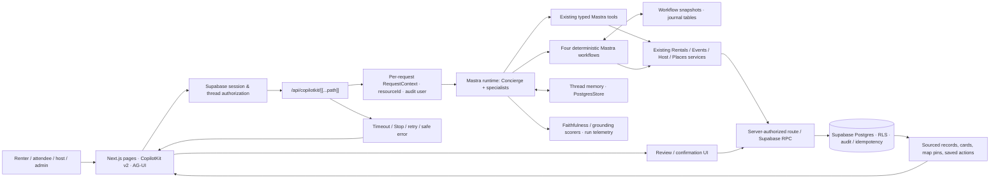
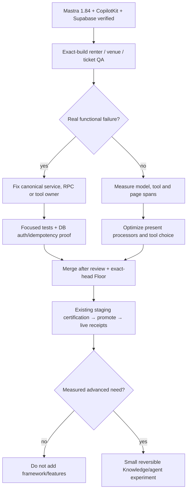

# MDE AI — Mastra Platform Audit and Implementation Tracker

> **Date:** 2026-11-22 (America/Bogota)
> **Source of truth:** clean `origin/main` at `0c3daf59afe84b0a8d8423cecb019b05ceee15a5`; live release `/api/version` confirmed same SHA.
> **Purpose:** source-backed architecture audit and executable remediation plan for the existing MDE Mastra/CopilotKit/Supabase stack.
> **Source request:** [01 — Full Mastra Audit/Implementation Brief](./01-MDE%20AI%20%E2%80%94%20Complete%20Mastra%20Platform%20Audit-Improvements%20and%20Implementation.md).
> **Phase:** A — PRELAUNCH DEVELOPMENT. **Never introduce business approvals, eligibility, ownership, publishing or booking certification prerequisites.** Maintain auth, private data, RLS, atomic writes, idempotency, and truthful provenance.

## 1. Executive summary

**Decision:** Keep and improve the nine existing agents, four workflows, one Mastra runtime, current Next.js + CopilotKit bridge, Supabase Postgres/pgvector and existing domain APIs. **Do not** adopt a second agent/search/booking/MCP/storage platform. The Mastra 1.84 rollout is already live and its platform contract passed; the highest-value remaining work is *real user journeys*, durable cross-instance state, clearer venue workflow recovery and instrumentation rather than speculative new agents.

| Subject | Verified finding | Classification |
|---|---|---|
| Exact production app | Both `www.mdeai.co` and `mdeai.co` returned `0c3daf59afe8` on `/api/version` in the prior post-merge verification; current clean baseline is same SHA | Verified baseline, not proof of all features |
| Dependencies | `@mastra/core@1.84.0`, `mastra@1.40.0`, `@mastra/pg@1.37.0`, `@mastra/memory@1.41.2`, `@mastra/client-js@1.61.0`, `@ag-ui/mastra@2.0.2`, `@copilotkit/runtime@1.88.0` | Verified package + lockfile |
| Registry | Nine agents, four workflows, workspace, scorers, single storage owner (`src/mastra/index.ts:26–49`) | Implemented |
| Existing storage | 36 `public.mastra_*` tables, both journal PKs + five secondary indexes, RLS + FORCE RLS, authenticated/anon journal reads denied, no orphan messages in prior live check | Verified deployment/schema |
| Existing chat | Previous exact-release production Playwright: renter 390px search/cards/follow-up/reload and User A/B isolation, authenticated wallet; **not** proof of every tool or action | Verified scoped journeys |
| Test run for this audit | `npm run check:mastra` passed; `npm run test:mastra`: **1,203 passed, 46 skipped** on clean `origin/main` (120 test files passed; 10 skipped) | Automated evidence; skips are not passes |
| Core risks | In-process-only working-memory lock; hard-coded workflow resume step; live authorized venue resume/retry and payment-to-QR proof incomplete | Two code-supported risks + missing journey proof |
| Scope exclusions | No business gate activation, no destructive production migrations, no real ticket payment charges, no false verified-inventory claim | Explicit |

**Scoring:** “Priority /100” below is an *estimated engineering priority*, not % complete. Weighted rubric: user value 30, observed gap 25, reuse 20, implementation effort 15, safety 10. An item can score highly without being a proven defect. Status uses **Verified working**, **Risk/needs proof**, **Incomplete**, **Optional**, or **Not used**. Never call a capability “broken” merely because no dedicated test was run.

**Audit method:** Read `AGENTS.md`, `.claude/skills/INDEX.md` and `errors`, `praudit`, `linear-task`, `implement`, `efficient`, `mastra`, `supabase`, `testing` skills; inspected `prd.md`, `roadmap.md`, `mvp.md`, current main code/tests/lockfile, live Linear statuses, official Mastra docs and Context7; ran focused clean-main tests. Local `/home/sk/mdeai` has unrelated uncommitted changes including `src/mastra/index.ts` and package files: those edits are **not** the audited runtime and must not be reset or swept into a Mastra change.

## 2. Architecture — existing paths, not a proposed replacement

**Crucial distinction:** `requestVenueBookingTool` prepares a proposal and deliberately performs **no booking write** (`src/mastra/tools/request-venue-booking.ts:38–77`). The authorized UI/API owns the actual transaction. A Mastra “success” therefore cannot certify a saved venue request, lead, ticket, webhook or payout. Similarly, a proposed card is not evidence of availability, ownership, coordinates or payments.

## 3. Runtime, security, memory and model inventory

| Surface | Source + lines | Verified role / status | Action |
|---|---|---|---|
| Runtime registry | `src/mastra/index.ts:1–49` | Nine agents, four workflows, scorers, workspace and `getMastraStorage()` | Keep single owner |
| Per-user CopilotKit bridge | `src/app/api/copilotkit/[[...path]]/route.ts:242–323` | Session authorization; sets `MASTRA_RESOURCE_ID_KEY`, audit user, host/rental scoped Supabase clients and partner context | Retain; keep User A/B negative tests |
| Provider selection | `src/mastra/lib/models.ts:28–71` | Defaults to configured Gemini Flash Lite; `MDE_AI_PROVIDER=nvidia` selects NVIDIA path; Concierge NVIDIA fallback to Gemini; usage wrapper | Check actual runtime env and per-request cost before changing |
| Thread working memory | `src/mastra/lib/agent-memory.ts:99–326` | Shared Postgres-backed Memory, `scope: "thread"`, deliberate null-clear shim and per-process lock | Preserve shim; add cross-instance concurrency proof |
| Cross-instance memory lock | `src/mastra/lib/agent-memory.ts:65–86` | Explicit **in-process** mutex; comments acknowledge DB is last-write-wins across instances | Risk: stale pin/furnishing on concurrent requests; design atomic compare/update only if reproduced |
| Durable storage | `src/mastra/lib/storage.ts:58–174` | Production chooses write-capable Postgres URL, enforces TLS/CA, pool max 3, `disableInit: true`; LibSQL for local/build | Keep schema migrations canonical, never runtime DDL |
| Processors | `src/mastra/lib/agent-input-processors.ts:1–30` | `TokenLimiter` always; `PromptInjectionDetector` opt-in by env | Benchmark on a fixed corpus, do not force expensive global guard |
| Concierge input/output | `src/mastra/agents/concierge.ts:535–653` | Deterministic tool-choice processors, route failure output guard, 10-message memory window, bounded model fallback | Regress every existing tool route and Stop |
| Evaluation | `src/mastra/scorers/index.ts:1–20` | Registered `faithfulness` + `grounding-coverage` scorers | Turn into an actionable release eval, not only Studio-visible scorers |
| Studio Builder | `src/mastra-studio/index.ts:1–56` | Explicit opt-in, local LibSQL, restricted editor tools, prohibited on Vercel | Keep local-only; do not count as live product agent |

**Provider truth:** `ACTIVE_TEXT_MODEL` is **environment-dependent**. The code defaults to `gemini-3.5-flash-lite` and permits NVIDIA when selected, while `PRO_MODEL` stays Gemini (`src/mastra/lib/models.ts:7–45`). Without an exact request-level provider receipt, avoid claiming every live call used one vendor. The configured fallback is limited to the Concierge model path; do not assume every specialist automatically shares it.

## 4. All nine registered agents

| Agent | Source | Tools/model/memory | Real-world job | Assessment / next proof |
|---|---|---|---|---|
| Concierge | `src/mastra/agents/concierge.ts:535–653` | `CONCIERGE_AGENT_MODEL`; 15 registered tool aliases; bounded processors; thread memory | One question for rentals/events/venues/maps and structured cards | **Working core**: renter and privacy live proof. Check event freshness, comparisons, Stop, tool-card replay |
| Router | `src/mastra/agents/router.ts:7–48` | `classifyIntentTool` + `ACTIVE_TEXT_MODEL` | Classify rental/event/local intent | Registered ≠ evidence it is the live user-facing router. Trace callers before adding delegation |
| Rentals | `src/mastra/agents/rental-agent.ts:34–125` | `searchRentalsTool`, `ACTIVE_TEXT_MODEL`, thread memory | Find grounded apartments | Keep deterministic search and card/map alignment; no parallel search engine |
| Events | `src/mastra/agents/event-agent.ts:37–99` | `searchEventsTool`, `ACTIVE_TEXT_MODEL`, thread memory | Discover real events, avoid fabricated tickets | Verify exact event source and non-invented time/price in live test |
| Host Events | `src/mastra/agents/host-event.ts:8–20` | No direct registered agent tools; `ACTIVE_TEXT_MODEL`, event draft memory | Help a host draft/prepare events | The host UI/domain APIs own publish; prove real draft→edit→publish via existing route |
| Host Operations | `src/mastra/agents/host-ops.ts:21–32` | `listHostEventsTool`, `getSalesSummaryTool`, `getSalesInsightsTool` | “Which bookings or sales need attention?” | Validate host identity in RequestContext and real SQL aggregate visibility |
| Partners | `src/mastra/agents/partner-agent.ts:22–28` | `getPartnerProfileTool` | Read scoped partner information | Verify cross-partner denial and no fabricated fallback |
| Evaluation | `src/mastra/agents/evaluation.ts:4–34` | `ACTIVE_TEXT_MODEL`, rerank labels | Label rental/event fit for controlled evaluation | No user-visible success implied by registration; measure versus deterministic ranking |
| Ping | `src/mastra/agents/index.ts:21–38` | No tools, `ACTIVE_TEXT_MODEL`, thread memory | Development wiring diagnostic | Keep for diagnostic use; not an extra business specialist |

**Agent rule:** Improve selection/context within Concierge and existing specialist paths first. An autonomous supervisor is not justified by the current nine-agent registry alone. Use the same fixed test questions to prove any cross-domain delegation wins more grounded completions than it costs in tokens and latency.

## 5. Mastra tool inventory (every defined `createTool`, plus non-tool helpers)

**Meaning of status:** “Registered” establishes wiring, **not** that a particular live call succeeded. The correction column is the smallest warranted next proof or improvement. The “read-only” label refers to the Mastra tool body; real bookings and updates happen through separate authorized routes.

| Tool / source | Registered caller | What it returns or does | Evidence-based status and smallest action |
|---|---|---|---|
| `classifyIntentTool` — `tools/classify-intent.ts:7` | Router | Validated intent/confidence echo | **Registered but cheap no-op:** avoid model round trip if deterministic classifier already exists; measure routing accuracy first |
| `extractIntentSlotsTool` — `tools/extract-intent-slots.ts:10` | Not on current Concierge tools map | Zod-validated echo of model-generated slots | **Intentionally unused:** keep out of main path; Concierge comments explicitly record latency removal (`concierge.ts:562–566`) |
| `searchRentalsTool` — `tools/search-rentals.ts:771` | Concierge, Rentals and rental workflow helper | Structured rentals with source truth and compact `toModelOutput` (`:833`) | **Core implemented:** ensure hard criteria, development-mode visibility, non-invented coordinates; test API 200, cards, pins and persisted viewing separately |
| `searchNewProjectsTool` — `tools/search-new-projects.ts:262` | Concierge | Canonical new-project cards | **Implemented:** test project identity and available source facts |
| `compareNewProjectsTool` — `tools/compare-new-projects.ts:137` | Concierge | Compares supplied project slugs | **Implemented:** test incomplete fields never become invented price/spec |
| `searchEventsTool` — `tools/search-events.ts:401` | Concierge, Events, workflow helper | Source-backed events and date windows | **Core implemented:** test this-weekend timezone, exact source URLs, actual active event records |
| `searchRestaurantsTool` — `tools/search-restaurants.ts:555` | Concierge | Catalog rows and explicit source status | **Implemented:** deterministic fixture rows are marked nonproduction (`:63–67`); test genuine provider outage yields “unavailable”, not fake venues |
| `searchAttractionsTool` — `tools/search-attractions.ts:258` | Concierge | Grounded local attraction search | **Implemented:** verify Places place IDs, missing coordinates and field masks |
| `searchGroundedPlacesTool` — `tools/search-grounded-places.ts:376` | Concierge | Nearby/venue grounded results | **Implemented:** verify selected map area and no imaginary location data |
| `searchWebGroundedEventsTool` — `tools/search-web-grounded-events.ts:14` | Concierge | Web-grounded external event candidates | **Needs provenance regression:** distinguish event listing from verified inventory/payment authority; present real source URL and unknown availability |
| `computeRouteTool` — `tools/compute-route.ts:68` | Concierge | Routes, request-scoped cache and in-flight deduplication | **Implemented:** route tool and cache at `:99–268`; measure provider errors, no model-invented ETA/distance |
| `lookupPublicDiscoveryItemTool` — `tools/lookup-public-discovery-item.ts:127` | Concierge | Canonical selected-entity facts | **Implemented:** compare selected names/IDs with server record, not user-supplied claims |
| `readBrokerWorkspaceTool` — `tools/read-broker-workspace.ts:11` | Concierge | Broker overview/listings/viewings | **Security-sensitive:** test anonymous, wrong broker and correct broker using current server context |
| `getPartnerProfileTool` — `tools/partner-profile-tool.ts:25` | Partner Agent | RequestContext-scoped partner profile | **Security-sensitive:** test tenant A/B and missing identity fail safely |
| `listHostEventsTool` — `tools/hostops-read-tools.ts:43` | Host Ops | Host event summaries | **Security-sensitive:** real logged-in host only; user B sees no user A events |
| `getSalesSummaryTool` — `tools/hostops-read-tools.ts:60` | Host Ops | Event sales summary | **Security-sensitive:** verify paid order totals from DB, never claim payment settled from AI prose |
| `getSalesInsightsTool` — `tools/hostops-insight-tool.ts:35` | Host Ops | Read-only operator insights | **Implemented:** compare numeric answer with database aggregate for authorized host |
| `requestVenueBookingTool` — `tools/request-venue-booking.ts:55` | Concierge | Validated **proposal** only; no DB booking mutation | **Deliberate HITL:** do not turn into direct write; prove UI confirm→authorized API→one persisted request/retry |
| `showRecommendationsTool` — `tools/show-recommendations.ts:31` | Concierge | Selects source-backed IDs for UI cards | **Implemented:** check source IDs and current A2UI card rendering |
| `showRentalFilterControlTool` — `tools/show-rental-filter-control.ts:12` | Concierge | Offers editable filter UI | **Implemented:** verify user changes are actually applied to page filters and results |
| `showViewingProposalTool` — `tools/show-viewing-proposal.ts:14` | Concierge | Editable viewing proposal | **Implemented:** test against existing viewing API, no false “booked” response |
| `nearby-rental-places.ts`, `search-venue-anchors.ts` | Helpers, not necessarily `createTool` | Local results / fixture data for other paths | **Do not count as independent registered agents/tools.** Trace source callers before editing or exposing |
| `whatsapp-rental-reply.ts`, `audit-wrapper.ts` | Shared helper/adapters | Formatting, run audit | **Keep reused**; do not create duplicate tool/event pipeline |

**Tool problems worth testing (not automatically defects):** RequestContext absent or wrong tenant; Supabase query failures represented as plausible empty success; stale or invented coordinates; wrong USD/COP formatting; repeated searches with identical criteria; text that asserts an uncommitted transaction; abort after tool execution; and a second identical request causing a duplicate transaction. Use data-backed assertions rather than checks for a nonempty AI paragraph.

### Tool choice: native vs advanced discovery

- Current Concierge has **15** tools in its active map and several deterministic per-turn selection processors (`concierge.ts:567–642`). There is **no demonstrated selection-cost bottleneck attributable to too many tools**.
- **Do not add ToolSearchProcessor** without measuring prompt/tool-schema tokens, wrong-tool rate and latency at current inventory size on exactly the same corpus; if there is a repeatable benefit, add behind a server-side feature flag and compare against baseline.
- `toModelOutput` is already used by `searchRentalsTool` (`:833`); expand its compact-output pattern only for demonstrably oversized tool results, preserving the full structured response to the UI.
- MCP tools are **not** a substitute for authenticated, tested internal domain RPCs.

## 6. All four registered workflows

| Workflow | Actual flow & file | What is currently true | Remaining proof |
|---|---|---|---|
| Rental Search | `src/mastra/workflows/rental-search-workflow.ts:55–288`: search → format → deterministic rerank | Uses existing search helper; `rerankStep` **is connected** (`:284–286`). No second rental-search engine required | Compare hard filters, fit ranking, maps and viewing writes using same query; check “Best for” labels are derived from records |
| Event Discovery | `src/mastra/workflows/event-discovery-workflow.ts:35–95`: search → card formatting | Calls `searchEvents()`; step description still says “mock data” (`:37`) although API flow is real; **stale comment**, not proof of fabricated events | Real “live music this weekend” with event IDs, dates, sources; empty-catalog recovery |
| Event/Venue Booking | `src/mastra/workflows/event-venue-booking-workflow.ts:31–157`: validate existing request → suspend admin review → apply decision → notification stub | Durable suspend/resume; business decision uses existing server-side DB service; `notifyAdminStep` always returns `notified:false` (`:119–139`) | Run *dedicated QA booking* through suspend → cold process → authorized resume once → persisted decision; duplicate replay and wrong-actor denial. Do not demand **business approval** as a development prerequisite |
| Sales Insight | `src/mastra/workflows/sales-insight-workflow.ts:26–55`: compute → narrate | Deterministic metrics then natural language | Real operator SQL total exactly matches claim; wrong tenant denied; no fabricated revenue |

**Concrete recovery improvement:** `src/lib/events/start-admin-review-workflow.ts:29,49` hardcodes `"suspend-for-admin-review"` both when returning a step and when resuming. This currently matches `event-venue-booking-workflow.ts:68`; it is **not a reproduced failure**. A later nested/renamed/foreach suspended step could make the restored run unresumable or resume the wrong thing. Use the installed `createWorkflowStateReader(state).getSuspendedStep()` and the returned **`path`** where supported. Re-check the saved booking/run binding, independently authorize the *acting user* in the API, atomically transition the booking, and prove a duplicate resume cannot send a second side effect. Never trust `resumeData.actorId` alone.

**Important Phase A distinction:** The workflow’s “admin review” is an implemented *product action to test*, **not** permission to block development event booking. Business approval gates remain deferred. Preserve admin audit trail and identity-bound write semantics.

## 7. Processors, memory, reliability, operations

| Capability | Source/evidence | Assessment | Recommended check |
|---|---|---|---|
| TokenLimiter | `lib/agent-input-processors.ts:22–29` | On by default; no model round trip | Compare token budget, truncation frequency and follow-up context |
| PromptInjectionDetector | `lib/agent-input-processors.ts:25–27` | Opt-in via `MASTRA_PROMPT_INJECTION_GUARD=true`. Historical comment reports 3–5s latency; **not freshly measured in this audit** | Run paired same-corpus tests (on/off): latency, false positives, tool misuse |
| Deterministic guardrails | `agents/concierge.ts:584–642` | Current tool-choice and verified-selection guards are more targeted than global model checks | Test direct malicious place/listing instructions do not override server auth |
| Output guard | `agents/concierge.ts:643–645` | Prevents unavailable route from becoming an estimated ETA | Inject route API failure and assert no invented distance |
| Provider fallback | `lib/models.ts:59–71` | NVIDIA primary fallback to Gemini, bounded by timeouts | Instrument which model answered; stop must abort all downstream work; no retry after consequential write |
| Stored working memory | `lib/agent-memory.ts:65–86,99–326` | Thread scope and null-clear support; cross-instance lock remains last-write-wins | Two **separate OS processes** update same thread (set → clear) with controlled generations; assert newest wins |
| Postgres durability | `lib/storage.ts:147–174` | TLS, small connection pool, no runtime schema init | Provider connection cut and restart; no lost threads or repeat effects |
| Evaluation scorers | `scorers/index.ts:8–11` | Faithfulness and grounding coverage registered | Fixed dataset + scored release report; Studio-visible scorer alone is not running production eval |
| Streaming / Stop | `src/mastra/copilotkit/logging-mastra-agent.ts` and CopilotKit route | Integrated with existing AG-UI adapter | Real browser: stop midstream, tool called once, no old response in new thread |
| Studio Builder | `src/mastra-studio/index.ts:12–55` | Local-only EE builder, isolated LibSQL and tool allowlists empty | Ensure deployment/bundle never imports builder code |
| MCP / Knowledge | No `MCPClient`, `MCPServer`, `ToolSearchProcessor` or Knowledge initialization found in active `src/mastra` or `src/mastra-studio` source search | **Not present as runtime features, not “broken”.** Other MCP configs elsewhere are not equivalent to exposing app tools | Only prototype for a verified user need; no generic public `/api/mcp` |

**Reliability rule:** All user-facing success states must come from the canonical persisted action receipt. A model's “done” text or a Mastra run status is insufficient for a lead, booking, notification, ticket, payout or payment. Keep idempotency on the existing DB/Stripe boundaries.

## 8. MCP and Mastra Knowledge — decision matrix

| Need | Existing app evidence | Decision |
|---|---|---|
| Internal Rentals, Events, broker and admin data | Native typed tools + existing services/RPCs are present | **KEEP native tool.** No new MCP client/server |
| External specialist provider offers a needed authenticated MCP tool | No provider-specific unmet workflow established in this audit | **DEFER MCPClient** until a concrete provider, identity propagation, retry and value proof exists |
| Authorized external agent must call a selected MDE capability | No requirement to expose all internal agents; no curated server found in active runtime | **DEFER curated MCPServer**; if later justified, expose allowlisted read-only tools first, keep server auth + RLS |
| Mastra's built-in `/api/mcp` | Modern official docs describe this endpoint, but MDE Next.js route is not automatically that Mastra server | **DO NOT EXPOSE** simply to populate Studio; verify API/version and external auth before any opt-in |
| Larger tool catalogs | Concierge registers 15 tools, some forced by deterministic step processors | **NO ToolSearchProcessor now**; only add if corpus shows wrong-tool or tool-schema context costs |
| MDE help/runbooks/host setup | `prd.md`, product docs and runbooks already exist; **not** live prices, events or ownership | **OPTIONAL read-only Knowledge experiment**, using existing Postgres/pgvector only if compatible; keep content separate from live search |
| Knowledge as private tenant database | Official Knowledge is alpha and scope access alone is not a complete tenant security boundary | **REJECT** without explicit server auth and cross-scope negative tests |

**Knowledge pilot contract:** choose five public, non-sensitive documents; index source ID/hash/revision, citation URL and removal timestamp; compare no-answer and outdated-answer behavior to existing source links; require deleted documents to stop appearing after reindex; never add ticket/user/listing content; never enable agent write/edit tools in the first pilot. If a direct FAQ/search over existing docs meets accuracy/latency goals, **do not adopt Knowledge**.

**Version caution:** documentation at `mastra.ai` and GitHub `main` evolves faster than the pinned `@mastra/core@1.84.0`. The site currently describes MCP protocol changes and alpha Knowledge; they are **research references**, not proof that the exact installed package and deployment support every new option. Use installed exports/types first. Installed `createWorkflowStateReader` was explicitly verified to be a function exported from `@mastra/core/workflows` in the clean main worktree.

## 9. Forensic findings — defect vs risk vs unknown

| Severity | Evidence and exact owner | User impact / reproduction | Root cause / smallest canonical fix | Owner / confidence / status |
|---|---|---|---|---|
| **P2 risk** | `lib/agent-memory.ts:65–86` explicitly uses a process-local `Map` lock and acknowledges cross-instance last-write-wins | Open same user thread in two isolated server processes; race “set furnished” with “clear furnished”; newest preference might be lost | Add two-process failing test; if reproducible, implement generation-aware atomic storage compare-and-set in the **existing** memory persistence owner. No second memory engine | `SAN-1299`; high confidence in design limitation, **failure unproven** |
| **P2 risk** | `src/lib/events/start-admin-review-workflow.ts:29,47–50` hardcodes step ID | Rename/nest/foreach a suspended step and try restoring it | Resolve persisted suspended step from `getWorkflowRunById` + `createWorkflowStateReader`; validate expected booking/run and server actor; retry once without repeat side effect | `SAN-881` complete durability baseline / `SAN-501` workflow; high code confidence; **no incident demonstrated** |
| **P2 incomplete** | `workflows/event-venue-booking-workflow.ts:119–139` notification stub always returns `notified:false` | Submit venue review and expect notification to be delivered | Do not claim operator was notified. If current product requires it, use existing event notification/outbox service with idempotency and actual receipt; not a new Mastra workflow | Check existing venue ops ownership, e.g. `SAN-312`; high confidence |
| **P2 missing proof** | ``/api/copilotkit` auth exists; existing QA tests prove renter & privacy but not full venue/Stripe journey | Two real “resume” API calls / webhook redelivery / operator read after saved action | Use existing SQL/Stripe test-mode and exact-deployment browser; assert one persisted status, one ticket/lead and other-user denial | `SAN-305`, `SAN-754`, `SAN-483`; high confidence in *coverage gap*, not defect |
| **P2 operational gap** | `scorers/index.ts:8–11` registers two scorers; `SAN-856` Todo, `SAN-1395` Backlog | Model can emit poorer grounded cards without an automatic alert tied to user journey | Fixed versioned production-like evaluation corpus, cost/latency counters, lightweight release comparison; reuse existing scorer and logs | `SAN-856` + `SAN-1395`; high confidence in incomplete operational proof |
| **P2 adjacent symptom** | Previous production Vercel log showed `/api/leads/schedule-viewing` returning `LISTING_UNAVAILABLE` while Phase A requestability projection counted 45/45 visible | Renter clicks Schedule Viewing and gets unavailable even though listing is displayed | **Do not conclude Mastra is at fault.** Correlate failed canonical listing reference and DB lookup. Existing **open PR #924** adds safe diagnostics; review that PR first, do not duplicate solution | `SAN-1502`; confirmed observed error, underlying identity mismatch **unknown** |
| **P3 documentation defect** | `workflows/event-discovery-workflow.ts:37` says helper has “mock data”, but `:43–50` calls `searchEvents` | Engineers may incorrectly believe live event discovery is synthetic | Change only the stale step description after verifying current helper; no new service | `SAN-125` existing backlog; high confidence |
| **P3 measurable risk** | `agents/concierge.ts:567–642` exposes 15 tools and many forced-choice processors | A long prompt or multiple tool calls may waste tokens | Benchmark same question corpus first; prune only measured redundant instructions. Do not blindly add ToolSearchProcessor | `SAN-1003` backlog, `SAN-856` Todo |
| **P3 optional** | Active Mastra tree has no Knowledge or MCPClient/Server initialization | Operator FAQs cannot yet use Mastra Knowledge directly | Only add a read-only Knowledge proof if existing document lookup fails; no parallel pgvector platform | Post-MVP candidate; not a defect |
| **Unknown** | Current audit did **not** run a fresh p50/p95/TTFT or dollar-per-success A/B experiment | A recommended processor/model switch may trade speed against answer correctness | Instrument request and tool spans first, compare identical queries under unchanged traffic shape, and refuse cost claims without provider usage records | `SAN-856` + `SAN-1003` |

**Explicitly dismissed as non-defects:** “Nine agents means nine active Concierge paths” (false; registrations are not routing); “all non-production fixtures are live” (false for deterministic restaurant fixtures, gated by `isDeterministicE2E`); “rental rerank step is missing” (false, `rental-search-workflow.ts:284–286`); “a saved venue proposal is automatically a confirmed booking” (false); “zero new journal rows means migration failed” (false; legacy snapshots are retained and new tables are demand-driven). Cross-tenant auth and DB grants are *tested*, not inferred from a prompt.

## 10. Core features — priority score /100

| Priority score | Capability | Current state | Existing owner / exact files to change | Smallest implementation + verification |
|---:|---|---|---|---|
| **97** | Real user-journey verification | **Incomplete scope**, though platform and renter/identity smoke passed | `SAN-755`, `SAN-483`, `SAN-754`; reuse existing Playwright + services | Rent→Details→viewing→one lead+showing/broker; event→checkout(TEST)→webhook→QR; host draft→publish |
| **93** | Venue once-only resume | **Durable DB proof passed; live authorized decision needs proof** | `SAN-501`, `SAN-881`; `src/lib/events/start-admin-review-workflow.ts` | Two-process cold restart + authorized actor + duplicate resume + audit receipt |
| **91** | Reliable tool/action results | **Implemented, requires per-tool negative cases** | `SAN-1245`, `SAN-305`; `src/mastra/tools/` + domain APIs | Fail provider safely; no fake data; save exactly one backend record |
| **89** | Cross-instance memory update correctness | **Design risk** | `SAN-1299`; `lib/agent-memory.ts` + integration test | Independent workers race; newest preference wins or measurable conflict/retry |
| **87** | Grounded cards/maps and source attribution | **Working core; event/version regression proof missing** | `SAN-128`, `SAN-755`; existing `search-*` tools + CopilotKit renderers | Event, rental, café result IDs match canonical source and displayed pin |
| **85** | AI run observability and cost | **Instrumentation partially implemented; task Todo** | `SAN-856`, `SAN-1003`; `lib/models.ts`, usage wrapper, existing logs | p50/p95, TTFT, tokens/model, failure reason, cost per completed request |
| **83** | Automated grounded-answer evaluation | **Two scorers implemented; automation incomplete** | `SAN-1395`; `scorers/*` and existing QA fixtures | Faithfulness/source coverage on versioned corpus; fail real regressions |
| **78** | Graceful streaming/Stop and retries | **Implemented; scoped prod proof** | `SAN-1245`, `SAN-1407`; `logging-mastra-agent.ts` / route tests | Network cut after tool ≠ duplicate; Stop cancels; clean new thread |
| **72** | Deterministic processor optimization | **On with deliberate guard opt-in** | `SAN-1003`; `agent-input-processors.ts` | Same prompts/conditions, compare TTFT, injection bypass and false refusal |
| **56** | Read-only operational Knowledge | **Missing but optional / alpha** | New issue **only if** existing issues do not own measured gap; `src/mastra` | Public docs FAQ pilot, 0 cross-tenant leaks, citations and removals |

**Suggested threshold to ship a feature, not a fabricated historical metric:** 100% of explicit authorization/transaction tests pass, no P0/P1 issue, no new duplicate writes, and an improvement in a predeclared measure relative to baseline on the same dataset. No unmeasured percent-complete values are assigned.

## 11. Advanced features — evaluate, do not install by default

| Priority /100 | Proposal | Decision, prerequisites, risks and expected proof |
|---:|---|---|
| **81** | Dynamic suspended-step recovery | **ADAPT installed state reader** inside existing venue workflow helper. Small, backwards-compatible change; demonstrate nested and restored run correctness, no duplicate DB decision |
| **75** | Model/cost-aware routing | **Experiment, not rollout**. Existing Gemini/NVIDIA selection is implemented; collect comparable exact-model receipts, compare grounded quality and dollar cost before enabling a cheaper path |
| **69** | Step-level trace/diagnostics | **Reuse existing logging and scorer infrastructure**; add non-PII span attributes (intent, tool ID, source type, latency, outcome). Sample and redact |
| **54** | Operational Knowledge retrieval | **Pilot only**, alpha release, read-only public docs, do not duplicate pgvector; reject if stale/removal/access tests fail |
| **47** | Supervisor / specialist delegation | **Defer** until 30+ cross-domain benchmark queries show existing Concierge fails and delegation meaningfully improves quality without unacceptable latency/cost |
| **35** | Context-aware tool discovery | **Defer ToolSearchProcessor** until recorded schema-token context and wrong-tool failures justify it |
| **30** | External MCPClient | **Defer** without specific authorized service, connection lifetime, token handling and rollback |
| **23** | Curated MCPServer | **Defer**, no external MDE client requirement. If needed, explicitly allowlist and independently authorize each tool; never publicly expose whole runtime |
| **17** | Agent-generated dynamic business workflows | **Reject now** for rentals/bookings/payment paths; existing deterministic workflows and atomic SQL are cheaper and safer |
| **12** | New vector store / booking framework / orchestration platform | **Reject**: duplicates canonical Supabase, Mastra and domain logic |

## 12. Verified Linear ownership — one tracker, no duplicate tasks

These names/statuses were checked directly in Linear on **2026-11-22**. Percent complete is **not assigned** when acceptance criteria cannot be converted into an independently observed count. Task `Done` means *Linear says Done*, not that every live product journey is certified. PRs are listed only where the relationship is grounded; a possible related PR is called out as related, not silently linked.

| Priority | Linear task | Component | Feature / defect | Status | Complete | PR | Evidence | Next action |
|---|---|---|---|---|---|---|---|---|
| P2 | [SAN-1698 · MASTRA-UPG-002 — Upgrade MDE to Mastra 1.84](https://linear.app/amo100/issue/SAN-1698) | Mastra runtime | Core/PG 1.84 upgrade | 🟢 Done in Linear | Scoped release verified | #909 and #917 merged | Exact release SHA and database migration/security certified; 1,203 Mastra tests passed | Preserve regression; track separate advanced work without redoing upgrade |
| P1 | [SAN-755 · MDE QA — Prove AI Rental Search, Map, Details, and Viewing End-to-End](https://linear.app/amo100/issue/SAN-755) | Rentals QA | Rentals ↔ Mastra ↔ atomic lead/showing | 🟡 In Progress | Not measured | — | Scoped real 390px renter cards/reload passed | Re-run complete saved viewing + correct broker + retry test |
| P1 | [SAN-305 · MDE Venues — Prevent Duplicate Venue Booking Requests](https://linear.app/amo100/issue/SAN-305) | Venue booking | Venue booking idempotency | 🔵 Todo | Not measured | — | Existing proposal tool never saves; DB writer is separate | Two identical authorized confirms produce one request, one audit record |
| P1 | [SAN-754 · MDE QA — Prove Host AI Event Draft, Review, and Publish End-to-End](https://linear.app/amo100/issue/SAN-754) | Host Events QA | Host Events action result | 🔵 Backlog | Not measured | — | Host agent has draft memory but no tools in its agent registration | Use existing host UI/API to prove editable draft → publish; no business approval prerequisite |
| P1 | [SAN-483 · Certify the Complete Rental Journey on the Exact Production Release](https://linear.app/amo100/issue/SAN-483) | Rentals release | Production renter journey | 🔵 Todo | Not measured | — | Post-merge partial renter smoke was green, not full end-to-end viewing | Exact-deployment transactional proof |
| P1 | [SAN-1299 · EPIC · Make MDE AI Chats, Memory, and Workflows Reliable in Production](https://linear.app/amo100/issue/SAN-1299) | Mastra Memory | Durable memory and recovery | 🟡 In Progress | Not measured | #909 merged (upgrade proof) | Thread scope, in-process lock, exact-release isolation | Two-process update/clear race and stale-version retry proof |
| P1 | [SAN-1502 · MDE Rentals — Enable Full Development Journeys and Defer Real-World Approval Gates](https://linear.app/amo100/issue/SAN-1502) | Rentals / Supabase | Phase A viewing access and truthful record identity | 🟡 In Progress | Not measured | Related open #924 diagnostics | Prior live `LISTING_UNAVAILABLE` error despite 45/45 requestable apartment projection | Review #924; capture hashed failed ID and distinguish missing slug from true privacy block |
| P2 | [SAN-856 · See What Every AI Request Cost, How Long It Took, and Where It Failed](https://linear.app/amo100/issue/SAN-856) | Observability | Model/tool observability | 🔵 Todo | Not measured | — | Token usage middleware exists, but end-to-end cost report not proven | Trace model selection, TTFT, p50/p95, tokens/cost by actual successful user outcome |
| P2 | [SAN-1003 · Show Exactly Where a Rental AI Request Slows Down or Fails](https://linear.app/amo100/issue/SAN-1003) | Rental AI performance | Rental AI performance | 🔵 Backlog | Not measured | — | Processor historical latency note is not fresh measurement | Same-corpus phase spans: search, LLM, tool, UI render |
| P2 | [SAN-1395 · Check Live Chats for Made-Up Claims Using the Quality Checkers We Already Built](https://linear.app/amo100/issue/SAN-1395) | AI quality | Faithfulness/scorer release gate | 🔵 Backlog | Not measured | — | Two registered scorers, no new benchmark in this audit | Reuse scorer core + source-backed fixtures; compare exact revisions |
| P2 | [SAN-1245 · Keep MDE Usable When AI Is Down, Slow, or Broken](https://linear.app/amo100/issue/SAN-1245) | AI reliability | Graceful failure and Stop | 🔵 Backlog | Not measured | — | Bounded retry/output guards implemented; live Stop scenario needs explicit test | Provider 429/503, route timeout, stream abort, clean retry and no duplicate tool action |
| P2 | [SAN-128 · Show Trusted Event Cards With Sources and Approval Before Saving](https://linear.app/amo100/issue/SAN-128) | Event cards | Event source attribution and user-confirmed save | 🔵 Backlog | Not measured | — | `searchEventsTool` and cards exist, not this whole flow | Grounded event card → exact source → user action saved truthfully |
| P2 | [SAN-876 · INT-024 — Topic-switch regression test matrix](https://linear.app/amo100/issue/SAN-876) | Routing QA | Cross-domain agent intent context | 🔵 Todo | Not measured | — | Previous 390px renter test skipped three opt-in topic switch cases | Run rentals→events/restaurants/coworking with context resets |
| P2 | [SAN-125 · EVT-007 — eventDiscoveryWorkflow (Mastra)](https://linear.app/amo100/issue/SAN-125) | Mastra Workflows | Registered event discovery workflow | 🔵 Backlog | Not measured | — | Workflow **exists** in main; backlog task title may be stale | Reconcile task criteria with already shipped source; target remaining live event proof, not duplicate workflow |
| P2 | [SAN-1309 · Catch Integration Breaks Between MDE Systems Before Merge](https://linear.app/amo100/issue/SAN-1309) | Cross-system CI | Cross-system CI contract | 🔵 Todo | Not measured | — | Unit test success does not cover payment, operator visibility | Add tiny stable DB/API/browser journey gates to existing CI |
| P2 | [SAN-1386 · EPIC · Mastra Upgrade — Upgrade MDE Without Losing Chats or Breaking Workflows](https://linear.app/amo100/issue/SAN-1386) | Upgrade epic | Upgrade epic remaining work | 🟡 In Progress | Not measured | #909 merged | 1.84 deployment and migration proof complete | Keep epic open only for remaining acceptance gaps |
| P2 | [SAN-501 · EVT-042 — eventVenueBookingWorkflow](https://linear.app/amo100/issue/SAN-501) | Venue Workflow | Venue workflow | 🟢 Done in Linear | Not measured | — | Workflow registration & suspend code present | Do not reopen merely for optional state reader; prove real QA resume under existing owner |
| P2 | [SAN-881 · VEB-MVP-010 · OPS-PERSIST — Verify Mastra Postgres workflow suspend durability](https://linear.app/amo100/issue/SAN-881) | Postgres durability | PG cold-start workflow | 🟢 Done in Linear | Not measured | #909 has related PG proof | Exact-main CI succeeded on database resume | Preserve regression; separate live booking outcome |
| P2 | [SAN-1201 · MDE Events — Create and Publish Events Through AI Chat](https://linear.app/amo100/issue/SAN-1201) | Host Events | Host event authoring | 🟢 Done in Linear | Not measured | — | Existing UI/domain publish path, not agent-only tools | Leave Done in task scope; SAN-754 owns new journey proof |
| P2 | [SAN-1205 · Prove a Renter Can Schedule a Viewing and the Correct Broker Receives It](https://linear.app/amo100/issue/SAN-1205) | Rental transactions | Lead+showing/broker | 🟢 Done in Linear | Not measured | — | Historical task outcome; no fresh complete exact-build proof in this audit | SAN-755/SAN-483 own future production regression |
| P3 | [SAN-1255 · Keep only Mastra agents with a proven MDE responsibility](https://linear.app/amo100/issue/SAN-1255) | Agents catalog | Agent catalog | 🟢 Done in Linear | Not measured | — | Nine registered in clean source | No new agents until measured demand |
| P3 | [SAN-1407 · Make Chat Searches Resilient: Latest Search Wins, Clean AI Disconnects, and a Stable CopilotKit Connection Rule](https://linear.app/amo100/issue/SAN-1407) | CopilotKit / Mastra | Cancellation and stale results | 🟢 Done in Linear | Not measured | — | Existing processors/bridge; scoped live renter behavior | Keep regression in shared Concierge tests |
| P3 | [SAN-1396 · Keep Every Chat Agent Answering When Gemini Fails, Not Only Rental Search](https://linear.app/amo100/issue/SAN-1396) | Model recovery | Model fallback | 🟢 Done in Linear | Not measured | — | Model fallback and error processors present | Probe provider outages and stop/replay safety |

**PRs verified separately:** [#909](https://github.com/amoai-tech/mdeai/pull/909) **merged** (Mastra 1.84), [#917](https://github.com/amoai-tech/mdeai/pull/917) **merged** (journal DDL), [#924](https://github.com/amoai-tech/mdeai/pull/924) **open** (failed viewing identity diagnostics), [#887](https://github.com/amoai-tech/mdeai/pull/887) **open** (real rental comparison tables), [#506](https://github.com/amoai-tech/mdeai/pull/506) **open** (host manual publish without AI), [#394](https://github.com/amoai-tech/mdeai/pull/394) **open** (venue inquiry deduplication/privacy). These open PRs have distinct scope; do not duplicate them or treat them as merged.

## 13. Smallest ordered implementation roadmap

**Stage 0 — Preserve stable baseline (already verified).** Use the current Mastra Core 1.84, CopilotKit 1.88, 36-table schema, existing service/RPC ownership, and existing exact-build Vercel certification. No new SQL or runtime install. Freeze the same 20–40 representative queries and screenshots/DB receipts for comparison.

**Stage 1 — Fix actual user-facing failures first (existing tasks `SAN-755` / `SAN-1502`).** Review existing #924 and apply the *real* listing identity fix only after hashed-ID evidence. Reuse current `p1_schedule_tour_atomic`. Run search→cards/maps→Details→viewing; assert exactly one lead+showing, correct broker, retry invariant, no private record leak. **Success:** one real QA identity-bound transaction, not a simulated Mastra completion.

**Stage 2 — Close venue/event journey proof (existing `SAN-305` / `SAN-754`).** Create development QA event/venue proposal using existing UI, confirm through existing authorized route, verify stored booking and permitted operators, simulate retry, then recover one suspended admin-review run with a fresh process. Ensure no duplicate side effects and clean up by re-query. Preserve Phase A development access; do not enforce business approval prerequisites.

**Stage 3 — Improve state-reader recovery only if current flow/next feature demands it.** In `src/lib/events/start-admin-review-workflow.ts` load saved run, require `status === "suspended"`, resolve `getSuspendedStep()?.path` (for simple step the path contains one ID), validate booking/run binding and authorization in the caller, resume once and verify DB final state. Add focused nested/renamed/foreach unit cases but do not refactor unrelated workflows. Required independent security review.

**Stage 4 — Prove cross-instance memory ordering (existing `SAN-1299`).** Create two independent Node processes using the same **throwaway** Postgres database, not the live production database. Race memory update/clear for a single authorized thread. If the latest decision loses, change the canonical store to CAS/generation/atomic update and rerun concurrent, retry and wrong-user negative tests.

**Stage 5 — Instrument and evaluate (existing `SAN-856` / `SAN-1395` / `SAN-1003`).** Reuse request IDs, existing token middleware, structured tool outcome logs and faithfulness/grounding scorers. Record a fixed question corpus with one expected underlying data snapshot. Compare before/after: answer quality, correct tool selection, missing facts, p50/p95, TTFT, timeout count, tokens, billed cost per successful action and provider failures. Never report percentages without sample count and recording method.

**Stage 6 — Optional advanced experiments.** Only after the previous core paths pass: read-only Knowledge pilot if existing FAQ lookup is inadequate; then model routing experiment; do not prioritize supervisor, dynamic workflow orchestration, MCP exposure or ToolSearchProcessor without measured ROI.

**Dependency graph:**

## 14. Real-world acceptance tests and source files

| User question / action | Exact existing entry point | Required user-visible result | Backend and negative proof |
|---|---|---|---|
| “Find furnished two-bedroom apartments in Laureles below COP 3 million” | `src/mastra/tools/search-rentals.ts` + existing Rentals/Concierge page | Correct cards, COP budget, matching map pins, honest missing fields | Real Supabase listing IDs, hard requirements, no made-up coordinates; 390px and refresh |
| “Compare these apartments” | `tools/lookup-public-discovery-item.ts` + existing comparison UI / open #887 | Side-by-side source-backed facts, never guessed availability | Same record IDs, missing values remain unknown; User B cannot read private selections |
| “Find live music this weekend” | `tools/search-events.ts` → current Events UI / workflow | Actual published/in-development eligible event cards, source URL, local time and real ticket action | Same event IDs in Supabase, no fabricated price or ticket count; explicit empty-result UI |
| “Which upcoming event bookings need attention?” | `agents/host-ops.ts`, `tools/hostops-read-tools.ts` | Real host scoped queue and correct numeric summary | SQL aggregate matched exactly; other host denied |
| “Confirm the viewing/venue request” | Existing editable HITL UI + authenticated route, **not** tool prose | Committed receipt, one visible saved transaction | Retry same idempotency key; exactly one lead+showing or venue request; unauthorized actor denied |
| Resume a paused venue review after restart | `workflows/event-venue-booking-workflow.ts` + `start-admin-review-workflow.ts` | Review resumes on exact suspended step once; state reflected in UI | Existing run recovered, actor authorized, DB transition once, audit event recorded; wrong actor rejected |
| Stop chat while external tool is running | `mastra/copilotkit/logging-mastra-agent.ts` + Next.js route | Stop spinner clears and next thread unaffected | Abort propagates, no duplicated tool side effect or replayed answer |
| Event checkout / ticket wallet | Existing Events Stripe TEST + webhook + wallet | QR available on wallet and after reload; source price exact | Payment/webhook idempotent, only owner's ticket accessible; no live charge in development test |

**Focused commands in existing repo:** `npm run check:mastra`; `npm run test:mastra`; `npm run typecheck`; `npm run lint`; `node --test scripts/__tests__/mastra-workflow-journal-contract.test.mjs`; guarded local-Postgres `MASTRA_184_MIGRATION_INTEGRATION=1` test on disposable Postgres only; `npx supabase test db` on migrated local stack; role-scoped Playwright. Run `npm run floor` on the final implementation PR head, then Vercel's existing exact-build release process. Do not run live service-role tests without known cleanup and post-run zero-residue assertions.

## 15. Reference receipts — practical use, not copy/paste architecture

| Official source | Relevant feature | Use | MDE destination | Proof required |
|---|---|---|---|---|
| https://mastra.ai/docs/agents/overview | Existing agents and tool schemas | **REFERENCE ONLY** | `src/mastra/agents/` | Installed exported signatures and agent tests |
| https://mastra.ai/docs/agents/processors | Input/output processors, prompt injection and token limit | **MODEL** benchmark approach | `lib/agent-input-processors.ts` | Paired latency + abuse test |
| https://mastra.ai/docs/workflows/suspend-and-resume | Recovery using `getWorkflowRunById` and `createWorkflowStateReader` | **ADAPT**, not wholesale copy | `src/lib/events/start-admin-review-workflow.ts` | Cold-start, auth, resumed path, no duplicate effects |
| https://mastra.ai/docs/workflows/snapshots | Durable persisted snapshots | **REFERENCE ONLY** | Existing `getMastraStorage()` / workflow SQL | Same run after process restart |
| https://mastra.ai/docs/storage | Storage domains and persistence | **REFERENCE ONLY** | Existing PostgresStore | Legacy data preservation + TLS/RLS/grants |
| https://mastra.ai/docs/connections/mcp | MCPClient/MCPServer distinction | **REFERENCE ONLY** | No change currently | External consumer need, scoped auth, credential lifetime |
| https://mastra.ai/docs/guides/mcp-authentication-authorization | MCP tool authorization and identity | **REFERENCE ONLY** | Any future curated MCP endpoint | Wrong user/tenant denied; no broad tool leakage |
| https://mastra.ai/docs/knowledge/overview | Alpha Knowledge | **MODEL** a five-document pilot only if justified | Future docs-only pilot, no duplicate vector DB | Cited answers, deletion, cross-scope denial |
| https://mastra.ai/docs/knowledge/scopes-and-access | Knowledge isolation limitations | **REFERENCE ONLY** | Future server-auth guard, not client-selected scopes | Cross-tenant data never appears |
| https://mastra.ai/docs/observability/overview | Traces/run/latency metrics | **ADAPT** recording conventions | Existing usage middleware and `SAN-856` | p95, cost and error rate on exact corpus |
| https://github.com/mastra-ai/mastra | Vendor implementation and installed-version types | **REFERENCE ONLY** (upstream main may differ) | Existing Mastra wrappers | Exact installed export/version and focused test |
| https://github.com/mastra-ai/mastra/tree/main/examples | Maintained examples | **REFERENCE ONLY**; not adopted here | No copied code | Require task-specific test before reuse |
| https://github.com/mastra-ai/workflow-builder-template | Studio Builder patterns | **REFERENCE ONLY** | Local `src/mastra-studio`; keep isolated | Local-only, no production imports |
| https://supabase.com/docs/guides/deployment/database-migrations | Applied migration ledger and dry-run | **KEEP existing guarded workflow** | `supabase/migrations` and release scripts | Remote ledger matches schema; no journal replay |

**Version caveat:** Mastra website/GitHub `main` changes frequently; `@mastra/core@1.84.0` and lockfile are the exact supported API baseline. Examples are *not* adopted merely because they exist online.

## 16. Work actually completed and remaining blockers

**Completed in this audit:**
1. Read exact local original request and relevant MDE instructions/product briefs.
2. Inspected clean `origin/main` registry, agent files, native tools, four workflows, storage, processors, scorers, Next.js CopilotKit bridge and local Studio Builder.
3. Verified package+lockfile Core 1.84.0, CLI 1.40.0, PG 1.37.0, current CopilotKit and AG-UI; checked installed `createWorkflowStateReader` export.
4. Queried existing Linear tasks and open PRs; reused their real names/statuses instead of creating duplicates.
5. Called official Mastra docs + Context7 and checked current primary documentation; distinguished newer docs from pinned package.
6. Executed clean-main `npm run check:mastra` **PASS** and `npm run test:mastra` **1,203 pass / 46 skip / 0 fail**. Prior exact-release evidence separately supports live renter, auth, User A/B privacy, 36-table storage and Vercel rollout.
7. Created **this audit document**. **No runtime/SQL/model changes** and no destructive or paid actions have been executed for the audit. This is not a false claim that the full 15-step implementation program was completed.

**Evidence boundary:** The fresh audit did **not** execute every tool, send new live event/host/ticket transactions, benchmark p95/provider cost, force a two-process memory conflict, or certify production ticket payment and recovery. Those remain in the scoped roadmap above. Some tasks are Done in Linear but this is neither a reason to re-open them reflexively nor proof of untested adjacent journeys.

**Next immediate action:** Use **existing `SAN-755`** and open #924 to prove and, if necessary, fix the exact failing rental listing→viewing identity path. Then use **existing `SAN-305` / `SAN-754`** to prove venue booking and host publishing under real persisted QA transactions. After those, optimize advanced Mastra features only when a before/after measurement demonstrates value.
