# MDE AI — One Ordered Mastra Implementation Plan (Core → Advanced)

**Date:** 2026-11-22 · **Phase:** A / PRELAUNCH DEVELOPMENT  
**Baseline:** clean GitHub main 0c3daf59afe84b0a8d8423cecb019b05ceee15a5 (reverify on implementation day).  
**Audit basis:** [02 — Verified Mastra Platform Audit](./02-MDE-Mastra-Platform-Audit-2026-11-22.md).  
**Linear parent:** [SAN-1299 · EPIC · Make MDE AI Chats, Memory, and Workflows Reliable in Production](https://linear.app/amo100/issue/SAN-1299).  
**Primary rule:** Reuse → configure → adapt a supported upstream pattern → minimal change → focused test → live transaction receipt. No duplicate agent/search/tool/booking/memory engine.

## Outcome and hard scope

A renter can search → see sourced cards/map → open Details → request a viewing → find **one persisted lead and showing attached to the right broker**. A host can prepare/edit/publish a development event. An attendee can find a genuine event, use Stripe **TEST** checkout, receive a verified webhook transition and one ticket/QR. Venue users can submit one inquiry; operators can resume existing workflow work safely. The Concierge supplies truthful answers and UI, not fictional save confirmations.

**Existing truth (audit + independent checks):** nine Mastra agents, four business workflows, 21 registered tools; Mastra Core 1.84, CopilotKit 1.88; one Mastra runtime and Supabase storage owner; 36 Mastra tables, 36 RLS+FORCE, 35 with primary keys; 1,203 tests passed, 46 skipped on audited main. Registration and passing unit tests do not prove all live transactions. Local /home/sk/mdeai has unrelated modifications: use a clean worktree; never reset or overwrite them.

**No Phase A business gates:** do NOT require approval, publication eligibility, landlord evidence, ownership checks, photo-rights paperwork, verification flags, freshness certifications, or viewing permission to run development journeys. Keep authentication, correct server-side Super Admin privileges, tenant isolation, transaction integrity/idempotency, real pricing/source truth and audit trails. Public-launch certification is a later owner-triggered phase.

**Migration policy:** No new migration is required to begin this plan. Preserve existing supabase/migrations/20261120180824_mastra_184_workflow_journal.sql. The only identified PK omission is legacy mastra_workflow_snapshot; do NOT add a key without verifying the installed Mastra adapter. Add a single new timestamped supabase/migrations SQL file only after a reproduced concurrency/schema need and an exact adapter-compatible design, never speculative DDL.

## Diagram 1/3 — the existing architecture (reuse it)

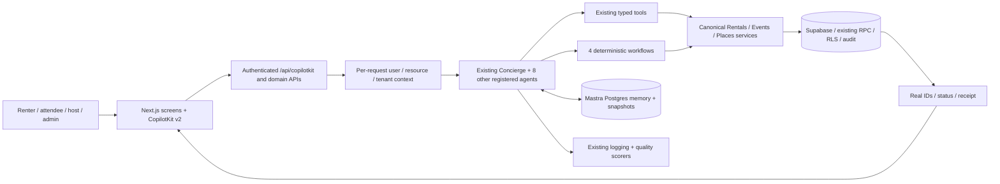

## Diagram 2/3 — a real action, not an AI promise

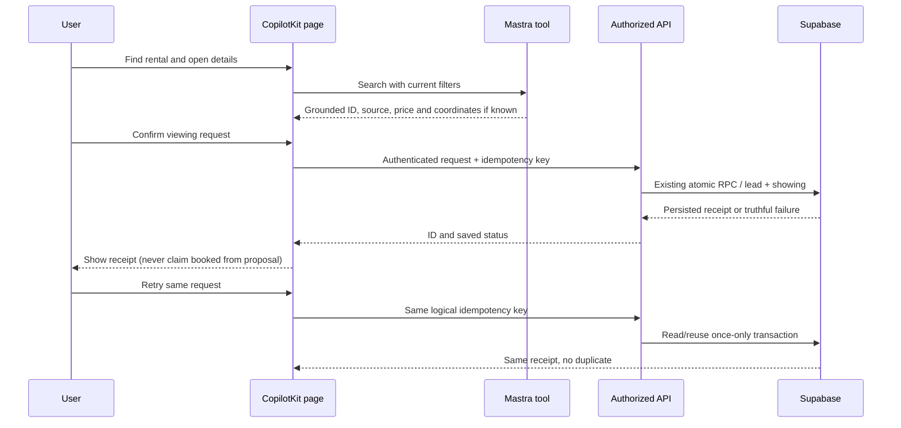

## Diagram 3/3 — implementation order and conditional advanced work

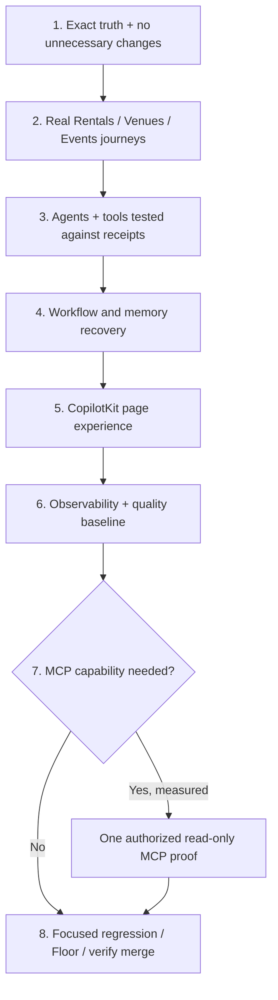

## UI wireframe A — Rentals, desktop + 390px

```text
DESKTOP /rentals
+---------------------+------------------------+--------------------+
| Search and filters  | Results with real IDs  | Map (same ID set)  |
| Area, max COP, beds | [photo] COP 2.5M       | [pin A] [pin B]    |
| [Ask MDE: refine]   | [Details] [Viewing]    | selected: pin A    |
|                     | [source / unknowns]    |                    |
+---------------------+------------------------+--------------------+
| AI: "Balcony not specified"   [View source] [Edit search]       |
+------------------------------------------------------------------+
MOBILE 390px
+----------------------------+
| Filters [Map] [Ask MDE]     |
| [photo / COP / source]      |
| [Details] [Schedule]       |
| [AI bottom sheet]          |
+----------------------------+
After Schedule: [Persisted viewing ID] [Status] [Assigned broker]
Never show a saved/scheduled success state from a tool proposal alone.
```

## UI wireframe B — Events / host / venue and payment

```text
EVENT DISCOVERY              EVENT DETAIL                 HOST / OPERATOR
[Date] [Area] [Category] --> [Actual source + time]      [Draft] [Preview]
[Grounded event cards]       [Tiers: TEST prices]         [Edit] [Publish]
[Map where verified]         [Checkout TEST]              [Publish receipt]
                              [Payment status]             [Sales actuals]
                              [Wallet ticket / QR]
VENUE INQUIRY: [Proposal] -> [Confirm] -> [Saved request ID]
ADMIN VIEW: [Existing review queue] -> [Resume] -> [One final DB status]
Business review state is NOT a prerequisite for creating/using Phase A records.
```

# Ordered delivery — every step has an owner and a check

## 1. Establish the exact baseline (no new infrastructure)

**Phase 1 — ownership, failure and proof (planned behavior, not test evidence):**

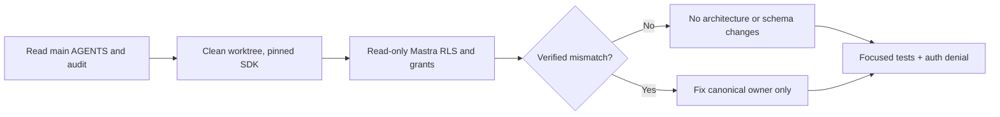


### 1.1 Pin the correct source and protect ongoing work — PRIMARY STEP
**Outcome:** Implementation is based on main, not the dirty local checkout, old docs, or an unmerged PR.

**Files:** /home/sk/mdeai/AGENTS.md; .claude/skills/{linear-task,plan,implement,mastra,supabase,testing,efficient}/SKILL.md; package.json; src/mastra/index.ts; docs/mastra/plan/02-MDE-Mastra-Platform-Audit-2026-11-22.md.
**Do:** Read the files and relevant task-specific instructions; create/use a clean worktree; verify branch SHA and check GitHub PR #925 and Linear owner before changes. Run npm run check:mastra and npm run test:mastra.
**Official reference → adaptation → verification (step 1.1; follow in this order):**
- **URL:** https://github.com/amoai-tech/mdeai/blob/main/.claude/skills/mermaid-diagrams/SKILL.md → **Exact upstream file/example:** .claude/skills/mermaid-diagrams/SKILL.md (diagram pass) → **REFERENCE ONLY** → **Exact destination:** `docs/mastra/plan/03-MDE-Mastra-Ordered-Execution-Plan.md` → **Verify:** render 12 Mermaid graphs in GitHub, then record clean main SHA.
- **URL:** https://github.com/mermaid-js/mermaid → **Exact upstream file/example:** README.md (flowchart and sequence diagram examples) → **MODEL diagram syntax only** → **Exact destination:** `docs/mastra/plan/03-MDE-Mastra-Ordered-Execution-Plan.md` → **Verify:** GitHub Mermaid code fences render.

**Checks:** - [ ] exact SHA + clean worktree recorded - [ ] no unrelated files modified - [ ] test pass/fail/skip counts recorded - [ ] no production migration started.

### 1.2 Verify runtime + Supabase security — PRIMARY STEP
**Outcome:** The platform's real storage and authorization are understood before any SQL or service change.

**Files:** src/mastra/lib/storage.ts; src/mastra/lib/agent-memory.ts; src/app/api/copilotkit/[[...path]]/route.ts; scripts/init-mastra-schema.mjs; existing Mastra migration above.
**Do:** Read-only query pg_class, policies and direct grants of public.mastra_*; check 9/4/21 registrations; authenticate API thread ownership; independently deny another user. Keep server-only Postgres key/URL, no client service key.
**Official reference:** https://supabase.com/docs/guides/database/postgres/row-level-security → documented RLS policy and grants model, **REFERENCE ONLY**, no copied blanket policy → existing SQL under supabase/migrations/ only if a specific missing permission is proved → verify anon/auth SELECT denied and server storage accessible.
**Official reference → adaptation → verification (step 1.2; follow in this order):**
- **URL:** https://supabase.com/docs/guides/database/postgres/row-level-security → **Exact upstream file/example:** RLS SQL CREATE POLICY and SELECT policy examples → **REFERENCE ONLY; do not copy permissive policy** → **Exact destination:** `src/mastra/lib/storage.ts; supabase/migrations/20261120180824_mastra_184_workflow_journal.sql` → **Verify:** read-only SQL RLS+FORCE and anon/authenticated denial.

**Checks:** - [ ] current table/PK/RLS counts recorded - [ ] User A/B isolation pass - [ ] no DDL unless a proven mismatch - [ ] original Mastra adapter behavior retained.

### 1.3 Confirm one front-end/back-end ownership boundary
**Outcome:** Generative UI displays results, the existing API owns writes, and the DB is the transaction authority.

**Files:** src/components/chat/concierge-copilot-bridge.tsx; src/components/copilot/search-tool-renders.tsx; src/components/host/host-event-copilot-bridge.tsx; src/app/api/leads/schedule-viewing/route.ts; src/app/api/venue-booking/request/route.ts.
**Do:** Trace browser handler → API authentication → canonical RPC/service → stored receipt → UI status; record tools that only propose UI.
**Official reference → adaptation → verification (step 1.3; follow in this order):**
- **URL:** https://docs.copilotkit.ai/reference/v2/hooks/useFrontendTool → **Exact upstream file/example:** useFrontendTool Zod parameters + browser handler snippet → **ADAPT existing action contract** → **Exact destination:** `src/components/chat/concierge-copilot-bridge.tsx` → **Verify:** UI click returns only a real API receipt.

**Checks:** - [ ] one owner per write - [ ] no invented success - [ ] existing schema and A2UI catalog reused.
**Owner:** [SAN-1591 · MDE AI — Simplify CopilotKit + Mastra Integration Using Official Patterns](https://linear.app/amo100/issue/SAN-1591).

## 2. Fix actual user journeys first (the fastest way to deliver value)

**Phase 2 — ownership, failure and proof (planned behavior, not test evidence):**

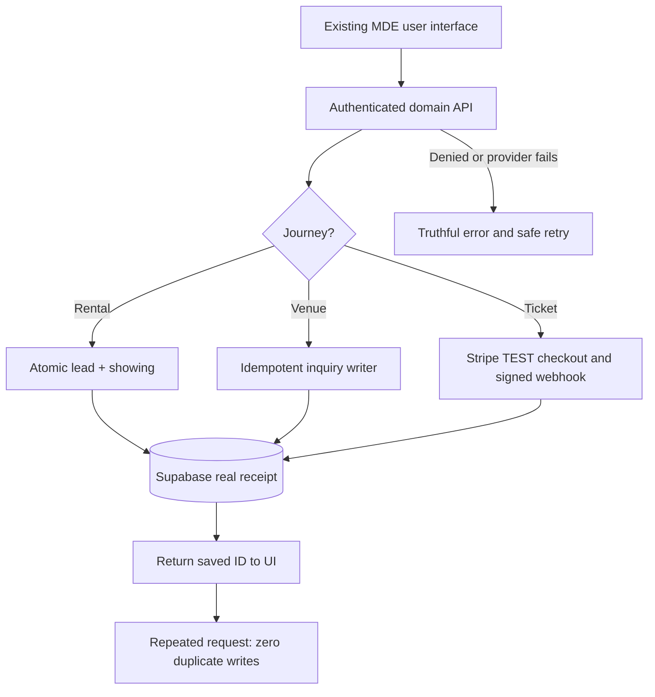


### 2.1 Rental search → Details → one saved viewing — PRIMARY STEP
**Outcome:** A test renter sees genuine listings (including development records without business eligibility gates), opens Details, requests viewing and sees one lead+showing tied to the correct broker.

**Files:** src/mastra/tools/search-rentals.ts; src/mastra/lib/rental-search-engine.ts; src/components/modals/schedule-viewing-modal.tsx; src/app/api/leads/schedule-viewing/route.ts; the **existing** p1_schedule_tour_atomic RPC and exact source migrations supabase/migrations/20260406120001_p1_schedule_tour_atomic.sql, supabase/migrations/20261026021125_san1502_phase_a_unrestricted_viewings.sql and supabase/migrations/20261102090000_san1059_viewing_error_contract.sql (check which definition is active before any edit); e2e/screens/SCREEN-008-schedule-viewing.spec.ts.
**Do:** Reproduce LISTING_UNAVAILABLE with truthful record identity; check open [PR #924](https://github.com/amoai-tech/mdeai/pull/924) diagnostics before making a minimal canonical identity fix; submit through the real UI/API; re-query lead, showing, broker; retry same intent; check User B cannot see private record. Never loosen authentication to remove business gates.
**Official reference → adaptation → verification (step 2.1; follow in this order):**
- **URL:** https://supabase.com/docs/guides/database/functions → **Exact upstream file/example:** Postgres Functions SQL/RPC examples → **REFERENCE ONLY; reuse canonical RPC** → **Exact destination:** `src/app/api/leads/schedule-viewing/route.ts; supabase/migrations/20260406120001_p1_schedule_tour_atomic.sql` → **Verify:** real lead+showing+correct broker; retry zero duplicates.

**Checks:** - [ ] search/cards/map/details share real listing ID - [ ] one saved lead AND showing - [ ] correct broker - [ ] retry adds zero duplicates - [ ] 390px usable - [ ] unknown availability/photo rights not invented.
**Owners:** [SAN-755 · MDE QA — Prove AI Rental Search, Map, Details, and Viewing End-to-End](https://linear.app/amo100/issue/SAN-755); [SAN-1502 · MDE Rentals — Enable Full Development Journeys and Defer Real-World Approval Gates](https://linear.app/amo100/issue/SAN-1502).

### 2.2 Venue inquiry → one saved request
**Files:** src/mastra/tools/request-venue-booking.ts; src/components/chat/venue-booking-hitl-panel.tsx; src/app/api/venue-booking/request/route.ts and its route.test.ts; src/lib/events/event-venue-booking-workflow-core.ts.
**Do:** Keep Mastra proposal-only; confirm once via existing signed-in route; retry, double-click, wrong account, lost reply; assert same persisted request ID and no duplicate. No review approval prerequisite.
**Official reference → adaptation → verification (step 2.2; follow in this order):**
- **URL:** https://docs.copilotkit.ai/reference/v2/hooks/useFrontendTool → **Exact upstream file/example:** useFrontendTool Zod parameters + browser handler snippet → **ADAPT existing confirm handler** → **Exact destination:** `src/components/chat/venue-booking-hitl-panel.tsx; src/app/api/venue-booking/request/route.ts` → **Verify:** double click/retry returns one persisted venue request.

**Checks:** - [ ] saved request receipt - [ ] idempotency - [ ] wrong actor denied - [ ] no fake “booked”.
**Owner:** [SAN-305 · MDE Venues — Prevent Duplicate Venue Booking Requests](https://linear.app/amo100/issue/SAN-305).

### 2.3 Host event + attendee TEST ticket
**Files:** src/components/host/host-event-copilot-bridge.tsx; src/app/host/events/page.tsx; src/app/api/events/proposal/route.ts; src/app/api/tickets/checkout/route.ts; supabase/functions/ticket-payment-webhook/index.ts; src/app/api/tickets/wallet/route.ts; e2e/screens/SCREEN-016-host-wizard.spec.ts and SCREEN-009-checkout.spec.ts.
**Do:** Generate clearly labeled QA draft → edit/preview → publish via existing host API → discover event → Stripe TEST checkout → TEST webhook → unique ticket/QR/wallet; retry webhook and confirm once-only effects. No real charge or public launch claims.
**Official reference → adaptation → verification (step 2.3; follow in this order):**
- **URL:** https://docs.stripe.com/webhooks → **Exact upstream file/example:** signature verification, event delivery and duplicate handling → **MODEL current endpoint without creating another webhook** → **Exact destination:** `supabase/functions/ticket-payment-webhook/index.ts; src/app/api/tickets/checkout/route.ts` → **Verify:** Stripe TEST signed webhook -> once-only wallet ticket.
- **URL:** https://docs.stripe.com/testing/overview → **Exact upstream file/example:** TEST payment and webhook test examples → **REFERENCE ONLY; TEST mode no live charge** → **Exact destination:** `src/app/api/tickets/checkout/route.test.ts; e2e/screens/SCREEN-009-checkout.spec.ts` → **Verify:** TEST payment and duplicate webhook cases.

**Checks:** - [ ] saved event ID - [ ] publish works in Phase A - [ ] checkout TEST receipt - [ ] webhook persisted - [ ] one QR/ticket - [ ] wrong user cannot fetch ticket.
**Owners:** [SAN-754 · MDE QA — Prove Host AI Event Draft, Review, and Publish End-to-End](https://linear.app/amo100/issue/SAN-754); [SAN-675 · MDE Events — Prove a New Host Can Onboard, Publish + Sell the First Ticket](https://linear.app/amo100/issue/SAN-675).

### 2.4 Record a reproducible journey fixture
**Files:** existing e2e/*.spec.ts and src/app/api/**/route.test.ts; no new runner.
**Do:** Freeze 20–40 realistic queries and DB identities; record authoritative expected source records and clear measured denominators. Separate a unit pass from UI/API/DB transaction pass.
**Official reference → adaptation → verification (step 2.4; follow in this order):**
- **URL:** https://playwright.dev/docs/test-assertions → **Exact upstream file/example:** expect auto-retrying web assertion example → **MODEL current runner tests** → **Exact destination:** `e2e/screens/SCREEN-008-schedule-viewing.spec.ts; e2e/screens/SCREEN-016-host-wizard.spec.ts` → **Verify:** UI/API/DB readback with same fixture IDs.

**Checks:** - [ ] fixture reproducible - [ ] authorized and unauthorized cases - [ ] exact deployed SHA named - [ ] none of the 46 historical skips counted as passes.
**Owner:** [SAN-1309 · Catch Integration Breaks Between MDE Systems Before Merge](https://linear.app/amo100/issue/SAN-1309).

## 3. Agents and tools — core correctness without a new framework

**Phase 3 — ownership, failure and proof (planned behavior, not test evidence):**

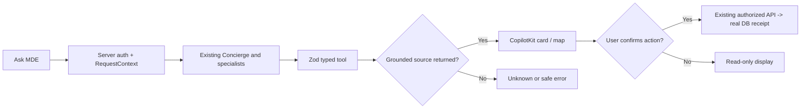


### 3.1 Classify nine existing agent roles and their actual callers
**Files:** src/mastra/index.ts; src/mastra/agents/{concierge,router,rental-agent,event-agent,host-event,host-ops,partner-agent,evaluation,index}.ts; src/app/api/copilotkit/[[...path]]/route.ts.
**Do:** Trace user-facing Concierge, specialists, evaluation and ping to real caller; avoid “registered means invoked” assumption. Use current RequestContext and thread identity.
**Official reference:** https://mastra.ai/docs/agents/overview → official agent setup and model/tool semantics; **MODEL**, not copy new sample agents → existing src/mastra/agents/* → focused agent test and actual authorized chat call.
**GitHub reference:** https://github.com/mastra-ai/mastra/blob/main/examples/agent/src/mastra/index.ts → upstream Mastra registry example, **REFERENCE ONLY** → existing src/mastra/index.ts (no duplicate runtime) → 9 agents + 4 workflow registration assertions.
**Official reference → adaptation → verification (step 3.1; follow in this order):**
- **URL:** https://mastra.ai/docs/agents/overview → **Exact upstream file/example:** Agent constructor and tools example → **MODEL current agents only** → **Exact destination:** `src/mastra/agents/concierge.ts; src/mastra/agents/index.ts` → **Verify:** nine agents have real callers or diagnostic labels.
- **URL:** https://github.com/mastra-ai/mastra/blob/main/examples/agent/src/mastra/index.ts → **Exact upstream file/example:** examples/agent/src/mastra/index.ts → **REFERENCE ONLY; do not copy app registry** → **Exact destination:** `src/mastra/index.ts` → **Verify:** unchanged single runtime and registrations.

**Checks:** - [ ] every agent assigned caller or diagnostic role - [ ] no redundant specialist added - [ ] truth grounded in actual caller.
**Owner:** [SAN-1700 · MDE Mastra Agents — Prove Nine Agent Roles, Routing and Tenant Safety](https://linear.app/amo100/issue/SAN-1700).

### 3.2 Validate routing, request isolation and errors
**Files:** src/mastra/agents/__tests__/{concierge,router,partner-agent,agent-failure-matrix}.test.ts; src/mastra/lib/{search-intent-router,partner-request-context}.ts.
**Do:** Test rentals→events→restaurants context switch; wrong host/partner/broker, missing identity, Stop and retry, original-source retrieval. Correct only real failures.
**Official reference → adaptation → verification (step 3.2; follow in this order):**
- **URL:** https://mastra.ai/docs/server/request-context → **Exact upstream file/example:** RequestContext.set/get; agent.generate({requestContext}) example → **ADAPT existing typed user-scoped request** → **Exact destination:** `src/app/api/copilotkit/[[...path]]/route.ts; src/mastra/lib/partner-request-context.ts` → **Verify:** User A/B and topic-switch assertions.

**Checks:** - [ ] deterministic source IDs - [ ] unauthorized denied - [ ] user intent not contaminated by previous turn - [ ] existing task SAN-876 kept as topic-switch owner.
**Owner:** SAN-1700 and [SAN-876 · INT-024 — Topic-switch regression test matrix](https://linear.app/amo100/issue/SAN-876).

### 3.3 Cover the 21 registered Mastra tools with typed contract tests
**Files:** src/mastra/tools/*.ts and src/mastra/tools/__tests__/*; src/mastra/agents/concierge.ts; src/mastra/index.ts.
**Do:** Record registered caller, structured input/output, provider-error state, source provenance and abort; test actual tool selection vs static registration; no new search/booking tool.
**Official reference:** https://mastra.ai/reference/tools/create-tool → official example src/mastra/tools/weather-tool.ts and createTool(inputSchema, outputSchema, execute(input, context)), **ADAPT** its typed contract, not weather business code → individual existing src/mastra/tools/*.ts → focused Vitest + npm run check:mastra.
**GitHub source:** https://github.com/mastra-ai/mastra/blob/main/docs/src/content/en/reference/tools/create-tool.mdx → upstream typed-tool documentation, **REFERENCE ONLY** → tests around existing tools → invalid input and provider failure assertion.
**Official reference → adaptation → verification (step 3.3; follow in this order):**
- **URL:** https://mastra.ai/reference/tools/create-tool → **Exact upstream file/example:** src/mastra/tools/weather-tool.ts; createTool with Zod and execute → **ADAPT typed schemas only, NOT demo weather logic** → **Exact destination:** `src/mastra/tools/*.ts; src/mastra/tools/__tests__/` → **Verify:** 21 registered tools tested for invalid/empty/error/result.
- **URL:** https://github.com/mastra-ai/mastra/blob/main/docs/src/content/en/reference/tools/create-tool.mdx → **Exact upstream file/example:** docs/src/content/en/reference/tools/create-tool.mdx → **REFERENCE ONLY: SDK signature** → **Exact destination:** `src/mastra/tools/*.ts` → **Verify:** TypeScript + Vitest tool contract.

**Checks:** - [ ] exact selected tool/source identity - [ ] unavailable remains unavailable - [ ] missing coordinates/price are unknown - [ ] external results cannot claim payment or ownership.
**Owner:** [SAN-1701 · MDE Mastra Tools — Test Grounded Contracts and CopilotKit Action Receipts](https://linear.app/amo100/issue/SAN-1701).

### 3.4 Keep rendered cards, actions and verified outputs aligned
**Files:** src/components/copilot/search-tool-renders.tsx; src/components/chat/concierge-copilot-bridge.tsx; src/components/copilot/__tests__/search-tool-renders-v2.test.tsx; src/mastra/tools/show-recommendations.ts.
**Do:** Reuse existing CopilotKit v2 tool renderer and frontend action, validate source IDs and one final backend receipt. SAN-396 retains provenance enforcement and SAN-303 retains tool/action name parity.
**Official reference 1:** https://docs.copilotkit.ai/reference/v2/hooks/useRenderTool → official typed named/wildcard render example, **ADAPT** existing result render binding (do not replace catalog) → src/components/copilot/search-tool-renders.tsx → Vitest rendering and real card ID assertions.
**Official reference 2:** https://docs.copilotkit.ai/reference/v2/hooks/useFrontendTool → browser action example with Zod + handler, **ADAPT** only where existing user action needs a client callback → src/components/chat/concierge-copilot-bridge.tsx and src/components/host/host-event-copilot-bridge.tsx → UI click → authenticated API receipt.
**Official reference → adaptation → verification (step 3.4; follow in this order):**
- **URL:** https://docs.copilotkit.ai/reference/v2/hooks/useRenderTool → **Exact upstream file/example:** useRenderTool named renderer + inProgress/executing/complete states → **ADAPT existing renderer** → **Exact destination:** `src/components/copilot/search-tool-renders.tsx; src/components/copilot/__tests__/search-tool-renders-v2.test.tsx` → **Verify:** source IDs and status render match tool calls.
- **URL:** https://docs.copilotkit.ai/reference/v2/hooks/useFrontendTool → **Exact upstream file/example:** useFrontendTool Zod parameters + browser handler snippet → **ADAPT existing browser handler, not renderer** → **Exact destination:** `src/components/chat/concierge-copilot-bridge.tsx` → **Verify:** click -> server authorized action -> DB receipt.

**Checks:** - [ ] renderer matches tool IDs - [ ] active controls update filters - [ ] proposal never appears as confirmed transaction - [ ] no old CopilotKit v1 component.

### 3.5 Test grounded tool-response provenance
**Files:** src/mastra/tools/{search-rentals,search-events,search-web-grounded-events,search-grounded-places}.ts; src/mastra/lib/search-grounding-types.ts; existing tool tests.
**Do:** Verify malformed/partial source, untrusted web data, error vs genuine empty, provider outages and redacted private fields. SAN-396 owns any centralized provenance fix; SAN-1701 owns coverage.
**Official reference → adaptation → verification (step 3.5; follow in this order):**
- **URL:** https://mastra.ai/docs/agents/processors → **Exact upstream file/example:** Input/output processor examples and policy controls → **REFERENCE ONLY; keep optional guards** → **Exact destination:** `src/mastra/lib/agent-input-processors.ts; src/mastra/lib/search-grounding-types.ts` → **Verify:** untrusted source and injection cases cannot make unverified claims.

**Checks:** - [ ] source link kept where available - [ ] no fabricated coordinates/availability/price - [ ] no private data becomes public.

### 3.6 Compare output compactness only if proven slow
**Files:** src/mastra/tools/search-rentals.ts (existing toModelOutput); src/mastra/agents/concierge.ts; src/mastra/lib/agent-input-processors.ts.
**Do:** Measure tokens/TTFT on fixed corpus first, then reuse compact model-only output for an oversized tool; keep full UI response intact. Do not add ToolSearchProcessor or supervisor by default.
**Official reference → adaptation → verification (step 3.6; follow in this order):**
- **URL:** https://mastra.ai/reference/tools/create-tool → **Exact upstream file/example:** src/mastra/tools/weather-tool.ts; createTool with Zod and execute → **MODEL compact model-only output, no new search engine** → **Exact destination:** `src/mastra/tools/search-rentals.ts; src/mastra/agents/concierge.ts` → **Verify:** before/after TTFT, tokens and identical record IDs.

**Checks:** - [ ] same grounded IDs - [ ] no quality regression - [ ] measured latency/token improvement or no code change.
**Owner:** [SAN-856 · See What Every AI Request Cost, How Long It Took, and Where It Failed](https://linear.app/amo100/issue/SAN-856).

### 3.7 Validate server authorization at tool boundaries
**Files:** src/mastra/tools/{read-broker-workspace,partner-profile-tool,hostops-read-tools,hostops-insight-tool}.ts; respective __tests__; CopilotKit route.
**Do:** Test correct user, wrong user, anonymous, missing scoped Supabase client; preserve server auth/RLS. Business eligibility must not become a proxy for security.
**Official reference → adaptation → verification (step 3.7; follow in this order):**
- **URL:** https://mastra.ai/docs/server/request-context → **Exact upstream file/example:** RequestContext.set/get; agent.generate({requestContext}) example → **ADAPT actual scoped auth** → **Exact destination:** `src/mastra/tools/read-broker-workspace.ts; src/mastra/tools/partner-profile-tool.ts` → **Verify:** authorized exact data; wrong tenant denied.

**Checks:** - [ ] wrong user denied - [ ] correct actor sees exact SQL aggregate - [ ] no secret client key in browser.

### 3.8 Close tool coverage with one focused regression receipt
**Files:** src/mastra/tools/__tests__/; src/components/copilot/__tests__/; existing CI and SAN-303.
**Do:** Record test cases with 21 registered tool names, actual used subset and any intentionally unused tools. Fix only failed cases.
**Official reference → adaptation → verification (step 3.8; follow in this order):**
- **URL:** https://vitest.dev/guide/ → **Exact upstream file/example:** Vitest test and expect examples → **MODEL existing tests, not new registry** → **Exact destination:** `src/mastra/tools/__tests__/; src/components/copilot/__tests__/` → **Verify:** 21-tool cases and v2 render parity recorded.

**Checks:** - [ ] every tool inventoried - [ ] no new registry/framework - [ ] assertion on persisted outcomes separately.

## 4. Workflows and memory — durable recovery without business gates

**Phase 4 — ownership, failure and proof (planned behavior, not test evidence):**

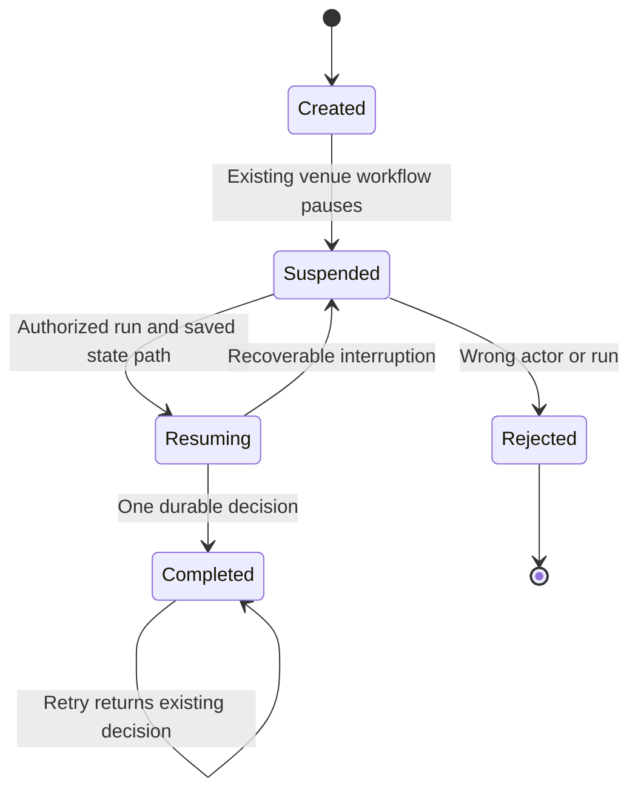

**Memory concurrent-write sequence (second independent critical boundary):**

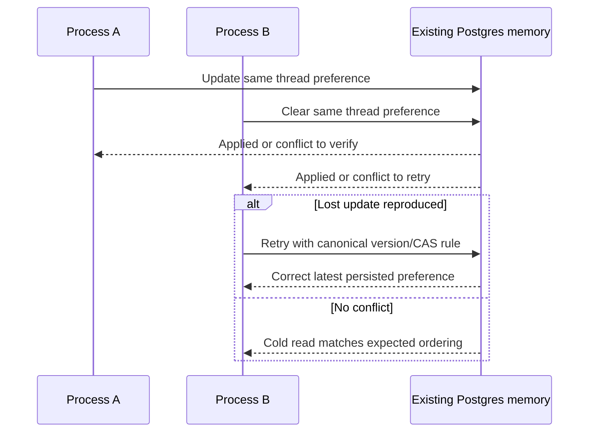


### 4.1 Verify all four existing workflows
**Files:** src/mastra/workflows/{rental-search-workflow,event-discovery-workflow,event-venue-booking-workflow,sales-insight-workflow}.ts.
**Do:** Confirm rental search→format→rerank, event search→cards, venue request→suspend/resume, sales compute→narrate. The rental rerank is already wired; do not rebuild it. Remove stale “mock data” workflow description only after source verification.
**Official reference → adaptation → verification (step 4.1; follow in this order):**
- **URL:** https://mastra.ai/docs/workflows/overview → **Exact upstream file/example:** createWorkflow/createStep and workflow registration examples → **REFERENCE ONLY; don't recreate workflows** → **Exact destination:** `src/mastra/workflows/{rental-search-workflow,event-discovery-workflow,event-venue-booking-workflow,sales-insight-workflow}.ts` → **Verify:** four existing graphs yield source-backed outputs.

**Checks:** - [ ] source-backed outputs - [ ] no duplicate deterministic workflow - [ ] real SQL sales totals - [ ] stale comments corrected.
**Owner:** [SAN-125 · EVT-007 — eventDiscoveryWorkflow (Mastra)](https://linear.app/amo100/issue/SAN-125) for event source regression, not a second workflow.

### 4.2 Resume an existing venue workflow from stored state — PRIMARY STEP
**Files:** src/lib/events/start-admin-review-workflow.ts; src/mastra/workflows/event-venue-booking-workflow.ts; src/mastra/workflows/event-venue-booking-workflow.test.ts; src/app/api/admin/event-bookings/{route.ts,route.test.ts}.
**Do:** Authenticate admin in existing route, verify run/booking association, getWorkflowRunById(runId), require suspended, obtain createWorkflowStateReader(state).getSuspendedStep()?.path, createRun({runId}), resume with validated data; handle absent/ambiguous paths and completed runs safely. Preserve idempotent DB decision. Admin review capability remains optional management behavior, NOT a booking gate in Phase A.
**Official reference:** https://mastra.ai/docs/workflows/suspend-and-resume#recovering-suspended-runs → docs example src/mastra/workflows/recover-run.ts, **ADAPT** stored-state reader and resume behavior → src/lib/events/start-admin-review-workflow.ts → cold-process, wrong actor, duplicate-resume tests.
**GitHub source:** https://github.com/mastra-ai/mastra/blob/main/packages/core/src/workflows/state-reader.ts → actual reader implementation, **REFERENCE ONLY; import public API, do not copy internals** → same helper → nested path/foreach regression if needed.
**Official reference → adaptation → verification (step 4.2; follow in this order):**
- **URL:** https://mastra.ai/docs/workflows/suspend-and-resume → **Exact upstream file/example:** src/mastra/workflows/recover-run.ts (saved run resume example) → **ADAPT read/status/opaque resume path from upstream** → **Exact destination:** `src/lib/events/start-admin-review-workflow.ts; src/app/api/admin/event-bookings/route.ts` → **Verify:** cold restore, denied actor, duplicate resume once-only.
- **URL:** https://github.com/mastra-ai/mastra/blob/main/packages/core/src/workflows/state-reader.ts → **Exact upstream file/example:** packages/core/src/workflows/state-reader.ts (public reader semantics) → **REFERENCE ONLY; import @mastra/core/workflows API** → **Exact destination:** `src/lib/events/start-admin-review-workflow.ts` → **Verify:** nested run path and completed run tests.

**Checks:** - [ ] correct saved run resumed once - [ ] non-suspended rejected - [ ] user/booking verified - [ ] replay no second decision - [ ] incorrect review notification never claimed.
**Owner:** [SAN-1702 · MDE Mastra Workflows — Recover Venue Review Safely From Saved State](https://linear.app/amo100/issue/SAN-1702).

### 4.3 Prove independent-process memory ordering — PRIMARY STEP
**Files:** src/mastra/lib/agent-memory.ts; src/mastra/lib/chat-memory-durability.integration.test.ts; src/mastra/lib/storage.ts.
**Do:** Run two independent Node processes against **disposable** Postgres, same permitted thread, race furnishing/pin update vs clear; cold-read. If a lost update is reproduced, implement compare/version/transaction in the canonical storage owner; consider a migration only if proven required.
**Official reference:** https://mastra.ai/docs/memory/overview → Mastra memory and thread scope, **REFERENCE ONLY** → src/mastra/lib/agent-memory.ts → two-worker test and restart read.
**Postgres reference:** https://www.postgresql.org/docs/current/transaction-iso.html → transaction/serialization semantics, **MODEL only after reproduced conflict** → canonical DB operation and conditional migration under supabase/migrations/ → race retry/rollback test.
**Official reference → adaptation → verification (step 4.3; follow in this order):**
- **URL:** https://mastra.ai/docs/memory/overview → **Exact upstream file/example:** Memory thread scope and message/working memory explanation → **REFERENCE ONLY; preserve thread storage** → **Exact destination:** `src/mastra/lib/agent-memory.ts; src/mastra/lib/chat-memory-durability.integration.test.ts` → **Verify:** two isolated server processes race and cold-read correct state.
- **URL:** https://www.postgresql.org/docs/current/transaction-iso.html → **Exact upstream file/example:** transaction isolation and concurrent-update SQL examples → **REFERENCE ONLY until race proof** → **Exact destination:** `src/mastra/lib/agent-memory.ts` → **Verify:** two-worker compare with disposable DB.

**Checks:** - [ ] no stale preference resurrection - [ ] correct clear precedence - [ ] tenant isolation - [ ] no extra memory subsystem.
**Owner:** [SAN-1704 · MDE Mastra Memory — Prove Concurrent Thread Updates Across Two Server Processes](https://linear.app/amo100/issue/SAN-1704).

### 4.4 Preserve truthful workflow notifications
**Files:** src/mastra/workflows/event-venue-booking-workflow.ts; existing host notification integration if any.
**Do:** The current notifyAdminStep returns notified:false. Do not change it to true without evidence of a durable delivery; if notification is part of an accepted user journey, reuse the existing notification service and add delivery/retry receipt. Separate this from workflow recovery.
**Official reference → adaptation → verification (step 4.4; follow in this order):**
- **URL:** https://mastra.ai/docs/workflows/overview → **Exact upstream file/example:** createWorkflow/createStep and workflow registration examples → **REFERENCE ONLY; existing step output contract** → **Exact destination:** `src/mastra/workflows/event-venue-booking-workflow.ts` → **Verify:** no `notified:true` without delivery receipt.

**Checks:** - [ ] user/admin sees truthful notification status - [ ] no speculative integration installed.

### 4.5 Reproduce memory race with one thread
**Do:** Test exact conflicting update order across processes as in 4.3. Capture expected vs observed generations and timeout after save.
**Official reference → adaptation → verification (step 4.5; follow in this order):**
- **URL:** https://mastra.ai/docs/memory/overview → **Exact upstream file/example:** Memory thread scope and message/working memory explanation → **MODEL two-worker test fixture** → **Exact destination:** `src/mastra/lib/chat-memory-durability.integration.test.ts` → **Verify:** same thread update vs clear reproducible in disposable DB.

**Checks:** - [ ] race outcome reproducible - [ ] failure isolated from provider latency - [ ] no live DB writes.

### 4.6 Fix canonical concurrency owner only if needed
**Do:** If test fails, add one atomic compare-and-set/versioned operation at canonical memory store and adapter-compatible migration **only if required**; do not place a second lock in the browser or worker.
**Official reference → adaptation → verification (step 4.6; follow in this order):**
- **URL:** https://www.postgresql.org/docs/current/transaction-iso.html → **Exact upstream file/example:** transaction isolation and concurrent-update SQL examples → **MODEL only IF race reproduced** → **Exact destination:** `src/mastra/lib/agent-memory.ts; conditional supabase/migrations/<timestamp>_mastra_thread_cas.sql` → **Verify:** CAS generation conflict/rollback and cross-process retry test.

**Checks:** - [ ] both processes honor order - [ ] repeated retry returns stable state - [ ] existing null-clear shim maintained.

### 4.7 Revalidate permissions, restarts and rollback
**Do:** Restore persisted thread after process death; check wrong user denial, attempt with stale version, and no duplicate user action. Run npm run test:mastra and relevant integration tests.
**Official reference → adaptation → verification (step 4.7; follow in this order):**
- **URL:** https://mastra.ai/docs/server/request-context → **Exact upstream file/example:** RequestContext.set/get; agent.generate({requestContext}) example → **ADAPT actor context during resume and readback** → **Exact destination:** `src/app/api/copilotkit/[[...path]]/route.ts; src/mastra/lib/chat-memory-durability.integration.test.ts` → **Verify:** cold restart, wrong user, stale generation tests.

**Checks:** - [ ] cold restart works - [ ] no privacy regression - [ ] adapter version compatible.

## 5. Front-end and back-end UX — reuse CopilotKit v2 catalog

**Phase 5 — ownership, failure and proof (planned behavior, not test evidence):**

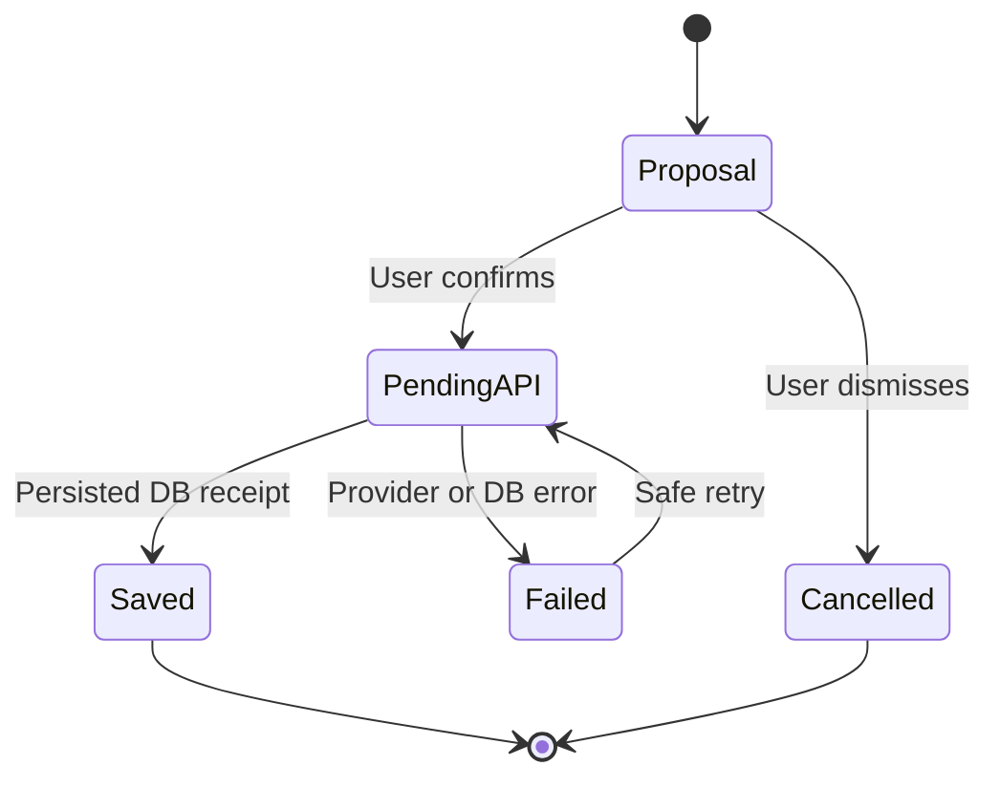


### 5.1 Match cards, maps and selected ID
**Files:** src/components/copilot/search-tool-renders.tsx; src/components/chat/concierge-copilot-bridge.tsx; existing Rentals/Events page components and e2e/screens/*.
**Do:** Reuse existing CopilotKit cards, forms, table, map surface and playground-derived UI. Do not replace all React components or create a second UI renderer.
**Official reference → adaptation → verification (step 5.1; follow in this order):**
- **URL:** https://docs.copilotkit.ai/reference/v2/hooks/useRenderTool → **Exact upstream file/example:** useRenderTool named renderer + inProgress/executing/complete states → **ADAPT existing named render** → **Exact destination:** `src/components/copilot/search-tool-renders.tsx` → **Verify:** card/map/details ID parity and 390px layout.

**Checks:** - [ ] exact source ID across card/map/details - [ ] filtered results identical in UI and tool - [ ] 390px no clipping.

### 5.2 Show proposal, pending, saved or failed accurately
**Files:** src/components/chat/venue-booking-hitl-panel.tsx; src/components/modals/schedule-viewing-modal.tsx; src/app/api/leads/schedule-viewing/route.ts; src/app/api/venue-booking/request/route.ts.
**Do:** Map UI status only from API response and re-queried persisted result. Keep no-approval-required Phase A test action path.
**Official reference → adaptation → verification (step 5.2; follow in this order):**
- **URL:** https://docs.copilotkit.ai/reference/v2/hooks/useFrontendTool → **Exact upstream file/example:** useFrontendTool Zod parameters + browser handler snippet → **ADAPT current user-confirmed write handler** → **Exact destination:** `src/components/modals/schedule-viewing-modal.tsx; src/components/chat/venue-booking-hitl-panel.tsx` → **Verify:** only DB/API receipt marks Saved.

**Checks:** - [ ] one saved receipt - [ ] retry recovers - [ ] invalid/denied never appears as success.

### 5.3 Show usable failure, Stop and retry
**Files:** src/mastra/copilotkit/logging-mastra-agent.ts; src/app/api/copilotkit/[[...path]]/route.ts; existing CopilotKit fallback components.
**Do:** Simulate provider timeout/429, interrupted stream, malformed UI and late tool output; preserve visible filters, cards and manual booking.
**Official reference → adaptation → verification (step 5.3; follow in this order):**
- **URL:** https://docs.copilotkit.ai/reference/v2/hooks/useRenderTool → **Exact upstream file/example:** useRenderTool named renderer + inProgress/executing/complete states → **REFERENCE ONLY for tool progress state** → **Exact destination:** `src/mastra/copilotkit/logging-mastra-agent.ts; src/components/chat/concierge-copilot-bridge.tsx` → **Verify:** 429/timeout/Stop leaves safe Retry, no fabricated success.

**Checks:** - [ ] no duplicate write - [ ] no wrong-thread message - [ ] controls usable after failure.
**Owner:** [SAN-1245 · Keep MDE Usable When AI Is Down, Slow, or Broken](https://linear.app/amo100/issue/SAN-1245).

### 5.4 Confirm host UI works without a live model
**Files:** src/components/host/host-event-copilot-bridge.tsx; src/app/host/events/page.tsx; existing host publish APIs.
**Do:** Run manual edit/publish and AI-assisted edit/publish for QA event, using same domain API and actual saved receipt.
**Official reference → adaptation → verification (step 5.4; follow in this order):**
- **URL:** https://docs.copilotkit.ai/reference/v2/hooks/useFrontendTool → **Exact upstream file/example:** useFrontendTool Zod parameters + browser handler snippet → **ADAPT existing host agent handler** → **Exact destination:** `src/components/host/host-event-copilot-bridge.tsx; src/app/host/events/page.tsx` → **Verify:** same QA event persisted with AI and manual fallback.

**Checks:** - [ ] manual path independent of AI outage - [ ] same persisted event - [ ] no launch certification gates.

## 6. Observability, evaluations, speed

**Phase 6 — ownership, failure and proof (planned behavior, not test evidence):**

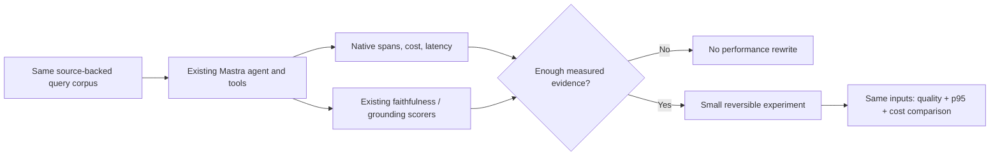


### 6.1 One cost/latency record tied to an actual user action
**Files:** src/mastra/lib/{ai-runs,model-cost,mastra-telemetry,log-agent-run,models}.ts; src/mastra/scorers/index.ts.
**Do:** Reuse current run audit, request ID, native spans, provider token usage and failure reason. Correlate to API/DB receipt; redact prompts, tokens and PII; report p50/p95, TTFT, cost **per completed outcome** with sample size.
**Official reference:** https://mastra.ai/docs/observability/tracing/overview → tracingOptions and span metadata, **ADAPT** existing Mastra logging only → src/mastra/lib/mastra-telemetry.ts and existing ai_runs audit → traced request with correct redaction.
**Official reference → adaptation → verification (step 6.1; follow in this order):**
- **URL:** https://mastra.ai/docs/observability/tracing/overview → **Exact upstream file/example:** native tracingOptions, metadata and child span examples → **ADAPT native trace ID/span metadata** → **Exact destination:** `src/mastra/lib/mastra-telemetry.ts; src/mastra/lib/ai-runs.ts` → **Verify:** request+model/cost+DB receipt joined; redacted PII.
- **URL:** https://mastra.ai/reference/observability/tracing/processors/sensitive-data-filter → **Exact upstream file/example:** SensitiveDataFilter redaction configuration example → **MODEL built-in filter, retain default secrets list** → **Exact destination:** `src/mastra/lib/mastra-telemetry.ts` → **Verify:** no raw token/email or private data in spans.

**Checks:** - [ ] a real failed request can be diagnosed - [ ] no sensitive content leaked - [ ] no second tracing backend.
**Owner:** [SAN-856 · See What Every AI Request Cost, How Long It Took, and Where It Failed](https://linear.app/amo100/issue/SAN-856).

### 6.2 Run source-grounding and hallucination checks
**Files:** src/mastra/scorers/{index,faithfulness,grounding-coverage}.ts; their existing __tests__; existing fixtures.
**Do:** Use existing two registered scorers on fixed source-backed questions; optionally sample live traces safely; classify misleading price/availability and source omissions.
**Official reference → adaptation → verification (step 6.2; follow in this order):**
- **URL:** https://mastra.ai/docs/observability/tracing/overview → **Exact upstream file/example:** native tracingOptions, metadata and child span examples → **REFERENCE ONLY for recorded evaluation outcomes** → **Exact destination:** `src/mastra/scorers/{faithfulness,grounding-coverage}.ts; src/mastra/scorers/index.ts` → **Verify:** source-backed corpus with sample count and wrong-fact detection.

**Checks:** - [ ] test labels trace to source records - [ ] measured baseline and regression counts - [ ] no invented “grounded” claim.
**Owner:** [SAN-1395 · Check Live Chats for Made-Up Claims Using the Quality Checkers We Already Built](https://linear.app/amo100/issue/SAN-1395).

### 6.3 Optimize only after measuring
**Files:** src/mastra/agents/concierge.ts; src/mastra/lib/agent-input-processors.ts; src/mastra/lib/models.ts.
**Do:** Same 20–40 real inputs before/after. Compare routing error rate, p50/p95, TTFT, tool schema tokens, provider cost and truthful completion. Keep or remove a processor only if quality is preserved and gain measured. Advanced supervisor, model routing and ToolSearchProcessor are deferred, not preconditions.
**Official reference → adaptation → verification (step 6.3; follow in this order):**
- **URL:** https://mastra.ai/docs/agents/processors → **Exact upstream file/example:** Input/output processor examples and policy controls → **REFERENCE ONLY until same-corpus measurements** → **Exact destination:** `src/mastra/agents/concierge.ts; src/mastra/lib/agent-input-processors.ts` → **Verify:** same 20–40 prompts before/after, no quality loss.

**Checks:** - [ ] same inputs/data snapshot - [ ] measured gain + no false claims - [ ] reversible flag or no implementation.
**Owner:** [SAN-1003 · Show Exactly Where a Rental AI Request Slows Down or Fails](https://linear.app/amo100/issue/SAN-1003).

## 7. MCP — optional, only after proven value

**Phase 7 — ownership, failure and proof (planned behavior, not test evidence):**

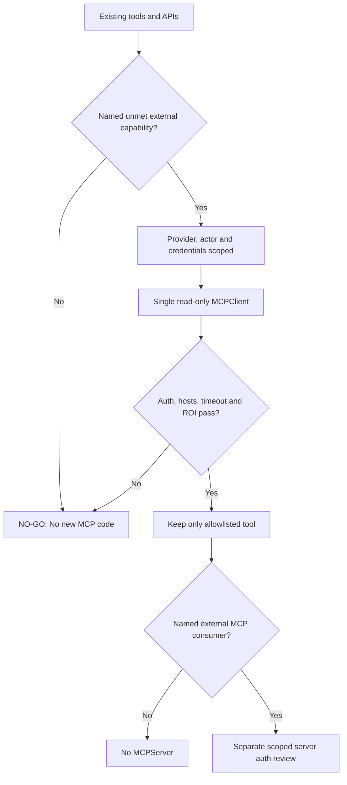


### 7.1 Make a one-use-case GO / NO-GO decision — PRIMARY STEP
**Files:** src/mastra/index.ts; src/mastra/tools/*; existing API integration inventory.
**Do:** Find one external capability not already solved by canonical app tools. With no named consumer/provider and measurable outcome, record NO-GO; **zero code/dependency/migration changes**.
**Official reference:** https://mastra.ai/docs/connections/mcp → upstream examples src/mastra/mcp/client.ts and src/mastra/mcp/server.ts, **REFERENCE ONLY until GO** → no destination/change on NO-GO; verify runtime still has same internal tools.
**Official reference → adaptation → verification (step 7.1; follow in this order):**
- **URL:** https://mastra.ai/docs/connections/mcp → **Exact upstream file/example:** src/mastra/mcp/client.ts + src/mastra/mcp/server.ts examples → **REFERENCE ONLY until GO decision** → **Exact destination:** `src/mastra/index.ts; no new file if NO-GO` → **Verify:** record one missing capability or prove no MCP dependency.

**Checks:** - [ ] named user value + provider or documented NO-GO - [ ] no speculative MCP endpoint.
**Owner:** [SAN-1703 · MDE Mastra MCP — Decide on One Safe External Integration Without Duplicating Services](https://linear.app/amo100/issue/SAN-1703).

### 7.2 If GO, adapt one allowlisted read-only MCP client
**Conditional new file only:** src/mastra/mcp/client.ts; src/mastra/index.ts registration under server flag. No browser secrets and no direct transaction write.
**Do:** Use approved server URL, allowedHosts, short timeout, per-request permission scoping, input/output validation and kill switch. Never call untrusted tool instructions “system rules”.
**Official reference:** https://mastra.ai/reference/tools/mcp-client#security → upstream inheritDefaultEnv/allowedHosts configuration, **ADAPT** exact provider-only allowlist → conditional src/mastra/mcp/client.ts → SSRF, missing-credential, wrong-tenant and timeout tests.
**Official reference → adaptation → verification (step 7.2; follow in this order):**
- **URL:** https://mastra.ai/reference/tools/mcp-client#security → **Exact upstream file/example:** allowedHosts and inheritDefaultEnv examples → **ADAPT only with named provider and GO decision** → **Exact destination:** `conditional src/mastra/mcp/client.ts` → **Verify:** host allowlist, credentials, SSRF, timeout and wrong tenant denied.

**Checks:** - [ ] one reliable read-only output - [ ] safe failure offline - [ ] delete flag reverses integration - [ ] no new bookings/search service.

### 7.3 External MCPServer only if a named client requires it
**Conditional new file:** src/mastra/mcp/server.ts, registered through existing src/mastra/index.ts after separate authorization review.
**Official reference:** https://mastra.ai/docs/guides/mcp-authentication-authorization → OAuth and per-user tool access, **MODEL** its security boundary → conditional server + existing request auth → wrong client/tenant denied and allowlisted tool allowed.
**Official reference → adaptation → verification (step 7.3; follow in this order):**
- **URL:** https://mastra.ai/docs/guides/mcp-authentication-authorization → **Exact upstream file/example:** MCP authentication and authorization patterns → **MODEL only after external consumer named** → **Exact destination:** `conditional src/mastra/mcp/server.ts; src/mastra/index.ts` → **Verify:** MCP OAuth/actor, strict allowlist, no public all-tools route.

**Checks:** - [ ] tool allowlist - [ ] protected HTTP transport - [ ] no public built-in all-tools server.

### 7.4 Capture cost/benefit and choose remove/keep
**Do:** Measure same user job via existing API vs optional MCP pilot; if slower, unsafe or redundant, remove pilot and close task NO-GO.
**Official reference → adaptation → verification (step 7.4; follow in this order):**
- **URL:** https://mastra.ai/docs/observability/tracing/overview → **Exact upstream file/example:** native tracingOptions, metadata and child span examples → **REFERENCE ONLY; reuse telemetry for comparison** → **Exact destination:** `src/mastra/lib/mastra-telemetry.ts; conditional src/mastra/mcp/client.ts` → **Verify:** same task vs direct API cost/latency; remove if no benefit.

**Checks:** - [ ] one named outcome - [ ] benchmark evidence - [ ] clear rollback.

## 8. Merge and acceptance (not public-launch certification)

**Phase 8 — ownership, failure and proof (planned behavior, not test evidence):**

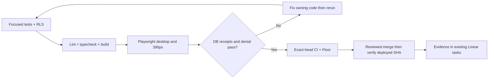


### 8.1 Run the smallest correct test sequence
**Commands:** npm run check:mastra; npm run test:mastra -- --reporter=dot; focused Vitest route/unit; DB/RLS negative cases; npm run lint; npm run typecheck; npm run build; focused e2e Playwright at 390px and desktop. Use npm run floor only on final release candidate or branch merge gate, not for each checklist tick.
**Official reference:** https://playwright.dev/docs/test-assertions → expect and retrying assertions, **MODEL** existing e2e/*.spec.ts instead of a new test framework → exact journey spec files above → ID/status/receipt assertions, not “chat said success.”
**Official reference → adaptation → verification (step 8.1; follow in this order):**
- **URL:** https://playwright.dev/docs/test-assertions → **Exact upstream file/example:** expect auto-retrying web assertion example → **MODEL existing test runner** → **Exact destination:** `e2e/screens/SCREEN-008-schedule-viewing.spec.ts; e2e/screens/SCREEN-009-checkout.spec.ts` → **Verify:** focused E2E + API/DB, 390px, negative auth, retry.

**Checks:** - [ ] focused tests green - [ ] typecheck/build green - [ ] unchanged skips reported - [ ] real API/DB proof - [ ] failure retry evidence.

### 8.2 Verify current PR, code, CI and exact deployed SHA
**Do:** Confirm origin/main vs PR head, ensure scoped changes only, no accidental live production DB writes; merge after code review and CI; verify /api/version on target environment and rerun one real journey. Do not say deployed or Done before proof.
**Official reference → adaptation → verification (step 8.2; follow in this order):**
- **URL:** https://docs.github.com/en/actions/how-tos/monitor-workflows/view-workflow-run-history → **Exact upstream file/example:** GitHub Actions run history/status example → **REFERENCE ONLY for CI evidence** → **Exact destination:** `existing .github/workflows/ and docs/mastra/plan/03-MDE-Mastra-Ordered-Execution-Plan.md` → **Verify:** exact PR SHA CI and after-merge /api/version proof.

**Checks:** - [ ] exact head commit - [ ] CI outcome from that head - [ ] post-merge API/UI/DB receipts - [ ] wrong-user denials.

### 8.3 Close only fully proved Linear outcomes
**Do:** Update the existing owners, attach test logs, before/after data, exact code refs and incident notes. Keep unresolved work Todo/Backlog and do not duplicate tickets. Separate Phase A working journeys from Phase B launch approval/certification.
**Official reference → adaptation → verification (step 8.3; follow in this order):**
- **URL:** https://playwright.dev/docs/test-assertions → **Exact upstream file/example:** expect auto-retrying web assertion example → **MODEL acceptance proof, not a new test framework** → **Exact destination:** `e2e/*.spec.ts; existing Linear SAN-755, SAN-305, SAN-754` → **Verify:** only mark Done with verified UI/API/DB receipts.

**Checks:** - [ ] existing issue IDs reused - [ ] completed only with evidence - [ ] no speculative launch gates enabled.

## Canonical Linear ownership — no duplicate tasks

**New, category-specific execution tickets:** [SAN-1700 · MDE Mastra Agents — Prove Nine Agent Roles, Routing and Tenant Safety](https://linear.app/amo100/issue/SAN-1700); [SAN-1701 · MDE Mastra Tools — Test Grounded Contracts and CopilotKit Action Receipts](https://linear.app/amo100/issue/SAN-1701); [SAN-1702 · MDE Mastra Workflows — Recover Venue Review Safely From Saved State](https://linear.app/amo100/issue/SAN-1702); [SAN-1703 · MDE Mastra MCP — Decide on One Safe External Integration Without Duplicating Services](https://linear.app/amo100/issue/SAN-1703); [SAN-1704 · MDE Mastra Memory — Prove Concurrent Thread Updates Across Two Server Processes](https://linear.app/amo100/issue/SAN-1704).

**Reused existing owners:** SAN-755 / SAN-1502 (rental truth and viewing); SAN-305 (once-only venue request); SAN-754 / SAN-675 (host + ticket); SAN-396 (source verification); SAN-303 (tool/UI registry); SAN-1591 (CopilotKit-Mastra bridge); SAN-125 (event discovery); SAN-876 (routing); SAN-1309 (cross-system tests); SAN-856 / SAN-1003 (performance); SAN-1395 (answer quality); SAN-1245 (failure handling). Existing SAN-501, SAN-881, SAN-1255 and SAN-1698 are Done for their **original** scope—do not reopen/reimplement those just to inflate a roadmap.

**Fastest execution path:** Stage 1 → Stage 2.1/2.2/2.3 in parallel where independent → Stage 3 selective failures → Stage 4 resume/memory tests → Stage 5 UI parity → Stage 6 metrics → Stage 8 release. Stage 7 MCP is optional and never blocks this sequence.

**Final success:** a complete authenticated UI → API → real Supabase transaction → correct returned status, repeated safely, with the correct source IDs and zero cross-tenant leaks. **That—not a registry count, green unit tests alone, or a draft checklist—is the working MDE AI app.**
