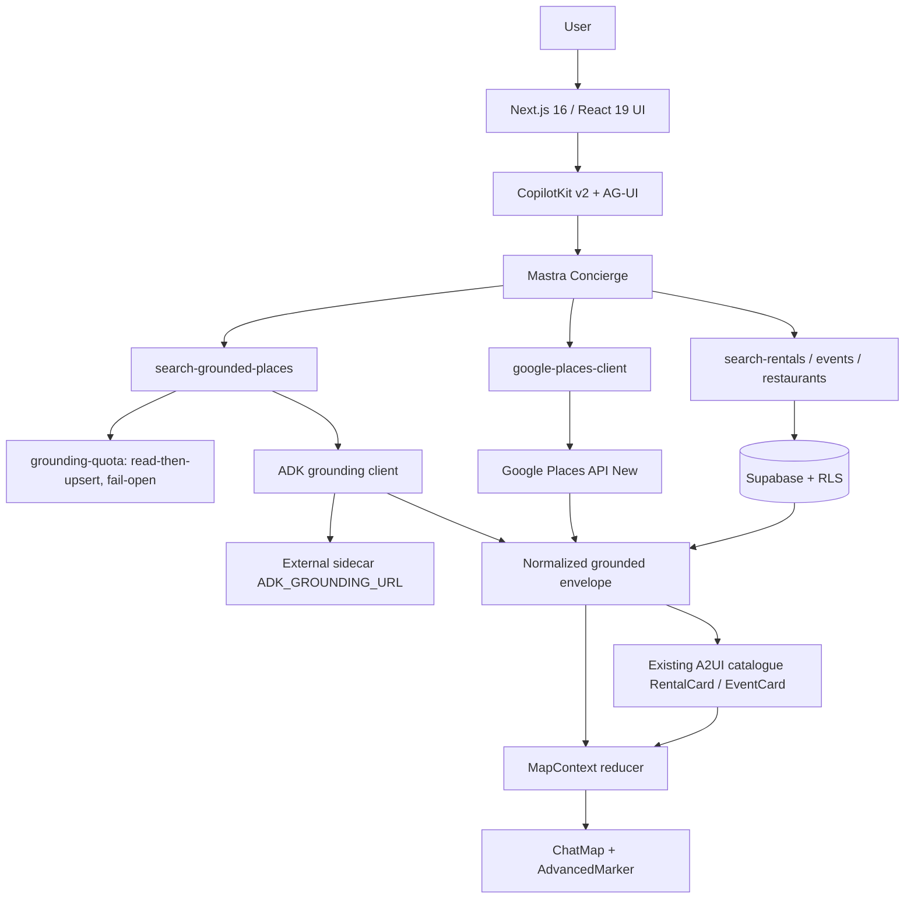
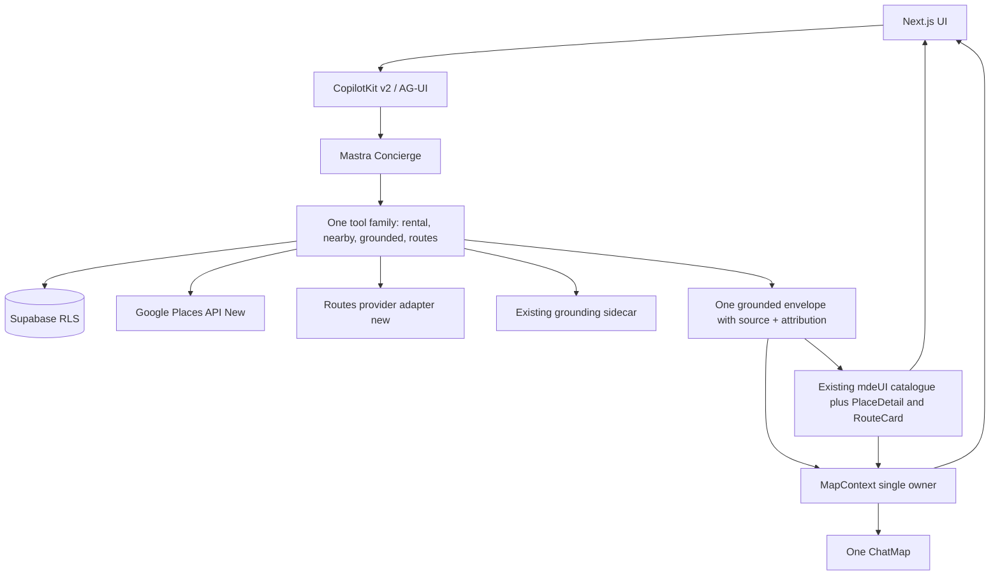
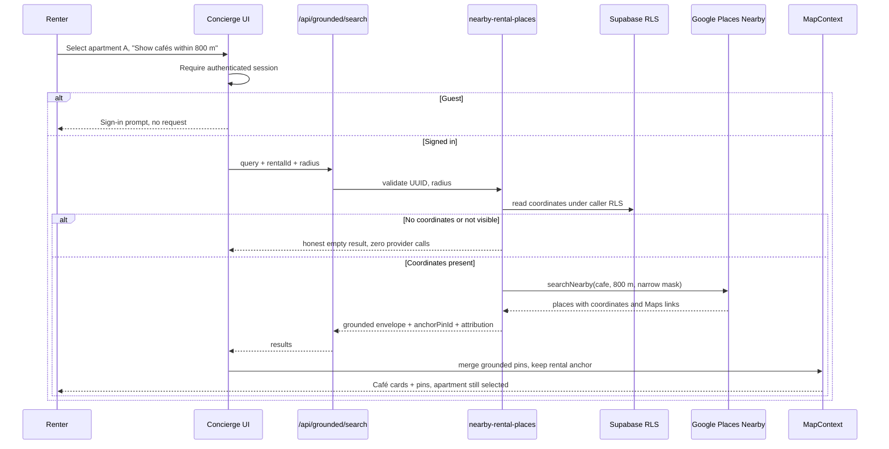
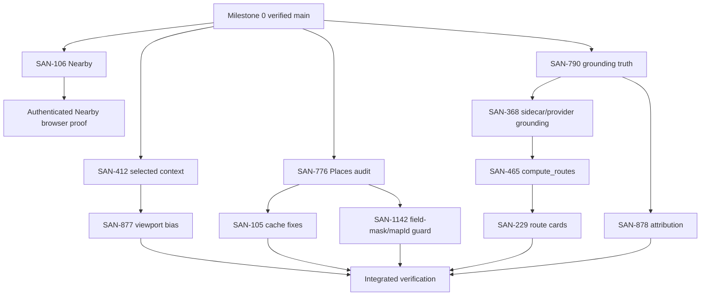
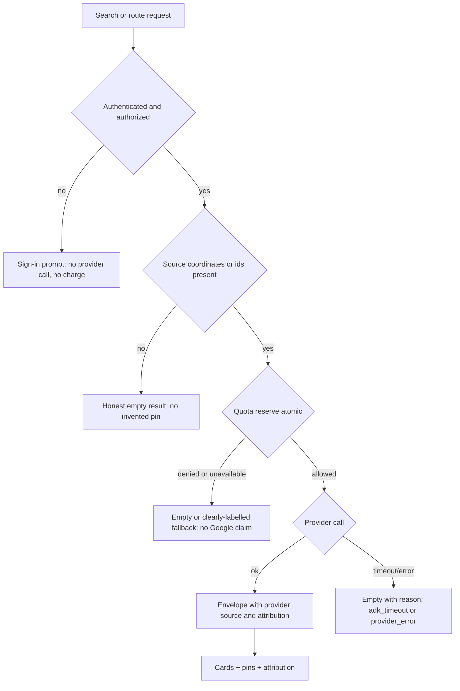

# Maps Platform — one plan for SAN-1437

This is the single canonical plan for the Maps epic. It replaces overlapping trackers as the
place to read *what is true, what is next, and why*. The Linear epic description remains the
tracker of record for status history; this document is the engineering plan.

Everything below was re-verified on 2026-11-06 against `origin/main`, the live production
deployment, the Linear API, open GitHub PRs, and the live Supabase project. Where the epic
description and current code disagree, the code wins and the disagreement is recorded.

## 1. Executive summary

**Readiness:** Linear reports **5 of 23** direct tasks Done (21.7% by row evidence, not effort),
**3 In Progress**, **12 Todo**, **3 Backlog**. Production serves the same commit as `origin/main`
(`8114a5a`), so there is no release drift to explain away.

**The honest summary:** the map itself, the pin/selection reducer, the production Map ID guard,
and the A2UI card/action path are real and shipped. The gaps are not "we need a Maps product".
They are specific: one open PR is the only route to working apartment-anchored Nearby
(`SAN-106`), the selected-place/viewport contract is only half-proven (`SAN-412`), one quota
path is racy and fails open, grounded fallbacks can be labelled as Google-sourced, and there is
no provider-backed routing at all — only a `compute_routes` enum on a sidecar client that no
repo code fulfils.

**Strategy:** keep the architecture MDE already has.

- One map: `ChatMap` / `@vis.gl/react-google-maps`.
- One map state owner: `MapContext` (reducer).
- One place provider: `google-places-client.ts` (Places API New) plus the existing grounding
  sidecar for grounded discovery.
- One agent runtime: Mastra concierge through CopilotKit v2 / AG-UI.
- One UI catalogue: `createGenerativeUI` fixed-schema A2UI (`RentalCard`, `EventCard`) whose
  props are **ids**, never facts.
- No Google Maps Agentic UI Toolkit runtime. Its alpha `@googlemaps/a2ui` Lit renderer plus
  Python ADK/A2A agent would add a second rendering stack and a second agent runtime for no
  user-visible gain over the existing catalogue. Borrow **patterns**, not the runtime
  (decision in §4).

**What "done" means here (Phase A development):**

1. A selected apartment can produce real Google cafés within a bounded radius, with the
   apartment pin and card retained.
2. The concierge answers about the *currently selected* place after A→B switching, with no
   stale replay.
3. A distance question returns a provider-backed distance/duration, attributed, or an honest
   "no route".
4. Guests get a sign-in prompt, never a billable provider call.
5. No invented coordinates, place ids, prices, routes or attribution.

Public-launch certification is a separate, later exercise. Nothing in this plan adds business
eligibility, ownership, publication-approval or viewing-permission gates.

## 2. Verified current truth

| Fact | Value | How verified |
|---|---|---|
| GitHub `main` | `8114a5a9638259126a58d7c15ca077dfdf5efe12` | `git ls-remote` / fetch |
| Production `/api/version` | `8114a5a9638259126a58d7c15ca077dfdf5efe12` | live HTTPS GET |
| Open Maps PR | **#783** `SAN-106`, head `02aea1f6b7d5e05147e132ba8a534ff2f894fb6e`, non-draft | `gh pr view 783` |
| #783 historical blocker | `busyRef` `TS2304` at `use-grounded-search-fast-path.ts:159` **is no longer present** on the head; concurrency moved to a `WeakSet` keyed by the provider setter | `git show` of head file |
| #783 CI | in progress at verification time (Floor, Playwright shards, Codacy); not yet a pass | `gh pr view --json statusCheckRollup` |
| Linear children | 23 direct children — 5 Done, 3 In Progress, 12 Todo, 3 Backlog | Linear GraphQL |
| Apartments | 45 total, **14 without coordinates** | read-only SQL |
| Events | 51 total, **2 without coordinates** | read-only SQL |
| Restaurants | 44 total, **2 without coordinates** | read-only SQL |
| Places cache | `place_details_cache` 94 rows; `places_search_cache` 33 rows | read-only SQL |
| Quota logs | `grounding_quota_log` 73 rows; `search_grounding_quota_log` 10 rows | read-only SQL |
| Grounding failures | `grounding_failures` 0 rows | read-only SQL |
| RLS | enabled on both caches and both quota logs | `pg_tables.rowsecurity` |
| Super Agent | runtime ready, repo `amoai-tech/mdeai`, agent `mde-amo`, 0 tickets running | Management API `GET state` |
| Super Agent policy | only `copy` and `visual` rules enabled; `eval.mode = observe`; allowed `amoai-tech` | Management API `GET settings` |

**Not verified in this pass (do not treat as passing):**

- A real signed-in Google Places Nearby call from a browser at the final head of #783.
- The A→B selected-place conversation on the deployed SHA.
- A provider-backed route request (implementation does not exist).
- 390×844 and 360×800 map open/select/close/reopen on the current release.
- Whether every grounded café card satisfies Google's current attribution rules.

**Authorization boundary (reported, not bypassed):** the running Super Agent admits copy and
visual work only, and evaluates inferred work in `observe` mode. A Maps engineering Ticket
therefore cannot be created from an ordinary unmentioned comment today. The smallest fix is one
operator action, not a code change — see §13.3.

## 3. Architecture inventory

### 3.1 Frontend

| Layer | Canonical file | Verdict | Notes |
|---|---|---|---|
| Map renderer | `src/components/maps/ChatMap.tsx` | **Working** | One `Map`, `AdvancedMarker`, Map ID required in production |
| Map state | `src/platform/maps/map-context.tsx` | **Working** | Reducer keeps pins, `selectedPinId`, `focusPinId` consistent in one update; merge drops selection only when the pin is gone |
| Pin merge | `src/platform/maps/merge-pins-by-category.ts`, `pin-selection.ts` | **Working** | Category replacement + selection reconciliation |
| Normalization | `src/platform/maps/normalize-tool-output.ts` | **Working** | Drops rows without finite coordinates; stable `category-id` keys |
| Tool → pins | `src/components/copilot/tool-pins-sync.tsx` | **Working** | "Newest finished result wins"; anchored Nearby keeps the rental anchor |
| Map ID | `src/lib/google-maps-map-id.ts` | **Working** | Production/preview refuses `DEMO_MAP_ID` |
| Map ↔ AI | `src/components/copilot/map-ui-sync.tsx`, `src/lib/map-ui-summary.ts` | **Partial** | Debounced 300 ms push of `selectedPinId`, categories, counts, viewport. It carries **ids and viewport**, not place facts; follow-up answers rely on `lastGroundedResults` in coagent state |
| Mobile sheet | `src/components/chat/map-mobile-sheet.tsx` | **Working (historically), unverified at this SHA** | Touch/close/reopen shipped in SAN-524 |
| A2UI catalogue | `src/components/copilot/a2ui/mde-ui-catalog.tsx` | **Working** | `createGenerativeUI` (`@copilotkit/react-core/v2/generative-ui`); components: `RentalCard`, `EventCard`; Zod props are ids only |
| A2UI → map | catalogue `onSelect` → `panToPin` | **Working** | Card selection focuses the matching pin |
| Cards/tools | `src/components/copilot/search-tool-renders.tsx` | **Working** | Renders tool results, pins, attribution |

### 3.2 Backend and providers

| Layer | Canonical file | Verdict | Notes |
|---|---|---|---|
| Places client | `src/mastra/lib/google-places-client.ts` | **Working** | `searchText` (:187), `searchNearby` (:217), details; explicit `X-Goog-FieldMask`, validated masks |
| Grounded discovery | `src/mastra/tools/search-grounded-places.ts` | **Working, one truthfulness defect** | Calls ADK sidecar; on quota/ADK failure falls back to `curatedFallback` **while returning `source: "grounding"` and empty attribution** |
| Anchored Nearby | `src/mastra/tools/nearby-rental-places.ts` | **Only on #783** | RLS-scoped rental coordinates, `searchNearby`, radius bounds, Maps URL validation |
| Grounded fast path | `src/app/api/grounded/search/route.ts` | **Partial** | Public POST, rate limit; #783 adds rental UUID + radius + cookie client |
| Concierge dispatch | `src/hooks/use-grounded-search-fast-path.ts` | **Partial** | #783 moves concurrency guard to a `WeakSet`; main still has a local `busyRef` |
| Sidecar client | `src/mastra/lib/adk-grounding-client.ts` | **Working client, no repo server** | Defaults to `http://localhost:8000`; abort timeouts; returns `adk_timeout`/`adk_unavailable` |
| Sidecar contract | `src/mastra/lib/adk-grounding-types.ts` | **Partial** | `compute_routes` exists only as an enum member (:35); no route request/response schema, no tool |
| Quota (grounded) | `src/mastra/lib/grounding-quota.ts` | **Defective** | Read-then-upsert daily counter: lost updates under concurrency; read/write errors **allow** the call (fail-open) |
| Quota (search) | `src/mastra/lib/search-grounding-quota.ts` + `reserve_search_grounding_quota` | **Working** | Single atomic upsert RPC; fails closed |
| Places detail cache | `src/lib/place-details-cache.ts`, `src/app/api/places/detail/route.ts` | **Working** | 7-day TTL, RLS on table |
| Routes | — | **Missing** | No `computeRoutes`, no Routes API client, no route card |

### 3.3 Data (Supabase)

Relevant tables: `apartments`, `events`, `restaurants`, `place_details_cache`,
`places_search_cache`, `grounding_quota_log`, `search_grounding_quota_log`,
`grounding_failures`, `rental_grounding`, `saved_places`.

Verified invariants to preserve: RLS on every private table; missing coordinates stay missing
(never synthesized); the service role never reaches the browser.

### 3.4 Tests that already exist

- Unit: `src/platform/maps/__tests__`, `src/mastra/tools/__tests__`, `src/lib/__tests__`,
  A2UI tests under `src/components/copilot/a2ui/__tests__`.
- E2E: `e2e/maps-layout-desktop.spec.ts`, `e2e/maps-layout-mobile.spec.ts`,
  `e2e/maps-grounding.spec.ts`, `e2e/maps-mobile-lifecycle.spec.ts`,
  `e2e/browse-map-close-touch.spec.ts`.
- Repo gate: `npm run floor` (audit, skills, DB-URL guard, release gates, dependency-cruiser,
  lint, typecheck, env check, build, Vitest, Mastra schema).

## 4. A2UI decision matrix

### 4.1 What the three options actually are

- **A — Existing MDE stack.** CopilotKit v2 fixed-schema A2UI (`createGenerativeUI`) renders
  `RentalCard`/`EventCard`; data resolves from stored authorization-scoped results; MapContext
  owns pins. No Google A2UI package.
- **B — Selective adoption.** Keep A, and borrow only *patterns/interop* that fit React 19:
  e.g. a compact place-detail surface, an inline route preview card, and a shared "place
  identity" prop contract — implemented in the existing catalogue unless a supported React
  wrapper exists.
- **C — Full Google Maps Agentic UI Toolkit.** Add `@googlemaps/a2ui` (Lit web renderer),
  Python `maui-a2ui-python` ADK agent over A2A, Maps JS **alpha** channel with
  `maps3d`/`places`/`routes`, and a second component registry.

### 4.2 Scored against MDE (0–100 per criterion)

| Criterion (weight) | A | B | C | Evidence |
|---|---:|---:|---:|---|
| Fit with Next 16 / React 19 / CopilotKit 1.84.1 (15) | 95 | 85 | 35 | C ships a Lit custom-element renderer plus a React sample wrapper; A is native React |
| Runtime simplicity — no second agent/protocol (15) | 95 | 88 | 15 | C needs Python ADK + A2A server; MDE already runs Mastra through AG-UI |
| Security / untrusted agent output (15) | 92 | 88 | 45 | A validates Zod props as ids and resolves facts server-side; C streams agent-selected surfaces that would need allow-listing |
| Reuse of MapContext / existing pins (10) | 95 | 90 | 25 | C's surfaces own their own map components; MDE's single-map invariant would fracture |
| Mobile/performance/bundle (10) | 90 | 80 | 40 | C adds Lit + alpha Maps JS libraries (`maps3d`, `places`, `routes`) |
| Time to working user journey (10) | 90 | 75 | 20 | A/B ship in days; C needs a Python service and deployment |
| Provider truth / attribution (10) | 80 | 85 | 60 | C improves grounding patterns but does not fix MDE's quota/fallback defects |
| Maintenance / GA risk (10) | 90 | 80 | 25 | Google labels the toolkit **Alpha/Experimental**; not a Core Service (no SLA/deprecation policy) |
| User-visible benefit vs A (5) | 60 | 85 | 70 | B adds detail/route surfaces users asked for; C's benefit is mostly cross-platform reuse MDE does not need |

**Weighted result: A ≈ 89, B ≈ 84, C ≈ 30.**

### 4.3 Decision

**Adopt A as the architecture, with B as a scoped pattern source.** Reject C for this epic.

Required code changes for the B elements that are worth doing, all inside the existing stack:

1. **Place-detail surface** (when `SAN-412` proves context): extend `mdeUI.components` with a
   `PlaceDetail` component whose props are `{ placeId }`, resolving from the stored grounded
   result — never accepting name/address/rating as props.
2. **Route preview card** (only after `SAN-465`): `{ originPlaceId, destinationPlaceId }` props;
   distance/duration come from the server tool response, not the model.
3. **Shared place identity:** a single `placeKey(providerId)` helper used by cards, pins and
   agent state, so A2UI selection and MapContext selection cannot diverge.

**Pilot (one day, no new dependency):** render one `PlaceDetail` surface from a selected café
result and assert card→pin→surface selection identity in Vitest plus one Playwright journey.
Only if that pilot shows a concrete gap that the Google renderer closes should C be revisited.

## 5. Diagrams

### 5.1 Verified current architecture



### 5.2 Recommended architecture with selective A2UI



### 5.3 Rental → Nearby cafés journey



### 5.4 Dependency graph (Linear relations)



### 5.5 Failure and authorization decision flow



## 6. The 23 direct tasks

Legend: 🟢 Done · 🟡 In progress · 🔴 Blocked · 🔵 Not started. "% verified" is the four-gate
evidence estimate from the epic, **not** engineering effort. Percentages are only advanced when
proof is attached.

| # | Task | Status | % | PR | Working | Broken / missing | Exact files | Depends on | Next fix | Proof |
|---|---|---|---|---:|---|---|---|---|---|---|
| 1 | [SAN-1351](https://linear.app/amo100/issue/SAN-1351/map-skill-ci-001-make-google-maps-external-maintenance-checks) MAP-SKILL-CI-001 | 🟢 Done | 75 | #111, #120 | Resilient Maps maintenance CI | No recent runtime check recorded | `.github/workflows/maps-skill-maintenance.yml` | — | Keep; re-run on demand | CI history |
| 2 | [SAN-1422](https://linear.app/amo100/issue/SAN-1422/make-map-results-truthful-and-clear-stale-pins-when-results-have-no) Truthful pins | 🟢 Done | 75 | merged | `tool-pins-sync` replaces finished category even when empty | Browser proof at current SHA pending | `src/components/copilot/tool-pins-sync.tsx`, `normalize-tool-output.ts` | — | One no-coordinate browser test | unit + e2e |
| 3 | [SAN-1429](https://linear.app/amo100/issue/SAN-1429/make-agent-search-results-change-the-map-only-when-they-are-the-newest) Newest search wins | 🟢 Done | 75 | #600 | `useCurrentSearchToolResult` ownership | Streaming race not re-proven | `search-tool-result-ownership.tsx` | — | A→B race test | unit |
| 4 | [SAN-524](https://linear.app/amo100/issue/SAN-524/san-524-map-011-m-mobile-map-interaction-system) Mobile map | 🟢 Done | 75 | #247, #266, #280 | Touch, close, escape, focus | 390px release check pending | `map-mobile-sheet.tsx` | — | Repeat open/select/reopen | e2e history |
| 5 | [SAN-1645](https://linear.app/amo100/issue/SAN-1645/mde-maps-let-ask-mde-highlight-real-places-on-the-existing-map-with) A2UI map selection | 🟢 Done | 75 | #773 | Reducer reconciles selection; ToolPinsSync keeps anchored rental | Authenticated Nearby proof pending | `map-context.tsx`, `tool-pins-sync.tsx` | SAN-472, SAN-106 | Recheck on next release | unit + earlier 390px |
| 6 | [SAN-106](https://linear.app/amo100/issue/SAN-106/map-006-nearby-search-show-nearby-on-rentalcard) Nearby + RentalCard | 🟡 In progress | 25 | **#783** (open) | Client + server nearby implementation, RLS lookup, CTA, tests | Final-head CI and real provider browser proof | `nearby-rental-places.ts`, `route.ts`, `use-grounded-search-fast-path.ts`, `mde-ui-catalog.tsx` | SAN-1645, SAN-1630 | Land #783 after green CI + provider proof | PR checks |
| 7 | [SAN-412](https://linear.app/amo100/issue/SAN-412/make-the-concierge-understand-the-selected-map-place-and-viewport) Selected map context | 🟡 In progress | 50 | — | `map-ui-sync` pushes selected id, categories, viewport | Follow-up/refresh/thread-switch not proven; carries ids not facts | `map-ui-sync.tsx`, `map-ui-summary.ts` | — | Contract test A→B→follow-up | unit + browser |
| 8 | [SAN-877](https://linear.app/amo100/issue/SAN-877/gnd-001-viewport-maps-locationbias) Viewport → locationBias | 🔵 Todo | 25 | — | Helper `grounding-location-bias.ts` exists; tool accepts `locationBias` | Agent does not reliably pass viewport | `grounding-location-bias.ts`, `search-grounded-places.ts` | SAN-412 | Wire after 412 | unit + request log |
| 9 | [SAN-790](https://linear.app/amo100/issue/SAN-790/search-001-harden-grounded-place-search-sources-attribution-and) Grounded search truth | 🔵 Backlog | 25 | — | Envelope shape + attribution array | Curated fallback labelled `source: "grounding"`; provider failure paths thin | `search-grounded-places.ts` | — | RED tests for fallback truth | unit |
| 10 | [SAN-878](https://linear.app/amo100/issue/SAN-878/gnd-002-maps-attribution-tos-on-grounded-cards) Attribution / ToS | 🟡 In progress | 50 | #246 | `GroundingAttribution`, card photo attribution | Full matrix unproven; café e2e expects no attribution node | `GroundingAttribution.tsx`, `grounded-place-card.tsx` | SAN-790 | Audit each sourced card | browser + doc |
| 11 | [SAN-368](https://linear.app/amo100/issue/SAN-368/tourist-adk-cafe-grounding-live-on-mdeaicochat-map-002b) Production ADK grounding | 🔵 Todo | 0 | — | Client + sidecar contract | Sidecar code not in repo; prod availability unproven | `adk-grounding-client.ts` | SAN-790 | Prove one live grounded request | trace + screenshot |
| 12 | [SAN-776](https://linear.app/amo100/issue/SAN-776/map-005-audit-places-cost-cache-compliance-and-field-masks) Places audit | 🔵 Todo | 0 | — | Masks exist; caches exist | Cost/quota not measured; `grounding-quota` racy + fail-open | `google-places-client.ts`, `grounding-quota.ts` | — | Fix quota atomicity, then audit | unit + SQL |
| 13 | [SAN-1142](https://linear.app/amo100/issue/SAN-1142/ven-009-map-002-field-mask-mapid-ci-guard-on-every-placesmap-call) CI mask/mapId guard | 🔵 Todo | 25 | — | Some masks/guards | Not every call site covered | scripts + `google-places-client.ts` | SAN-776 | Extend caller coverage | CI test |
| 14 | [SAN-105](https://linear.app/amo100/issue/SAN-105/map-005-reconcile-remaining-places-proxy-and-cache-gaps) Places proxy/cache | 🔵 Todo | 0 | — | Existing client/caches | No proven defect beyond quota | `place-details-cache.ts`, `route.ts` | SAN-776 | Fix only audited findings | focused test |
| 15 | [SAN-104](https://linear.app/amo100/issue/SAN-104/map-010-place-autocomplete-for-roberto-host-venue) Host venue autocomplete | 🔵 Todo | 0 | — | — | No venue autocomplete UI | host event form | SAN-776 | Reuse Places widget | e2e |
| 16 | [SAN-1352](https://linear.app/amo100/issue/SAN-1352/map-skill-routes-001-add-modern-routes-api-reference-examples) Routes references | 🔵 Todo | 0 | — | — | Skill examples unproved | `.claude/skills/maps` | — | Document current API + MCP | review |
| 17 | [SAN-465](https://linear.app/amo100/issue/SAN-465/map-011a-adk-sidecar-compute-routes-grounding-lite-mcp) compute_routes | 🔵 Todo | 0 | — | `compute_routes` enum only | No server implementation, no schema | `adk-grounding-types.ts`, `adk-grounding-client.ts` | SAN-368 | One provider adapter | unit + live call |
| 18 | [SAN-229](https://linear.app/amo100/issue/SAN-229/map-011-route-previews-commute-cards) Route cards | 🔵 Todo | 0 | — | — | No route card | `search-tool-renders.tsx` | SAN-465 | Build after real provider | e2e |
| 19 | [SAN-230](https://linear.app/amo100/issue/SAN-230/map-012-neighborhood-intelligence-cards) Neighborhood intel | 🔵 Todo | 0 | — | — | No grounded comparison | reuse Nearby | SAN-106, SAN-465 | Defer until core works | e2e |
| 20 | [SAN-466](https://linear.app/amo100/issue/SAN-466/map-034-advanced-marker-ux-polish-selection-badges-mobile-a11y) Marker UX | 🔵 Todo | 0 | — | Markers/cluster exist | Dense tap + keyboard unproven | `ClusteredCategoryMarkers.tsx` | SAN-1422, SAN-524 | Keyboard/tap test | e2e |
| 21 | [SAN-1424](https://linear.app/amo100/issue/SAN-1424/map-013-resolve-pasted-google-maps-links-and-place-names-to-stable) Link → Place ID | 🔵 Backlog | 0 | — | — | No resolver | Places client | SAN-790 | Places link resolver | unit |
| 22 | [SAN-1425](https://linear.app/amo100/issue/SAN-1425/map-014-add-grounded-weather-context-for-outdoor-events-and-places) Weather grounding | 🔵 Backlog | 0 | — | — | No weather provider | — | SAN-790 | Defer | — |
| 23 | [SAN-108](https://linear.app/amo100/issue/SAN-108/map-023-static-maps-api-event-location-previews-og-images) Static Maps / OG | 🔵 Todo | 0 | — | — | No static preview | — | real coordinates | Defer | — |

### 6.1 Status corrections made by this pass

- **#783's `busyRef` failure is fixed on the head.** The tracker's "🔴 CI blocked — TS2304" row
  is stale. The head replaces the local ref with a `WeakSet` guard; the remaining gate is CI +
  real provider proof, not a type error.
- **Production SHA moved.** The tracker said `30d12a0`; production now serves `8114a5a`, equal
  to `main`.
- **No duplicate open PRs for the same task.** #783 is the only open Maps implementation PR.

## 7. Related tasks (separate owners — never double-counted)

| Task | Status | Relationship to this epic | Rule |
|---|---|---|---|
| [SAN-472](https://linear.app/amo100/issue/SAN-472/keep-rental-cards-and-map-pins-in-sync-using-real-listing-locations) Rental card ↔ pin | 🟢 Done | Supplies card/pin identity | Consume; do not re-implement |
| [SAN-1564](https://linear.app/amo100/issue/SAN-1564/stop-chat-google-maps-crashing-on-desktop-and-mobile) Map crashes | 🟢 Done | Map lifecycle fixes | Regression-test only |
| [SAN-369](https://linear.app/amo100/issue/SAN-369/map-008b-map-id-on-production) Production Map ID | 🟢 Done | Map ID | Verify config, don't rebuild |
| [SAN-1588](https://linear.app/amo100/issue/SAN-1588/mde-ai-add-nvidia-nemotron-to-chat-and-rental-search-without) NVIDIA provider | 🟢 Done | Chat provider | Out of scope |
| [SAN-1322](https://linear.app/amo100/issue/SAN-1322/mde-maps-fix-local-map-errors-and-keep-google-api-keys-secure) Keys / local maps | 🟡 In progress | Key restrictions | Report only |
| [SAN-1631](https://linear.app/amo100/issue/SAN-1631/mde-ai-let-chat-update-existing-pages-with-copilotkit-surfaces) Page surfaces | 🔵 Todo | Reuses A2UI catalogue | Do not fork catalogue |
| [SAN-1041](https://linear.app/amo100/issue/SAN-1041/mde-rentals-compare-real-apartments-with-interactive-ai-cards-and-maps) Apartment compare | 🔵 Todo | Reuses cards + map | Do not duplicate comparison |
| [SAN-280](https://linear.app/amo100/issue/SAN-280/trp-016-trip-map-google-pins-tab) Trip map | 🔵 Todo | Reuses pins + RLS | Do not add a map engine |
| [SAN-1630](https://linear.app/amo100/issue/SAN-1630/mde-ai-build-one-reusable-copilotkit-a2ui-component-catalog) A2UI catalogue prerequisite | 🟢 Done | `mdeUI` | Prerequisite, not a Maps child |

Superseded/canceled history stays untouched: SAN-102, SAN-103, SAN-463.

## 8. Proven defects, risks and smallest fixes

### E1 — #783 cannot be called done until final-head CI and one real provider journey pass
- **Symptom:** the only working Nearby implementation is unmerged.
- **Evidence:** PR head `02aea1f`; CI in progress at this verification; no signed-in browser proof
  on this head.
- **Root cause:** verification gap, not an open code defect (the `busyRef` type error is fixed).
- **Owner:** `src/mastra/tools/nearby-rental-places.ts`, `src/app/api/grounded/search/route.ts`.
- **Smallest fix:** none additional if CI passes; otherwise fix only the failing check.
- **Test:** `npm run floor`; `playwright test e2e/maps-layout-mobile.spec.ts`; one authenticated
  Places Nearby call.
- **Outcome:** café cards and pins around the selected apartment, apartment still selected.

### E2 — grounded quota is racy and fails open (high)
- **Symptom:** concurrent grounded searches can exceed the daily cap; a database error permits
  unmetered spending.
- **Evidence:** `src/mastra/lib/grounding-quota.ts:14` reads `count`, computes `count + 1`, then
  upserts; read/write errors `return { allowed: true }`. The search quota already does this
  correctly with `reserve_search_grounding_quota` (atomic upsert, fail-closed).
- **Root cause:** two quota implementations with different guarantees.
- **Owner:** `grounding-quota.ts` (SAN-776; SAN-105 only if a cache defect is proven).
- **Smallest fix:** add a `reserve_grounding_quota(p_daily_cap)` RPC modelled on the search one;
  call it; fail closed (`quota_unavailable`) when the RPC is missing.
- **Test:** 20 parallel reservations, cap 10 → exactly 10 allowed; DB-down → denied.
- **Outcome:** no unbounded Google spend under concurrency or outage.

### E3 — curated fallback is labelled as grounded (high)
- **Symptom:** when quota is exhausted or the sidecar is down, database restaurants are returned
  as `source: "grounding"` with empty attribution.
- **Evidence:** `search-grounded-places.ts` `curatedFallback` paths return
  `{ source: "grounding", attribution: [] }`.
- **Root cause:** one envelope type serving two different truths.
- **Owner:** `search-grounded-places.ts`; UI label in `grounded-place-card.tsx`.
- **Smallest fix:** return `source: "curated"` (or add `provider: "mde"`) and render it without
  any Google attribution; keep `source: "grounding"` only for Google rows.
- **Test:** quota-denied request yields zero `source: "grounding"` rows and no Google label.
- **Outcome:** users never see MDE data presented as Google data.

### E4 — selected-place context is ids-only and unproven across switch/refresh
- **Symptom:** "this apartment" may answer from stale `lastGroundedResults` after A→B.
- **Evidence:** `buildMapUiSummary` emits `selectedPinId`, categories, counts, viewport only;
  `map-ui-sync` debounces 300 ms; no A→B test exists.
- **Root cause:** the contract was designed for map view state, not conversational identity.
- **Owner:** `map-ui-summary.ts`, `map-ui-sync.tsx`, `concierge.ts`.
- **Smallest fix:** add a focused test that sets selected pin A, asks, selects B, asks, and
  asserts the agent state seen by the tool contains B and not A's facts.
- **Outcome:** no stale place answers.

### E5 — no provider-backed routes
- **Symptom:** "How far is this apartment from Provenza?" has no real distance/time path.
- **Evidence:** only `compute_routes` in an enum (`adk-grounding-types.ts:35`); no Routes API
  client; `Route`/`duration` handling absent.
- **Root cause:** SAN-465 never implemented; SAN-229 depends on it.
- **Owner:** `adk-grounding-client.ts` + a typed route adapter.
- **Smallest fix:** one server function calling the documented `compute_routes` MCP tool (or the
  Routes API) with `place_id`/`lat_lng`; parse `distanceMeters` and `duration`; attribute.
- **Test:** one live request Medellín → Provenza returns a finite distance and duration; provider
  failure returns "no route" without numbers.
- **Outcome:** truthful distance/time only when Google returned it.

### E6 — ADK sidecar is an external, unversioned dependency
- **Symptom:** grounded search depends on `ADK_GROUNDING_URL` (default `localhost:8000`); no
  server code in the repo.
- **Evidence:** `adk-grounding-client.ts:7`; no `adk/` directory in the repository.
- **Root cause:** deployment artifact outside source control.
- **Owner:** SAN-368.
- **Smallest fix:** record the deployed revision/contract and a health probe; do not rewrite the
  sidecar inside this epic.
- **Outcome:** a grounded request can be reproduced and its failure explained.

### E7 — attribution matrix is incomplete
- **Symptom:** cards may show Google ratings/photos without the required source line.
- **Evidence:** `e2e/maps-grounding.spec.ts` asserts **no** `grounding-attribution` node for café
  cards while asserting rating/photo attribution; `GroundingAttribution` exists but is opt-in.
- **Root cause:** attribution applied per-card variant, not per-source rule.
- **Owner:** `GroundingAttribution.tsx`, `grounded-place-card.tsx` (SAN-878).
- **Smallest fix:** one helper that decides attribution from `provider`, applied by every card
  variant; test each variant.
- **Outcome:** every Google-sourced fact carries Google attribution; MDE/curated rows do not.

### E8 — duplicate/overlapping quota logs
- **Symptom:** two counters (`grounding_quota_log`, `search_grounding_quota_log`) with different
  semantics.
- **Root cause:** incremental feature growth.
- **Rule:** keep both only if they meter different SKUs; otherwise converge in SAN-776. Do not add
  a third.

## 9. Milestones

### Milestone 0 — Verify and reconcile (done in this pass)
- `main`/production SHA reconciled; policy and Super Agent health recorded; 23 task states
  re-read from Linear; open PRs enumerated; DB geo gaps counted.
- Exit: one plan, no duplicate tasks, no stale blocker claimed.

### Milestone 1 — Reliable map, Nearby, selected context
1. **SAN-106** (S/M, #783) — land after green final-head CI + real Nearby proof.
2. **SAN-412** (S) — prove/repair A→B context; one test, one small state change.
3. **SAN-466** (M, parallel-safe after 1422/524) — keyboard/tap marker proof.
4. **SAN-877** (S, after 412) — pass viewport as `locationBias`.
Exit: rental → café cards/pins with anchor retained; A→B answers correctly; 390/360 no crash.

### Milestone 2 — Truthful, cost-safe Places
1. **SAN-776** (M) — atomic quota RPC + fail-closed; cost/mask audit.
2. **SAN-105** (S) — only audited cache/proxy defects.
3. **SAN-1142** (S) — CI guard across every Places/Map call site.
4. **SAN-790** (M) — source truth + fallback labelling; **SAN-878** (S) attribution matrix.
5. **SAN-368** (M) — one reproducible grounded request in production.
Exit: one Google request path per behavior; no unmetered path; no false Google label.

### Milestone 3 — Map-aware AI and A2UI
- **SAN-412** follow-through, optional `PlaceDetail` surface, catalogue identity helper.
- Keep the catalogue at two components unless a journey test proves a third is needed.

### Milestone 4 — Real Routes
- **SAN-1352** (docs) → **SAN-465** (adapter) → **SAN-229** (card/preview).
- Success is a finite provider distance/duration or an honest "no route".

### Milestone 5 — Events, trips, neighborhoods
- **SAN-104** (venue autocomplete) reusing the Places client.
- **SAN-230** neighborhood intel after Nearby/Routes.
- **SAN-108**, **SAN-1424**, **SAN-1425** only after core journeys are green.

### Milestone 6 — Integrated verification
- Guest + authenticated; desktop + 390×844 + 360×800; timeout/quota/invalid-key; exact SHA.
- No mocked test counts as provider proof.

### Parallelization

Safe in parallel: SAN-776 and SAN-106 (different files); SAN-1352 docs; SAN-466 after 1422.
Do **not** run in parallel: SAN-105 with SAN-776 (same quota/cache surface), SAN-229 with
SAN-465, or any two PRs touching `search-grounded-places.ts` / `mde-ui-catalog.tsx`.

## 10. Real-world use cases

| Request | Required behavior | Truth guard |
|---|---|---|
| "Show cafés near this apartment" | Real Google cafés, apartment pin + card retained | Coordinates only from RLS-visible row |
| "What is this place?" | Compact details for selected place | Facts from Places, not the model |
| "Compare these three rentals" | Stored rental rows + synced pins | No invented price/amenity |
| "Restaurants in this map area" | Viewport-biased search | Bias only; never fabricate viewport |
| "How far from Provenza?" | Provider distance + duration | No estimate without provider |
| "Plan a route between these events" | Ordered stops, truthful legs | No invented geometry |
| "Open this Google Maps link" | Stable Place ID | Resolve; never guess |
| Guest asks for cafés | Sign-in prompt | Zero billable calls |

## 11. Official references and what each settles

| Source | URL | Used for |
|---|---|---|
| Maps Agentic UI Toolkit | https://developers.google.com/maps/ai/agentic-ui-toolkit | Alpha/experimental status, scope |
| Toolkit repo | https://github.com/googlemaps/a2ui | Lit renderer, Python ADK/A2A, alpha Maps JS |
| CopilotKit A2UI | https://docs.copilotkit.ai/generative-ui/a2ui | Existing fixed-schema path |
| AG-UI | https://docs.ag-ui.com/introduction | Transport ownership |
| Google Maps skill | https://github.com/googlemaps/agent-skills/blob/main/skills/google-maps-platform/SKILL.md | Current implementation guidance |
| Places Nearby | https://developers.google.com/maps/documentation/places/web-service/nearby-search | Radius, rank, included types |
| Places fields | https://developers.google.com/maps/documentation/places/web-service/choose-fields | Field mask/billing |
| Places policies | https://developers.google.com/maps/documentation/places/web-service/policies | Caching, attribution |
| Maps Experience tools | https://developers.google.com/maps/ai/maps-experience-agent-tools | Grounding capabilities |
| `compute_routes` MCP | https://developers.google.com/maps/ai/maps-experience-agent-tools/reference/mcp/compute_routes | Waypoints, `distanceMeters`, `duration`, attribution |
| JS Routes migration | https://developers.google.com/maps/documentation/javascript/routes/routes-js-migration | Current route API |
| Place Autocomplete (New) | https://developers.google.com/maps/documentation/javascript/place-autocomplete-new | Venue selection |
| Accessible markers | https://developers.google.com/maps/documentation/javascript/advanced-markers/accessible-markers | Keyboard/SR |
| Mastra tools | https://mastra.ai/docs/agents/tools | Typed tools |
| Playwright mobile | https://playwright.dev/docs/emulation | Mobile proof |

Rule: an official example is applied only at the installed version (`@googlemaps/places 2.4.1`,
`@vis.gl/react-google-maps 1.8.3`, CopilotKit 1.84.1, Mastra 1.81.0). A current upstream example
against an older pin is a new bug.

## 12. Testing and release criteria

**Per task:** reproduce → RED test (defect) → smallest change → focused Vitest → lint/typecheck
on changed files → batch review comments → final-head CI once → targeted browser/provider proof.

**Commands**

```sh
npx vitest run <focused files>
npm run typecheck
npm run lint
npm run floor                     # final head only
npx playwright test e2e/maps-layout-desktop.spec.ts e2e/maps-layout-mobile.spec.ts
npx playwright test e2e/maps-grounding.spec.ts
```

**Gates**

| Gate | Pass condition |
|---|---|
| Implementation | Inspected diff; canonical owner file; no duplicate service |
| Focused tests | GREEN; failure path covered |
| CI | `floor` + required Playwright shards green on the exact head |
| Provider | One real Google response at that head, or explicitly recorded as unknown |
| Release | `/api/version` equals the verified SHA |

**Provider vs mock:** unit tests may mock; a provider-backed journey may not be claimed from a
mock. Record the request path, the redacted response shape and the source IDs.

## 13. Risks, unknowns and blockers

1. **#783 staleness risk:** long-lived branch; `main` moved 300+ commits since the working
   checkout. Merge only after rebase/merge of current `main` and a fresh CI run.
2. **Sidecar opacity:** an external ADK service can fail in ways the repo cannot reproduce.
   Record its revision; keep the honest empty-result path.
3. **Authorization policy (operator action):** Super Agent admits only copy and visual rules.
   Its Management API (`PUT settings/policy`, revision 1) needs one scoped rule, for example:

   ```json
   {"id":"maps-engineering","name":"Maps engineering","enabled":true,
    "instruction":"Explicit requests to implement, fix or verify MDE Google Maps Platform behavior: Maps JavaScript, Places, grounding, routes, map state, A2UI map components, and their tests. Keep Phase A rules; preserve auth, RLS, secrets, quotas and truthful provider data."}
   ```

   Until that rule exists (or the requester comments explicitly and Eval accepts), a Super Agent
   Ticket for this engineering work is not authorized. This plan does **not** change it.
4. **No open GitHub issues:** Super Agent intake is GitHub-only; the documented trigger is a
   comment from `amoai-tech` on an issue mentioning `@mde-amo`. With no open issue, the smallest
   action is: create one issue titled with the task id, then comment
   `@mde-amo implement SAN-xxx per docs/plans/maps-platform-SAN-1437.md`.
5. **Attribution legal risk** is not fully closed by code alone; SAN-878 remains open until each
   card variant is audited against current policy.

## 14. Next five actions

1. **Land SAN-106 (#783):** watch final-head CI; on green, one authenticated Nearby browser proof;
   update Linear with the exact SHA and evidence.
2. **Fix the quota truth (SAN-776):** atomic RPC + fail-closed, with a concurrency test.
3. **Prove selected context (SAN-412):** A→B→follow-up test; only then wire viewport bias
   (SAN-877).
4. **Label fallbacks honestly (SAN-790):** curated ≠ grounded; attribution helper for every card.
5. **Implement one route adapter (SAN-465), then the card (SAN-229).**

## 15. Final decision

- **Architecture:** Option A — existing MDE Map + MapContext + CopilotKit v2 A2UI + Mastra.
- **A2UI:** selective patterns (B), never the full toolkit (C) in this epic.
- **Repair first:** Nearby (#783), atomic quota, truthful fallback labelling.
- **Parallel-safe:** SAN-776 with SAN-106; docs with anything.
- **Deferred:** SAN-108, SAN-1425, SAN-1424 until core journeys are green.
- **Working development journey:** selected rental → real cafés with anchor retained; accurate
  A→B context; provider-backed distance or honest refusal; all with auth/RLS/attribution intact.
- **Public-launch certification:** separate, explicitly initiated; not implied by this plan.
