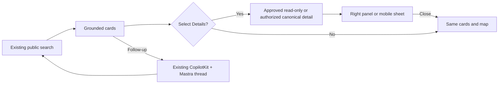

# MDE Shared Discovery — Fast-Track Readiness & Implementation Plan

**Source of truth:** [SAN-1390 · EPIC · UI/UX MDE — Make Chat, Mobile, Maps, Rentals, and AI Workspaces Production-Ready](https://linear.app/amo100/issue/SAN-1390/epic-uiux-mde-make-chat-mobile-maps-rentals-and-ai-workspaces)
**Code snapshot:** `9e0b3ed2cf46f9b75fe0809553f6e914666c545a` (2026-10-14) — refresh before implementing.
**Status:** Planning verified, *not* code merged or cross-route production certified.

## Decision — faster than a five-page redesign

Build **one complete rental details → chat → map loop** using existing components and data. Reuse it for venues and events. Let sidebar polish and page-aware AI work in parallel instead of blocking the visible rental result. **No new CopilotKit provider, Mastra agent, chat history store, ResultCardShell, map context, RentalSearchEngine, pgvector index, table, or migration.**

Current main already has:
- Chat: `src/components/chat/{chat-canvas,chat-center-panel,chat-map-panel,chat-nav-rail,rental-ui-context}.tsx`
- Venue cards: `src/components/browse/{venue-card-shell,venue-browse-card}.tsx`; **9/9 focused Vitest tests passed** on this snapshot
- Map/mobile: `src/components/browse/{BrowseMapContextShell,BrowseMapPanel,BrowseMapSheet}.tsx`, `src/platform/maps/map-context.tsx`
- Rental search: `src/lib/rentals/public-external-discovery.ts`, `src/mastra/tools/search-rentals.ts`, `src/lib/rentals/get-rental-detail.ts`
- Root non-chat CopilotKit provider: `src/components/copilot/copilot-kit-provider.tsx`; `/chat` has a distinct provider. **Inspect before composing across routes.**

## Readiness tracker (Linear snapshot, not production percentages)

| Order | Exact Linear task | Status | Decision | Smallest proof |
| --- | --- | --- | --- | --- |
| Reuse | [SAN-245 · UIX-017 — SCREEN-007 — Venue / Listing Detail Sheet](https://linear.app/amo100/issue/SAN-245/san-245-uix-017-screen-007-venue-listing-detail-sheet) | Done | Reuse, don't rebuild | Current Sheet tests + focus |
| Reuse | [SAN-489 · SCREEN-018 — Mobile Responsive 3-Panel Shell](https://linear.app/amo100/issue/SAN-489/san-489-screen-018-mobile-responsive-3-panel-shell) | Done | Reuse, don't rebuild | 390px sheet/layout |
| 0 | [SAN-1140 · VEN-004 · UI-001 — Unify browse + chat cards onto one ResultCardShell](https://linear.app/amo100/issue/SAN-1140/ven-004-ui-001-unify-browse-chat-cards-onto-one-resultcardshell) | Todo | **Non-blocking parity audit**; existing shell passes 9 tests | Same venue browse/chat comparison; fix only a demonstrated difference |
| 1a | [SAN-1417 · Define the authoritative /rentals/[id] property-detail design — responsive wireframes, states + SAN-1416 handoff](https://linear.app/amo100/issue/SAN-1417/define-the-authoritative-rentalsid-property-detail-design-responsive) | Todo | Ready for rapid wireframe/contract signoff; **not** a coding prerequisite for unrelated nav work | 1440/390px, COP/month, unknowns |
| 1b | [SAN-1416 · Implement the authoritative /rentals/[id] detail UI — render canonical data only](https://linear.app/amo100/issue/SAN-1416/implement-the-authoritative-rentalsid-detail-ui-render-canonical-data) | Todo | **First focused code PR** — typed public read-only detail + reusable renderer | Approved external visible; other drafts denied; no viewing CTA |
| 2 | [SAN-1421 · Reskin /rentals as the MDE Rental Discovery Workspace — Filters, Ranked Cards, Map + Ask MDE](https://linear.app/amo100/issue/SAN-1421/reskin-rentals-as-the-mde-rental-discovery-workspace-filters-ranked) | Todo | **Second focused code PR** — card Details/right panel and same-thread composer | Select → details → ask → close → same results/map |
| Parallel | [SAN-1088 · Make Chat Navigation Simple and Keep the Right Conversation Selected](https://linear.app/amo100/issue/SAN-1088/make-chat-navigation-simple-and-keep-the-right-conversation-selected) | Todo | Parallel nav polish; not blocking rental details | URL/thread A→B→Back, 390px drawer |
| Parallel | [SAN-737 · Help the AI Understand the Page the User Is On](https://linear.app/amo100/issue/SAN-737/help-the-ai-understand-the-page-the-user-is-on) | Todo | Extend existing context *after selected-item ID works* | A→B→clear context, auth isolation |
| 3a | [SAN-1146 · VEN-005 · MAP-001 — Living map column on /cafes + /nightlife](https://linear.app/amo100/issue/SAN-1146/ven-005-map-001-living-map-column-on-cafes-nightlife) | Todo | **No longer blocked by SAN-1140**; start with /cafes | Pin↔card/detail and map failure fallback |
| 3b | [SAN-1145 · VEN-003 · CK-001 — Concierge band on /cafes /nightlife /restaurants](https://linear.app/amo100/issue/SAN-1145/ven-003-ck-001-concierge-band-on-cafes-nightlife-restaurants) | Todo | **No longer blocked by SAN-1140**; persistent chat, not a one-shot band | Two follow-ups, no duplicate agent |
| 4a | [SAN-972 · Events discovery index — design screen build (/events · LIVE, 3-panel)](https://linear.app/amo100/issue/SAN-972/events-discovery-index-design-screen-build-events-live-3-panel) | Backlog | Reuse right layout/map and existing details | Published event → detail → back; checkout unchanged |
| 4b | [SAN-1250 · EVOS-09 — Public concierge panel + NL search on /events](https://linear.app/amo100/issue/SAN-1250/evos-09-public-concierge-panel-nl-search-on-events) | Backlog | Reuse composer/agent + published event search | “Salsa this weekend” → “only Laureles” |

**Tracker:** 2/12 Done (17% *administrative*); 8 Todo; 2 Backlog. **Actual five-route certification: not yet complete.** Do not infer percent implementation from issue state.

## Exact minimal delivery slices

### 1. Rental read-only details — SAN-1416 (after SAN-1417 signoff)
1.1 Verify publicly approved external ad scope (exact slug/owner/publication/recorded photo permission) in `src/lib/rentals/public-external-discovery.ts`. **Do not** relax active-only `src/lib/rentals/get-rental-detail.ts` or any broker requestability checks.
1.2 Reuse detail sections from `src/components/rentals/rental-detail-view.tsx` and `src/components/sheets/venue-detail-sheet.tsx`; normalize COP/month, photos[], nullable beds, amenities, source and nullable coordinates. Extract a small display component **only if reused by multiple surfaces**.
1.3 Tests: authorized signed-out ad succeeds; arbitrary inactive draft fails; 4 authorized photos; null bedrooms reads Unknown; no fake map pin; no Schedule Viewing. Vitest/typecheck/lint then mobile focus test.
**Checkpoint:** A correct, accessible *read-only* property detail component exists with no second search or DB service.

### 2. Rental workspace — SAN-1421
2.1 In `src/components/rentals/{rental-browse-view,rental-browse-card}.tsx` make title/photo/**Details** select the item, not navigate to Fincaraíz (the original source remains an optional secondary link).
2.2 Reuse `src/components/chat/{rental-ui-context,chat-map-panel,chat-center-panel}.tsx` and existing `BrowseMapPanel/Sheet` to swap right map ↔ details. Check the root and chat CopilotKit providers before embedding; no nested provider or new thread store.
2.3 Test filtered Laureles cards → detail → same chat follow-up → close → unchanged card/map/filter; do desktop 1440px and mobile 390px, keyboard and map failure.
**Checkpoint:** First full user-facing workspace works in preview, then exact-SHA production.

### 3. Parallel UX efficiency — SAN-1088 / SAN-737
3.1 Simplify only `src/components/chat/chat-nav-rail.tsx` + drawer; reuse `src/lib/chat/thread-nav-context.tsx` / current history APIs. No navigation rewrite.
3.2 Add selected public item/filters to existing `src/components/chat/concierge-copilot-bridge.tsx` context. Never pass private draft rows, secrets or cross-user data. Keep SAN-737 scoped; it should not block the basic Details click.

### 4. Reuse on venues and events
4.1 SAN-1146/1145: reuse `VenueBrowseCard`, `BrowseMapContextShell` and existing Mastra concierge; implement **/cafes first**, then /nightlife, then /restaurants. Map and conversation can be worked independently in parallel, integrating before Done.
4.2 SAN-972/1250: reuse `src/components/events/{event-browse-view,event-detail-view}.tsx`, `src/mastra/tools/search-events.ts`, and published-event IDs. No new checkout/payment code.

## Desktop/mobile wireframe

```text
Desktop [Compact nav] [Filters + genuine cards + multi-turn Ask MDE] [Map ⇄ selected details]
Mobile  [Single-column cards + fixed composer] → [Map or details sheet] → same cards
```



## Official reference → action → verification

- [CopilotKit v2 Chat Configuration](https://docs.copilotkit.ai/reference/v2/hooks/useCopilotChatConfiguration) → **ADAPT** existing agent/thread binding in `src/components/copilot/copilot-kit-provider.tsx` and `src/components/chat/chat-provider.tsx`; verify one agent request and persistent thread; don't copy new providers.
- [Mastra memory](https://mastra.ai/docs/memory/overview) → **REFERENCE ONLY** thread/resource isolation in `src/mastra/agents/concierge.ts`; verify follow-ups stay in the same authorized thread; no new memory store.
- [Supabase RLS](https://supabase.com/docs/guides/database/postgres/row-level-security) → **REFERENCE ONLY** service key and RLS rules; **ADAPT** approved external scope from `src/lib/rentals/public-external-discovery.ts`, test anonymous allowlisted success and unrelated draft denial.
- [Google Maps AdvancedMarker](https://developers.google.com/maps/documentation/javascript/advanced-markers/add-marker) → **ADAPT** current mapId/validated positions in `src/platform/maps/map-context.tsx` and existing map components, prove pin omitted for null coordinates.
- [Playwright emulation](https://playwright.dev/docs/emulation) → **ADAPT** 1440px/390px and keyboard tests in `playwright.config.ts` and current E2E; prove map/detail open-close and no horizontal overflow.

## Skills and proof discipline

Before each PR: **Linear + GitHub + Desktop Commander**; read `AGENTS.md` and installed `.claude/skills/{efficient,implement,frontend-design,uiux,real-estate,copilotkit,mastra,maps,events,testing}/SKILL.md` appropriate to the change. Supabase only when relevant to existing schema/public-access evidence.

Focused Vitest → typecheck/lint → `npm run floor` → Playwright → production smoke on deployed SHA. Attach failures, repairs, real user journey evidence, and Linear status change. **No task is Done merely because code merged or screenshots look correct.**
