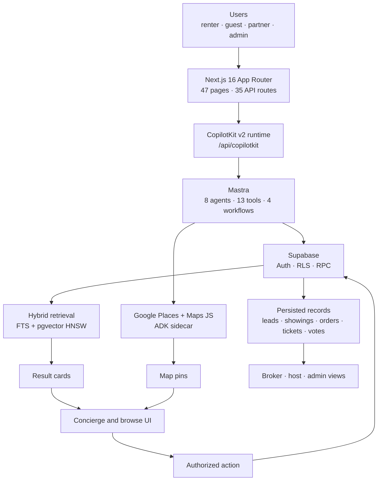
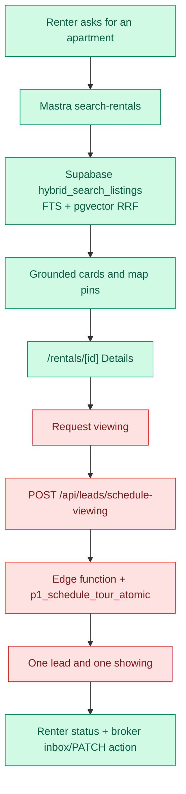
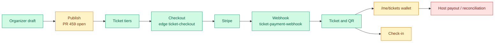
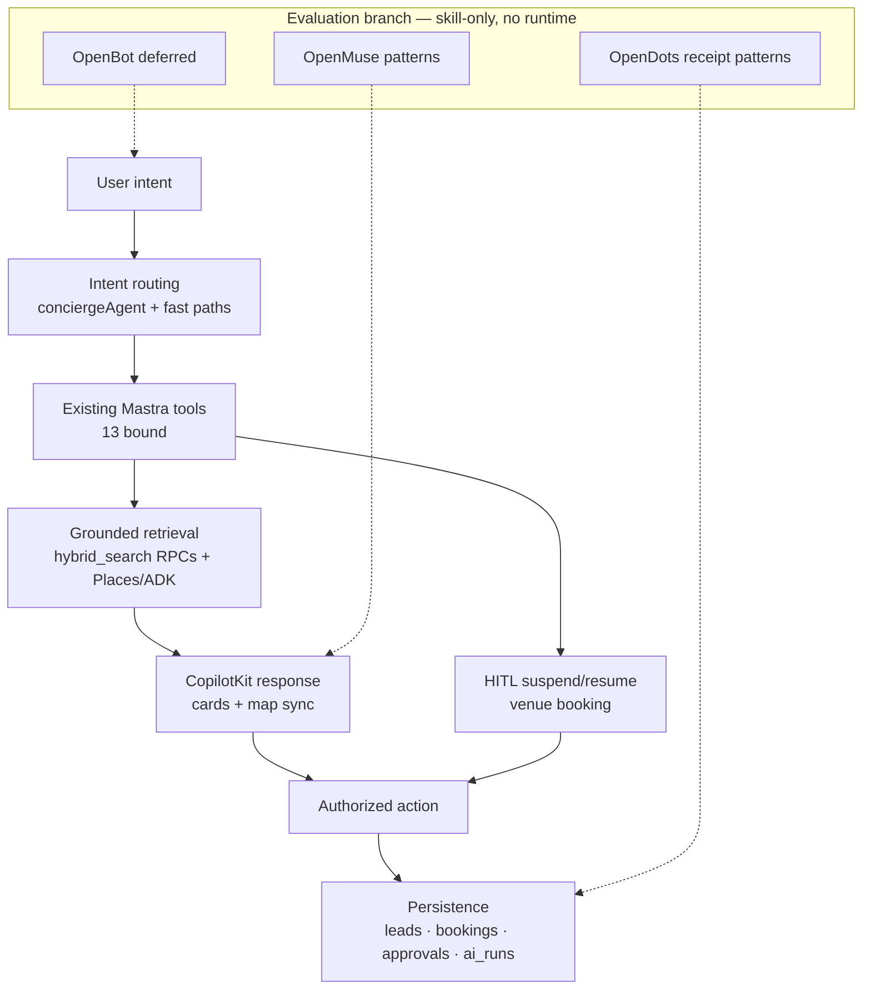
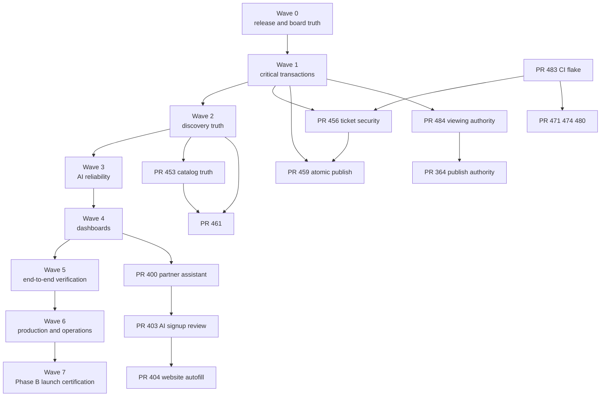

# MDE AI — Product Roadmap, PR Value Review & Development Progress Tracker

**Status:** Phase A prelaunch development · **Audit date:** 2026-10-21 · **Auditor role:** product / architecture / QA / TPM
**Repository:** [amoai-tech/mdeai](https://github.com/amoai-tech/mdeai) · **Linear:** [MDE AI project](https://linear.app/amo100/project/mde-ai-bb25cababf6c/issues) · **Production:** [www.mdeai.co](https://www.mdeai.co)

> **Evidence base.** All product claims describe `origin/main` @ `5d1d76ddf6c26ca8996c4e121a87b584c3a2971b` (2026-10-20), the commit production serves. GitHub, Linear, the live Supabase project `zkwcbyxiwklihegjhuql` (name `medellin`), Vercel and production HTTP were queried directly. Tests were **inventoried and CI results read, not re-executed**; anything that depends on a live paid provider or a signed-in browser journey is labelled **Unverified**, not Working.
>
> **Local checkout warning.** `/home/sk/mdeai` is on the reduced canary branch `ai/san-1332-frozen-canary`, 1,061 commits behind `main` and missing 676 files (33 pages / 23 API routes / 18 pgTAP vs main's 47 / 35 / 72). It is **not** the shipping surface. This plan deliberately uses the clean `origin/main` snapshot; do not audit or release from the working tree.
>
> **This is a planning document.** No application code, migration, Linear issue, PR or production datum was changed. Detailed evidence lives in [Appendix A](03-evidence-appendix.md) and the six audit artefacts in [`_work/`](_work/).

---

## 1. Executive summary

### Verdict

**MDE is real, deployed and further along than its planning documents claim — but it is not launch-ready, and the gap is evidence more than code.** Production serves the exact `main` HEAD with zero deployment drift and zero migration drift. The AI concierge, hybrid search, rentals discovery/detail, broker inbox, contest voting and event discovery are implemented and test-backed. What is missing is a **proven money loop**, a **proven viewing commitment**, complete **partner/admin surfaces**, and a **green release signal**.

| Question | Answer |
| --- | --- |
| What works? | Production parity, AI concierge read path, hybrid search, rentals browse/detail/map, broker inventory + viewing actions, contest voting core, event discovery, auth/RLS, migration reproducibility |
| What is broken? | Prod `behaviour smoke` has failed 6 consecutive runs (~22.7 h) on a real assertion: the peso budget is **not disclosed** in rental chat at desktop and 390 px; ticket RPC security is not yet merged (#456); the paid-ticket journey has no end-to-end proof |
| What is missing? | Partner dashboard/listings/leads/analytics, 5 of 8 admin surfaces, landlord management UI, refunds/payouts, contest fixture-hiding proof, cross-surface Phase B launch certification |
| Which PRs matter? | #483 first (unblocks CI), then #456 + #459 (ticket security + atomic publish), #484 + #364 (viewing/publish authority), #394 (venue-lead idempotency), #453/#461 (catalog truth), partner stack #400 → #403 → #404 |
| Development readiness | **60 / 100** — a development indicator, **not** public-launch certification (Phase B is separate; see §10 Wave 7) |

### What works (verified)

1. **Release truth.** Production deployment `dpl_HvShr4ZcvnF1zoMrdHs25qbxCKoH` (READY/PROMOTED, 2026-10-20T16:09:52Z) serves commit `5d1d76ddf6…` = `origin/main` HEAD. 207 remote migrations = 207 migrations on `main`; **drift 0**.
2. **Application surface.** 47 page routes, 35 API route handlers (+2 auth), 8 Supabase edge functions on main (plus `_shared` and tests), 422 Vitest files, 106 Playwright specs, 72 pgTAP specs.
3. **AI concierge read path.** One runtime (Mastra), one transport (CopilotKit v2 / AG-UI), one retrieval layer (Supabase). 8 registered agents (4 AG-UI-exposed), 13 bound tools, 4 workflows, RRF hybrid search over 768-dim HNSW vectors with Spanish FTS.
4. **Rentals decision path.** Browse → cards/map synced → `/rentals/[id]` details → broker onboarding/inventory/viewing actions, with pgTAP + Playwright coverage on main.
5. **Contest voting data integrity.** Dedicated `vote` schema, 11 tables, 19+ RPCs (22 including trigger/recompute helpers), partial-unique constraints preventing double ballots and replays, nonce ledger, audit trail, 10 pgTAP specs.
6. **Security baseline.** 194 app tables, all RLS-enabled except PostGIS `spatial_ref_sys`; 540 policies; 0 of 190 app functions missing `search_path`; production HTTP 200 on all public routes; auth-gated routes 307 to `/login`.

### What is broken or unproven (do not round up)

1. **Live product regression on the serving build.** Scheduled `Prod behaviour smoke` failed 6 consecutive runs (last green 2026-10-20T14:16Z; latest red 2026-10-21T17:06Z) on both desktop and 390 px: *“peso budget is disclosed, never silently capped — budget disclosure present: false”*. All other assertions pass. This is a real Phase A defect, not deploy drift.
2. **Ticket money loop.** Checkout proxy, deployed `ticket-checkout`/`ticket-payment-webhook` edge functions and 202 `event_orders` rows exist, but **no test proves paid order → readable ticket → wallet**; `stripe_payment_intent` is not UNIQUE, so finalize idempotency rests on a status guard alone.
3. **Viewing commitment.** The atomic `p1_schedule_tour_atomic` RPC and broker action endpoint exist on main, but no browser-to-database proof shows one saved lead + one showing reaching the owning broker. The authority fix is still an open PR (#484).
4. **Ticket RPC grants.** `ticket_validate_consume` is anon-executable and returns attendee names; `redeem_promo_code` is anon-executable with no caller guard and can exhaust promo inventory. #456 fixes the first, but is unmerged and its migration version collides with main.
5. **Contest public hygiene.** Two of four live contests are test fixtures; no test asserts they are excluded from `/contests`. Paid votes (`paid_vote_orders = 0`) are unexercised.

### What to do next

Work in dependency order, not by PR age: **stop the CI bleed (#483) → land the two security/transaction PRs (#456, #459) → prove the renter commitment (#484/#364) → turn the production smoke green → prove the paid-ticket loop → only then expand dashboards.** The queue is review-bound (20 green PRs waiting on one approval), not code-bound; the fastest meaningful gain is reviewer throughput on a tiny ordered set.

**Readiness: 60/100 · Real blockers: 5 · Test-only PRs: 8 · Actionable feature PRs: 22 · Superseded/already-satisfied: 5 · Close candidates: 7 (the same five overlap).**

---

## 2. Current GitHub, Linear, release and database state

### 2.1 GitHub

| Metric | Value | Evidence |
| --- | --- | --- |
| Open PRs | **43** (6 draft, 37 non-draft) | `gh pr list --state open --limit 200` |
| Classification | 22 product feature · 8 infrastructure · 8 tests/QA · 4 security · 1 documentation | Appendix A |
| Open PRs by priority | P1 8 · P2 12 · P3 10 · P4 6 · P5 7 | `pr-data.json` |
| Green but blocked only on required review | **20** (plus #403/#404 CLEAN with no review) | `gh pr view --json mergeable,mergeStateStatus,reviewDecision` |
| Conflicting / DIRTY | 8 — #256, #238, #248, #324, #362, #376, #447, #100 | `gh pr list --json mergeable` |
| Heads with ≥1 non-passing check | 11 | `gh pr checks <n>` |
| Superseded or already satisfied by main | 5 — #256, #447, #255, #100, #238 | `git show origin/main:<path>` comparison |
| Merge velocity | 100 merged in the last 7 days; ≥300 since 2026-08-01 | `gh pr list --state merged` (limit-capped) |

The prompt's previous snapshot (43 open; provisionally 23 product features/fixes, 15 tests/CI, 5 infrastructure/security) matches the live **open count** but not the live **classification** — recalculated from `gh pr view` the split is 22 product feature / 8 infrastructure / 8 tests-QA / 4 security / 1 documentation. The earlier category counts are not reproducible from current heads and are not used below.

The open queue is **review-bound**: 20 of 26 non-draft heads with no failing check are `MERGEABLE` + `BLOCKED (REVIEW_REQUIRED)`. The main exception is one shared flaky test, `e2e/chat-virtualization.spec.ts` (SAN-1357), which is the sole red check on #456, #471, #474 and #480 and is fixed by #483.

### 2.2 Release truth

| Fact | Value |
| --- | --- |
| Production domain | `www.mdeai.co` (apex 308 → www) |
| Serving deployment | `dpl_HvShr4ZcvnF1zoMrdHs25qbxCKoH`, READY/PROMOTED, created 2026-10-20T16:09:52Z |
| Serving commit | `5d1d76ddf6c26ca8996c4e121a87b584c3a2971b` = `origin/main` HEAD — **drift 0** |
| Required gate `floor` | **green** on the serving commit |
| Prod renter journey / runtime smoke / deploy freshness | **green** |
| Scheduled `Prod behaviour smoke` | **red — 6 consecutive failures (~22.7 h)** on budget disclosure, desktop + 390 px |
| Production HTTP | `/` 200 · `/rentals` 200 · `/events` 200 · `/chat` 200 · `/restaurants` 200 · `/login` 200 · `/host/dashboard` 307 → login · `/me/tickets` 307 → login |
| Env key-name drift | `.env` only: `GOOGLE_GENERATIVE_AI_API_KEY`, `GOOGLE_MAPS_SERVER_API_KEY`, `SUPABASE_ACCESS_TOKEN`, `VERCEL_TEAM_ID`; `.env.local` only: `GOOGLE_API_KEY`, `SUPABASE_DB_URL`, `SUPABASE_PERSONAL_ACCESS_TOKEN`, `VERCEL_OIDC_TOKEN` (names only; values not compared) |

### 2.3 Linear

| Metric | Value |
| --- | --- |
| Issues in MDE AI project | **460** (Backlog 173 · Done 129 · Todo 77 · In Progress 50 · Canceled 14 · Duplicate 9 · In Review 8) |
| Unassigned | 331 (28 unowned `MVP · Launch Blocker`) |
| Done while a referencing PR is still open | **18** — including SAN-1502, SAN-1286, SAN-1105, SAN-1349 (the viewing-authority cluster) |
| Done with no PR/migration/query receipt in issue text | **25** — including production-data claims SAN-1434, SAN-1454 |
| Launch Blockers still in Backlog/Todo | **28** |
| Overlapping epics | 5 contest epics (45 children), 2 rental-launch epics (SAN-1315 has 112 children), 6 childless "progress tracker" epics |
| Label taxonomy | All 6 `MVP_MDE` categories exist, but 74 issues carry `MVP · …` without `MVP_MDE`; 124 labels across ≥5 generations — no single filter reconstructs the launch set |

### 2.4 Supabase (live)

| Metric | Value |
| --- | --- |
| Project | `zkwcbyxiwklihegjhuql` / `medellin` — ACTIVE_HEALTHY, PG 17, us-east-1, ~349 MB |
| App tables | **194** (public 136, vote 11, sponsor 10, marketing 12, outreach 6, openclaw 4, postiz 5, paperclip 5, hermes 5) |
| RLS | enabled on 193/194 (exception: extension table `spatial_ref_sys`); **540 policies**; 3 intentional zero-policy service-role tables |
| App functions | **190** in public; 0 missing `search_path`; **23 anon-executable SECURITY DEFINER** (5 flagged) |
| Migrations | 207 remote = 207 conforming on main; **drift 0**; highest `20261021070000_san1502_phase_a_pending_rental_search` |
| Edge functions | **41 ACTIVE deployed**; `origin/main` defines **8** deployable functions (+`_shared`, tests) — 33 deployed functions (sponsor-*, postiz-*, openclaw-*, outreach, legacy ticket/moderation helpers) have no source on main; provenance unverified, reconcile or retire |
| Key rows | apartments 44 · leads 19 · showings 8 · events 65 · event_orders 202 · event_tickets 21 · event_attendees 41 · restaurants 44 · vote.contests 4 · vote.votes 4 · vote_consumed_nonces 99 · ai_runs 2015 |
| Anomaly | `profiles` 1,235 vs `auth.users` 24 — do not read 1,235 as real users; cause unverified |

_Access note: the configured Supabase MCP server points at a different project (`nvdlhrodvevgwdsneplk`); every MDE database fact here was queried against `zkwcbyxiwklihegjhuql` through the Management API._

### 2.5 Engineering-hygiene state (Wave 0 input)

- **296 registered worktrees** and **1,433 branches** (441 local) exist for a 47-page app; `git worktree prune --dry-run` already lists dead entries. This is a merge/release hazard, not just clutter.
- **Deployed edge functions outnumber repo source:** 41 ACTIVE on the live project vs 8 deployable functions on `main`. Retire or bring legacy functions under source control before Phase B.
- The shared checkout is a **reduced canary** (1,061 commits behind, 80 migrations missing relative to main). Any audit or release run from it will see a falsely broken product.
- `docs/sitemap.md` is stale: it says `/rentals/[id]` “doesn’t exist” and `/rentals` redirects to `/chat`; both are false on main and in production.

---

## 3. PR inventory and value scoring

Full 43-row inventory and per-PR evidence: **Appendix A**. Value rubric: user impact 30 · unlocks a critical journey 25 · security/data correctness 20 · reuse/architectural simplicity 10 · effort vs value 10 · dependency leverage 5.

### 3.1 Highest-value PRs

| Rank | PR | Value | Why it matters now | Action |
| ---: | --- | ---: | --- | --- |
| 1 | [#459](https://github.com/amoai-tech/mdeai/pull/459) Events: publish once with safe retries, correct ticket amounts | **87** | Closes the organizer half of the event money loop; retry-safe publish + COP→Stripe minor units | Fix (rebase over merged #454/#475) → merge |
| 2 | [#456](https://github.com/amoai-tech/mdeai/pull/456) Stop fake ticket refunds and check-ins | **81** | Removes anon ticket-write/refund/QR abuse; security-critical | **Fix migration version** (`20261021030000` collides with main) → merge |
| 3 | [#484](https://github.com/amoai-tech/mdeai/pull/484) Renters request pending development apartments without exposing fixtures | **80** | Completes the viewing-authority half of the rental commitment | Re-run `supabase-acl` after base fix → merge |
| 4 | [#394](https://github.com/amoai-tech/mdeai/pull/394) Venue inquiries: save once, keep contact private | **74** | Idempotent lead capture + PII log privacy; all checks green | Merge |
| 5 | [#453](https://github.com/amoai-tech/mdeai/pull/453) Show real ticket prices and only valid Buy actions | **70** | Stops “Free”/dead Buy buttons in event discovery; base of #461 | Merge, then rebase #461 |
| 6 | [#364](https://github.com/amoai-tech/mdeai/pull/364) Rental publishing: block unauthorized brokers, keep original dates | **66** | Publish-authority counterpart to #484 | Undraft + rebase → merge after #484 |
| 7 | [#479](https://github.com/amoai-tech/mdeai/pull/479) Keep the same apartments visible during follow-ups | **65** | Grounded follow-ups instead of re-search/invention | Run documented 3-turn replay → merge |
| 8 | [#404](https://github.com/amoai-tech/mdeai/pull/404) Autofill partner profile from website | **65** | Partner onboarding | Merge in stack order |
| 9 | [#403](https://github.com/amoai-tech/mdeai/pull/403) Review AI signup suggestions before applying | **64** | Human-in-the-loop partner onboarding | Merge after #400 |
| 10 | [#402](https://github.com/amoai-tech/mdeai/pull/402) Let partners edit their own business profile | **62** | First self-service partner capability | Merge |

**Top lever ≠ top value:** [#483](https://github.com/amoai-tech/mdeai/pull/483) scores 48 but must merge **first** — its 29-line fix to `e2e/chat-virtualization.spec.ts` is the only red check on #456, #471, #474 and #480.

### 3.2 Disposition summary

| Disposition | Count | PRs |
| --- | ---: | --- |
| Merge now (green; approval is the only gate) | 20 | #394, #405, #481, #400, #402, #482, #367, #467, #455, #420, #406, #387, #373, #234, #389, #313*, #214*, #403, #404, #453 |
| Merge first — unifiers | 3 | #483 (flake), #453 (stack base), #400 → #403 → #404 (partner stack) |
| Fix then merge | 9 | #456 (migration collision), #459 (rebase), #484/#473 (re-run ACL after base fix), #461 (own assertion), #480/#474 (after #483), #364 (undraft), #479 (preview replay) |
| Combine | 4 | #255 → #456 · #100 → #214 · #471 → existing release tooling · #476 → rebase on #457/#464 |
| Low value (<30/100) | 8 | #452 (8), #100 (15), #256 (18), #362 (21), #238 (23), #447 (24), #313 (29), #471 (29) |
| Defer / investigate | 4 | #244, #248, #324, #376 |
| Close | 7 | #256 (satisfied on main), #447 (#445), #255 (#456), #100 (#214), #238 (covered), #362 (owner-deferred), #452 (never-merge probe) |

### 3.3 Queue-level blockers

1. **Review throughput** — 20 green PRs wait on one required approval; 2 more (#403/#404) have none. No engineering work unblocks them.
2. **Shared flake** — SAN-1357 chat-virtualization test reds four unrelated PRs; #483 is the fix.
3. **Base-branch `supabase-acl` drift** — identical 3-suite failure signature (2/14, 6/15, 7/25) appears on #484 (has SQL) and #473 (no SQL), so it is **not** evidence either diff is wrong; it is still a real gate and must be made green before any migration merges.
4. **Migration-version collision** — #456’s `20261021030000` already exists on main as `san1548_event_approval_id`; merging would corrupt ordering. Hard blocker.

**Recommended merge / revise / close:** merge 20, revise 9 fix-then-merge + 4 combine, close 7 (plus 5 superseded, of which 4 overlap the close list).

_Dispositions are not a partition: a PR can be both “merge first” and “merge now”, and the five superseded PRs are also close candidates. The union of flagged work is 7 closes + 8 low-value + 5 superseded, with overlap._

---

## 4. Features and product-domain progress

### 4.1 Progress dashboard

Scoring uses the mandated weights — **40% working end-to-end journeys · 25% core functionality/backend correctness · 15% security & transaction integrity · 10% UI/UX & mobile · 10% deployment/observability** — and credits only what has evidence (code + committed automated test, live schema, or runtime observation). Unverified capability earns zero in the criteria it would otherwise satisfy and is shown separately.

| Product area | W | P | B | U | N | Verified progress | Critical blocker | Next outcome |
| --- | ---: | ---: | ---: | ---: | ---: | ---: | --- | --- |
| **Rentals + Real Estate** | 5 | 0 | 1 | 1 | 1 | **65/100** | Viewing insert has no browser→DB proof; prod budget-disclosure regression | One saved lead + one showing visible to the owning broker |
| **Events + Ticketing** | 1 | 0 | 0 | 3 | 1 | **43/100** | No paid-order→ticket→wallet proof; ticket ACL fix unmerged | Successful checkout, ticket, receipt |
| **AI Concierge** | 4 | 0 | 0 | 1 | 0 | **71/100** | HITL apply path unproven; viewing is not an agent tool | Grounded answers + authorized action |
| **Local Discovery** | 4 | 0 | 0 | 2 | 0 | **68/100** | Cafés/nightlife only visual evidence; no browser journey | One card+map+chat journey per place type |
| **Restaurants + Contests** | 6 | 2 | 0 | 2 | 1 | **70/100** | Fixture hiding and receipt-survival unverified; paid votes unexercised | Valid vote + durable receipt + standings |
| **Partners + Dashboards** | 2 | 0 | 0 | 1 | 4 | **43/100** | Journey dead-ends after activation; no partner dashboard | Self-service profile/listings/leads |
| **Super Admin** | 2 | 1 | 0 | 0 | 5 | **45/100** | Only contests, event bookings, rental test mode exist | Users/roles/inventory/media/transactions |
| **Infrastructure + Release** | 4 | 1 | 0 | 0 | 0 | **78/100** | Prod smoke red ~23 h; canary checkout/296 worktrees risk wrong-branch release | Green serving build + one certification |

_W Working · P Partial · B Broken · U Unverified · N Not implemented. Unverified and broken capability earns no credit._

**Overall development readiness: 60/100** (equal-weight mean of the eight domain scores: 65+43+71+68+70+43+45+78 = 483 ÷ 8 = 60.4). This is a **development** indicator, not public-launch certification.

### 4.2 How each domain score was computed

Each criterion is scored 0–100, then multiplied by its weight; the row total is the weighted sum.

| Domain | Journeys (×40%) | Core (×25%) | Security (×15%) | UI/UX (×10%) | Deploy (×10%) | Total | Evidence used |
| --- | ---: | ---: | ---: | ---: | ---: | ---: | --- |
| Rentals | 55 | 71 | 75 | 80 | 60 | **65** | browse/detail/map test-backed; viewing commit unverified; atomic RPC + RLS strong; prod budget-smoke red |
| Events | 35 | 40 | 45 | 65 | 55 | **43** | discovery/detail verified; 202 orders + edge functions exist; paid→ticket unproven; ticket ACL PR open |
| AI Concierge | 60 | 80 | 80 | 80 | 70 | **71** | read path + cards + map sync test-backed; action/HITL unverified; auth→ownership→rate-limit verified |
| Local Discovery | 65 | 67 | 70 | 70 | 75 | **68** | restaurants/places/detail 200 + tests; cafés/nightlife only visual evidence |
| Contests | 70 | 64 | 85 | 75 | 60 | **70** | 10 pgTAP + 2 e2e + edge tests; unique/nonce constraints real; fixture hiding unverified |
| Partners | 35 | 29 | 60 | 55 | 70 | **43** | signup + contact lead only; no partner-authenticated surface |
| Super Admin | 30 | 31 | 80 | 65 | 70 | **45** | 4 admin pages, double-gated; 5 of 8 documented surfaces absent |
| Infrastructure | 75 | 90 | 75 | 70 | 75 | **78** | zero drift, prod parity, RLS/search_path clean; anon SECDEF grants + red prod smoke |

Full per-feature matrix with route, code entry point, data source, status and evidence: **[Appendix F](03-evidence-appendix.md#appendix-f--feature-matrix-with-route-code-data-and-evidence)**. UX review against `DESIGN.MD`: **[Appendix G](03-evidence-appendix.md#appendix-g--ux-review-against-the-mde-design-system)**.

### 4.3 Domain detail (only what is evidenced)

**Rentals — strongest decision path, weakest commitment proof.**
Working: `/rentals` browse (`src/app/rentals/(browse)/page.tsx:28`), `/rentals/[id]` detail (`:57`), map/card sync (SAN-472), broker onboarding/inventory (`host/rentals/(broker)`), broker viewing actions (`api/host/rentals/viewings/[id]:18`, e2e `san-1204`, pgTAP `san1286`), new-projects browse/detail (16 development projects live). Not implemented: landlord management UI (tables only). Broken on the serving build: the peso budget is not disclosed in rental chat (`Prod behaviour smoke`, 6 consecutive failures at desktop and 390 px). Unverified: the final `POST /api/leads/schedule-viewing` → edge function → `p1_schedule_tour_atomic` chain; no browser proof that one lead + one showing persists and reaches the owning broker. This is the single highest-correctness write path and it is the one without a runtime receipt.

**Events + Ticketing — real plumbing, unproven money loop.**
Working: `/events` discovery, `/events/[slug]` detail, host event list, `ticket-checkout` and `ticket-payment-webhook` edge functions ACTIVE, 202 `event_orders` and 21 `event_tickets` rows, transactional capacity in `ticket_checkout_create_pending` (advisory lock, `qty_sold + qty_pending <= qty_total`). Unverified: paid order → finalized ticket → readable wallet; host payout/reconciliation; refunds have tables (`event_order_refunds`, `revenue_ledger`) but no route/UI. Security gap: `ticket_validate_consume` anon-executable; `stripe_payment_intent` not UNIQUE.

**AI Concierge — one coherent runtime, action layer incomplete.**
Working: `/api/copilotkit` with a real ordered gate chain (IP ceiling → `auth.getUser()` → thread ownership → rate limit → `RequestContext` with user-scoped Supabase client → audited run log), `conciergeAgent` with 8 search/action tools, 12 `useRenderTool` + 7 `useFrontendTool` renderers, map pin sync (`map-ui-sync`, `focusMapPin`), thread history/titles, 84 Mastra test files. Partial: HITL approval apply (`/api/approval-commit` → edge fn) has schema/panel tests only; viewing request is an HTTP route, **not** an audited agent tool. Missing: model-level fallback (`gemini-3.5-flash-lite` is the only bound model; `PRO_MODEL` is dead code).

**Local Discovery — broad surface, uneven proof.**
Working: `/restaurants` + `/restaurants/[id]` (voting entry, production 200), `/venues`, Places search/detail/photo routes, maps/grounded places. Unverified: `/cafes` and `/nightlife` have visual-evidence suites, not asserted journeys. Missing: nothing critical, but proof depth is lower than restaurants.

**Restaurants + Contests — implemented in a `vote` schema, not absent.**
Working: `/contests`, `/contests/[id]`, `/admin/contests*`, `/restaurants/[id]` voting panel, `/api/restaurants/my-vote`, 11 `vote.*` tables, 19+ RPCs (22 including trigger/recompute helpers), `vote-cast`/`vote-nonce` edge functions, 10 pgTAP + 2 e2e specs, real duplicate prevention (`vote_votes_one_restaurant_ballot_idx`, `vote_votes_idempotency_idx`, nonce PK). Unverified: receipt survival across reload, standings rendering, public-list fixture hiding (2 test fixtures among 4 contests), paid votes (0 rows). `vote_receipt`/`vote_my_receipt` exist; there is no `receipts` table — a receipt is derived from `vote.votes`.

**Partners — marketing plus intake, no operating surface.**
Working: `/partners`, `/partners/restaurants|cafes|nightlife` real landings, `/partners/signup` wizard, `/api/partners/activate`, `/api/partners/contact-leads` (idempotent replay), 9 `partners` rows. Missing: partner-authenticated profile/dashboard, listings, leads inbox, analytics, assistant. `/partners/rentals`, `/business/ai`, `/sponsors` are `PartnerLandingPlaceholder` stubs. The venue-partner journey terminates after activation.

**Super Admin — four pages, double-gated.**
Working: `/admin/event-bookings` (queue + decision), `/admin/contests` + `[id]`, `/admin/rentals` test-mode tool. Each is gated by `is_admin()` in the page **and** re-gated in the route/action. Missing: users, roles, inventory, imports, media, transactions, monitoring — all claimed by planning docs, none present among 47 routes.

**Infrastructure + Release — best-evidenced domain.**
Working: Supabase auth/SSR/service clients, RLS across 194 tables, pgvector HNSW (768-d, cosine, m=16/ef=64), FTS GIN indexes, 7 cron jobs, `embedding_jobs` pipeline, WhatsApp HMAC webhook + durable inbound + sweeper, `/api/version`, migration reproducibility (207/207). Risks: production smoke red; anon SECDEF grants; `profiles` 1,235 vs 24 auth users; canary branch and 296 worktrees.

---

## 5. Technology stack and architecture

| Layer | What is actually used | Evidence |
| --- | --- | --- |
| Web | Next.js 16 App Router, React 19, 47 pages / 35 API routes / 2 auth routes | `origin/main` snapshot |
| AI transport | CopilotKit `@copilotkit/react-core` + `runtime` **1.75.0**, AG-UI client 0.0.59, `@ag-ui/mastra` 1.1.6 | `package.json`; 34 v2 hook imports; v1 blocked by `floor` |
| Agents | Mastra 1.74.0, 8 registered agents, 13 bound tools, 4 workflows | `src/mastra/index.ts` |
| Model | Gemini `gemini-3.5-flash-lite` via `@ai-sdk/google`; embeddings `gemini-embedding-001` @768 | `src/lib/ai-model-ids.ts`, `query-embedding.ts` |
| Data | Supabase Postgres 17 + Auth + RLS + RPC; 194 app tables / 190 functions / 540 policies | live Management API |
| Retrieval | `ts_rank_cd` Spanish FTS + pgvector HNSW cosine, fused with RRF (k=60, weights 1.5/1.0) | migrations + live indexes |
| Maps | Google Maps JS + Places API with explicit field masks; ADK grounding sidecar client | `google-places-client.ts`, `adk-grounding-client.ts` |
| Payments | Stripe via Supabase edge functions `ticket-checkout` / `ticket-payment-webhook` | deployed functions; live orders |
| Media | Cloudinary | `cloudinary_assets` repo usage + skill |
| Deploy | Vercel production on `www.mdeai.co`, exact SHA parity | Vercel API |

The verified architecture is drawn in [§9 Diagram A](#a-system-architecture).

**Architecture verdict:** one runtime, one transport, one retrieval layer — correct shape. The risk is not missing architecture; it is unproven write paths and a red production signal. Adding an orchestrator (OpenBot/OpenMuse/OpenDots as runtime) would create a competing system with no product evidence.

---

## 6. AI agents, tools and integration mapping

### 6.1 Agents (8 registered; 4 AG-UI-exposed)

| Agent id | Responsibility | Tools | Runtime-exposed |
| --- | --- | ---: | --- |
| `concierge-agent` | User-facing chat across all domains | 8 | **Yes** |
| `host-event-agent` | Event draft creation | 0 | **Yes** |
| `host-ops-agent` | Host analytics on user-scoped client | 3 | **Yes** |
| `ping-agent` | Wiring smoke only | 0 | **Yes (default allowlist)** |
| `router-agent` | Intent classification → workflow dispatch | 1 | No |
| `rental-agent` | Rental specialist | 1 | No |
| `event-agent` | Events specialist | 1 | No |
| `evaluation-agent` | Rerank + “Best for” labels | 0 | No |

`RUNTIME_AGENT_ALLOWLIST` is environment-overridable (`MASTRA_RUNTIME_AGENT_ALLOWLIST`): exposure can change without a code change and should be asserted at deploy time.

### 6.2 Tools and workflows

13 tools are actually bound (14 ids defined; `extract-intent-slots` is a deliberately removed no-op bound to nothing; `search-venue-anchors` is a helper module, not a tool). Bound tools: `classify-intent`, `search-rentals`, `search-new-projects`, `compare-new-projects`, `search-events`, `search-restaurants`, `search-attractions`, `search-grounded-places`, `search-web-grounded-events`, `request-venue-booking`, `list-host-events`, `get-sales-summary`, `get-sales-insights`. All DB tools route through audited wrappers. Workflows: rental-search (search → format → rerank), event-discovery (search → format), event-venue-booking (validate → suspend for admin review → notify = real HITL), sales-insight.

### 6.3 Technology table

Value scores below are the AI auditor’s Phase A judgement, not measurements.

| Technology | Current MDE implementation | Actual capability | Missing integration | Value /100 | Recommendation |
| --- | --- | --- | --- | ---: | --- |
| CopilotKit v2 + AG-UI | Runtime with ordered auth/ownership/rate-limit/RequestContext; 12 render tools, 7 frontend tools; threads; cards; maps | **Verified in code + tests**; live paid turn not executed here | Viewing action not a tool; one residual v1 hook | 95 | Reuse — extend |
| Mastra | 8 agents, 13 tools, 4 workflows, memory, Postgres/LibSQL store, audit wrapper | **Verified** (84 test files) | No model fallback; unused `PRO_MODEL`; scorers not wired to live turns | 90 | Reuse |
| Supabase + pgvector/FTS | 3 HNSW 768-d tables, RRF hybrid RPCs, embedding jobs, query cache | **Verified** (migrations + live indexes/rows) | Embedding freshness/coverage unproven; FTS was once dropped and restored (san1305) | 85 | Reuse/extend |
| Google Maps + Gemini | Maps JS, field-masked Places, ADK sidecar client + quota, pin join by `mapsUrl` | **Code verified**; sidecar availability **unverified** | Live sidecar proof; AdvancedMarker mapId proof | 85 | Reuse |
| **OpenMuse** | Skill only (PR #431, pinned `CopilotKit/openmuse@1ac68f3`); zero runtime code | **Claimed guidance**; ~70% of patterns already present | Draft-on-stop, queue vs durable copy | 25 | Reuse patterns only; never install |
| **OpenDots** | Skill only (pinned `CopilotKit/OpenDots@ab39f25`) | **Claimed/partial**: MDE already has `/api/approval-commit`, proposal cards, HITL | Exact-draft identity, stale-version conflict, persisted receipt readback | 30 | Integrate the pattern into the existing review path |
| **OpenBot** | Skill only (pinned `CopilotKit/openbot@e01a7c2`), explicitly optional | **Claimed only** — no MDE capability | Pinned-release proof, AG-UI bridge, action policy, kill switch | 10 | Defer |

**OpenBot/OpenMuse/OpenDots verdict:** `git grep -i "openmuse\|opendots\|openbot" origin/main -- src package.json` returns **no matches**. They are advisory pattern libraries with pinned upstream SHAs and drift CI (PR #426), with no agents, tools, routes, tables or packages. Any claim that MDE “integrates” them would be false today. Do not add a second orchestrator.

### 6.4 AI capability status

Working: intent routing, grounded tools, structured cards, map sync (code+tests; live unverified), persistence, memory/follow-up. Partial: safe actions (booking HITL yes; viewing HTTP-only), failure recovery (integration fallbacks yes; no model fallback; stop-preserves-draft unproven), grounding eval scoring (2 scorers registered, not applied to live turns). Missing: viewing as an audited agent tool; embedding freshness guarantee. Unverified: ADK sidecar live availability; AdvancedMarker mapId wiring.

---

## 7. Application pages and dashboards

47 page routes and 35 API routes exist on main (full tables: **Appendix C**; per-feature evidence: **Appendix F**; UX criteria: **Appendix G**). Key findings:

- **Consumer discovery is the mature surface:** `/`, `/chat`, `/rentals`, `/rentals/[id]`, `/events`, `/events/[slug]`, `/restaurants`, `/restaurants/[id]`, `/contests`, `/contests/[id]`, `/venues`, `/new-projects*` are implemented and test-backed.
- **Cafés and nightlife** (`/cafes`, `/nightlife`) render but have visual-only evidence — status **Unverified**, not Working.
- **Partner surface stops at intake:** real landings for restaurants/cafés/nightlife, signup wizard, contact-lead capture; **no partner-authenticated dashboard, profile editor, listings, leads or analytics** (`/partners/rentals`, `/business/ai`, `/sponsors` are placeholders).
- **Super Admin is four pages:** contests list/detail, event bookings, rental test mode. The planning claim of users/roles/inventory/imports/media/transactions/monitoring is **not implemented**.
- **Host surfaces:** `/host/events` works; `/host/event/new`, `/host/dashboard`, `/host/analytics` are code+unit-level only (Unverified end-to-end).
- **Design-system review:** cards, map pins, detail sheets, skeletons, error/empty states and mobile sheets exist; 390 px contest and chat overflow are covered by e2e; skip-link accessibility is being fixed by #481. No horizontal-overflow blocker was observed on the checked production pages; keyboard behaviour was not executed. The ticket-buyer and partner UX remain the weakest real journeys.

---

## 8. Complete user journeys

| Persona | Journey | Success condition | Current state | Exact breakpoint / evidence |
| --- | --- | --- | --- | --- |
| Renter | Search → cards/map → Details → Viewing | One saved lead + showing | **Partial** | Browse/detail verified; `POST /api/leads/schedule-viewing` → edge fn → `p1_schedule_tour_atomic` has no browser→DB receipt; #484 open |
| Broker | Login → listings → incoming leads → respond | Correct lead visible/manageable | **Working (test-backed)** | e2e `san-1204` + pgTAP `san1286`/`san1206`; PATCH validates action/time + ownership 403 |
| Event organizer | Create → tiers → publish → receipt | One persisted event + valid tiers | **Unverified** | AI draft + approval commit unit-only; no draft→approve→publish e2e; #459 would close publish safety |
| Ticket buyer | Discover → checkout → payment → ticket | Paid order + valid ticket | **Unverified** | `/api/tickets/checkout` proxies to edge fn; no test proves paid→readable ticket→wallet; refunds absent |
| Restaurant voter | Discover → sign in → confirm → vote | Valid persisted receipt | **Partial** | Vote path test-backed (pgTAP + edge + e2e); receipt survival across reload unproven; fixture hiding unproven |
| Venue partner | Register → profile → inquiry/booking | Saved inquiry visible to partner | **Partial** | Contact lead + venue-booking request exist; partner has no dashboard to see it |
| Admin | Manage users/inventory/events → save | Authorized audited change | **Partial** | Only contests, event bookings, rental test mode; users/roles/inventory/media/transactions absent |
| AI concierge user | Ask → grounded results → action | Correct response + persisted action | **Partial** | Read/grounded path verified; HITL apply unproven; viewing not agent-callable |

**Rule applied:** a green unit test or a rendered page is not a completed journey. Eight canonical journeys: **1 fully test-backed (broker), 5 partial, 2 unverified (organizer, ticket buyer).**

**User-journey completion:** **1/8 fully proven = 12.5%**; **6/8 have partial-or-better evidence = 75%** (1 full + 5 partial); **2/8 unverified = 25%**. No journey is claimed on a simulated confirmation.

---

## 9. Mermaid architecture and workflow diagrams

### A. System architecture

### B. Rentals journey with current evidence

### C. Events and ticketing with stage status

### D. AI orchestration

### E. Roadmap dependency graph

---

## 10. Priority-ordered implementation waves

Wave 0 is already part-complete: production parity, migration drift and CI on `main` were verified in this audit. Remaining Wave 0 work is board/checkout hygiene.

| Order | Wave | Linear | Existing PR | Change needed | Dependencies | Test / proof | Priority | Status |
| ---: | --- | --- | --- | --- | --- | --- | --- | --- |
| 1 | 0 | SAN-1268 | — | Freeze this plan as the single scoreboard; stop the empty `docs/progress-tracker.md` and stale `sitemap.md` from competing | this audit | Doc review; `git diff` docs-only | P1 | Ready |
| 2 | 0 | SAN-1357 | #483 | Merge flake fix; unblocks four PR heads | — | `deterministic chromium` on #456/#471/#474/#480 | P1 | Ready |
| 3 | 0 | — | — | Reconcile 18 Done-with-open-PR issues and 25 Done-no-receipt claims in Linear (edit, do not duplicate) | Linear-audit corrections C1–C11 | Board query returns 0 contradictions | P1 | Ready |
| 4 | 0 | — | — | Worktree/branch hygiene (296 worktrees, 1,433 branches) **and** edge-function reconciliation (41 deployed vs 8 on main) | — | `git worktree list` + function inventory diff; retire or commit each | P1 | Ready |
| 5 | 1 | SAN-1562 | #456 | Renumber migration past `20261021090000`; rebase over #475; merge; verify anon loses ticket RPC grants | #483 | pgTAP ACL suite green; QR/refund abuse query fails | P0 | Fix |
| 6 | 1 | SAN-1285 | #459 | Rebase over merged #454/#475; re-run `review`; merge; prove retry returns same event+tiers | #483 | e2e publish retry + COP→minor-units assertion | P0 | Fix |
| 7 | 1 | SAN-1502, SAN-1286 | #484, #364 | Merge viewing authority + publish authority; run one real renter→lead→showing on preview and confirm owning broker sees it | #483 | Browser/API/DB receipt: 1 lead, 1 showing, correct broker | P0 | Fix |
| 8 | 1 | SAN-178, SAN-116 | — | Prove paid ticket loop end-to-end: checkout → webhook → finalized order → QR ticket → wallet; add UNIQUE on `stripe_payment_intent` or justify state-only guard | #456, live Stripe test mode | Playwright + DB assertions; refund regression | P0 | Todo |
| 9 | 1 | — (no owner; see N9) | — | Replace cost-guard-only promo/QR RPC grants; add caller auth to `redeem_promo_code`, `fn_record_conversion`, `fn_join_wait_list` | #456 | pgTAP negative tests: anon cannot mutate | P0 | Todo |
| 10 | 1 | SAN-1497, SAN-1524 | — | Contest vote correctness: caller-layer identity in the vote edge route, nonce replay, durable receipt readback, public fixture hiding, and an explicit paid-vote scope decision | — | pgTAP + e2e: one ballot per voter, replay rejected, receipt survives reload, /contests excludes fixtures | P1 | Todo |
| 11 | 2 | SAN-1560 | #453, #461 | Merge catalog truth (#453) then #461; verify “From COP …” and no dead Buy | #483 | e2e price + Buy assertions on 390/1440 | P1 | Ready |
| 12 | 2 | SAN-1421 | #479 | Run three-turn preview replay; merge follow-up grounding | #467 | Replay transcript + no re-search | P1 | Fix |
| 13 | 2 | SAN-1554 | #476 | Rebase on #457/#464, merge empty-transcript retry | #483 | e2e first-turn failure → Retry → result | P1 | Fix |
| 14 | 2 | SAN-1524 | #480, #481 | Merge vote-await fix and skip-link; verify fixture hiding with a real test | — | e2e ballot + `/contests` excludes fixtures | P1 | Fix |
| 15 | 2 | — | — | Prove café/nightlife browser journeys (currently visual-only) | — | Playwright card→map→detail on 390/1440 | P2 | Todo |
| 16 | 2 | SAN-1473 | — | Restaurants/venues discovery end-to-end: search → grounded cards → map → details → vote/inquiry action at 390 and 1440 | — | Playwright journey per place type with DB assertion | P1 | Todo |
| 17 | 3 | SAN-1502 | — | Expose viewing request as an audited Mastra tool (not just HTTP route) | #484 | Tool audit row + single persisted lead | P1 | Todo |
| 18 | 3 | SAN-1548 | — | Prove HITL apply: `/api/approval-commit` → edge fn → persisted decision → visible receipt; adopt OpenDots exact-draft/receipt pattern | #459 | Apply once, reload shows same receipt, stale version rejected | P1 | Todo |
| 19 | 3 | SAN-1305 (closest owner) | — | Embedding freshness guard: new/updated listing embedded before searchable; regression test on `hybrid_search_*` existence | — | Fresh row appears in hybrid search within SLA | P1 | Todo |
| 20 | 3 | — (no owner; see N9) | — | Decide model fallback (or document single-model ceiling); remove/justify dead `PRO_MODEL`; wire scorers into live sampling | — | Failure injection: degrade safely | P2 | Todo |
| 21 | 4 | SAN-705, SAN-709 | #400 → #403 → #404 → #402 | Land partner stack in order; build partner-authenticated dashboard/listings/leads/analytics | #400 first | Partner signs in, edits profile, sees own leads | P1 | Todo |
| 22 | 4 | SAN-1452…1459 | — | Consolidate 5 contest epics into one owner; close duplicates SAN-1492–1495 | — | One epic, no orphan children | P2 | Todo |
| 23 | 4 | — | — | Admin surfaces: users/roles, inventory/imports, media, transactions, monitoring (only where launch-relevant) | RLS policies | Admin CRUD + negative non-admin tests | P2 | Todo |
| 24 | 4 | — | — | Renter, broker and event-organizer self-service screens: saved/tickets, broker status/lead handling, organizer dashboard | Wave 1 | Executed journey on the exact candidate; unauthorized access denied | P2 | Todo |
| 25 | 4 | — | — | Landlord management UI and refunds/payouts decision (build or declare Post-MVP) | — | Journey or explicit deferral | P3 | Decide |
| 26 | 5 | SAN-483 (rentals), SAN-178 (events) + new cross-surface issue | — | One end-to-end verification pass over all 8 journeys on an exact candidate, including authentication, authorization, retries, 390 px mobile and error recovery | Waves 1–4 | Executed browser/API/DB matrix; zero unverified launch journey | P1 | Todo |
| 27 | 6 | SAN-1281, SAN-1330 | — | Green `Prod behaviour smoke` (budget disclosure), deploy exact candidate, verify serving SHA, logs, recovery and performance | Wave 5 | Red→green scheduled run; SHA parity; rollback drill; latency check | P1 | Todo |
| 28 | 7 | new Phase B certification issue | — | Deferred public-launch certification: rights, inventory accuracy, payment controls, external approvals | Wave 6 | Signed certification at one immutable release | — | Deferred |

**Do not start Wave 4 dashboards before Waves 1–3 have runtime proof.** Dashboard breadth without a completed money/viewing loop increases surface without increasing launch readiness.

---

## 11. Existing Linear task-to-PR mapping

Full 460-issue inventory and active/Done tables: **Appendix B**. Summary of the mapping and integrity findings:

| Cluster | Linear tasks | Related PRs | Required outcome | Verified progress | Missing work | Priority |
| --- | --- | --- | --- | --- | --- | --- |
| Viewing authority / atomic viewing | SAN-1502, SAN-1286, SAN-1206, SAN-1105, SAN-1349 | #364, #484 open; #478 merged | One lead + one showing, correct broker, fixtures not bookable | DB RPC + pgTAP exist; journey unproven | Merge #484/#364 + runtime receipt | P0 |
| Atomic event publish | SAN-1285, SAN-1548, SAN-582 | #459 open | One event + tiers, retry-safe | Tests in PR; not merged | Rebase + merge + e2e | P0 |
| Ticket RPC security | SAN-1562, SAN-1284, SAN-757 | #456 open | Anon cannot refund/consume/check-in | Fix coded; migration collision | Renumber + merge + pgTAP | P0 |
| Ticket buyer money loop | SAN-178, SAN-116, SAN-1242, SAN-1262–1266 | — | Paid → ticket → wallet → host payout | Edge functions deployed; 202 orders; no E2E | End-to-end proof + payout/refund scope | P0 |
| Event catalog truth | SAN-1560, SAN-1285 | #453, #461 | Real prices, valid Buy only | PRs open, green | Merge + e2e | P1 |
| Contest integrity | SAN-1452–1459, SAN-1470, SAN-1497, SAN-1524 | #470, #480 merged/open | Valid vote, receipt, standings, fixture hiding | Constraints + tests strong; 4 items unverified | Fixture test, receipt reload, standings render | P1 |
| AI grounding follow-ups | SAN-1421, SAN-1554 | #479, #476, merged #445/#449/#457/#464 | Grounded follow-ups, retry | Merged work + open refinements | Rebase/merge + replay | P1 |
| Partner onboarding | SAN-705, SAN-709, SAN-814, SAN-1193 | #400, #403, #404, #402 | Partner signup, profile, assistant | Stack open | Merge in order, then build dashboard | P1 |
| Release truth | SAN-1268, SAN-1281, SAN-1330 | #471, #214, #100 | One trustworthy board + green release | Parity/drift verified; prod smoke red | Fix regression, board cleanup | P1 |

**Integrity problems to correct (edit existing issues first):**

1. **18 Done-with-open-PR claims** — the worst are SAN-1502, SAN-1286, SAN-1105, SAN-1349 (rental authority cluster) and SAN-1092 (its only PR #455 is open). Revert to In Progress or add the missing receipt.
2. **25 Done-with-no-receipt claims** — including production-data claims SAN-1434 and SAN-1454 and 11 schema/data claims that should be replayable migrations. Require a migration filename/query receipt before Done.
3. **Done epics with open children** — SAN-1281, SAN-1341, SAN-1271.
4. **Duplicate clusters** — 5 contest epics (45 children), 2 rental-launch epics (SAN-1315 holds 112 children), 6 childless “Verified Progress Tracker” epics, near-duplicate pairs SAN-1204↔SAN-476 and SAN-1408↔SAN-1406.
5. **Label drift** — 74 `MVP · …` issues missing `MVP_MDE`; 28 `MVP · Launch Blocker` in Backlog/Todo; fix these rather than creating parallel labels.
6. **Unassigned launch work** — 28 Launch Blockers unassigned; 5 of 8 In Review issues unassigned.

---

## 12. Missing or proposed tasks

Only gaps with **no existing owner** are proposed. Everything else should be corrected on the existing issue.

| # | Proposed task | Why no existing owner | Acceptance criteria | Dependency |
| ---: | --- | --- | --- | --- |
| N1 | **Phase B — certify the whole public launch at one exact release** | SAN-483 certifies rentals only; SAN-178 is events only; no cross-surface issue exists | One immutable release SHA; all 8 journeys + rights/inventory/payment controls certified; signed evidence | Wave 6 |
| N2 | **Reconcile the remote migration ledger to committed migrations (replayable from zero)** | 11 Done schema claims have no committed trace; drift is 0 today but not replay-proven | `supabase db reset` on a scratch project yields the production schema; diff = 0; receipt committed | Wave 0 |
| N3 | **Managed secrets store** | PR #234 exists with no Linear issue | One secret source per environment; no duplicated env keys; documented rotation | Wave 0 |
| N4 | **CI coverage reporting + release dashboards** | #100/#214 exist without issues | Coverage uploaded per PR; gate documented (not necessarily blocking) | Wave 0 |
| N5 | **Accessibility baseline for launch journeys** | #481 fixes skip links only; no owning issue | Keyboard + screen-reader pass on 8 journeys at 390/1440; axe clean on critical pages | Wave 5 |
| N6 | **Deployed-version verification in the release path** | #471 exists without an issue | `/api/version` compared to `main` before promotion; fails closed | Wave 6 |
| N7 | **Partner operating surface (dashboard, listings, leads, analytics)** | Partner onboarding PRs exist; no issue owns the *surface* | Signed-in partner sees own profile/listings/leads; unrelated partner denied | Wave 4 |
| N8 | **Renter/broker viewing completion receipt** | SAN-1502 cluster owns the fix, but no issue owns the *runtime proof* | Browser→API→DB receipt: exactly one lead + one showing, correct broker, fixture denied | Wave 1 |
| N9 | **Anon SECDEF grant remediation + single-model ceiling decision** | DB audit found 4 unguarded anon SECDEF writers; AI audit found no model fallback and dead `PRO_MODEL`; no Linear issue owns either | anon cannot call `redeem_promo_code`/`fn_record_conversion`/`fn_join_wait_list`; ticket QR consume service-role-only; fallback decision documented and tested | Wave 1 / Wave 3 |

---

## 13. Verification matrix and evidence

### 13.1 What this audit executed

| Check | Method | Result |
| --- | --- | --- |
| Open PR count/state/CI | `gh pr list/view/checks` for all 43 | 43 open; 6 draft; 22/8/8/4/1 by type; 11 non-green; 20 review-bound |
| `main`/production parity | Vercel API + GitHub | Production commit = `origin/main` HEAD; drift 0 |
| CI on serving commit | `gh run list -b main` | `floor` green; `Prod behaviour smoke` red 6× (~22.7 h) |
| Production reachability | read-only `curl` | Public routes 200; auth routes 307 → `/login` |
| Migrations | Supabase Management API + `origin/main` snapshot | 207 = 207; drift 0; highest `20261021070000` |
| Schema/security | read-only SQL (`/tmp/mde_sql.sh`) | 194 tables, 540 policies, 190 functions, 23 anon SECDEF, pgvector HNSW live |
| Linear board | GraphQL (460 issues) | State distribution, Done claims, duplicates, labels |
| Page/API inventory | `origin/main` snapshot | 47 pages, 35 API routes, 8 edge functions + `_shared` |
| AI inventory | code + live DB | 8 agents, 13 bound tools, 4 workflows, 3 embedding tables |

### 13.2 What remains unverified (explicit)

- **No test suite was executed in this audit** (`npm test`, Playwright, pgTAP). Test/CI statements are copied from GitHub check results and repository inventory.
- **No signed-in browser journey was executed.** The paid ticket path, HITL apply, partner activation, contest receipt reload and fixture hiding remain Unverified.
- **No paid provider call was made** (Stripe, Gemini, Places, ADK sidecar). Sidecar availability and AdvancedMarker mapId wiring are Unverified.
- **Linear completion evidence** was assessed from issue text + PR references, not from a runtime replay.

### 13.3 Contradictions found between planning docs and implementation

| Document claim | Verified reality | Consequence |
| --- | --- | --- |
| Super Admin covers users, roles, inventory, imports, media, events, approvals, transactions, monitoring | 4 admin pages: contests list/detail, event bookings, rental test mode | Dashboard work is genuinely missing, not “polish” |
| Partners get profile, onboarding assistant, listings, leads, analytics | Signup + activation API + contact lead only; no partner-authenticated page | Partner journey dead-ends after activation |
| Landlord management exists | Tables `landlord_profiles`/`landlord_inbox` exist; no route/UI | Mark Not implemented |
| Refunds/payouts exist | Tables exist; no route/UI | Post-MVP decision required |
| `/rentals/[id]` does not exist; `/rentals` redirects to chat (`sitemap.md`) | Detail exists and serves; browse exists on main | Stale doc must be corrected |
| OpenBot/OpenMuse/OpenDots “integration” | Skill-only, zero runtime references | Do not present as integrated |
| Linear Done means done | 18 Done issues have open PRs; 25 have no receipt | Treat Done as a claim until evidence |

### 13.4 Validation checks performed

- **Counts reconciled:** 43 PR rows = 43 live open PRs; 58 active Linear tasks = 50 In Progress + 8 In Review; 18 Done-with-open-PR; 25 Done-without-receipt; 47 page routes (44 table rows + 3 dev-only) and 35 API handlers (33 rows with combined public routes); 207 migrations = 207 remote.
- **Titles and states** were generated from Linear GraphQL and GitHub API responses, not transcribed; PR sub-scores sum to each posted value.
- **Mermaid:** all five diagrams were rendered through an external Mermaid renderer (HTTP 200 PNG) as a syntax check.
- **Unverified labeling:** provider-, browser- and test-execution-dependent claims are explicitly separated in §13.2 and Appendix E.2.

### 13.5 Score inputs (reproducible)

- Domain feature counts: §4.1; per-domain criterion scores and evidence: §4.2.
- PR values: `data/pr-data.json` (sub-scores sum to each total).
- Overall readiness: 483 ÷ 8 = **60.4 → 60/100**.
- Real blockers: 5 — (1) prod budget-disclosure regression; (2) unproven paid ticket loop + ticket ACLs; (3) unproven viewing commit; (4) contest fixture hiding/paid votes; (5) release cannot certify while prod smoke is red and the checkout is a canary.

---

### 13.6 Delivery

The canonical plan and appendix are delivered in [PR #485](https://github.com/amoai-tech/mdeai/pull/485) from branch `docs/master-plan-progress-20261021`, created from `origin/main`. It is documentation-only: no code, migration, Linear issue or production data change, and nothing is merged or deployed by this work.

## 14. Recommended next 10 actions

| # | Action | Owner | Evidence of done |
| ---: | --- | --- | --- |
| 1 | **Merge #483** (test-only flake fix) | reviewer | `deterministic chromium` green on #456/#471/#474/#480 |
| 2 | **Renumber #456 migration → ≥`20261021090000`, rebase, merge** | #456 author | pgTAP ACL green; anon ticket RPC denied |
| 3 | **Rebase/merge #459** (atomic publish) | #459 author | publish retry returns same event+tiers; money units correct |
| 4 | **Merge #484 + #364 and capture one real renter→lead→showing receipt** | rentals owner | 1 lead, 1 showing, owning broker sees it, fixture denied |
| 5 | **Fix the production budget-disclosure regression and re-green `Prod behaviour smoke`** | AI/rentals owner | 2 consecutive green scheduled runs on the serving SHA |
| 6 | **Prove the paid ticket loop** (checkout → webhook → ticket → wallet) and decide refund/payout scope | events owner | E2E + DB assertions; refund path either implemented or explicitly Post-MVP |
| 7 | **Merge #453 → #461, #394, #479, #476** | reviewers | real prices/Buy states; idempotent lead; grounded follow-up; retry |
| 8 | **Land partner stack #400 → #403 → #404 → #402, then scope the partner dashboard** | partners owner | activated partner edits profile and sees own leads |
| 9 | **Close the 4 contest verification gaps** (fixture hiding, receipt reload, standings render, paid votes) | contests owner | e2e/pgTAP proofs; `/contests` excludes the 2 fixtures |
| 10 | **Wave 0 board/release hygiene** — reconcile 18 Done-with-open-PR + 25 no-receipt claims, prune 296 worktrees/1,433 branches, correct `sitemap.md`, and open the Phase B certification issue | program lead | board query shows 0 contradictions; docs match main; one certification owner |

---

## Appendix index

- **[Appendix A — Full PR inventory (43) and CI evidence](03-evidence-appendix.md#appendix-a--full-pr-inventory-43)**
- **[Appendix B — Linear mapping: active work, Done audits, duplicates, labels](03-evidence-appendix.md#appendix-b--linear-inventory-and-mapping)**
- **[Appendix C — 47 page routes and 35 API routes](03-evidence-appendix.md#appendix-c--page-and-api-inventory)**
- **[Appendix D — Live Supabase schema, security and migration reconciliation](03-evidence-appendix.md#appendix-d--live-database-inventory)**
- **[Appendix E — Test inventory and evidence limits](03-evidence-appendix.md#appendix-e--test-inventory-and-evidence-limits)**
- **[Appendix F — Feature matrix with route, code, data and evidence](03-evidence-appendix.md#appendix-f--feature-matrix-with-route-code-data-and-evidence)**
- **[Appendix G — UX review against the MDE design system](03-evidence-appendix.md#appendix-g--ux-review-against-the-mde-design-system)**
- **[Appendix H — Prompt compliance checklist](03-evidence-appendix.md#appendix-h--prompt-compliance-checklist)**
- Raw audit artefacts: [`_work/pr-inventory.md`](_work/pr-inventory.md), [`_work/linear-inventory.md`](_work/linear-inventory.md), [`_work/features-and-pages.md`](_work/features-and-pages.md), [`_work/ai-architecture.md`](_work/ai-architecture.md), [`_work/database-inventory.md`](_work/database-inventory.md), [`_work/release-and-runtime.md`](_work/release-and-runtime.md), plus `data/pr-data.json` and `data/linear-data.json` (machine-readable).

---

*This plan is a development progress indicator. Public-launch certification is Phase B and intentionally not activated here. It changes no production code, migration or data.*
