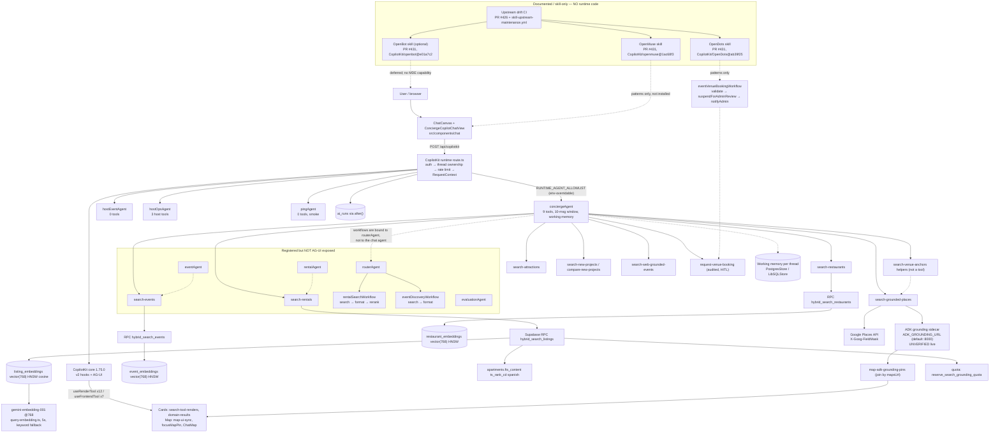

# MDE AI Architecture Audit — Phase A prelaunch (2026-10-21)

Auditor: ai-auditor (read-only). Task board: `task-4`.
Scope: Mastra, CopilotKit v2/AG-UI, retrieval (FTS + pgvector), Google Maps/Gemini/ADK sidecar, and the OpenBot / OpenMuse / OpenDots question.

## 0. Evidence base (read before trusting any path)

**Evidence base: origin/main `5d1d76ddf6` snapshot `/tmp/mde-main`; local checkout is a reduced canary
and was not used as product truth.** The worktree at `/home/sk/mdeai` sits on a reduced canary branch
(`ai/san-1332-frozen-canary`; `HEAD = 82d5021eb4`, `git rev-list --count HEAD..origin/main` = **1061**,
with 676 files / ~70,991 lines removed for canary freezing), so inventorying AI code from it would
under-report the product. Confirmed against the clean snapshot: `47` page files and `35` API
`route.ts` files under `src/app`, matching the snapshot, not the canary.

All findings were read from **`origin/main`** (`git show origin/main:<path>`) and re-checked against
`/tmp/mde-main`. Paths below are cited relative to that snapshot (`src/...`). Runtime/DB evidence comes
from the live project `zkwcbyxiwklihegjhuql` via `/tmp/mde_sql.sh` (read-only), which is unaffected by
the canary branch.

No code, migration, config, or data was modified. The only file written is this one.

---

## 1. Mastra inventory

### 1.1 Registered agents (`src/mastra/index.ts`, origin/main)

`new Mastra({ agents, workflows, workspace, scorers, storage, logger })` registers **8 agents**:

| Map key | `id` | File | Responsibility | Exposed to CopilotKit runtime? |
|---|---|---|---|---|
| `pingAgent` | `ping-agent` | `src/mastra/agents/index.ts` | wiring smoke, no tools | **Yes (default allowlist)** |
| `routerAgent` | `router-agent` | `src/mastra/agents/router.ts` | classify intent, dispatch workflow, never prose | No |
| `rentalAgent` | `rental-agent` | `src/mastra/agents/rental-agent.ts` | rental specialist, 1 tool | No |
| `conciergeAgent` | `concierge-agent` | `src/mastra/agents/concierge.ts` | user-facing UX, 8-tool map, all domains | **Yes** |
| `eventAgent` | `event-agent` | `src/mastra/agents/event-agent.ts` | events specialist, 1 tool | No |
| `evaluationAgent` | `evaluation-agent` | `src/mastra/agents/evaluation.ts` | rerank + "Best for" labels | No |
| `hostEventAgent` | `host-event-agent` | `src/mastra/agents/host-event.ts` | event draft creation, 0 tools | **Yes** |
| `hostOpsAgent` | `host-ops-agent` | `src/mastra/agents/host-ops.ts` | host analytics on user-scoped client | **Yes** |

**Four agents are AG-UI reachable by default**, not three: `RUNTIME_AGENT_ALLOWLIST` is
`conciergeAgent`, `hostEventAgent`, `hostOpsAgent`, **`pingAgent`**
(`src/mastra/copilotkit/logging-mastra-agent.ts:213-218`, `filterRuntimeAgents` at :228) — `pingAgent` has
no tools and is a wiring smoke test. The allowlist is **environment-overridable** via
`MASTRA_RUNTIME_AGENT_ALLOWLIST` (`resolveRuntimeAllowlist`, :220-226), so runtime exposure can change
without a code change; that is worth a deploy-time assertion. The other four (`routerAgent`,
`rentalAgent`, `eventAgent`, `evaluationAgent`) are internal. The user-facing chat is `conciergeAgent`;
"8 agents" must not be reported as "8 chat agents".

### 1.2 Tools — name → backend (verified by reading each tool file)

**Exact count, corrected:** `src/mastra/tools/` contains **13 files exporting `createTool`**, and 14
distinct tool `id`s are defined — but only **13 tools are actually bound to an agent**, and
`extract-intent-slots` is defined while bound to **nothing**: it is a deliberately removed no-op
(`concierge.ts:427` "PERF-002: extractIntentSlotsTool removed. Its execute() just Zod-echoed the…"),
guarded by a negative test (`concierge.test.ts:141-144` "does not register the no-op
extract-intent-slots tool"). `search-venue-anchors.ts` is **not a tool at all** — it exports rank/search
helper functions consumed by the grounded-places path. `tools/index.ts` re-exports 9 of them:

Tool files that define real `AgentTool`s: `classify-intent`, `compare-new-projects`,
`hostops-insight-tool`, `hostops-read-tools`, `request-venue-booking`, `search-attractions`,
`search-events`, `search-grounded-places`, `search-new-projects`, `search-rentals`,
`search-restaurants`, `search-web-grounded-events` (12 active) + the unbound `extract-intent-slots`.

| Tool `id` | Backend / data path | Reachable from |
|---|---|---|
| `classify-intent` | Gemini structured output, no DB | routerAgent |
| `search-rentals` (`src/mastra/tools/search-rentals.ts:696`) | `public.apartments` (`:522`) + `rpc('rental_development_active')` (`:148`) + `hybrid_search_listings` | rentalAgent, conciergeAgent |
| `search-new-projects` (`:263`) | `development_projects`, `development_unit_types`, `development_project_sources` | conciergeAgent |
| `compare-new-projects` (`:138`) | same three tables | conciergeAgent |
| `search-events` (`:323`) | `public.events` (`:285`) + `hybrid_search_events` | eventAgent, conciergeAgent |
| `search-restaurants` (`:438`) | `public.restaurants` (`:394`) + `hybrid_search_restaurants` | conciergeAgent |
| `search-attractions` (`:259`) | `public.tourist_destinations` (`:209`) | conciergeAgent |
| `search-grounded-places` (`:323`) | **ADK grounding sidecar** `invokeAdkGrounding` (`:392`) + Google Places, quota-guarded | conciergeAgent |
| `search-web-grounded-events` (`:15`) | Gemini web grounding, then DB hydrate | conciergeAgent |
| (`search-venue-anchors`) | **helper module, not an AgentTool** — rank/search functions used by the grounded path | — (imported by search-grounded-places) |
| `request-venue-booking` (`:72`) | venue booking request, `withAudit` wrapper | conciergeAgent |
| `list-host-events` (`hostops-read-tools.ts:44`), `get-sales-summary` (`:61`) | user-scoped Supabase client from `RequestContext[HOST_SUPABASE_KEY]` | hostOpsAgent |
| `get-sales-insights` (`hostops-insight-tool.ts:36`) | sales insight compute + narration | hostOpsAgent |

All DB tools route through `runAuditedSearch` / `runAuditedTool` (`src/mastra/lib/run-audited-search.ts`)
or `withAudit` (`src/mastra/tools/audit-wrapper.ts`), so every call is audited — good, and it is the
place retry/timing is centralized.

**Reachability check (done, not assumed):** `conciergeAgent.tools` is a literal name→tool map
(`concierge.ts:310`), the tools are the exported singletons from `tools/index.ts`, and the runtime builds
agents from the same `mastra` instance in `route.ts`. Registration is real, not orphaned. The one
weakness is *indirect* verification: no test asserts that each of the 8 tool names in
`concierge.ts:310` resolves, so a broken import would only fail at runtime.

### 1.3 Workflows (`src/mastra/workflows/`)

| Workflow | Steps | Notes |
|---|---|---|
| `rental-search-workflow` | `search-rentals` → `format-rental-cards` → `rerank-rentals` (`:55,87,244`) | used by routerAgent |
| `event-discovery-workflow` | `search-events` → `format-event-cards` (`:35,55`) | used by routerAgent |
| `event-venue-booking-workflow` | `validateBooking` → `suspendForAdminReview` → `notifyAdmin` (`:31,67,119`) | **HITL suspend/resume** for booking |
| `sales-insight-workflow` | `compute` → `narrate` (`:26,34`) | host analytics |

routerAgent binds the first two (`router.ts:47`); it is explicitly told never to call both in one turn (`:43`).

### 1.4 Memory and storage

- Per-agent `createThreadMemory(schema, { lastMessages })` (`src/mastra/lib/agent-memory.ts`); concierge
  uses a 10-message window (PERF-002, `concierge.ts:320-324`) with working-memory keys `lastIntent`,
  `lastRentalQuery`, `lastRentalResults`, `selectedListingId`, `lastEventQuery`, `selectedEventId`,
  `mapUi{selectedPinId, pinCounts, viewport}`. This is a real follow-up mechanism, not a claim.
- Storage: `PostgresStore` (`@mastra/pg`) when `DATABASE_URL` resolves, else `LibSQLStore`
  (`src/mastra/lib/storage.ts`), behind a `globalThis` singleton for dev HMR. Pinned `@mastra/pg 1.29.0`,
  `@mastra/libsql 1.25.0`.
- `ai_runs` persistence happens **after** the SSE response via Next `after()`
  (`route.ts` `persistTurnLog` → `logAgentRunForTurn`), so a turn log failure is logged, not user-visible.

### 1.5 Model/provider pins, routing, fallbacks

- `FLASH_MODEL = withTokenUsageTracking(google(GEMINI_FLASH_MODEL_ID))`; id lives in
  `src/lib/ai-model-ids.ts` = **`gemini-3.5-flash-lite`** (with a CI-enforced capability record: function
  calling + structured outputs). All 8 agents use `FLASH_MODEL` — verified per agent.
- `PRO_MODEL = google("gemini-3.1-pro-preview")` declared (`src/mastra/lib/models.ts`); no agent binds it.
  `CONCIERGE_MODEL`/`REASONING_MODEL`/`PLANNING_MODEL` are aliases of `FLASH_MODEL`.
- **No model-level fallback chain exists.** Fallbacks are *per-integration*, not per-model: embedding
  failure → keyword-only search; ADK sidecar failure → Places/DB fallback; grounding quota exhaustion →
  fallback path. `gemini-2.x`/second-provider fallback: none.

### 1.6 Error/retry/logging and evals

- Logging: `ConsoleLogger` with `LOG_LEVEL` (`src/mastra/index.ts`), structured `console.error/warn` with
  tags (`[search-grounded-places] ...`, `[copilotkit ai_runs persist failed]`).
- Retry: `src/mastra/lib/google-places-client.ts` retry covered by `places-retry.test.ts`; per-tool audit
  wrapper; `grounding-quota` + atomic `rpc('reserve_search_grounding_quota')`.
- Evals: **2 scorers registered** — `faithfulness`, `grounding-coverage`
  (`src/mastra/scorers/index.ts`), exposed through `GET /api/scorers`. There is **no committed eval
  dataset / eval-run harness** in `src/mastra` (only scorer unit tests). Scorers are available but not
  wired into the live turn path in `route.ts`. Status: partial.
- Test surface: **84** test files under `src/mastra/` (origin/main), including
  `router.test.ts`, `concierge.test.ts`, `search-*-logic.test.ts`, grounding-quality, quota, storage
  durability, telemetry. This is the strongest evidence layer in the repo.

---

## 2. CopilotKit inventory

### 2.1 Runtime route — `src/app/api/copilotkit/[[...path]]/route.ts`

Verified middleware order (each step is a real gate, not documentation):

1. `checkCopilotKitDistributedIpHardCeiling` — sheds abuse before any DB round-trip.
2. `supabase.auth.getUser()` — server-derived identity. "Origin/Referer is routing context, never proof."
3. `resolveRequestedThread` + `authorizeCopilotKitRequest` → the **only** `resourceId` this turn may write
   under; runs *before* AG-UI thread-metadata handling because "AG-UI loads and rewrites thread metadata
   before downstream memory validation".
4. `checkCopilotKitDistributedRateLimit(req, userId)`.
5. `new RequestContext()` sets `MASTRA_RESOURCE_ID_KEY` (D17: prevents service turns writing to a shared
   bucket), audit user id, and `HOST_SUPABASE_KEY` = the **user-scoped** client with an explicit comment
   that a service principal must never receive it.
6. `CopilotRuntime({ agents: getLocalAgentsWithLogging(...) })` + `copilotRuntimeNextJSAppRouterEndpoint`
   with `ExperimentalEmptyAdapter` (Mastra is the model backend; the runtime holds no LLM adapter).
7. `GET`/`POST` both routed here (so `/api/copilotkit/info` works); `runtime="nodejs"`,
   `maxDuration=30`, `dynamic="force-dynamic"`.

Pins (`package.json`, origin/main): `@copilotkit/react-core` **1.75.0**, `@copilotkit/runtime` **1.75.0**,
`@ag-ui/client` 0.0.59, `@ag-ui/mastra` 1.1.6, `@mastra/core` 1.74.0, `ai` SDK 2.x via `@ai-sdk/google` 2.0.74.
v2 API usage is real and dominant: **34** `@copilotkit/react-core/v2` imports, **6**
`@copilotkit/runtime/v2` imports, and `npm run floor` includes `audit:copilotkit-v2` +
`audit:copilotkit-v2:depcruise:proof` to block v1 regressions. One residual `useCopilotAction` occurrence
remains in `src/`; the v1 audit gate is the thing that keeps that from growing.

### 2.2 Hooks

`useRenderTool` (12), `useFrontendTool` (7), `useCopilotChatConfiguration` (3), `useAgent` (1),
`useCopilotAction` (1). v2 hook vocabulary throughout (`src/components/**`).

### 2.3 Generative UI cards

`src/components/copilot/search-tool-renders.tsx:317-318` registers **two renderers per tool** — the Mastra
`id` name and the dash-cased frontend id — for the same result shape. Supporting surfaces:
`domain-results.tsx`, `search-tool-result-cards.tsx`, `cafe-result-card.tsx`, plus map-neutral regression
tests (`rental-results-map-neutral.test.tsx`, `event-results-map-neutral.test.tsx`,
`grounded-payload-shapes.test.tsx`). The map-neutral tests are meaningful: cards must not fabricate
coordinates.

### 2.4 Map sync / selected-item state

`src/components/copilot/map-ui-sync.tsx` (agent → UI state), `focus-map-pin-action.tsx:24` (`focusMapPin`
frontend tool), `src/components/maps/ChatMap.tsx`, `MapFocusController.tsx`,
`ClusteredCategoryMarkers.tsx`, `src/lib/google-maps-map-id.ts`. Server-side, `conciergeAgent` working
memory carries `mapUi{selectedPinId, pinCounts, viewport}` — so "focus pin 2" is a real round-trip, not a
one-way UI event.

### 2.5 Actions (safe operations)

- Open details: `focusMapPin`; detail panels/sheets (`rental-detail-mobile-sheet.tsx`,
  `event-detail`/`nightlife-detail-mobile-sheet.tsx`, `cafe-detail-mobile-sheet.tsx`).
- Submit viewing: `src/app/api/leads/schedule-viewing/route.ts` — **HTTP route, not an agent tool**, so the
  concierge cannot complete a viewing request by tool call today.
- Submit booking: `request-venue-booking` tool (audited, `withAudit`) → `event-venue-booking-workflow`
  with `suspendForAdminReview` (HITL) → `notifyAdmin`; also `src/app/api/venue-booking/request/route.ts`
  and HITL contexts (`venue-booking-direct-hitl-context.ts`, `lead-confirmation-banner.tsx`).
- Host event editing: `set_event_basics` / `set_venue` / `set_pricing` frontend tools
  (`host-event-copilot-bridge.tsx:129,141,153`).

### 2.6 Persistence, follow-up, memory

`/api/threads` (GET list, `src/app/api/threads/route.ts`), `/api/threads/[threadId]` and
`/api/threads/[threadId]/messages`; ownership enforced by `src/lib/copilotkit-thread-ownership.ts`;
lifecycle test `src/components/__tests__/copilotkit-thread-lifecycle.test.tsx`. Client props are built by
`src/lib/copilotkit-client-props.ts` with **module-level stable empty objects** because inline `{}` props
retrigger connect; `agentId` is the single identity and there is no hosted-Cloud shape (same-origin runtime
always wins).

### 2.7 Loading / error / mobile

`concierge-thinking-indicator.tsx`, `concierge-run-feedback.tsx`, `concierge-error-notice.tsx`,
`concierge-error-store.ts`, `concierge-sign-in-prompt.tsx`, `deterministic-concierge-chat.tsx` (E2E
determinism), four mobile detail sheets + `map-mobile-sheet.tsx` + `chat-nav-drawer.tsx`. Test evidence:
26 component tests under `src/components/{copilot,chat,maps}`, 6 CopilotKit API contract tests in
`src/__tests__`, and `e2e/copilotkit-request-budget.spec.ts`.

---

## 3. Retrieval: FTS + pgvector

### 3.1 Schema and indexes (DB definitions)

`supabase/migrations/20260509205216_pgvector_semantic_search.sql`:
`listing_embeddings`, `event_embeddings`, `restaurant_embeddings`, each `embedding vector(768) not null`
(lines 19/29/39), with `using hnsw (embedding vector_cosine_ops)` (55/60/65). `query_embedding_cache`
`vector(768)` (`20260530123440_vec004_query_embedding_cache.sql:8`).

**Live verification** (`/tmp/mde_sql.sh`, project `zkwcbyxiwklihegjhuql`):

| Table | live rows |
|---|---|
| `listing_embeddings` | 44 |
| `event_embeddings` | 67 |
| `restaurant_embeddings` | 44 |
| `embedding_jobs` | 275 |
| `query_embedding_cache` | 9 |
| `embedding_cache` (schema `hermes`) | 0 |

Indexes confirmed live: `listing_embeddings_hnsw`, `event_embeddings_hnsw`, `restaurant_embeddings_hnsw`
— `USING hnsw (embedding vector_cosine_ops) WITH (m='16', ef_construction='64')`; plus
`embedding_cache_ann` in `hermes`, and a separate `vote.entities` `ivfflat lists=100`. A duplicate-index
cleanup exists (`20260601120000_vec001_drop_duplicate_hnsw_indexes.sql`), so the index set is curated.

### 3.2 Hybrid ranking (RPC, atomic, `search_path`-pinned)

`20261021060000_san1305_restore_fts_hybrid_search.sql` defines, as `LANGUAGE sql STABLE SET search_path TO ''`:

- `hybrid_search_listings(query_text, query_embedding, match_count=10, fts_weight=1.5, semantic_weight=1.0, rrf_k=60)`
- `hybrid_search_events(...)` — same shape, plus `is_active = true` and
  `event_start_time > now() - interval '1 hour'` on **both** candidates
- `hybrid_search_restaurants(...)` — `search_path TO 'public','extensions'`

Ranking is **RRF, not score blending**: `fts_weight/(rrf_k + fts.rank) + semantic_weight/(rrf_k + sem.rank)`,
`full outer join` so either side can win. FTS uses `ts_rank_cd(a.fts_content, websearch_to_tsquery('spanish', ...))`
and semantic retrieval is pre-limited to `match_count * 3` before ranking. Filters are baked in
(`status='active'`, event recency) — so the AI cannot surface inactive or past listings through hybrid search.
Later migrations `20261021070000_san1502_phase_a_pending_rental_search.sql` and
`20261016110100_restaurant_search_phase_visibility.sql` constrain Phase A visibility; the san1305 migration
**restores** FTS after it had been dropped — i.e. this path has already regressed once, which is a
consistency risk worth a regression test on the RPC's existence.

### 3.3 Code side

`src/mastra/lib/query-embedding.ts`: `EMBED_MODEL = "gemini-embedding-001"`, `EMBED_DIM = 768`,
`EMBED_TIMEOUT_MS = 5000`, `outputDimensionality: EMBED_DIM`, and an explicit failure union
(`missing_key | empty_text | http_error | empty_response | network_error`) that degrades to
**keyword-only hybrid search** rather than failing the turn. This is a genuine, readable fallback contract.

### 3.4 Ingestion and consistency

`embedding_jobs` (275 live rows), `20260601120200_data040_embedding_jobs.sql`,
`20261017010000_embedding_worker_pipeline.sql`, `20261018130000_embedding_jobs_scheduler.sql`.
Read-only posture for visitors is enforced separately
(`20261016235500_embedding_tables_read_only_for_visitors.sql`,
`20261018092945_revoke_visitor_privileges_on_embedding_jobs_and_cache.sql`) and an earlier
`fix_embedding_rls_allow_anon_select.sql` shows the current state is a **tightening**, which is the right direction.

**Unverified:** end-to-end freshness — no inspection proved a newly created apartment acquires an
embedding before a user can search it, and 44 listing embeddings is small enough that coverage is partial
relative to the `apartments` table. Treat "semantic search covers all active listings" as **unverified**.

### 3.5 Service-role boundary and atomic writes

Agent tools use a **user-scoped** client (`HOST_SUPABASE_KEY`, `route.ts` comment: "RLS-governed; never
service-role"). Service role appears on server read paths (`/api/threads` imports
`createServiceRoleClient`), which is server-only and out of the agent's reach. Atomic RPCs used by AI
actions: `reserve_search_grounding_quota` (`20261018102300_atomic_search_grounding_quota.sql`),
`rental_development_active`; booking goes through the suspend/resume workflow rather than a blind insert.
**Partial gap:** viewing requests (`/api/leads/schedule-viewing`) and ticket checkout are HTTP routes, not
Mastra tools, so they are not covered by the tool audit wrapper.

---

## 4. Google Maps, Places, and the ADK grounding sidecar

Verified in code:
- Places calls carry intentional field masks via `X-Goog-FieldMask`
  (`src/mastra/lib/google-places-client.ts`; asserted in `google-places-client.test.ts:63-92` — searchText,
  searchNearby, getPlace each have mask assertions). Named masks in `src/lib/place-search.ts`
  (`RENTAL_PLACE_VERIFY_MASK`, `RENTAL_ADDRESS_SEARCH_MASK`) and `restaurant-place-photo.ts`
  (`PLACE_PHOTO_FIELD_MASK`). `fieldMaskVersion` is carried on cards
  (`rental-ui-context.tsx:99,155`) so the UI knows which mask produced the data.
- ADK grounding sidecar: `ADK_GROUNDING_URL` (`.env.example:18`, default `http://localhost:8000`);
  `src/mastra/lib/adk-grounding-client.ts:38,76` `invokeAdkGrounding` / `invokeAdkSearchGrounding`;
  `attach-web-grounding.ts`; `map-adk-grounding-pins.ts` joins ADK attribution to rows **by `mapsUrl`,
  never index-zip** (`search-grounded-places.ts:290` — an explicit audit-B1 fix). Quota is reserved
  atomically before spending grounding budget.
- Map state sync: see §2.4. `src/lib/google-maps-map-id.ts` exists for AdvancedMarker/map-id configuration.

**Unverified (do not claim as working):** the sidecar's live reachability from this environment (no
`ADK_GROUNDING_URL` call was made — it would spend credits), the AdvancedMarker mapId wiring end-to-end,
and grounding-quota headroom. Sidecar *usage* is verified in code; sidecar *availability* is not.

---

## 5. Technology table

Value scores are this auditor's judgement for **Phase A prelaunch**, not measurements.

| Technology | Current MDE implementation | Actual capability | Missing integration | Value /100 | Recommendation |
|---|---|---|---|---|---|
| **CopilotKit v2 + AG-UI** | `route.ts` runtime w/ auth→ownership→rate-limit→RequestContext; 34 v2 hook imports; 12 `useRenderTool`, 7 `useFrontendTool`; cards, map sync, threads; 26+6 tests + v1-blocking CI gate | **Verified** (code + tests); live chat turn not executed under this audit | Viewing request not exposed as a tool; residual 1 `useCopilotAction` | 95 | **Reuse** — extend, do not replace |
| **Mastra** | 8 agents (4 AG-UI-allowlisted), 13 bound AgentTools (+1 unbound no-op), 4 workflows, per-agent working memory, Postgres/LibSQL store, token-usage middleware, audit wrapper | **Verified** (84 test files, registry read) | No model fallback; `PRO_MODEL` unused; scorers not wired to live turns | 90 | **Reuse** |
| **Supabase + pgvector/FTS** | 3 `vector(768)` HNSW tables + `hybrid_search_*` RRF RPCs + `embedding_jobs`/scheduler + `query_embedding_cache`; live rows 44/67/44 | **Verified** (migrations + live DB index/row query) | Embedding freshness/coverage unproven; san1305 shows one FTS restore already | 85 | **Reuse / extend** — prove ingestion consistency |
| **Google Maps + Gemini** | Maps JS + Places w/ masks; ADK sidecar client + pin mapping + quota; Gemini `gemini-3.5-flash-lite` pinned w/ capability record | **Verified** in code; sidecar availability **unverified** | Live sidecar proof; AdvancedMarker mapId proof | 85 | **Reuse** |
| **OpenMuse** | Merged **skill only** (PR #431, `origin/main:.claude/skills/openmuse`, upstream pinned `CopilotKit/openmuse@1ac68f3`). Zero runtime code, zero dependency | **Claimed** — guidance doc; its patterns are independently ~70% present in MDE (cards, map sync, mobile sheets, draft retention) | No install intended; gaps are draft-on-stop and queue-vs-durable copy | 25 | **Reuse patterns only** (skill), never install |
| **OpenDots** | Merged **skill only** (`CopilotKit/OpenDots@ab39f25`); MDE has partial native equivalents (`/api/approval-commit`, proposal cards, HITL workflow) | **Claimed / partially reflected** | Exact-draft identity, stale-version conflict, persisted receipt readback (SAN-1548 shared contract) | 30 | **Integrate the pattern** into existing review path; no new engine |
| **OpenBot** | Merged **skill only** (`CopilotKit/openbot@e01a7c2`), explicitly optional; zero runtime code | **Claimed only** — no MDE capability | Pinned-release proof (SAN-1324), AG-UI bridge (SAN-1325), server-side action policy, kill switch | 10 | **Defer** (re-evaluate only if a real external-portal task appears) |

**Do not add a competing orchestrator.** MDE already has exactly one agent runtime (Mastra), one transport
(CopilotKit/AG-UI), and one retrieval layer (Supabase). None of the three Open* projects is a runtime
dependency in this repo, and the skills themselves forbid installing them.

### OpenBot / OpenMuse / OpenDots verdict (what is actually implemented)

- **Documented:** `docs/OPENBOT/` holds 13 planning/PRD/audit documents (2026-10-18 → 2026-10-20), including
  `10-openbot-mde-portfolio-audit-and-corrections.md` and `13-progress-tracker.md`.
- **Shipped as guidance:** PR **#431** (SAN-1557) merged `.claude/skills/{openmuse,opendots,openbot}` with
  `SKILL.md` + `references/source-map.md` + `evals/{evals,trigger-evals}.json`, mirrored to `.agents/skills/`,
  plus `scripts/run-skill-behavior-eval.py`.
- **Shipped as CI:** PR **#426** (SAN-1551) merged `docs/03-platform/copilotkit-mastra/reference-upstreams.{md,json}`,
  `scripts/check-ai-reference-upstreams.mjs`, `scripts/check-skill-upstream-drift.mjs`, and
  `.github/workflows/skill-upstream-maintenance.yml` — an upstream watch/pin mechanism.
- **Not implemented:** `git grep -i "openmuse\|opendots\|openbot" origin/main -- src package.json` returns
  **no matches**. No agents, tools, routes, tables, or packages. The three are **advisory pattern
  libraries with upstream pinning**, not integrations. Any statement that MDE "integrates OpenMuse/OpenDots/
  OpenBot" would be false today.

---

## 6. Capability status (evidence per row)

| Capability | Status | Evidence |
|---|---|---|
| Intent routing | **Working** | `routerAgent` + `classify-intent` tool (`router.ts:8-47`); client fast paths `flash-route-classifier.ts`, `event-search-fast-path.ts`, `rental-fast-path-*`; `router.test.ts`, `classify-intent.test.ts`. Caveat: the chat surface is `conciergeAgent`, whose long instruction gates do much of the routing — routerAgent is not AG-UI exposed |
| Grounded tools | **Working** | 13 bound tools, real RPCs/tables (§1.2), `runAuditedSearch` wrapper, 84 mastra tests; live tables populated |
| Structured cards | **Working** | `search-tool-renders.tsx:317-318` dual-name renderers, `domain-results.tsx`, card tests, map-neutral regression tests |
| Map sync / selected item | **Working (code+tests); live unverified** | `map-ui-sync.tsx`, `focusMapPin` (`:24`), `MapFocusController`, `mapUi` working memory, `maps-degradation.test.tsx` |
| Safe actions (booking/lead) | **Partial** | Booking: audited tool + suspend/resume HITL + admin notify. Viewing: HTTP route only (`/api/leads/schedule-viewing`), no agent tool, not audit-wrapped |
| Persistence | **Working** | `/api/threads*` routes, `resolveRequestedThread` ownership, `ai_runs` via `after()`, Postgres store, lifecycle test |
| Memory / follow-up | **Working** | `createThreadMemory` schemas, concierge 10-message window, `lastResults`/`selectedId`/`mapUi`; `concierge.test.ts` |
| Failure recovery | **Partial** | Embedding→keyword fallback, ADK→Places/DB fallback, quota fallback, error notice + run feedback. Missing: model fallback, stop-preserves-draft and retry semantics (the OpenMuse gap) not proven |
| Grounding eval scoring | **Partial** | `faithfulness` + `grounding-coverage` scorers registered and served at `/api/scorers`; not wired into the live turn, no eval dataset in `src/mastra` |
| ADK sidecar availability | **Unverified** | Client + quota + pin mapping exist; no live call made (would spend credits) |
| Embedding coverage/freshness | **Unverified** | 44 listing embeddings; no proof a new listing is embedded before search; `embedding_jobs` scheduler exists |
| OpenBot / OpenMuse / OpenDots runtime | **Missing (by design)** | No `src/` or `package.json` reference; skill-only |

### Top AI gaps (ranked)
1. **Viewing/lead submission is not an agent capability** — the concierge can talk about viewings but cannot transact one through an audited tool.
2. **No embedding freshness guarantee** — semantic recall can silently miss new inventory.
3. **No model-level fallback** and `PRO_MODEL` is declared but unbound; a `gemini-3.5-flash-lite` degradation has no fallback path.
4. **Review/receipt durability (OpenDots pattern)** — exact-draft identity + persisted readback is the real Phase A risk in AI-proposed writes.
5. **Scorers exist but are not applied to live turns** — quality is asserted by tests, not measured in production.

---

## 7. Agent architecture (nodes/edges that actually exist)



Edge labels matter: solid edges are code-verified; dotted edges are either advisory (Open*) or
inferred-from-registration (internal agents). `ADK` is labeled **UNVERIFIED live** because only the client
code was inspected.

### One-paragraph description for a diagram caption

MDE has one AI runtime. A browser chat surface calls the same-origin CopilotKit v2 runtime, which authenticates,
proves thread ownership, rate-limits, then builds a Mastra-backed `CopilotRuntime` that exposes exactly three
agents: `conciergeAgent` (the user-facing chat, with nine tools — eight search/grounding plus an audited booking request — and structured working memory),
`hostEventAgent`, and `hostOpsAgent`. The concierge's search tools call Supabase RPCs that fuse `ts_rank_cd`
FTS with HNSW cosine similarity over 768-dimension `gemini-embedding-001` vectors via reciprocal-rank fusion,
under row filters that exclude inactive or past listings. Grounded place discovery goes through an ADK grounding
sidecar plus Google Places with explicit field masks, and returned coordinates become map pins that synchronize
with the chat's selected item. Booking is the only write path that is both agent-callable and human-reviewed
(suspend/resume workflow); viewing requests remain plain HTTP routes. OpenMuse, OpenDots and OpenBot exist only
as reviewed guidance skills with pinned upstream SHAs and a drift-check workflow — they contribute patterns, not
services, and no MDE code imports them.

---

## Verification commands used (reproducible)

```bash
git rev-parse HEAD origin/main && git rev-list --count HEAD..origin/main
git show origin/main:src/mastra/index.ts
git show origin/main:src/mastra/tools/index.ts
git show origin/main:src/app/api/copilotkit/[[...path]]/route.ts
git show origin/main:supabase/migrations/20261021060000_san1305_restore_fts_hybrid_search.sql
git show origin/main:src/mastra/lib/query-embedding.ts
git grep -nE '\.rpc\(' origin/main -- src/mastra
git grep -inE 'openmuse|opendots|openbot' origin/main -- src package.json   # → no matches
gh pr view 426 / 431 --json title,state,mergedAt,files
/tmp/mde_sql.sh "select relname,n_live_tup from pg_stat_user_tables where relname like '%embedding%'"
/tmp/mde_sql.sh "select indexname,indexdef from pg_indexes where indexdef ilike '%hnsw%'"
```
