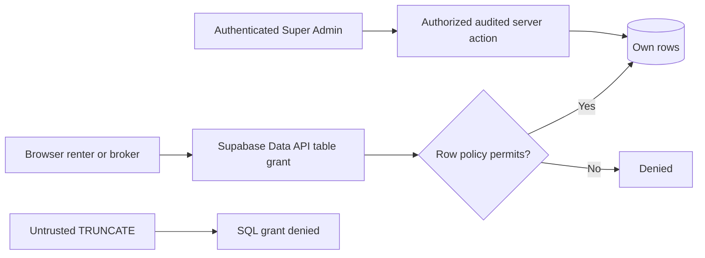
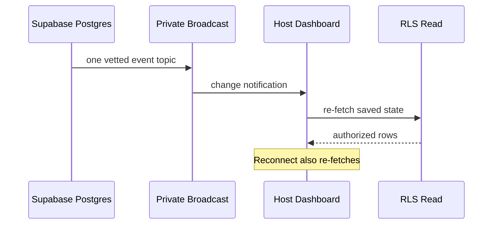
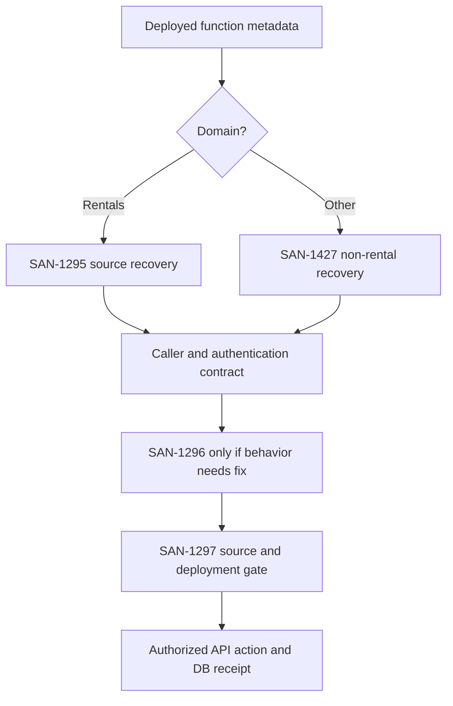

# MDE Supabase — One Ordered Implementation Plan

**Updated:** 2026-10-25 · [Supabase Linear view](https://linear.app/amo100/view/supabase-mde-9499e01299ff) · [SAN-1281 Supabase Platform epic](https://linear.app/amo100/issue/SAN-1281) · [GitHub](https://github.com/amoai-tech/mdeai)

## Goal and boundaries

Finish the **existing** MDE Rentals, Events/Ticketing and AI Concierge workflows using the current Next.js 16/React/CopilotKit/Mastra/Supabase/pgvector/PostGIS/Google Maps backend. Secure database grants/RLS/RPCs/Auth, fix only necessary Edge Functions, prove Cron outcomes, private Realtime, embedding replay and measured performance.

**Phase A: prelaunch development.** No business approvals, ownership/agency/rights verification, moderation, freshness, or publishing/viewing/booking eligibility gates. Preserve technical Auth, private-data isolation, server-side Super Admin, atomic transactions/idempotency, payment integrity and truthful record provenance. Never invent map coordinates, prices, availability or action success.

## Verified current truth

- [PR #527](https://github.com/amoai-tech/mdeai/pull/527) is **merged** at `999c1869f499b6af87f9d04fa9ce0a978f8b2072`. Live `fn_join_wait_list`: anon denied, authenticated denied, service allowed. **Do not redo this fix**.
- `has_role`, `check_rate_limit`, `redeem_promo_code` still have live anon/auth EXECUTE; confirm actual caller risk, preserve legitimate operations.
- Prior inventory: 136 public tables; 61 effective anon/81 authenticated `TRUNCATE` table privileges (SQL grants, not verified public API exploit).
- Six active Cron jobs; earlier test asserts four. Existing paired Realtime producers, private/public topic configuration need review.
- Actual existing Edge tests live at flat paths `supabase/functions/tests/*_test.ts`; `san1304a_recover_missing_column_contracts_test.sql` explicitly excludes Increment B surrogate PK work.
- The SUPA-MDE2 saved view now includes **29 issues**; SAN-1368, SAN-531, SAN-1266, SAN-482 were added for visibility; SAN-1281 is correctly **In Progress** while children remain open.

## Shared workflow — write once, don't duplicate in issues

Run only **two concurrent implementation PRs**. Prefer **existing implementation → configure → reuse vendor API/docs → minimal patch → verify**. Before each task inspect current clean `origin/main`, live read-only schema, exact issue title/status, code caller, and prior PRs. Read `AGENTS.md` plus `@linear-task`, `@linear-audit`, `@efficient`, `@plan`, `@supabase` and `@testing` as needed. Add `@mastra`, `@events`, `@real-estate`, `@e2e`, `@praudit` only for that slice. MCP: Linear, GitHub, Supabase, Remote Desktop Commander, Context7 for current SDK APIs, Chrome DevTools/browser for UI QA.

**Proof path:** focused RED test → reuse/adapt canonical owner → allowed and denied actors, rollback/retry → pgTAP/Deno/Vitest → lint/typecheck → selected Playwright at 390px → `npm run floor` on merge-ready head → review/CI → merge → approved migration preflight/dry-run and deployment (only when needed) → live UI/API/DB receipt → update **existing Linear task**. Use CLI `supabase migration new <name>` to generate real timestamps; never rewrite historical migrations or run release from an unrelated worktree. Avoid new parallel engines or redundant audits.

## Ordered steps by existing owner

### 1. [SAN-1287 · MDE Security — Stop Unauthorized Access to Customer and Business Data](https://linear.app/amo100/issue/SAN-1287/mde-security-stop-unauthorized-access-to-customer-and-business-data)

**Status:** Todo · **Labels:** stack:supabase, SUPA-MDE2, MDE_CORE, REAL_ESTATE, MVP_MDE, MVP · Launch Blocker, RLS · **Blocked by:** none

#### Outcome

A renter or broker can use their own data, but cannot view, modify, or wipe another tenant's records. Super Admin keeps server-audited management access.

**Scope / non-goals:** App-owned exposed `public` table/sequence privileges and actual tenant RLS CRUD. Exclude provider/extension objects; no Phase A ownership or business approval gates.

#### Current truth / blocking risk

Live: 136 public tables, effective `TRUNCATE` on 61 for anon / 81 for authenticated (SQL privilege, NOT proof of HTTP exploitability). Reuse existing grants/RLS and [SAN-1562](https://linear.app/amo100/issue/SAN-1562/mde-events-stop-unauthorized-ticket-refunds-and-qr-check-ins) event-commerce narrowing.

**Skills and MCP to run:** Skills: `@linear-task`, `@efficient`, `@supabase`, `@testing`, `@task-verifier`. MCP: Linear, Supabase (read-only catalog), GitHub, Remote Desktop Commander. Stack: Postgres 17, RLS, pgTAP, Next.js.

#### Ordered subtasks and checkpoints

- [ ] **1.1 Inventory effective grants** — Read live `pg_class`, `pg_namespace`, `pg_roles`, `aclexplode`, `has_table_privilege` and owners; export app-owned grant list once. Checkpoint: reproduce 61/81 counts and classify provider objects; do not attempt production destructive probes.
- [ ] **1.2 Map real actor permissions** — Inspect `src/lib/supabase/{client,server,service}.ts`, `src/app/api/host/rentals/viewings/`, related RLS migrations and `supabase/migrations/20261021031500_san1562_restrict_event_commerce_rpcs.sql`. Define allowed CRUD by renter, broker, outsider, staff, admin, service. Checkpoint: no legitimate direct `TRUNCATE` caller; normal viewing route preserved.
- [ ] **1.3 Write minimal forward SQL** — Run `supabase migration new san1287_revoke_destructive_grants`; in CLI-generated `supabase/migrations/<generated>_san1287_revoke_destructive_grants.sql` revoke unjustified `TRUNCATE`/confirmed destructive rights on app tables **without** revoking RLS-scoped DML. [Supabase RLS](<https://supabase.com/docs/guides/database/postgres/row-level-security>) → **ADAPT** table-GRANT-versus-RLS boundary to this migration and existing policies → verify grants with `has_table_privilege`.
- [ ] **1.4 Reuse shared tenant tests instead of rebuilding them** — [Supabase pgTAP guide](<https://supabase.com/docs/guides/local-development/testing/overview>) → **ADAPT** rollback/`set local role` checks into `supabase/tests/database/san1287_destructive_grants_test.sql` **only for** `TRUNCATE`**/table-grant boundaries**. Reuse existing [SAN-482 · Prove Only the Right Broker Can Access Rental Data Using One Shared Test Setup](<https://linear.app/amo100/issue/SAN-482>) role fixtures and [SAN-1266 · RLS-EVENTS-AUDIT — Supabase RLS audit: event_orders + event_tickets + event_attendees](<https://linear.app/amo100/issue/SAN-1266>) for event tenant isolation. Checkpoint: unauthorized `TRUNCATE` fails, legitimate CRUD/admin succeeds, no duplicate RLS test engine.
- [ ] **1.5 Release proof** — Run local focused pgTAP + existing `supabase-acl`, then `npm run floor`; independent security review; canonical `main` migration preflight/dry-run; post-release live readback. Checkpoint: zero unjustified destructive grants and no broken user journey.

#### Diagram — canonical access path



#### Success criteria

- [ ] Untrusted direct destructive SQL denied with zero changed rows
- [ ] Own-user CRUD and authorized Super Admin action succeed
- [ ] Migration + role test replay, required CI, post-deploy readback passed

**Implementation owner:** [SAN-1287](https://linear.app/amo100/issue/SAN-1287/mde-security-stop-unauthorized-access-to-customer-and-business-data) · MDE Security — Stop Unauthorized Access to Customer and Business Data. Phase A business approvals remain deferred; this task enforces technical safety only.

---

### 2. [SAN-1284 · Stop Unauthorized Users From Running Admin Database Actions](https://linear.app/amo100/issue/SAN-1284/stop-unauthorized-users-from-running-admin-database-actions)

**Status:** In Progress · **Labels:** MVP_MDE, stack:supabase, SUPA-MDE2, MVP · Launch Blocker · **Blocked by:** none

#### Outcome

Users cannot pass another identity to privileged functions, consume arbitrary rate limits, or redeem promos without a legitimate transaction; internal/admin actions still work.

**Scope / non-goals:** Function-specific `EXECUTE` and `SECURITY DEFINER` caller contracts. Keep live checkout and QR scanner usable; no broad revoke of RLS helpers.

#### Current truth / blocking risk

`fn_join_wait_list`, `has_role`, `check_rate_limit`, `redeem_promo_code` have effective anon/auth EXECUTE in live DB. PR [amoai-tech/mdeai#527](https://linear.app/amo100/review/prevent-users-joining-event-waitlists-as-someone-else-f47a7f0831d5) is OPEN, review required, contains wait-list fix with local tests; not deployed. `has_role` is depended on by RLS/admin.

**Skills and MCP to run:** Skills: `@praudit`, `@linear-task`, `@efficient`, `@supabase`, `@testing`. MCP: GitHub PR, Supabase catalog, Linear, Desktop Commander. Stack: SQL RPCs, Edge Functions, pgTAP.

#### Ordered subtasks and checkpoints

- [X] **2.1 Wait-list RPC restriction — shipped and verified** — [amoai-tech/mdeai#527](https://linear.app/amo100/review/prevent-users-joining-event-waitlists-as-someone-else-f47a7f0831d5) merged (`999c1869f499b6af87f9d04fa9ce0a978f8b2072`). Live `has_function_privilege` now shows `fn_join_wait_list`: `anon=false`, `authenticated=false`, `service_role=true`. Keep `supabase/migrations/20261025192055_san1284_waitlist_service_rpc_acl.sql`, `supabase/tests/database/san1284_waitlist_rpc_acl_test.sql`, and ACL baseline. Checkpoint: completed; do not reopen/reimplement this fix.
- [ ] **2.2 Map remaining caller contracts** — Read `pg_get_functiondef`, `proacl`, references in `supabase/migrations/`, `src/lib/distributed-rate-limit.ts`, `supabase/functions/_shared/rate-limit.ts`. Enumerate `has_role` use by `user_roles` RLS, `is_admin`, contest admin. Checkpoint: determine which caller must retain access before changing grants.
- [ ] **2.3 Correct only confirmed misuse** — [Supabase database functions](<https://supabase.com/docs/guides/database/functions>) → **ADAPT** least-privilege `SECURITY DEFINER`/search_path/EXECUTE model into CLI-generated specific RPC migrations (not historical SQL) → verify denied unknown-user role lookup but allowed actual admin and policy evaluation.
- [ ] **2.4 Make effects trustworthy** — Ensure rate-limit key/thresholds originate from a trusted server and promo `redeem_promo_code` is linked to atomic checkout/idempotency. Touch existing checkout/Edge handler only if caller trace demonstrates necessity. Checkpoint: retry creates one redemption/charge, rejected caller creates none.
- [ ] **2.5 Regression + release** — Reuse `scripts/check-function-acl-optin.mjs` and focused pgTAP direct-role tests; run ticket/wait-list positive paths + `npm run floor`; post-deploy audit roles and transaction counts. Checkpoint: no regressions in `user_roles` RLS or Super Admin.

#### Success criteria

- [X] PR #527 merged; live anon/auth denied, trusted service allowed
- [ ] Remaining function access classified and denied tests pass
- [ ] Admin/checkout success and retry idempotency demonstrated

**Implementation owner:** [SAN-1284](https://linear.app/amo100/issue/SAN-1284/stop-unauthorized-users-from-running-admin-database-actions) · Stop Unauthorized Users From Running Admin Database Actions. Phase A business approvals remain deferred; this task enforces technical safety only.

---

### 3. [SAN-1572 · SEC — Revoke supabase_admin default public table/function grants in MDE](https://linear.app/amo100/issue/SAN-1572/sec-revoke-supabase-admin-default-public-tablefunction-grants-in-mde)

**Status:** Backlog · **Labels:** MVP · Launch Supporting, SUPA-MDE2, MVP_MDE, stack:supabase · **Blocked by:** none

#### Outcome

Future newly created application tables, functions, and sequences do not inherit unneeded end-user privileges.

**Scope / non-goals:** Owner-specific `pg_default_acl` for future objects; [SAN-1287](https://linear.app/amo100/issue/SAN-1287/mde-security-stop-unauthorized-access-to-customer-and-business-data) owns existing-table grants.

#### Current truth / blocking risk

Live `supabase_admin` defaults still include browser-role DML, `TRUNCATE`, function `EXECUTE`, and sequence rights. Current `postgres` migration identity may not own those defaults; don't submit a known-failing migration.

**Skills and MCP to run:** Skills: `@linear-task`, `@efficient`, `@supabase`, `@testing`. MCP: Supabase project + advisor, Linear, GitHub; Desktop Commander for local tests. Stack: Postgres defaults, migration grant checks.

#### Ordered subtasks and checkpoints

- [ ] **3.1 Confirm default ACL owner** — Query `pg_default_acl`, owner role, schema, object type; compare with existing `supabase/migrations/20261021031500_san1562_restrict_event_commerce_rpcs.sql`. Checkpoint: distinguish `postgres` from `supabase_admin` privileges.
- [ ] **3.2 Choose supported owner-level correction** — [Supabase database roles](<https://supabase.com/docs/guides/database/postgres/roles>) → **REFERENCE ONLY** for owner/privileged role model; verify authorized owner route before `ALTER DEFAULT PRIVILEGES FOR ROLE supabase_admin` and never insert unauthorized DDL in an ordinary migration. Checkpoint: authorized path proven OR provider limitation recorded.
- [ ] **3.3 Validate future objects safely** — [Supabase test guide](<https://supabase.com/docs/guides/local-development/testing/overview>) → **ADAPT** transaction/rollback fixture in existing `supabase/tests/database/` to create a disposable future table/function under **the actual owner**, check visitor privilege denial and trusted service use; never probe destructively on production.
- [ ] **3.4 Add detection if owner unavailable** — Extend `scripts/check-function-acl-optin.mjs` or its existing grant checker rather than a new parallel scanner; add Node/pgTAP test to flag newly unsafe owner defaults. Checkpoint: intentional bad default fails, corrected default passes.
- [ ] **3.5 Record status** — Update `docs/supabase/` runbook with owner action/result and exact live readback; preserve explicit residual risk when provider-controlled. Checkpoint: new object is safe, not just historical tables.

#### Success criteria

- [ ] Actual grant owner and authority verified
- [ ] Future table/function/sequence rights validated or limitation documented with detection
- [ ] No [SAN-1287](https://linear.app/amo100/issue/SAN-1287/mde-security-stop-unauthorized-access-to-customer-and-business-data) responsibilities duplicated

**Implementation owner:** [SAN-1572](https://linear.app/amo100/issue/SAN-1572/sec-revoke-supabase-admin-default-public-tablefunction-grants-in-mde) · SEC — Revoke supabase_admin default public table/function grants in MDE. Phase A business approvals remain deferred; this task enforces technical safety only.

---

### 4. [SAN-1291 · Supabase CI — Catch Database and Security Breakage Before Merge](https://linear.app/amo100/issue/SAN-1291/supabase-ci-catch-database-and-security-breakage-before-merge)

**Status:** In Progress · **Labels:** MVP_MDE, stack:supabase, SUPA-MDE2, MVP · Launch Blocker · **Blocked by:** none

#### Outcome

A PR changing SQL, grants, or schema types cannot merge with an undetected privilege or migration regression; unrelated PRs still receive an honest required-check status.

**Scope / non-goals:** One existing `supabase-acl` CI workflow; no duplicate test runner or Mastra schema gate.

#### Current truth / blocking risk

Existing `.github/workflows/supabase-acl.yml` has workflow-level `paths:` filters, runs pgTAP and ACL baseline. Lint-drift and generated `database.types.ts` parity remain to verify against exact head.

**Skills and MCP to run:** Skills: `@linear-task`, `@efficient`, `@supabase`, `@testing`, `@praudit`. MCP: GitHub PR/Actions, Desktop Commander, Linear. Stack: GitHub Actions, Supabase CLI, pgTAP, Node tests.

#### Ordered subtasks and checkpoints

- [ ] **4.1 Verify baseline + required checks** — Read `.github/workflows/supabase-acl.yml`, `scripts/check-function-acl-optin.mjs`, `scripts/function-acl-baseline.json`, protected branch rules. Checkpoint: document actual skip/required-check behavior without new workflow.
- [ ] **4.2 Fix skipped required checks with one stable GitHub job** — [GitHub required status check troubleshooting](<https://docs.github.com/en/repositories/configuring-branches-and-merges-in-your-repository/managing-protected-branches/troubleshooting-required-status-checks>) → **ADAPT** workflow-level path-filter guidance to existing `.github/workflows/supabase-acl.yml`: always create `supabase-acl` status for PRs, detect changed paths inside workflow and conditionally skip only heavy work. Preserve pinned Supabase CLI action unless version change is necessary. Include `merge_group` ONLY if MDE enables merge queue. Checkpoint: SQL PR + non-SQL PR both report truthful required status; intentionally unsafe SQL fails.
- [ ] **4.3 Detect lint and type changes** — [Supabase CI testing guide](<https://supabase.com/docs/guides/deployment/ci/testing>) → **MODEL** local schema replay + compare generated types in `src/lib/supabase/database.types.ts`; add `scripts/check-supabase-db-lint.mjs` + baseline and Node tests only if these files are still absent. Checkpoint: generated types match clean replay; new linter regression detected.
- [ ] **4.4 Prove red/green** — On disposable branch add deliberately unsafe grant/column type drift; confirm checker RED, then restore and confirm GREEN. Run SQL-specific pgTAP/ACL before final `npm run floor`; do not rerun full browser suite per SQL edit.
- [ ] **4.5 Ship stable gate** — Independent review and required-check rule update (if needed), record CI runtime. Checkpoint: false-green skip impossible; no duplicate `mastra-schema-init` or `floor`.

#### Success criteria

- [ ] Changed SQL / generated type drift makes CI red
- [ ] Baseline and unrelated PR have truthful check status
- [ ] No new redundant CI workflow or accidental required-check skip

**Implementation owner:** [SAN-1291](https://linear.app/amo100/issue/SAN-1291/supabase-ci-catch-database-and-security-breakage-before-merge) · Supabase CI — Catch Database and Security Breakage Before Merge. Phase A business approvals remain deferred; this task enforces technical safety only.

---

### 5. [SAN-1295 · MDE-EDGE-001 — Recover and Canonicalize Rental Edge Functions + Rules Engine](https://linear.app/amo100/issue/SAN-1295/mde-edge-001-recover-and-canonicalize-rental-edge-functions-rules)

**Status:** Todo · **Labels:** SUPA-MDE2, MVP_MDE, stack:supabase, MVP · Launch Blocker, WHATSAPP_MDE · **Blocked by:** none

#### Outcome

A rental lead or directions handler that runs in Supabase can be rebuilt from reviewed source and its real caller/auth mode is known.

**Scope / non-goals:** Rental Edge source recovery and ownership; behavior corrections [SAN-1296](https://linear.app/amo100/issue/SAN-1296/make-rental-edge-actions-rules-engine-safe-and-idempotent), non-rental [SAN-1427](https://linear.app/amo100/issue/SAN-1427/recover-and-secure-the-remaining-non-rental-production-edge-functions); no forced relaunch of retired reminder cron.

#### Current truth / failure mode

Live-only slugs exist; local deployable source dirs total eight. `lead-reminder-tick` cron retired by `20261019120000_san1313_retire_broken_lead_reminder_cron.sql`. Existing `supabase/functions/chat-lead-capture/index.ts` is a canonical path; some other slugs only deployed.

**Skills / MCP to run:** Skills: `@linear-task`, `@efficient`, `@supabase`, `@testing`, `@real-estate` (rental journeys). MCP: Supabase Edge Functions, GitHub, Desktop Commander, Linear.

#### Ordered subtasks and proof checkpoints

- [ ] **5.1 Make per-slug caller/provenance list** — Query deployed function slug/version/`verify_jwt`, code only where accessible, `supabase/functions/`, `src/app/api/`, Mastra callers, Cron, provider events and retained secrets **names**. Checkpoint: `KEEP`, `MERGE`, `RETIRE` or `UNKNOWN-PRESERVE`; never assume zero callers from a grep alone.
- [ ] **5.2 Choose one active missing-source rental slug** — Prioritize real lead/viewing calls; verify if `lead-from-form` duplicates `chat-lead-capture`; do **not** re-enable `lead-reminder-tick` Cron based on historic 500s. Checkpoint: owner and deployed version confirmed before changing code.
- [ ] **5.3 Recover exact source** — [Supabase Edge examples](<https://github.com/supabase/supabase/tree/master/examples/edge-functions>) → **REFERENCE ONLY** for Deno handler/import layout; recover deployed implementation into `supabase/functions/<verified-slug>/index.ts` and existing `_shared/`, not a new proxy; verify response/auth compatibility against real caller.
- [ ] **5.4 Reuse the existing flat Deno tests** — [Supabase Edge testing](<https://supabase.com/docs/guides/functions/unit-test>) → **ADAPT** fetch mocks and handler examples into `supabase/functions/tests/chat-lead-capture_schedule_viewing_test.ts`; if a truly new handler needs coverage, add flat `supabase/functions/tests/<slug>_test.ts`, not a nonexistent `<slug>/index.test.ts` subdirectory. Checkpoint: caller allowed, outsider denied, replay has one saved result, failure never claims success.
- [ ] **5.5 Reconcile retained configuration** — Match `supabase/config.toml` JWT config, declared secret names and source hash with deployed function; hand behavioral fix to [SAN-1296](https://linear.app/amo100/issue/SAN-1296/make-rental-edge-actions-rules-engine-safe-and-idempotent). Checkpoint: retained function reproducible and no live source accidentally overwritten.

#### Success criteria

- [ ] Prioritized live slug/source/caller/auth identity recorded
- [ ] Negative/positive Deno tests and actual persisted result pass
- [ ] Retired/unknown functions not silently redeployed

**Canonical task:** [SAN-1295](https://linear.app/amo100/issue/SAN-1295/mde-edge-001-recover-and-canonicalize-rental-edge-functions-rules) · MDE-EDGE-001 — Recover and Canonicalize Rental Edge Functions + Rules Engine. The shared release/test protocol is recorded in `docs/supabase/26-supabase-tasks-improvements.md`

---

### 6. [SAN-1296 · Make Rental Edge Actions + Rules Engine Safe and Idempotent](https://linear.app/amo100/issue/SAN-1296/make-rental-edge-actions-rules-engine-safe-and-idempotent)

**Status:** Todo · **Labels:** SUPA-MDE2, MVP_MDE, stack:supabase, MVP · Launch Blocker · **Blocked by:** SAN-1295

#### Outcome

Renter submits a viewing once—or retries after losing internet—and receives exactly one persisted lead and showing with the correct broker.

**Scope / non-goals:** Existing rental handler behavior and transaction/retry semantics, no duplicate approval/rules/search subsystem. Dependent on required source recovery in [SAN-1295](https://linear.app/amo100/issue/SAN-1295/mde-edge-001-recover-and-canonicalize-rental-edge-functions-rules).

#### Current truth / failure mode

[SAN-1286](https://linear.app/amo100/issue/SAN-1286/san-1286-save-the-lead-and-viewing-together-or-not-at-all) already owns atomic lead/showing RPC. `chat-lead-capture` exists; `lead-from-form` requires caller reconciliation. Reminder Cron was retired, not an active production scheduler failure.

**Skills / MCP to run:** Skills: `@errors`, `@efficient`, `@supabase`, `@testing`, `@e2e`, `@real-estate`. MCP: Desktop Commander, Supabase, GitHub, Linear, browser/Chrome DevTools if UI evidence needed.

#### Ordered subtasks and proof checkpoints

- [ ] **6.1 Trace completed atomic viewing workflow, don't rebuild it** — [SAN-474 · Make Sure Every Viewing Request Creates Exactly One Lead and One Showing](<https://linear.app/amo100/issue/SAN-474>) and [SAN-1286 · Save the Lead and Viewing Together or Not at All](<https://linear.app/amo100/issue/SAN-1286>) are Done. Follow `src/app/rentals/[id]/` → `src/app/api/host/rentals/viewings/` / `supabase/functions/chat-lead-capture/index.ts` → canonical existing lead/showing RPC. Checkpoint: identify actual persisted transaction owner and correct broker before coding.
- [ ] **6.2 Reuse isolation and retry tests** — [Supabase pgTAP](<https://supabase.com/docs/guides/local-development/testing/overview>) → **ADAPT** same-user/other-user role checks only where not covered by [SAN-482 broker isolation](<https://linear.app/amo100/issue/SAN-482>) and [SAN-474](https://linear.app/amo100/issue/SAN-474/san-474-make-sure-every-viewing-request-creates-exactly-one-lead-and)/[SAN-1286](https://linear.app/amo100/issue/SAN-1286/san-1286-save-the-lead-and-viewing-together-or-not-at-all) tests. Extend `supabase/functions/tests/chat-lead-capture_schedule_viewing_test.ts` for Edge denied caller/duplicate request; no parallel SQL RLS matrix. Checkpoint: one transaction and outsider denied.
- [ ] **6.3 Patch only missing Edge safeguards** — Keep [SAN-474](https://linear.app/amo100/issue/SAN-474/san-474-make-sure-every-viewing-request-creates-exactly-one-lead-and)/[SAN-1286](https://linear.app/amo100/issue/SAN-1286/san-1286-save-the-lead-and-viewing-together-or-not-at-all) atomic SQL unchanged; fix verified auth, idempotency-key forwarding and truthful errors in `supabase/functions/chat-lead-capture/index.ts` or existing caller. Reconcile `lead-from-form` only after identifying live callers. Checkpoint: two identical submits → exactly one saved lead + showing; failure has no partial success.
- [ ] **6.4 Test external provider failure in flat Deno suite** — [Supabase Edge unit testing](<https://supabase.com/docs/guides/functions/unit-test>) → **ADAPT** network failure and retry mocks into `supabase/functions/tests/chat-lead-capture_schedule_viewing_test.ts` or a necessary `supabase/functions/tests/<slug>_test.ts`. Do not recreate retired reminder Cron without a confirmed caller. Checkpoint: failed provider effect remains pending/failed rather than falsely sent.
- [ ] **6.5 Test UI and agents** — From rental Details → Schedule Viewing → persisted broker status, include AI Concierge authorized action using same RPC, not separate engine. Playwright mobile 390px and replay. Checkpoint: correct user-visible receipt and no duplicate DB writes.

#### UI wireframe — reuse existing screen

```text
Rental Details (mobile ~390px)
┌──────────────────────────────┐
│ Apartment / source attribution│
│ Grounded price & location     │
│ [Date] [Time]                 │
│ [Request viewing]            │
├──────────────────────────────┤
│ Saved • Request reference     │
│ Broker / status from database │
│ [View request]                │
└──────────────────────────────┘
```

#### Success criteria

- [ ] One click and same-key retry = exactly one lead + one showing
- [ ] Authorized broker/renter see persisted state; unrelated user denied
- [ ] Error shows failed/pending, never falsely confirmed

**Canonical task:** [SAN-1296](https://linear.app/amo100/issue/SAN-1296/make-rental-edge-actions-rules-engine-safe-and-idempotent) · Make Rental Edge Actions + Rules Engine Safe and Idempotent. The shared release/test protocol is recorded in `docs/supabase/26-supabase-tasks-improvements.md`

---

### 7. [SAN-1313 · Keep Scheduled Jobs Reproducible and Prove They Actually Work in Production](https://linear.app/amo100/issue/SAN-1313/keep-scheduled-jobs-reproducible-and-prove-they-actually-work-in)

**Status:** In Progress · **Labels:** SUPA-MDE2, MVP_MDE, stack:supabase, MVP · Launch Supporting · **Blocked by:** none

#### Outcome

Every required Cron job survives fresh database replay and records a real downstream result or a visible failure, not just a scheduler success.

**Scope / non-goals:** Live/replay job manifest + effects; edge behavior [SAN-1296](https://linear.app/amo100/issue/SAN-1296/make-rental-edge-actions-rules-engine-safe-and-idempotent); existing Mastra Cron producers remain owned by their migration.

#### Current truth / failure mode

Six live active jobs; existing `supabase/tests/database/san1313b_pg_cron_schedule_replay_test.sql` asserts four. Two extra are `mastra_span_retention` and `mastra_anonymous_regression_check`; old lead reminder was retired.

**Skills / MCP to run:** Skills: `@linear-audit`, `@efficient`, `@supabase`, `@mastra` (Mastra jobs), `@testing`. MCP: Supabase SQL/logs, GitHub, Desktop Commander, Linear.

#### Ordered subtasks and proof checkpoints

- [ ] **7.1 Compare approved schedules** — Read `cron.job`, `cron.job_run_details` and migration owners under `supabase/migrations/` (especially Mastra retention/regression and `20261018130000_embedding_jobs_scheduler.sql`). Checkpoint: exact six-job live inventory with name, schedule, command and ownership.
- [ ] **7.2 Correct replay test, not live data blindly** — Review `supabase/tests/database/san1313b_pg_cron_schedule_replay_test.sql` and current Mastra migrations; adapt test to the intentional job set after fresh replay and check each dependency, without reactivating `mdeai_lead_reminder_tick`. Checkpoint: clean replay matches intended live set.
- [ ] **7.3 Prove full execution** — [Supabase Cron docs](<https://supabase.com/docs/guides/cron>) → **ADAPT** job/run-history inspection (`cron.job_run_details`) to existing `supabase/tests/database/san1313_pg_cron_replay_test.sql` plus existing logs → verify real SQL effect or HTTP status + persisted outbox/provider result; scheduler success alone insufficient.
- [ ] **7.4 Check retries and failures** — Run representative job in controlled environment twice; inspect pg_net response and Edge logs if HTTP; record non-sensitive error/alert, demonstrate no duplicate contact. Checkpoint: one change/receipt or explicit no-op; bad provider results aren't green.
- [ ] **7.5 Release with owner coordination** — Change Cron SQL only via CLI-generated forward migration if essential; rerun pgTAP/CI and targeted live check after release. Keep job schedule/config test in one canonical location.

#### Success criteria

- [ ] Fresh replay includes expected owned jobs and dependencies
- [ ] At least one direct SQL and retained HTTP route has end-effect proof
- [ ] Failure creates observable error; retired reminder not reintroduced

**Canonical task:** [SAN-1313](https://linear.app/amo100/issue/SAN-1313/keep-scheduled-jobs-reproducible-and-prove-they-actually-work-in) · Keep Scheduled Jobs Reproducible and Prove They Actually Work in Production. The shared release/test protocol is recorded in `docs/supabase/26-supabase-tasks-improvements.md`

---

### 8. [SAN-1294 · SAN-1294 · Make Realtime Updates Reliable, Private, and Safe](https://linear.app/amo100/issue/SAN-1294/san-1294-make-realtime-updates-reliable-private-and-safe)

**Status:** Todo · **Labels:** SUPA-MDE2, MVP_MDE, stack:supabase, MVP · Launch Blocker · **Blocked by:** none

#### Outcome

Private organizer/renter notifications cannot leak to unrelated users and database writes produce a single appropriate broadcast.

**Scope / non-goals:** Broadcast producer/topic security and trigger consolidation; frontend subscriptions [SAN-1288](https://linear.app/amo100/issue/SAN-1288/task-482h7-mde-sb-007-deduplicate-realtime-and-define-one-frontend); public vote tally may intentionally remain public.

#### Current truth / failure mode

`trips`, `trip_items`, `proactive_suggestions` have paired live triggers. Event/check-in producers send with `private=false` despite private-topic policies; `realtime.messages` has three current SELECT policies.

**Skills / MCP to run:** Skills: `@linear-task`, `@efficient`, `@supabase`, `@testing`; use `@events` for organizer ownership. MCP: Supabase read-only SQL/Realtime, GitHub, Desktop Commander, Linear.

#### Ordered subtasks and proof checkpoints

- [ ] **8.1 Inventory producer, policy, subscriber AND hosted settings** — Read actual `pg_trigger`, `realtime.messages` RLS, topic payload, `supabase/migrations/20260505000200_realtime_broadcast_migration.sql` (historical read only), and hosted Realtime **Allow public access** configuration. [Supabase Realtime Authorization](<https://supabase.com/docs/guides/realtime/authorization>) → **REFERENCE ONLY** for private-channel setting/policy. Checkpoint: classify private organizer/orders/trips versus intentionally public vote tally; do not break public tallies with a global toggle.
- [ ] **8.2 Fix only sensitive topics** — [Supabase Realtime Authorization](<https://supabase.com/docs/guides/realtime/authorization>) → **ADAPT** `realtime.messages` topic RLS example and `private:true` subscriber agreement into **new CLI-generated** `supabase/migrations/<generated>_san1294_private_topics.sql` and focused SQL tests → verify organizer allowed, outsider denied, and payload excludes sensitive fields.
- [ ] **8.3 Consolidate verified duplicates** — Compare paired triggers' emitted topic/payload; remove only redundant `trips`/`trip_items`/`proactive_suggestions` producers in same or separate focused forward migration. Checkpoint: exactly one relevant event per write, no lost subscribers.
- [ ] **8.4 Test two actors, revocation, and reconnect** — [Supabase Broadcast](<https://supabase.com/docs/guides/realtime/broadcast>) → **ADAPT** `private=true` producer, matching `private: true` client and authorization policies to retained SQL and subscriber. Deny outsider and **new subscription after role revocation**; force disconnect/re-auth for active sessions if required. Checkpoint: no cross-tenant payload, one signal/write, reconnect refetches saved state.
- [ ] **8.5 Hand off canonical topic names** — Document brief producer/topic/authorization contract for [SAN-1288](https://linear.app/amo100/issue/SAN-1288/task-482h7-mde-sb-007-deduplicate-realtime-and-define-one-frontend), without implementing competing UI subscriptions. Checkpoint: privacy and delivery proven from two sessions.

#### Success criteria

- [ ] Unrelated users cannot receive private sales/trip/customer payloads
- [ ] One DB write → one authorized signal
- [ ] Kept topics and public tally have documented visibility

**Canonical task:** [SAN-1294](https://linear.app/amo100/issue/SAN-1294/san-1294-make-realtime-updates-reliable-private-and-safe) · [SAN-1294](https://linear.app/amo100/issue/SAN-1294/san-1294-make-realtime-updates-reliable-private-and-safe) · Make Realtime Updates Reliable, Private, and Safe. The shared release/test protocol is recorded in `docs/supabase/26-supabase-tasks-improvements.md`

---

### 9. [SAN-1288 · Task 48.2H.7 · MDE-SB-007 — Deduplicate Realtime and Define One Frontend Subscription Contract](https://linear.app/amo100/issue/SAN-1288/task-482h7-mde-sb-007-deduplicate-realtime-and-define-one-frontend)

**Status:** Todo · **Labels:** MVP_MDE, stack:supabase, SUPA-MDE2, MVP · Launch Supporting · **Blocked by:** SAN-1294

#### Outcome

Broker/event host sees a saved status change without page refresh; missed socket events recover by reading the actual database.

**Scope / non-goals:** One reusable React subscription mechanism and one high-value consumer first; security/producers [SAN-1294](https://linear.app/amo100/issue/SAN-1294/san-1294-make-realtime-updates-reliable-private-and-safe); don't duplicate CopilotKit/Mastra token streaming.

#### Current truth / failure mode

Existing `src/lib/supabase/client.ts` is present; checked `src/` has no direct `.channel(` subscriber. Current live private policies cover event dashboard, check-in and vote tally but not every user/trip topic.

**Skills / MCP to run:** Skills: `@linear-task`, `@efficient`, `@supabase`, `@testing`, `@e2e`; MCP: GitHub, Supabase Realtime, Desktop Commander, Chrome DevTools/Browser for UI, Linear.

#### Ordered subtasks and proof checkpoints

- [ ] **9.1 Start only after producer/private-topic contract** — [SAN-1294 · SAN-1294 · Make Realtime Updates Reliable, Private, and Safe](<https://linear.app/amo100/issue/SAN-1294>) owns private producer topic authorization. Inspect `src/app/host/events/` or `src/app/host/rentals/(broker)/dashboard/`, choose one real use case and current saved-state read endpoint; keep CopilotKit/Mastra chat streaming separate. Checkpoint: exactly one high-value consumer and authorized topic.
- [ ] **9.2 Wire single scoped client hook** — [Supabase Realtime Authorization client example](<https://supabase.com/docs/guides/realtime/authorization>) → **ADAPT** `supabase.channel(topic, {config:{private:true}})` to `src/lib/supabase/client.ts` + **conditional** `src/hooks/use-event-realtime.ts` (only if no existing shared hook). On event refetch authoritative saved rows. Checkpoint: authorized update seen and correct cleanup on unmount.
- [ ] **9.3 Reconnect and failure cases** — [Supabase Broadcast docs](<https://supabase.com/docs/guides/realtime/broadcast>) → **MODEL** a Broadcast listener and reconnect state machine inside the existing hook, not a second data store → test missed message/refetch after JWT refresh, browser visibility return, duplicate event and fallback polling.
- [ ] **9.4 Integrate user-facing receipt** — In exact chosen current event/host screen display last persisted order/check-in/viewing status; accessible loading, empty, connection-error states at 390px. Checkpoint: never claim paid/confirmed from a socket event alone.
- [ ] **9.5 Browser proof** — Playwright two signed-in sessions (host/outsider), cause one real test data change, confirm host updates, outsider denied, one listener after rerender, status agrees with Supabase.

#### Workflow diagram



#### UI wireframe — reuse existing screen

```text
Host dashboard • mobile 390px
┌─────────────────────────────────┐
│ Event       [Connection status] │
├─────────────────────────────────┤
│ Orders   12  (saved count)      │
│ Check-ins 7  (saved count)      │
│ Last updated: database time     │
├─────────────────────────────────┤
│ [Refresh]  [Open orders]        │
│ Connection lost? State is safe. │
└─────────────────────────────────┘
```

#### Success criteria

- [ ] Exactly one authorized subscriber on selected screen
- [ ] Failed/reconnected connection refetches persisted state
- [ ] Outsider denied, one update shown, mobile screen usable

**Canonical task:** [SAN-1288](https://linear.app/amo100/issue/SAN-1288/task-482h7-mde-sb-007-deduplicate-realtime-and-define-one-frontend) · Task 48.2H.7 · MDE-SB-007 — Deduplicate Realtime and Define One Frontend Subscription Contract. The shared release/test protocol is recorded in `docs/supabase/26-supabase-tasks-improvements.md`

---

### 10. [SAN-1289 · Task 48.2H.8 · MDE-SB-008 — Recover, secure, test, and prove all Edge Functions](https://linear.app/amo100/issue/SAN-1289/task-482h8-mde-sb-008-recover-secure-test-and-prove-all-edge-functions)

**Status:** Todo · **Labels:** stack:supabase, SUPA-MDE2, MDE_CORE, REAL_ESTATE, MVP · Launch Supporting, MVP_MDE · **Blocked by:** none

#### Outcome

Every retained Edge Function has an owner, reproducible source, caller identity, tests, and a real outcome receipt.

**Scope / non-goals:** Coordination issue for [SAN-1295](https://linear.app/amo100/issue/SAN-1295/mde-edge-001-recover-and-canonicalize-rental-edge-functions-rules) (rental recovery), [SAN-1296](https://linear.app/amo100/issue/SAN-1296/make-rental-edge-actions-rules-engine-safe-and-idempotent) (rental behavior), [SAN-1297](https://linear.app/amo100/issue/SAN-1297/task-482h8c-mde-edge-003-add-edge-function-tests-deployment-provenance) (drift gate), [SAN-1427](https://linear.app/amo100/issue/SAN-1427/recover-and-secure-the-remaining-non-rental-production-edge-functions) (non-rental). No duplicate parent implementation PR.

#### Current truth / failure mode

Audit saw 41 deployed functions vs eight local deployable dirs (snapshot only); deployed ACTIVE is not proof of working security or recoverable version. `supabase/edge-functions-contract.json` does not yet exist.

**Skills / MCP to run:** Skills: `@linear-audit`, `@efficient`, `@supabase`, `@testing`; MCP: Supabase Functions/Logs, GitHub, Linear, Desktop Commander; `@mastra` only where agent tool invokes retained Edge handler.

#### Ordered subtasks and proof checkpoints

- [ ] **10.1 Establish one per-slug ledger** — Query current deployed slugs/versions/config and compare `supabase/functions/`, `supabase/config.toml`, app/Mastra/cron callers. Checkpoint: classification `KEEP`, `MERGE`, `RETIRE`, `UNKNOWN-PRESERVE` and ownership; do not guess unknown.
- [ ] **10.2 Assign existing children** — Rental source to [SAN-1295](<https://linear.app/amo100/issue/SAN-1295>), rental action correction to [SAN-1296](<https://linear.app/amo100/issue/SAN-1296>), common CI to [SAN-1297](<https://linear.app/amo100/issue/SAN-1297>), non-rental to [SAN-1427](<https://linear.app/amo100/issue/SAN-1427>). These are **issue relationships**, not external implementation references. Checkpoint: no duplicate owner/PR.
- [ ] **10.3 Standardize minimum contract** — [Supabase Edge Function Auth](<https://supabase.com/docs/guides/functions/auth>) → **REFERENCE ONLY** classification of signed-in JWT, server secret, signed webhook and public guest contexts; map into existing per-slug ledger in `docs/supabase/`, optionally `supabase/edge-functions-contract.json` if [SAN-1297](https://linear.app/amo100/issue/SAN-1297/task-482h8c-mde-edge-003-add-edge-function-tests-deployment-provenance) formally adopts it. Verify a known auth test per retained slug.
- [ ] **10.4 Prioritize real journey paths** — Trace rental viewing, signed ticket webhook/QR, concierge authorized tool call. Do not rebuild current payment or search engines. Checkpoint: critical retained handler has source, auth negative proof, persisted result.
- [ ] **10.5 Close parent from child evidence** — Link exact hashes/tests/deploy receipts and keep UNKNOWN-PRESERVE flagged for live-only handlers, never delete without caller proof.

#### Workflow diagram



#### Success criteria

- [ ] Retained live slugs classified and assigned one owner
- [ ] High-impact functions have reproducible source and actor tests
- [ ] Parent closed from evidence, without 41 blind recovery PRs

**Canonical task:** [SAN-1289](https://linear.app/amo100/issue/SAN-1289/task-482h8-mde-sb-008-recover-secure-test-and-prove-all-edge-functions) · Task 48.2H.8 · MDE-SB-008 — Recover, secure, test, and prove all Edge Functions. The shared release/test protocol is recorded in `docs/supabase/26-supabase-tasks-improvements.md`

---

### 11. [SAN-1297 · Task 48.2H.8C · MDE-EDGE-003 — Add Edge Function Tests, Deployment Provenance, and Drift Gates](https://linear.app/amo100/issue/SAN-1297/task-482h8c-mde-edge-003-add-edge-function-tests-deployment-provenance)

**Status:** Todo · **Labels:** SUPA-MDE2, MVP_MDE, stack:supabase, MVP · Launch Supporting · **Blocked by:** none

#### Outcome

Changed Edge Functions are tested and match reviewed source, auth mode, and deployment metadata; untracked production edits cannot be mistaken for reviewed code.

**Scope / non-goals:** CI/per-slug provenance of retained Edge handlers; [SAN-1291](https://linear.app/amo100/issue/SAN-1291/supabase-ci-catch-database-and-security-breakage-before-merge) handles SQL; [SAN-1295](https://linear.app/amo100/issue/SAN-1295/mde-edge-001-recover-and-canonicalize-rental-edge-functions-rules)/1427 own source recovery.

#### Current truth / error risks

No `supabase/edge-functions-contract.json` exists yet in current checkout; new contract file only if justified. Some deployed `verify_jwt=false` slugs are intentional webhook/guest entry points with alternate authentication.

**Skills / MCP to run:** Skills: `@linear-task`, `@efficient`, `@supabase`, `@testing`, `@praudit`. MCP: GitHub Actions/PR, Supabase Functions, Desktop Commander, Linear.

#### Ordered subtasks and checkpoints

- [ ] **11.1 Check existing tools before adding** — Search `.github/workflows/`, `scripts/`, `supabase/config.toml` and `supabase/functions/tests/` for current Edge tests/config verifiers; map stable required checks. Checkpoint: one canonical workflow identified; no duplicate database CI.
- [ ] **11.2 Capture retained slug contract** — In one reviewed `supabase/edge-functions-contract.json` **if needed**, record slug, source hash, deployed version/source provenance, JWT/secret/webhook mode, allowed method, secret **names only**, caller and side effects. Verify from actual deployed metadata, never store secret values.
- [ ] **11.3 Use actual MDE flat Deno test paths** — [Supabase Edge unit tests](<https://supabase.com/docs/guides/functions/unit-test>) → **ADAPT** mocks into existing `supabase/functions/tests/vote-cast_handler_test.ts`, `process-embedding-jobs_test.ts`, or `chat-lead-capture_schedule_viewing_test.ts`; only add `supabase/functions/tests/<slug>_test.ts` if required for a retained new handler. Do not create nonexistent nested `tests/<slug>/index.test.ts` files. Checkpoint: denied caller, forged webhook, network failure, retry tested.
- [ ] **11.4 Add cheap drift gate** — [Supabase setup-cli](<https://github.com/supabase/setup-cli>) → **ADAPT** pinned CLI setup inside current `.github/workflows/` Edge workflow (choose existing owner) to compare changed slugs and intended JWT/source config; prove deliberately wrong flag or missing source makes CI red. Avoid untrusted PR access to prod secrets.
- [ ] **11.5 Verify deploy receipt after real release** — On trusted release, record actual deployed version/hash and compare. Checkpoint: repo source and running handler proven equal, no invented deploy success.

#### Success criteria

- [ ] Changed-slug negative cases pass
- [ ] Drift mismatch causes red CI; unchanged baseline green
- [ ] Actual deployment hash/version read back under trusted release only

**Canonical task:** [SAN-1297](https://linear.app/amo100/issue/SAN-1297/task-482h8c-mde-edge-003-add-edge-function-tests-deployment-provenance) · Task 48.2H.8C · MDE-EDGE-003 — Add Edge Function Tests, Deployment Provenance, and Drift Gates. Shared release/QA steps are in `docs/supabase/26-supabase-tasks-improvements.md`

---

### 12. [SAN-1293 · Task 48.2H.11 · MDE-SB-011 — Harden Supabase Auth Production Settings and Abuse Controls](https://linear.app/amo100/issue/SAN-1293/task-482h11-mde-sb-011-harden-supabase-auth-production-settings-and)

**Status:** Todo · **Labels:** SUPA-MDE2, stack:supabase, MDE_CORE, REAL_ESTATE, MVP · Launch Supporting, MVP_MDE · **Blocked by:** SAN-1282

#### Outcome

Users sign in and return to the intended page; malformed/expired sessions and wrong-role requests cannot perform privileged actions.

**Scope / non-goals:** Hosted Supabase Auth settings plus existing Next.js session middleware and server authorization; not a new auth provider or Phase A business verification gate.

#### Current truth / error risks

`src/lib/supabase/middleware.ts` and `src/lib/supabase/{server,env}.ts` already implement session protection; admin server actions still require independent role checks. Leaked-password protection previously flagged disabled (hosted plan availability unverified).

**Skills / MCP to run:** Skills: `@linear-task`, `@efficient`, `@supabase`, `@testing`, `@e2e`; MCP: Supabase Auth/settings, GitHub, Desktop Commander, browser/Chrome DevTools, Linear.

#### Ordered subtasks and checkpoints

- [ ] **12.1 Check actual hosted settings** — In Supabase project Auth configuration, inventory Site URL/redirect allowlist, providers, signup/recovery, leaked-password protection availability, throttles, session/JWT expiry and admin MFA support. Checkpoint: dated settings baseline; distinguish hosted settings from `supabase/config.toml`.
- [ ] **12.2 Reuse Next.js 16 proxy** — [Supabase SSR client pattern](<https://supabase.com/docs/guides/auth/server-side/creating-a-client?framework=nextjs&package-manager=npm>) → **ADAPT** `proxy.ts` + cookie refresh guidance only where missing in existing `src/proxy.ts`, `src/lib/supabase/middleware.ts`, `src/lib/supabase/server.ts`; verify `src/proxy.ts` continues calling `updateSession` and callback does not loop. Do **not** create a second middleware.
- [ ] **12.3 Verify privileged actions server-side** — [Supabase getClaims reference](<https://supabase.com/docs/reference/javascript/auth-getclaims>) → **REFERENCE ONLY** for JWT validation semantics; use current installed SDK in actual `src/app/api/admin/` route and server-side role lookup (avoid client-controlled metadata). Test expired/invalid JWT and unrelated user 401/403, Super Admin still succeeds.
- [ ] **12.4 Protect redirect and test bypass behavior** — Inspect `src/app/auth/callback/`, exact sign-in callback, `E2E_BYPASS_AUTH` checks, same-origin `next` return path. Checkpoint: malicious redirect rejected, production never bypasses auth.
- [ ] **12.5 Run real journeys** — Playwright login→requested rental/event→logout→re-login and admin denies, 390px viewport. Checkpoint: session refresh doesn't lose user's page, no service key reaches frontend.

#### Success criteria

- [ ] Hosted configuration evidence recorded; supported controls enabled where available
- [ ] Invalid, expired, unrelated actor denied by server; admin action allowed
- [ ] Redirect and 390px signin/logout journeys work with existing middleware

**Canonical task:** [SAN-1293](https://linear.app/amo100/issue/SAN-1293/task-482h11-mde-sb-011-harden-supabase-auth-production-settings-and) · Task 48.2H.11 · MDE-SB-011 — Harden Supabase Auth Production Settings and Abuse Controls. Shared release/QA steps are in `docs/supabase/26-supabase-tasks-improvements.md`

---

### 13. [SAN-1304 · SAN-1304 · Make AI Search Work the Same After a Fresh Database Rebuild](https://linear.app/amo100/issue/SAN-1304/san-1304-make-ai-search-work-the-same-after-a-fresh-database-rebuild)

**Status:** In Progress · **Labels:** SUPA-MDE2, MVP_MDE, stack:supabase, MVP · Launch Supporting, MDE_SEARCH · **Blocked by:** none

#### Outcome

A clean Supabase rebuild reproduces the embedding primary keys and can serve accurate AI Concierge listings and map results using real stored records.

**Scope / non-goals:** Only embedding-table migration/replay parity, its existing worker and Mastra search tool; broad FTS/hybrid search recovery already [SAN-1305](https://linear.app/amo100/issue/SAN-1305/make-rental-event-and-restaurant-search-work-after-a-fresh-database) Done. No new AI/vector engine.

#### Current truth / error risks

Three relevant embedding tables: `public.listing_embeddings`, `event_embeddings`, `restaurant_embeddings` (verify PK/unique live vs clean replay). Installed pgvector 0.8.0; `src/mastra/lib/intelligence-rental-search.ts` uses existing `hybrid_search_listings` RPC.

**Skills / MCP to run:** Skills: `@linear-task`, `@efficient`, `@supabase`, `@mastra`, `@testing`; MCP: Supabase SQL/vector, GitHub, Desktop Commander, Context7 only for current SDK, Linear. Frontend: Next.js/CopilotKit cards/maps; Backend: Mastra+pgvector+PostGIS.

#### Ordered subtasks and checkpoints

- [ ] **13.1 Capture exact live key contract** — Inspect PK, unique and column definitions for `listing_embeddings`, `event_embeddings`, `restaurant_embeddings` via `pg_constraint`/catalog; compare migration replay. Checkpoint: exact mismatch proven, no table guessed.
- [ ] **13.2 Add Increment B tests; preserve Increment A** — `supabase/tests/database/san1304a_recover_missing_column_contracts_test.sql` explicitly excludes embedding surrogate primary keys. [Supabase pgTAP guide](<https://supabase.com/docs/guides/local-development/testing/overview>) → **ADAPT** schema/constraint assertions to NEW `supabase/tests/database/san1304b_embedding_primary_keys_test.sql` for `listing_embeddings`, `event_embeddings`, `restaurant_embeddings` PK/unique/UPSERT shape. Checkpoint: prove clean replay mismatch before writing SQL, green after correction.
- [ ] **13.3 Fix only confirmed Increment B schema drift** — [Supabase vector columns](<https://supabase.com/docs/guides/ai/vector-columns>) → **REFERENCE ONLY** for existing pgvector conventions; compare live `pg_constraint` and duplicate data, then `supabase migration new san1304_embedding_keys` to generate a new `supabase/migrations/<generated>_san1304_embedding_keys.sql` only if tests prove drift. Do not edit historical migrations or completed Increment A test. Checkpoint: three PKs/UPSERT match live and clean replay; existing embeddings preserved.
- [ ] **13.4 Verify existing worker and agent** — Trace `supabase/functions/process-embedding-jobs/index.ts` → `src/mastra/lib/intelligence-rental-search.ts` → existing CopilotKit rental cards/maps. [Supabase vector query guide](<https://supabase.com/docs/guides/ai/vector-columns>) → **ADAPT** similarity operator/index-order verification to existing `hybrid_search_listings` SQL, not new `match_documents` engine; ensure factual rows, truthful missing coordinates and Phase A listings.
- [ ] **13.5 End-to-end rebuild proof** — Run fresh migration replay, test same-key embedding UPSERT retry, search fallback, RLS and response action receipts; sample UI 390px. Checkpoint: no fake listing, one embedding row per canonical key, no cross-user action.

#### Success criteria

- [ ] Three tables' PK/unique schema reproduces in fresh build
- [ ] Embedding UPSERT/retry and existing hybrid RPC succeed
- [ ] Mastra/CopilotKit UI returns grounded records and preserves access control

**Canonical task:** [SAN-1304](https://linear.app/amo100/issue/SAN-1304/san-1304-make-ai-search-work-the-same-after-a-fresh-database-rebuild) · [SAN-1304](https://linear.app/amo100/issue/SAN-1304/san-1304-make-ai-search-work-the-same-after-a-fresh-database-rebuild) · Make AI Search Work the Same After a Fresh Database Rebuild. Shared release/QA steps are in `docs/supabase/26-supabase-tasks-improvements.md`

---

### 14. [SAN-1290 · Task 48.2H.9 · MDE-SB-009 — Optimize Supabase Indexes and Query Plans from Production Evidence](https://linear.app/amo100/issue/SAN-1290/task-482h9-mde-sb-009-optimize-supabase-indexes-and-query-plans-from)

**Status:** Todo · **Labels:** MVP_MDE, stack:supabase, SUPA-MDE2, MVP · Launch Supporting · **Blocked by:** SAN-1283

#### Outcome

Rental/map search and viewing or ticket operations are faster by measured p95, without relaxing authorization or unnecessarily enlarging the schema.

**Scope / non-goals:** Evidence-led query/index and pg_net maintenance; not wholesale index deletions or new database engines.

#### Current truth / error risks

Live snapshot: `net._http_response` \~107 MB and \~72 estimated live rows; no proven customer p95 regression. Performance advisor reported FK/index/RLS initplan candidates, many 'unused' indexes may be harmless or future-facing.

**Skills / MCP to run:** Skills: `@linear-task`, `@efficient`, `@supabase`, `@testing`, `@mastra` only if hybrid query changes. MCP: Supabase advisors/query stats, Desktop Commander, GitHub, Linear.

#### Ordered subtasks and checkpoints

- [ ] **14.1 Capture customer baseline** — Trace actual rental SQL from `src/app/api/rentals/search/` and `src/mastra/lib/intelligence-rental-search.ts`, viewing RPC and event order RPC. Measure p50/p95, sample queries, row counts, and `pg_stat_statements` stats reset. Checkpoint: 3 reproducible query baselines; don't infer slowness from advisor count.
- [ ] **14.2 Use built-in planner first** — [Supabase Index Advisor](<https://supabase.com/docs/guides/database/extensions/index_advisor>) → **USE BUILT-IN** Query Performance 'indexes' tab or SQL `index_advisor(query)` for actual identified slow query → attach before/after estimated plan to [SAN-1290](https://linear.app/amo100/issue/SAN-1290/task-482h9-mde-sb-009-optimize-supabase-indexes-and-query-plans-from); candidate only, not automatic DDL.
- [ ] **14.3 Choose one reversible improvement** — [Supabase Query Optimization](<https://supabase.com/docs/guides/database/query-optimization>) → **ADAPT** EXPLAIN/BUFFERS measurement to current hybrid search or RLS policy migration; only if proven, run `supabase migration new san1290_query_fix` and modify CLI-generated SQL. Preserve PostGIS GiST and pgvector indices until query evidence supports change.
- [ ] **14.4 Treat pg_net bloat separately** — Read pg_net maintenance/retention and `net._http_response` relation stats; evaluate safe vacuum/cleanup with approved maintenance plan, **no** `VACUUM FULL` **or destructive production operation by default**. Checkpoint: retained responses and storage reclaimed safely where feasible.
- [ ] **14.5 Remeasure identical load** — Same parameters/data for before/after plans and p95, confirm tenant RLS and write consistency; rollback if no material user benefit. Checkpoint: measured improvement, not cosmetic index-count changes.

#### Success criteria

- [ ] Representative before/after search/map/booking timings recorded
- [ ] Only measured beneficial index/policy/maintenance change shipped
- [ ] No tenant-data leak, lost records or uncontrolled maintenance

**Canonical task:** [SAN-1290](https://linear.app/amo100/issue/SAN-1290/task-482h9-mde-sb-009-optimize-supabase-indexes-and-query-plans-from) · Task 48.2H.9 · MDE-SB-009 — Optimize Supabase Indexes and Query Plans from Production Evidence. Shared release/QA steps are in `docs/supabase/26-supabase-tasks-improvements.md`

---

## Supporting issues in SUPABASE_MDE view

- [SAN-1368 · Keep AI Chats and Memory Private in Every Fresh Environment](https://linear.app/amo100/issue/SAN-1368) — Done; keep its evidence, no reimplementation.
- [SAN-531 · Harden SECURITY DEFINER / mutable-search_path RPCs (Supabase advisor)](https://linear.app/amo100/issue/SAN-531) — Backlog; coordinate with SAN-1284.
- [SAN-1266 · RLS-EVENTS-AUDIT — Supabase RLS audit: event_orders + event_tickets + event_attendees](https://linear.app/amo100/issue/SAN-1266) — Todo; event-specific RLS proof, already blocked by SAN-1287.
- [SAN-482 · Prove Only the Right Broker Can Access Rental Data Using One Shared Test Setup](https://linear.app/amo100/issue/SAN-482) — Todo; reuse canonical broker isolation fixture.

**3 Mermaid diagrams:** SQL grants/RLS (SAN-1287), private Realtime delivery (SAN-1288), Edge Function recovery (SAN-1289). **2 ASCII mobile wireframes:** Rental request (SAN-1296) and Host dashboard (SAN-1288). These are reference sketches; update the existing UI, not new routes.

**Not implemented by this document:** Supabase changes, migrations, PR #527 follow-ons, AI/vector, Realtime, CI and end-to-end journeys remain owned by their task. This plan is an execution snapshot synchronized from live Linear descriptions; update Linear with real runtime proof after code deploy.