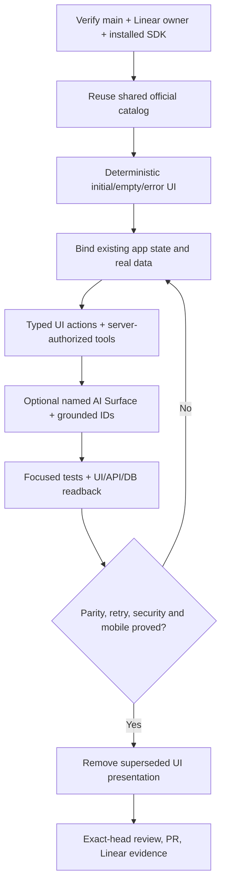

# MDE AI — AI-Native Development Plan

**Current operating mode:** Phase A, prelaunch development. **Purpose:** a short, reusable execution plan for real MDE changes, including the current **CopilotKit component-first Rentals migration**. This document does **not** own current issue status or roadmap priority.

**Sources:** [AGENTS.md](AGENTS.md) (policy) · [spec.md](spec.md) (testable contract) · [REVIEW.md](REVIEW.md) (PR findings) · [DESIGN.MD](DESIGN.MD) (design and component UI direction) · [sitemap.md](sitemap.md) (source-verified routes, not status) · [prd.md](prd.md) (product requirements) · [roadmap.md](roadmap.md) (strategy) · [mvp.md](mvp.md) (Phase B public-launch criteria only) · [advanced.md](advanced.md) (optional future CopilotKit/OpenBot/OpenFuse/OpenDots capabilities) · [Linear](https://linear.app/amo100/project/mde-ai-bb25cababf6c/issues) (actual task/owner/status) · [tasks skill](.claude/skills/tasks/SKILL.md) (worktrees/PRs).

> The former June 2026 Phase 1 tracker is preserved as [historical root-plan snapshot](docs/_archive/root-plan-phase1-2026-06-06.md). Its percentages, production SHAs and task ordering are **not** current instructions.

## 1. One issue → one verifiable outcome

For every implementation, take the smallest correct path:

1. **Verify:** read exact current Linear issue title/criteria/dependencies and relevant PR, inspect target merge-base/`main`, installed libraries, code/tests and current UI/API/data. Mark verified facts separately from unknowns.
2. **Specify:** define actor → action → observable result, stable `AC-#` acceptance criteria, errors/retries/auth and true non-goals from [spec.md](spec.md). Reuse issue acceptance when complete; create task-specific Markdown only for substantial ambiguity.
3. **Reuse first:** existing UI/service/RPC → installed SDK → official example → smallest necessary adapter. Never create a second provider, search engine, booking writer, state store or task registry.
4. **Plan:** file/function-level changes in dependency order. Write a focused failing regression for confirmed defects; set one explicit stop condition for unsafe or unknown behavior.
5. **Implement:** complete one thin *vertical user journey*, not separate UI/DB/API feature stubs. Agents may inspect independent areas in parallel; serialize shared catalog/schema/transaction changes.
6. **Verify:** focused tests → applicable DB/RLS & negative/retry tests → lint/typecheck/build → browser/mobile → `npm run floor` on final head when required. Report command, SHA and true PASS/FAIL/NOT RUN. A screenshot/toast is not a persisted receipt.
7. **Review and deliver:** inspect current-head review findings using [REVIEW.md](REVIEW.md); fix only verified issues at canonical owners, rerun affected tests, push the **fewest necessary PRs**, update current Linear issue with evidence and next action.
8. **Post-merge:** independently re-check merged SHA and the affected journey; never label a PR or whole product Done before proof.

**Default path for S0/S1:** inspect → focused fix → focused proof → PR. No mandatory interview, documentation stage, business approval or review-only issue. **S2–S4:** persist additional context only when it prevents a real handoff or decision failure; use the existing [task-specific templates](docs/07-operations/intent-spec-plan/README.md).

### Six-stage AI-native loop — one existing task, not six new gates

| Stage | Durable output (reuse existing owner) | Practical stop/feedback signal |
| --- | --- | --- |
| **Plan** | Linear issue or optional `intent.md`: actor, problem, target result | User outcome still ambiguous, not merely missing ceremony |
| **Design** | Task `spec.md`: accepted `AC-#`, alternatives/non-goals and technical risks | No safe authoritative write path or current SDK/API contract |
| **Build** | Smallest vertical slice + test/diff on isolated branch/worktree | Regression or stale interface means change plan before more code |
| **Test** | Exact-head focused and applicable negative/browser/API/DB evidence in issue/PR | Failed decisive case or unproved security/payment behavior |
| **Deploy** | Existing PR/CI and deployed SHA when applicable | Required release check failed or incorrect deployment target |
| **Maintain** | Existing logs/alerts and reproducible issue when a new defect appears | Report observed failure and re-enter **Plan**, not a second workflow |

This adapts the [AI-native SDLC playbook](https://claude.com/resources/articles/the-ai-native-sdlc-playbook) to MDE: **read the last reliable artifact, do the next small action, and verify it**. Do not automatically create an `intent.md`, spec folder, second Linear issue, reviewer gate or approval for every fix. Authorization/technical safety checks still apply whenever the action touches them.

## 2. CopilotKit component-first implementation — Rentals

**Goal:** use the installed official CopilotKit Standard Catalog as the approved Rentals presentation system, without replacing the existing real MDE services or making core pages dependent on an AI response.

### A. Shared catalog first (one contract; existing provider boundaries)

**Owner:** [SAN-1675 · MDE AI — Map Official Standard Catalog Components to Existing Pages](https://linear.app/amo100/issue/SAN-1675).

- Verify exact aligned `@copilotkit/react-core` / `@copilotkit/runtime` pins from `package.json` and installed types; do not copy latest upstream examples blindly.
- Inventory [`mde-ui-catalog.tsx`](src/components/copilot/a2ui/mde-ui-catalog.tsx): existing enabled/omitted types, source-ID adapters, slots, state and function declarations. Register only official types a real page can use.
- Prove a scripted/no-model gallery for relevant layout, `Card`, `Carousel`, `Table`, `Form` and controls (or explicitly document unsupported deterministic paths); test empty/error/nested children and missing trusted data.
- Keep **Concierge and Host providers separate**, sharing the component contract rather than a global thread/agent. Host registration belongs to [SAN-1659 · MDE AI — Add Reusable AI Insights Panels to Existing Dashboards](https://linear.app/amo100/issue/SAN-1659).
- Mirror every enabled component/action/Surface change in [`generative-ui-context.ts`](src/mastra/lib/generative-ui-context.ts) and drift tests. Renderer functions handle typed user events; authorized server/Mastra tools handle agent-driven writes.
- **PASS:** exact installed SDK imports, deterministic rendering, valid component props, authorized source-ID resolution, no dead controls or cross-thread leakage.

### B. Complete real pages with three checkpoints each

Use **A = component/UI, B = real backend+agent integration, C = independent end-to-end proof** as checkpoints *inside existing Linear issues*; do not create 24 replacement tickets.

| Page/journey | A · Component-first UI | B · Real data/action owner | C · Verification owner |
| --- | --- | --- | --- |
| Create Rental Listing | [SAN-1688](https://linear.app/amo100/issue/SAN-1688): existing V2 form → official Form/fields/preview | [SAN-1391](https://linear.app/amo100/issue/SAN-1391): draft; [SAN-1107](https://linear.app/amo100/issue/SAN-1107): atomic final save | [SAN-677](https://linear.app/amo100/issue/SAN-677): new broker → first listing/viewing |
| Photo Manager | [SAN-1689](https://linear.app/amo100/issue/SAN-1689): official Carousel + **registered uploader adapter** | Same media service: real upload/reorder/cover, persisted references | SAN-1689 + SAN-677: retry, refresh, A/B broker |
| Rental Discovery | [SAN-1694](https://linear.app/amo100/issue/SAN-1694): catalog cards/grid/gallery and existing Maps adapter | [SAN-1039](https://linear.app/amo100/issue/SAN-1039): canonical filters; [SAN-1229](https://linear.app/amo100/issue/SAN-1229): ID/pins; SAN-1695: interim gallery bug | [SAN-755](https://linear.app/amo100/issue/SAN-755): real search → pin → Details |
| Apartment Details | [SAN-1615](https://linear.app/amo100/issue/SAN-1615): photos, source, amenities | Existing Details loader; [SAN-1612](https://linear.app/amo100/issue/SAN-1612): action choice | SAN-755: same selected source ID, no invented facts |
| Request Viewing | SAN-1612: typed action/review controls | Existing authorized lead + showing transaction; reuse [SAN-1205](https://linear.app/amo100/issue/SAN-1205) proof | SAN-755: exactly one lead and showing |
| Broker Dashboard | [SAN-1683](https://linear.app/amo100/issue/SAN-1683): responsive catalog shell | [SAN-1684](https://linear.app/amo100/issue/SAN-1684): broker KPIs/actions; SAN-1659: Host GenUI | [SAN-1686](https://linear.app/amo100/issue/SAN-1686): real counts, auth, 390px |
| Viewing Management | SAN-1684: scoped status table/actions | Existing showing writer; [SAN-1426](https://linear.app/amo100/issue/SAN-1426): renter visibility | SAN-1686 + SAN-1426: transitions and isolation |
| Ask MDE | [SAN-1685](https://linear.app/amo100/issue/SAN-1685): **one** Host composer; current Concierge elsewhere | SAN-1659: existing hostOpsAgent; SAN-1039: renter filter state | SAN-755 + SAN-1686: grounded responses, Stop/Retry/replay |

**Parallel lanes after A:** Discovery, Onboarding and Broker can progress independently **once their shared catalog contracts are stable**. The single existing backend service in each lane remains authoritative. No automatic new issues or per-layer PRs. **Concurrency rule:** give each implementer a separate clean worktree with explicit changed-file ownership and AC IDs; parallelize independent read-only analysis, but serialize edits to shared catalog types, database schema/RPCs, agent context contracts and the same branch. Merge/test integration before recording success.

### C. Minimal component lifecycle — repeat per page

**Never replace** search, Maps, Supabase, Mastra agents, canonical database actions or saved-thread state merely to migrate presentation. Preserve any native fallback until the installed official component route meets genuine parity.

### D. Required real-world proof

- **Renter:** “Furnished 2-bedroom in Laureles under COP 3M” → source-backed result cards with matching map pins for known coordinates → exact Details → viewing review → **one** persisted lead and showing → correct broker.
- **Broker:** create rental → upload/reorder actual photos → save/resume draft → one atomic final listing → view it in Discovery → receive the first viewing without cross-broker exposure.
- **AI Concierge:** grounded intent → existing tools → correct catalog Surface/listing ID → authorized action → persisted receipt; failure/Stop/retry cannot invent success.

No development eligibility, ownership document, moderation, photo-rights paperwork, publication approval or booking permission prerequisite. Keep login/server auth, RLS/private isolation, truthful records, idempotent transactions, safe payment testing and audit.

## 3. Execution evidence and handoff

Attach to the **existing** Linear issue/PR. On any context reset, the next agent must be able to reconstruct the next action **without trusting a previous AI summary**: verify current branch/base/head, changed canonical files, completed `AC-#` proof, failed commands, remaining risks and the first executable command. Re-run stale proof when the changed files or test environment invalidate it. For a release-affecting change, record the existing rollback/recovery route and monitor its real failure signals; do not build a new monitoring system to do this.

| Check | Evidence required |
| --- | --- |
| Baseline | issue + title/status, base/head SHA, installed version and actual files |
| Spec | numbered `AC-#` results and non-goals |
| Change | smallest affected canonical owners, no duplicated engine/provider |
| Focused proof | command, exact output and regression/negative case |
| Integration proof | browser → API → database where affected, A/B isolation, retries |
| Release checks | lint/typecheck/floor or explicit NOT RUN and reason |
| Review | verified findings fixed or disproved at current head |
| Next | one executable next step; never infer merged/deployed |

**Historical note:** old root Phase 1 tracker moved to [`docs/_archive/root-plan-phase1-2026-06-06.md`](docs/_archive/root-plan-phase1-2026-06-06.md). [README.md](README.md), [prd.md](prd.md) and [roadmap.md](roadmap.md) retain their separate navigation, product and strategy responsibilities.
